# Web Infrastructure: P0-P5 mashqlar va batafsil qadamlar

O‘qituvchi tekshiruvi uchun birinchi nashr. Talabaning qo‘llanma bo‘yicha boshidan oxirigacha o‘tishi hali tekshirilmagan.

Ruscha va o‘zbekcha matn yaponcha asl nusxa bilan bir xil qadam va shartlarga ega. Ona tili mutaxassisi tahriri hali bajarilmagan.

[日本語](../ja/practice-full.md) · [Русский](../ru/practice-full.md) · [O‘zbekcha](../uz/practice-full.md)

[Mashqlar P0–P5](practice.md) · [Topshiriqlar M0–M5](missions.md)

## Qo‘llanmadan foydalanish

Avval P topshirig‘ini o‘qing; kerak bo‘lsa batafsil namunani qadam-baqadam bajaring. P - batafsil qadamli mashq. M da boshqa obyekt/qiymatni mustaqil quring. Topshiriq raqami dars raqami emas; o‘z sur’atingizda ishlang. P tugashi M bajarilganini anglatmaydi.

P0 → M0 → P1 → M1 → P2 → M2 → P3 → M3 → P4 → P5 → M4 → M5

P4 uchun ham M2 DNS kerak. P3 da DB ga IP va nom orqali ulanishni mashq qiling. Ilova db.lab.test dan foydalanadi. Practice → mission almashishdan oldin P5 da setup ni tugating.

P0–P5 va M0–M5 vazifalarining barchasi baholanadi. P uchun 60 ball, M uchun 63 ball: jami 123 ball. Shaxsiy namoyish, backup/restore, qo‘shimcha disk va app dasturlash talab qilinmaydi. 25 ballga o‘tkazishni o‘qituvchi alohida qiladi. E’lon qilingan muddatgacha qayta yuborish mumkin. Turli urinish PASS lari qo‘shilmaydi; eng yuqori ball avtomatik tanlanmaydi.

## Muhit va tayyorgarlik

Avval boshlang‘ich tarqatma imzosi, yangi beshta server yoki mavjud muhitga install, ichki SSH va shaxsiy ro‘yxatni tugating. Yo‘riqnoma zip dagi distribution/STUDENT.md da. Maxfiy kalitni umumiy Windows ga saqlamang; shaxsiy Academy hisobining CloudShell idan foydalaning. O‘qituvchi anonim Lab ID, fingerprint va muddatni beradi.

Umumiy private IP quyida; public IPv4 doimiy emas. AWS region us-east-1, Ubuntu24.04/amd64. RDP: labuser; SSM: ssm-user; ichki SSH: ubuntu. User nomi va server rolini adashtirmang.

| Role | Private IPv4 | Vazifa |
| --- | --- | --- |
| bastion | 10.20.1.10 | RDP3389 / Firefox / SSH |
| web | 10.20.1.20 | HTTP80 / private8080 / loopback8000 |
| dns | 10.20.2.10 | BIND UDP/TCP53 |
| db | 10.20.2.20 | PostgreSQL5432 |
| repo | 10.20.2.30 | Oldindan saqlangan imzolangan resurslar HTTP80 |

P0 va M0 da Session Manager’ni EC2 ro‘yxatidan oching. Keyingi qadam CloudShell orqali ulanishni so‘rasa, u yerda `aws ssm start-session --target i-server-ID` ni bajaring. Har ikkala holatda serverda `ssm-user` sifatida ishlaysiz.

Nano: faylni ochish → matn yozish → Ctrl+O → Enter bilan saqlash → Ctrl+X bilan chiqish. Sozlama bloki shell buyrug‘i emas. Psql ichida prompt o‘zgaradi; SQL/\password shu yerga yoziladi, \q Ubuntu ga qaytaradi. Xatodan keyin natijani tekshirmay davom etmang.

Raqamli izohlar shu qadamdagi tartib va maqsadni bildiradi. # shell, -- psql ichidagi izohdir. Izohni o‘zgartirish shart emas. Ulanish, editor va parol kiritish tugashini kutib, bittadan bajaring. Qatorga bo‘lingan buyruq bitta buyruq bo‘lib qoladi.

## Qadamlarni qanday o‘qish kerak

Avval Practice tavsifi va diagrammasini o‘qing, so‘ng qadamlarni qayerda bajarishni tekshiring. Buyruqlarni bittadan bajarib, natijani ko‘ring. Qator oxiridagi teskari qiya chiziq buyruq keyingi qatorda davom etishini bildiradi.

Bash blokini ko‘rsatilgan muhit terminaliga kiriting. Text bloki config matni, psql ichidagi kiritish yoki natija namunasi bo‘lishi mumkin; oldingi izohni o‘qing. # bilan boshlangan izoh comment hisoblanadi. Terminaldagi $ yoki postgres=# prompt ini command ga qo‘shmang. YOUR- qiymatlarini o‘zingiznikiga almashtiring.

Tekshirish tartibi: saqlangan fayl, sintaksis, service ga qo‘llash, haqiqiy ulanish. To‘g‘ri fayl ishlayotgan service yangi sozlamani ishlatayotganini hali isbotlamaydi. HTTP response, DNS answer yoki SQL natijasini log bilan solishtiring.

## Tayyor tizim va ulanish yo‘llari

| Manba | Manzil | Protocol / port | Maqsad |
| --- | --- | --- | --- |
| Windows PC | Web public IPv4 | TCP/80 | Internet Gateway orqali ochiq ro‘yxat va statik fayllarni ko‘rish. |
| Windows PC | bastion public IPv4 | TCP/3389 | Ruxsatli CIDR dan RDP bilan bastion ish stoliga kirish. |
| bastion | Web/DNS/DB/repo | TCP/22 | Boshqarish uchun ichki SSH; private key bastion ichida qoladi. |
| bastion / Web | DNS 10.20.2.10 | UDP+TCP/53 | lab.test nomlarini yechish. DNS Web sahifa mazmunini qaytarmaydi. |
| Web app | DB 10.20.2.20 | TCP/5432 | App DB role bilan SQL bajaradi. Windows dan DB ga bevosita ulanish ishlatilmaydi. |
| bastion | Web 10.20.1.20 | TCP/8080 | admin.lab.test admin oynasi; ochiq 80 portdan alohida. |
| Nginx on Web | 127.0.0.1 on Web | TCP/8000 | Shu Web ichidagi app ga uzatish; 127.0.0.1 - ayni joriy host. |

Boshlang‘ich SSM CloudShell dan EC2 ga alohida management yo‘lidir. U oddiy Web request yo‘liga qo‘shilmaydi. Jadvaldagi ichki IP va portlar shu Lab uchun, barcha Web tizimlari uchun emas.

## P0 Shaxsiy muhit va buyruqlarni bajarish joyi

### Nimani o‘rganamiz

EC2 ro‘yxatidan kerakli serverni tanlash, Session Manager orqali ulanish va topshiriq natijasini tekshirish.

### Topshiriq

Tayyor muhitingizda beshta serverning instance ID si va rolini tekshiring. Qaysi serverga va qaysi foydalanuvchi sifatida ulanganingizni aniqlang.

### Ulaniladigan serverlar

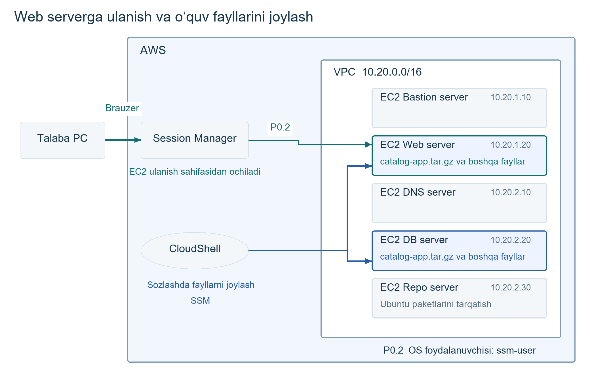

Yashil strelka P0.2 da Web serverga ulanishni ko‘rsatadi.

**Practice0 da bajariladigan ishlar**

O‘z AWS hisobingizni, har bir server rolini va buyruq bajariladigan muhitni tekshiring.

### Yechim namunasi (bajarish tartibi)

#### P0.1 Beshta serverning instance ID sini tekshirish

**Bajarish muhiti:**

Talabaning shaxsiy AWS Console oynasi

**Maqsad va amallar:**

AWS Console tepasidagi Search maydoniga EC2 deb yozib, boshqaruv oynasini oching. EC2 → Instances ro‘yxatida Name ustunidan o‘z muhitingizdagi beshta serverni tekshiring. Shu qatordagi Instance ID ustunidan i- bilan boshlangan to‘liq ID ni ko‘ring.


EC2 dagi Instances ro‘yxati. P0 uchun nomi `-web`, M0 uchun `-db`, `-dns`, `-repo` va `-bastion` bilan tugaydigan qatorlarni navbat bilan tanlang.

#### P0.2 Session Manager orqali Web serverga ulanish

**Bajarish muhiti:**

Web serverning SSM terminali: ssm-user

**Maqsad va amallar:**

P0.1 da topilgan Web serverning **Instance ID** havolasini bosing. Tafsilotlarda **Connect** yonidagi o‘ng strelkani bosing va **Connect with SSM Session Manager** ni tanlang. Yangi varaqdagi terminalda quyidagi buyruqlarni bittadan bajaring. Dastlabki sozlashda yaratilgan `/etc/jdu-web/bootstrap.json` faylini `cat` bilan ko‘ring va `"role": "web"` yozuvini toping. Web serverga ulangan bo‘lsangiz, uy katalogida `nano` bilan tekshiruv faylini yarating.


EC2 tafsilot oynasi. Connect yonidagi o‘ng strelkadan Connect with SSM Session Manager ni tanlang. Rasmda Web server ko‘rsatilgan.

Buyruqlar: raqamlar shu qadam ichidagi tartib

```bash
# 1. Shu terminaldagi OS user nomini ko‘rsatish.
id -un
# 2. O‘z uy katalogingizga o‘ting.
cd ~
# 3. Joriy ish katalogini ko‘rsatish.
pwd
# 4. Administrator huquqi bilan /etc/jdu-web/bootstrap.json mazmunini o‘qish.
cat /etc/jdu-web/bootstrap.json
# 5. Faqat web deb yozing. Ctrl+O va Enter bilan saqlang, Ctrl+X bilan chiqing.
nano p0-connection.txt
# 6. Administrator huquqi bilan p0-connection.txt mazmunini o‘qish.
cat p0-connection.txt
```

**Kutilgan natija va ma’nosi:**

`id -un` buyrug‘i `ssm-user`, `pwd` esa `/home/ssm-user` ni ko‘rsatadi. JSON faylda `"role": "web"` bor va oxirgi `cat` buyrug‘i faqat bitta `web` satrini chiqaradi.

#### P0.3 RDP orqali bastion ish stolini ochish

**Bajarish muhiti:**

Talabaning Windows PC si (umumiy hisob)

**Maqsad va amallar:**

Windows dagi Remote Desktop Connection orqali o‘z oraliq serveringizning ish stolini oching.

**1. Oraliq serverni tanlang**

EC2 → Instances bo‘limida o‘z muhitingizdagi nomi `-bastion` bilan tugaydigan qatorni toping va shu qatordagi **Instance ID** ni bosing.

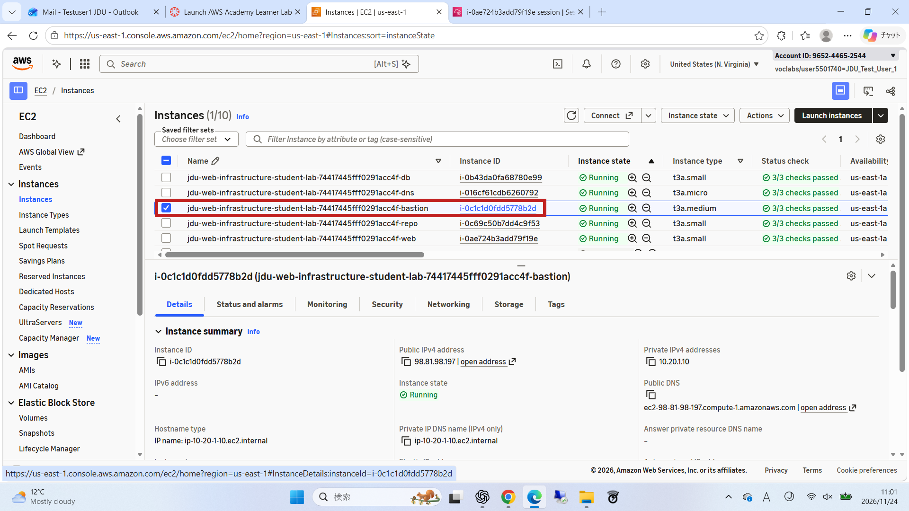

**2. Ommaviy IPv4 manzilini nusxalang**

Instans tafsilotlarida **Public IPv4 address** yonidagi nusxalash belgisini bosing. Keyingi qadamda o‘z oynangizdagi joriy ommaviy IPv4 manzilini ishlating. Rasmdagi manzil misol.


Windows+R tugmalarini bosib Run oynasini oching. Open maydoniga `mstsc /prompt` yozing va **OK** ni bosing.

Buyruqlar: raqamlar shu qadam ichidagi tartib

```bash
# 1. Windows RDP ni hisob ma’lumotlarini so‘rash bilan ochish.
mstsc /prompt
```

**3. Ommaviy IPv4 manzilini kiritib ulaning**

Remote Desktop Connection oynasidagi **Computer** maydoniga 2-qadamda nusxalangan ommaviy IPv4 manzilini qo‘ying va **Connect** tugmasini bosing.

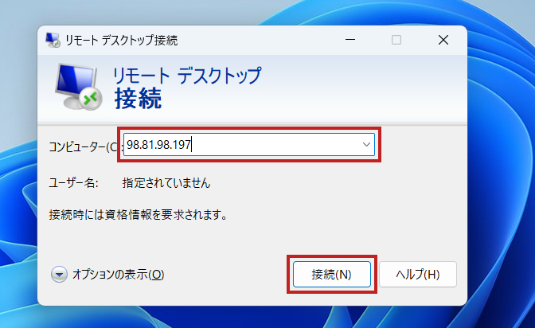

**4. Sertifikat ogohlantirishini tekshiring**

Bu oyna chiqsa, ulanish manzilini 2-qadamdagi ommaviy IPv4 manzili bilan solishtiring. O‘qituvchi bu sizning oraliq serveringiz va mashq sertifikati ekanini tasdiqlasa, **Yes** ni bosing. Tasdiqlanmasa, **No** ni bosing va o‘qituvchiga murojaat qiling.

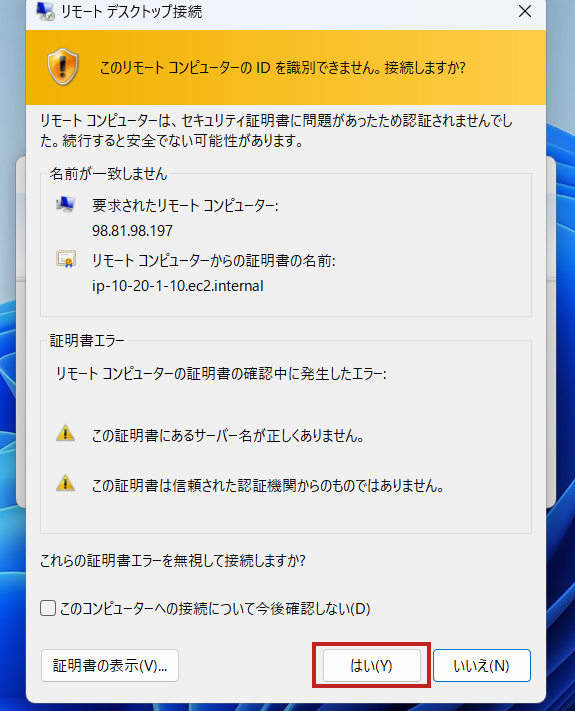

**5. Oraliq serverga kiring**

xrdp kirish oynasida **Session** maydonida `Xorg` tanlanganini tekshiring. **username** maydoniga `labuser`, **password** maydoniga dastlab belgilagan RDP parolingizni yozing va **OK** ni bosing.

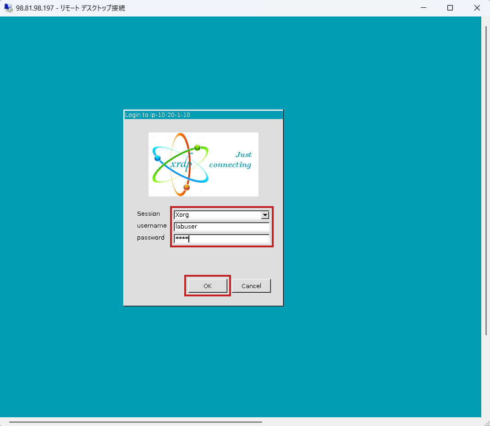

**6. Ish stoli ochilganini tekshiring**

Uzoq ish stoli oynasining yuqori chapida **Applications** menyusi va **Home** belgisi ko‘rinsa, oraliq serverga ulangansiz.


**Buyruq va sozlamalar ma’nosi:**

RDP bastion ekrani va kiritishni uzatadi. RDP ichidagi Firefox request i Windows emas, bastiondan chiqadi. Klaviatura tartibi paroldagi belgilarga ta’sir qiladi; interfeys tili va keyboard layout alohida sozlamadir.

**Kutilgan natija va ma’nosi:**

Oraliq serverning Ubuntu ish stoli (Xfce) ochiladi. Yuqori chapdagi Applications menyusidan Firefox va boshqa dasturlarni ochish mumkin.

**Ishlamasa:**

Login failed bo‘lsa user nomi va klaviatura tartibini tekshiring. Parolni chat ga yubormang. Ulanmasa joriy IP va ruxsatli CIDR ni o‘qituvchi bilan tekshiring; 3389 ni hammaga ochmang. RDP ni yopishdan oldin ishni saqlang.

### Tekshirish va topshirish

O‘qituvchi bergan baholash manzilini o‘z kompyuteringizdagi brauzerda oching va ta’lim muassasasining Google hisobi bilan kiring. Birinchi kirishda o‘z AWS muhitingizni ro‘yxatdan o‘tkazish bo‘limini tanlang va ekrandagi ko‘rsatmalarga amal qiling.

P0 qatoridagi **Ushbu vazifani tekshirish** tugmasini bosing. Shu sahifada natijani tekshirib, P0 qatorida **1 / 1** saqlanganiga ishonch hosil qiling.

## P1 HTTP orqali statik faylni qaytarish

### Nimani o‘rganamiz

Nginx, fayl joyi, tinglash porti, HTTP javobi va access log ni bog‘lash.

### Topshiriq

Nginx ni sozlab, `/var/www/jdu-practice/practice.txt` faylini HTTP orqali tarqating.

### Topshiriq diagrammasi

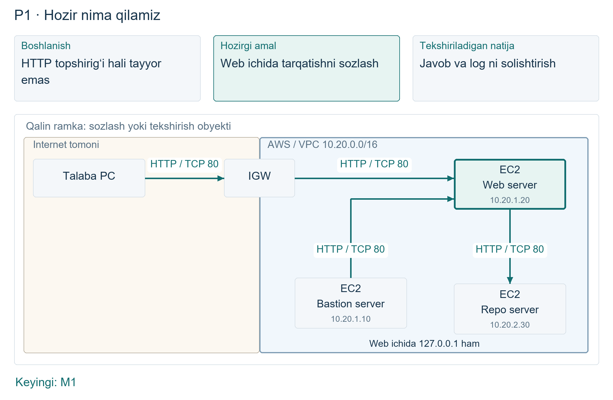

- File: /var/www/jdu-practice/practice.txt
- URL path: /practice.txt

```text
JDU WEB-02 practice: HTTP response verified.
```

**Practice1 da bajariladigan ishlar**

Nginx da HTTP uchun TCP 80 portini oching va `/practice.txt` so‘roviga fayl matnini qaytaring. Web serverning o‘z terminalidan va Bastion terminalidan so‘rov yuboring, so‘ng ularni Nginx access log ida tekshiring.

### Yechim namunasi (bajarish tartibi)

#### P1.1 Ichki APT dan Nginx o‘rnatish

**Bajarish muhiti:**

Web serverning SSM terminali: ssm-user

**Maqsad va amallar:**

P0 dagidek Web serverga SSM orqali ulaning. Nginx paketini ichki Repo serveridan (`10.20.2.30`) yuklab olib, Web serverga o‘rnating.


Buyruqlar: raqamlar shu qadam ichidagi tartib

```bash
# 1. Ichki serverdagi paketlar ro‘yxatini yangilash.
sudo apt-get update
# 2. Ichki paket serveridan nginx ni o‘rnatish.
sudo apt-get install nginx
```

**Buyruq va sozlamalar ma’nosi:**

`apt-get update` mavjud paketlar ro‘yxatini yangilaydi. `apt-get install nginx` shu ro‘yxat yordamida Nginx ni o‘rnatadi.

**Kutilgan natija va ma’nosi:**

Ro‘yxat yangilanganda ichki server qatorida `Hit:` yoki `Get:` ko‘rinadi. `N: Ignoring file ... ubuntu.sources.jdu-disabled` xabari APT dastlabki sozlashda o‘chirilgan standart Ubuntu manbasi faylini o‘tkazib yuborganini bildiradi. Yuklash yoki imzo tekshiruvida xato bo‘lmasa, o‘rnatishni davom ettiring. Tasdiq so‘ralsa, `Y` kiriting.

**Ishlamasa:**

Paketlar ro‘yxatini olib bo‘lmasa, ichki paket serverining holati va IP manzilini tekshiring.

#### P1.2 Aniq matn yaratish va ruxsatlarni sozlash

**Bajarish muhiti:**

Web serverning SSM terminali: ssm-user

**Maqsad va amallar:**

Matnni ish fayliga yozing, keyin uni Nginx fayllarni tarqatadigan katalogga nusxalang.

Buyruqlar: raqamlar shu qadam ichidagi tartib

```bash
# 1. O‘z uy katalogingizga o‘ting.
cd ~
# 2. Mashq katalogini yaratish; mavjud bo‘lsa saqlash.
mkdir -p jdu-web-practice/p1
# 3. Ish katalogini jdu-web-practice/p1 ga o‘zgartirish.
cd jdu-web-practice/p1
# 4. Joriy ish katalogini ko‘rsatish.
pwd
# 5. Practice.txt ni ochish: matn yozish, saqlash va chiqish.
nano practice.txt
```

**nano oynasiga yoziladigan matn**

```text
JDU WEB-02 practice: HTTP response verified.
```

nano oynasiga yuqoridagi qatorni aynan yozing va oxirida Enter tugmasini bosing. Ctrl+O va Enter orqali saqlang, Ctrl+X orqali chiqing. Terminalga qaytgach, 6-qadamdan davom eting.

Buyruqlar: raqamlar shu qadam ichidagi tartib

```bash
# 6. /var/www/jdu-practice katalogini yaratish.
sudo mkdir -p /var/www/jdu-practice
# 7. Fayllarni /var/www/jdu-practice/practice.txt ga nusxalash.
sudo cp practice.txt /var/www/jdu-practice/practice.txt
# 8. /var/www/jdu-practice/practice.txt egasi va guruhini root:www-data ga o‘zgartirish.
sudo chown root:www-data /var/www/jdu-practice/practice.txt
# 9. /var/www/jdu-practice/practice.txt huquqlarini 0640 ga o‘zgartirish.
sudo chmod 0640 /var/www/jdu-practice/practice.txt
# 10. Ko‘rsatilgan fayl owner, guruh, permission va nomini o‘qish.
stat -c '%U:%G %a %n' /var/www/jdu-practice/practice.txt
# 11. Administrator huquqi bilan /var/www/jdu-practice/practice.txt mazmunini o‘qish.
sudo cat /var/www/jdu-practice/practice.txt
```

**Buyruq va sozlamalar ma’nosi:**

`chown root:www-data` egani root, guruhni www-data qiladi. `chmod 0640` egaga o‘qish/yozish, guruhga o‘qish huquqini beradi; boshqalarga ruxsat yo‘q. Nginx worker process lari www-data sifatida ishlaydi va guruh huquqi bilan faylni o‘qiydi.

**Kutilgan natija va ma’nosi:**

`root:www-data 640 /var/www/jdu-practice/practice.txt` ko‘rinadi. Matn bitta qator: `JDU WEB-02 practice: HTTP response verified.`.

**Ishlamasa:**

Nano hali ochiq bo‘lsa, keyingi buyruqdan oldin faylni saqlab chiqing.

#### P1.3 Nginx da tarqatish katalogini sozlash

**Bajarish muhiti:**

Web serverning SSM terminali: ssm-user

**Maqsad va amallar:**

`sudo nano /etc/nginx/sites-available/default` bilan sozlamani oching. Quyidagi blokni `listen 80` mavjud `server { ... }` ichiga, boshqa `location` bloklaridan tashqariga qo‘shing. `/practice.txt` so‘ralganda Nginx yo‘lni root ga qo‘shib, `/var/www/jdu-practice/practice.txt` ni o‘qiydi. Saqlang, sintaksisni tekshiring va sozlamani qayta yuklang.

Buyruqlar: raqamlar shu qadam ichidagi tartib

```bash
# 1. /etc/nginx/sites-available/default faylini nano da tahrirlash.
sudo nano /etc/nginx/sites-available/default
```

**Qo‘shish joyi**

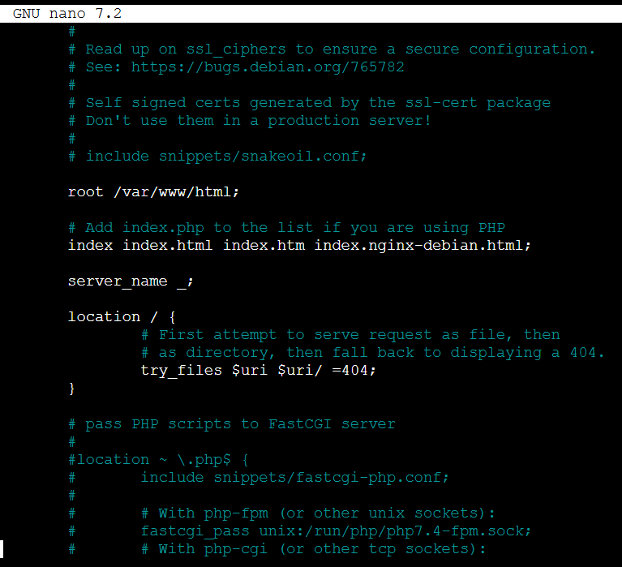

nano da `location / {` ni toping. Ctrl+W orqali `location /` ni qidirish mumkin. `try_files $uri $uri/ =404;` qatorini ham, undan keyingi `}` ni ham o‘chirmang. Bu qavs mavjud `location /` blokini yopadi. Kursorni shu qavs ostidagi bo‘sh qatorga olib, quyidagi uch qatorni qo‘shing. Ularni `try_files` bilan yopuvchi qavs orasiga yozmang.

**nano da yoziladigan sozlama**

```text
location = /practice.txt {
    root /var/www/jdu-practice;
}
```

**Qo‘shilgandan keyingi joylashuv (parcha)**

Mavjud va yangi bloklar quyidagidek yonma-yon turadi. Ikkalasi ham mavjud `server { ... }` ichida bo‘ladi. Butun faylni bu misol bilan almashtirmang: boshqa sozlamalar va yuqoridagi `root /var/www/html;` qatori saqlansin.

```text
location / {
    try_files $uri $uri/ =404;
}

location = /practice.txt {
    root /var/www/jdu-practice;
}
```

`location = /practice.txt` so‘rov yo‘li `/practice.txt` ga aynan mos kelganda ishlaydi. Faqat shu holatda yangi root ishlatiladi va `/var/www/jdu-practice/practice.txt` o‘qiladi.

Sozlamani Ctrl+O, Enter bilan saqlang, Ctrl+X bilan chiqing. Terminalda keyingi buyruqlarni bajaring.

Buyruqlar: raqamlar shu qadam ichidagi tartib

```bash
# 2. Nginx ning to‘liq sozlamasini chiqarib, qanday yozilganini tekshirish.
sudo nginx -T
# 3. Nginx config sintaksisi va fayllarini tekshirish.
sudo nginx -t
# 4. nginx ni hozir yoqish va avtomatik start ni yoqish.
sudo systemctl enable --now nginx
# 5. nginx ni to‘xtatmay sozlamani qayta o‘qish.
sudo systemctl reload nginx
# 6. nginx joriy ish holatini o‘qish.
systemctl is-active nginx
# 7. Nginx TCP 80 portini, masalan 0.0.0.0:80 manzilida tinglayotganini tekshirish.
sudo ss -lntp
```

**Buyruq va sozlamalar ma’nosi:**

Nginx -T config ni ko‘rsatadi; -t sintaksisni tekshiradi. Systemctl enable keyingi boot da ishga tushishni, --now hozir ishga tushishni belgilaydi. Fayl saqlangach reload, service holati va portni tekshiring.

**Kutilgan natija va ma’nosi:**

Sintaksis tekshiruvida `syntax is ok` va `test is successful`, xizmat holatida `active` chiqadi. Nginx TCP 80 portini, masalan `0.0.0.0:80` manzilida tinglayotganini tekshiring.

**Ishlamasa:**

Sintaksis xatosida `nginx -t` ko‘rsatgan fayl va qatorni tuzating.

#### P1.4 Web ichidan javobni ko‘rish

**Bajarish muhiti:**

Web serverning SSM terminali: ssm-user

**Maqsad va amallar:**

Web server terminalida `curl` bilan HTTP so‘rov yuboring. `127.0.0.1` buyruq bajarilayotgan Web serverning o‘zini bildiradi.


Buyruqlar: raqamlar shu qadam ichidagi tartib

```bash
# 1. http://127.0.0.1/practice.txt manziliga HTTP so‘rov yuborish.
curl -i http://127.0.0.1/practice.txt
```

**Buyruq va sozlamalar ma’nosi:**

`127.0.0.1` - loopback manzili. So‘rov shu Web server ichidagi Nginx ga yetib boradi.

**Kutilgan natija va ma’nosi:**

HTTP 200 va practice.txt ichidagi `JDU WEB-02 practice: HTTP response verified.` qatori chiqadi.

**Ishlamasa:**

«Welcome to nginx» chiqsa, curl buyrug‘ida `/practice.txt` ko‘rsatilganini tekshiring. `http://127.0.0.1/` manzili Nginx bosh sahifasini qaytarishi mumkin.

#### P1.5 Ayni faylni Bastion serveridan tekshirish

**Bajarish muhiti:**

Bastionning SSM terminali: ssm-user

**Maqsad va amallar:**

Bastion serverga SSM orqali ulaning va `curl` bilan Web serverga HTTP so‘rov yuboring. Ichki tarmoqdan Web serverning ichki IP manzili `10.20.1.20` ni kiriting.

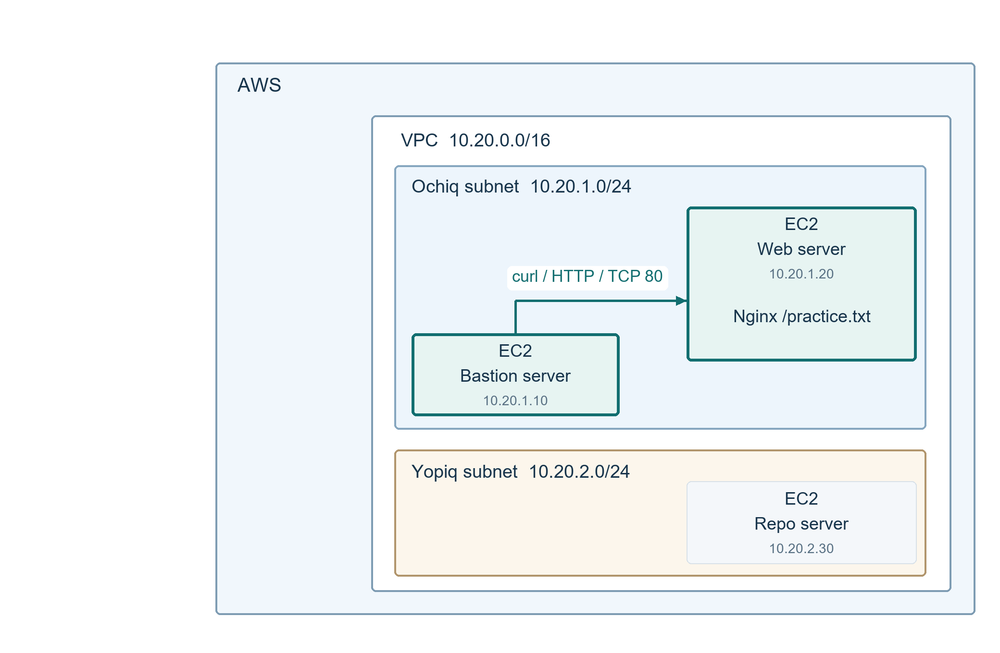

Buyruqlar: raqamlar shu qadam ichidagi tartib

```bash
# 1. http://10.20.1.20/practice.txt manziliga HTTP so‘rov yuborish.
curl -i http://10.20.1.20/practice.txt
```

**Buyruq va sozlamalar ma’nosi:**

Manzil Web serverning ichki IP siga o‘zgaradi. Fayl yo‘li P1.4 dagidek `/practice.txt` bo‘lib qoladi.

**Kutilgan natija va ma’nosi:**

HTTP 200 va `JDU WEB-02 practice: HTTP response verified.` qatori chiqadi.

#### P1.6 So‘rovni log bilan bog‘lash va yuborish

**Bajarish muhiti:**

Web serverning SSM terminali: ssm-user

**Maqsad va amallar:**

Web ga qayting. Access log da vaqt, client IP, path va statusni ko‘ring. Bu fayl borligidan tashqari so‘rov ishlanganining dalilidir. Exit bilan CloudShell ga qaytgach, PC dagi Web Portal da P1 ni tekshiring.

Buyruqlar: raqamlar shu qadam ichidagi tartib

```bash
# 1. Access log oxirgi 20 qatoridan oldingi HTTP so‘rovini topish.
sudo tail -n 20 /var/log/nginx/access.log
# 2. Joriy server session ini yopib CloudShell ga qaytish.
exit
```

**Buyruq va sozlamalar ma’nosi:**

Access log dagi vaqt, path va status ni oldingi curl bilan solishtiring. Tail oxirgi qatorlarni o‘qiydi, log ni o‘zgartirmaydi. Exit dan keyin PC brauzerida P1 ni tekshiring.

**Kutilgan natija va ma’nosi:**

Ekranda sakkizta tekshiruv natijasi va bajarilgan mezonlar soni ko‘rinadi. Tizim ochiq IP orqali HTTP ulanishini avtomatik tekshiradi.

**Ishlamasa:**

Ishlov davom etsa natijani yangilang. Saqlash xatosida sababni o‘qing. Checker kutgan matnni o‘zgartirmang.

### Natijani o‘qish namunasi (kiritmang)

```text
HTTP/1.1 200 OK

JDU WEB-02 practice: HTTP response verified.
```

Faqat kerakli qatorlar ko‘rsatilgan; haqiqiy javobda boshqa header lar ham bor. 200, matn va access log dagi path/status ni tekshiring.

### Tushunishni tekshirish (ballsiz)

Web ichida 200, bastiondan ulanish ishlamaydi. Faylni qayta yozishdan oldin nimani tekshirasiz?

**Izoh:**

Manzil IP, listen address/port va bastion → Web ruxsatini tekshiring. Fayl mazmuni va yetib borish alohida tekshiruvdir.

## P2 Ichki DNS va odatiy nom yechimi

**Practice2 da bajariladigan ishlar**

Ichki DNS ga Web va DB nomlarini yozing. Bastion va Web ni shu DNS ga sozlab, P1 faylini nom bilan oching.

### Topshiriq diagrammasi

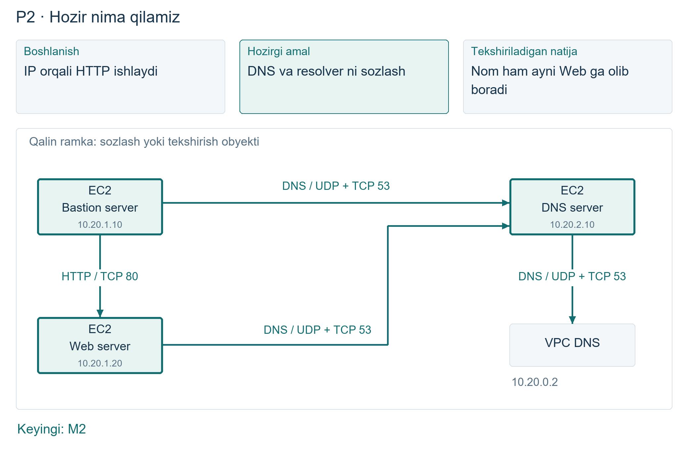

### Yechim namunasi (bajarish tartibi)

#### P2.1 Paketlar serveridan BIND o‘rnatish

**Bajarish muhiti:**

DNS serverning SSM terminali: ssm-user

DNS serverda paketlar ro‘yxatini yangilang va BIND hamda tekshiruv vositalarini o‘rnating. Tahrirdan oldin ikkita faylni nusxalang.

Buyruqlar: raqamlar shu qadam ichidagi tartib

```bash
# 1. Ichki serverdagi paketlar ro‘yxatini yangilash.
sudo apt-get update
# 2. Paketlar serveridan bind9 bind9-utils va kerakli bog‘liqliklarni o‘rnatish.
sudo apt-get install --no-install-recommends bind9 bind9-utils
# 3. Asl fayldan nusxa olish; mavjud nusxani ustidan yozmaslik.
sudo cp -an /etc/bind/named.conf.options /etc/bind/named.conf.options.before-p2
# 4. Asl fayldan nusxa olish; mavjud nusxani ustidan yozmaslik.
sudo cp -an /etc/bind/named.conf.local /etc/bind/named.conf.local.before-p2
```

**Kutilgan natija va ma’nosi:**

`bind9` va `bind9-utils` o‘rnatiladi va ikkita `.before-p2` nusxasi yaratiladi.

#### P2.2 DNS so‘rovini yubora oladigan serverlarni belgilash

**Bajarish muhiti:**

DNS serverning SSM terminali: ssm-user

DNS serverning o‘zi, Bastion va Web serverlariga ruxsat bering. Mashq zonasidan tashqaridagi nomlar AWS DNS ga (`10.20.0.2`) yuboriladi.

Fayl tarkibini quyidagi sozlama bilan almashtiring. nano da Ctrl+W qidiradi, Ctrl+O va Enter saqlaydi, Ctrl+X chiqadi.

```bash
sudo nano /etc/bind/named.conf.options
```

**nano da kiritiladigan matn**

```text
acl "jdu_clients" { 127.0.0.1; 10.20.1.10; 10.20.1.20; };
options {
    directory "/var/cache/bind";
    listen-on { 127.0.0.1; 10.20.2.10; };
    listen-on-v6 { none; };
    allow-query { jdu_clients; };
    allow-recursion { jdu_clients; };
    allow-query-cache { jdu_clients; };
    recursion yes;
    forward only;
    forwarders { 10.20.0.2; };
    dnssec-validation no;
    allow-transfer { none; };
};
```

**Kutilgan natija va ma’nosi:**

`listen-on` da DNS serverning ichki IP manzili `10.20.2.10`, `forwarders` da AWS DNS `10.20.0.2` turadi.

#### P2.3 Nom va IPv4 manzillarini yozish

**Bajarish muhiti:**

DNS serverning SSM terminali: ssm-user

`named.conf.local` da BIND ga `lab.test` zona fayli yo‘lini ko‘rsating. `db.lab.test` da nomni IPv4 manzili bilan bog‘lovchi A yozuvlarini yozing.

`named.conf.local` oxiriga blokni qo‘shing. `lab.test` bloki mavjud bo‘lsa uni tahrirlang.

```bash
sudo nano /etc/bind/named.conf.local
```

**nano da kiritiladigan matn**

```text
zone "lab.test" {
    type primary;
    file "/etc/bind/zones/db.lab.test";
    allow-transfer { none; };
    allow-update { none; };
};
```

`/etc/bind/zones/db.lab.test` faylini nano da ochib, quyidagi sozlamani kiriting va saqlang.

```bash
sudo mkdir -p /etc/bind/zones
sudo chmod 0755 /etc/bind/zones
sudo nano /etc/bind/zones/db.lab.test
```

**nano da kiritiladigan matn**

```text
$TTL 300
@ IN SOA dns.lab.test. hostmaster.lab.test. (
    2026102301 3600 600 604800 300 )
@ IN NS dns.lab.test.
dns IN A 10.20.2.10
guide IN A 10.20.1.20
practice-db IN A 10.20.2.20
```

**Kutilgan natija va ma’nosi:**

`guide.lab.test` Web serverning `10.20.1.20`, `practice-db.lab.test` DB serverning `10.20.2.20` manziliga mos keladi.

**Ishlamasa:**

Zona fayli mavjud bo‘lsa, mavjud nomlarni qoldirib ikkita mashq yozuvini qo‘shing. Yozuvlar o‘zgarganda SOA seriya raqamini oshiring.

#### P2.4 BIND ni ishga tushirib DNS serverning o‘zidan so‘rash

**Bajarish muhiti:**

DNS serverning SSM terminali: ssm-user

Sozlama va zona faylini tekshirib BIND ni ishga tushiring. `dig` DNS so‘rovini yuborib javobni ko‘rsatadi. `127.0.0.1` DNS serverning o‘zini bildiradi.

Buyruqlar: raqamlar shu qadam ichidagi tartib

```bash
# 1. BIND config va ulangan zone sintaksisini tekshirish.
sudo named-checkconf -z
# 2. Lab.test zone faylini tekshirish.
sudo named-checkzone lab.test /etc/bind/zones/db.lab.test
# 3. OS yuklanganda named avtomatik ishga tushishini yoqish.
sudo systemctl enable named
# 4. named ni yangi sozlama bilan qayta ishga tushirish.
sudo systemctl restart named
# 5. UDP 53 orqali guide.lab.test ni so‘rab javobini o‘qish.
dig @127.0.0.1 guide.lab.test A
# 6. TCP 53 orqali guide.lab.test ni so‘rab javobini o‘qish.
dig @127.0.0.1 guide.lab.test A +tcp
```

**Kutilgan natija va ma’nosi:**

Zona tekshiruvida `OK` chiqadi. UDP va TCP uchun `NOERROR` hamda `guide.lab.test` uchun `10.20.1.20` qaytadi.

**Ishlamasa:**

Xatoda sudo journalctl -u named -n 30 --no-pager ni o‘qing, sozlamani tuzatib yana tekshiring.

#### P2.5 BIND ni Bastion va Web serveridan tekshirish

**Bajarish muhiti:**

Bastion va Web serverlarining SSM terminallari

Buyruqlarni ikkala serverda bajaring. `dig` dagi `@10.20.2.10` faqat shu so‘rov uchun DNS serverni tanlaydi. `AXFR` zona yozuvlarini to‘liq ko‘chirishni so‘raydi. Unga ruxsat berilmaganini tekshiring.

Buyruqlar: raqamlar shu qadam ichidagi tartib

```bash
# 1. UDP 53 orqali guide.lab.test ni so‘rab javobini o‘qish.
dig @10.20.2.10 guide.lab.test A
# 2. TCP 53 orqali practice-db.lab.test ni so‘rab javobini o‘qish.
dig @10.20.2.10 practice-db.lab.test A +tcp
# 3. UDP 53 orqali absent-p2.lab.test ni so‘rab javobini o‘qish.
dig @10.20.2.10 absent-p2.lab.test A
# 4. UDP 53 orqali aws.amazon.com ni so‘rab javobini o‘qish.
dig @10.20.2.10 aws.amazon.com A
# 5. Butun zone uchun AXFR so‘rab aniq rad etilishini tekshirish.
dig @10.20.2.10 lab.test AXFR
```

**Kutilgan natija va ma’nosi:**

`guide.lab.test` uchun `10.20.1.20`, `practice-db.lab.test` uchun `10.20.2.20` chiqadi. Ro‘yxatda yo‘q nom uchun `NXDOMAIN`, `aws.amazon.com` uchun IP qaytadi, zona uzatish rad etiladi.

#### P2.6 Ubuntu OS odatda ishlatadigan DNS ni sozlash

**Bajarish muhiti:**

Bastion va Web serverlarining SSM terminallari

Bastion va Web serverlarini bittadan sozlang. Brauzer va ilovalar nomni qidirganda Ubuntu ishlatadigan DNS sifatida Netplan da `10.20.2.10` ni belgilang.

Avval tarmoq interfeysi nomini va Netplan fayli nomini toping.

```bash
ip -br link
ls /etc/netplan
```

`ens5` va `YOUR-NETPLAN-FILE.yaml` o‘rniga haqiqiy nomlarni yozing. `networkctl status` dagi `Network File` kerakli Netplan faylini topishga yordam beradi.

```bash
networkctl status ens5
```

Quyida mavjud faylni tahrirlash namunasi. O‘z interfeysingiz bo‘limida `dhcp4-overrides` va `nameservers` ni qo‘shing yoki tuzating. Interfeys nomi va boshqa sozlamalarni saqlang.

```bash
sudo cp -an /etc/netplan/YOUR-NETPLAN-FILE.yaml /etc/netplan/YOUR-NETPLAN-FILE.yaml.before-p2
sudo nano /etc/netplan/YOUR-NETPLAN-FILE.yaml
```

**nano da kiritiladigan matn**

```text
network:
  version: 2
  ethernets:
    ens5:
      dhcp4: true
      dhcp4-overrides:
        use-dns: false
      nameservers:
        addresses: [10.20.2.10]
```

**Kutilgan natija va ma’nosi:**

IP manzilni DHCP orqali olishni saqlang. Faqat DNS ni avtomatik olishni o‘chiring va YAML chekinishlarini tekislang.

**Ishlamasa:**

Bir interface bir necha YAML da bo‘lsa, qiymatlar birlashadi. resolvectl dns da AWS DNS qolsa, tegishli barcha YAML va amaldagi sozlamani tekshiring.

#### P2.7 DNS sozlamasini qo‘llab sahifani nomi bilan ochish

**Bajarish muhiti:**

Bastion va Web serverlarining SSM terminallari

Netplan sozlamasini qo‘llang. `resolvectl dns` da DNS serverni, `getent` orqali Ubuntu nomni qanday yechishini tekshiring. So‘ng P1 faylini nom bilan oling.

Buyruqlar: raqamlar shu qadam ichidagi tartib

```bash
# 1. Netplan YAML dan config yaratib, qo‘llashdan oldin sintaksisni tekshirish.
sudo netplan generate
# 2. Saqlangan netplan sozlamasini tarmoqqa qo‘llash.
sudo netplan apply
# 3. systemd-resolved ni yangi sozlama bilan qayta ishga tushirish.
sudo systemctl restart systemd-resolved
# 4. Odatiy resolver ishlatadigan DNS serverlarni ko‘rsatish.
resolvectl dns
# 5. Odatiy resolver orqali guide.lab.test IPv4 sini olish.
getent ahostsv4 guide.lab.test
# 6. Odatiy resolver orqali practice-db.lab.test IPv4 sini olish.
getent ahostsv4 practice-db.lab.test
# 7. http://guide.lab.test/practice.txt manziliga HTTP so‘rov yuborish.
curl -i http://guide.lab.test/practice.txt
```

**Kutilgan natija va ma’nosi:**

`resolvectl dns` da `10.20.2.10` chiqadi. Nomlar `10.20.1.20` va `10.20.2.20` ga yechiladi. HTTP `200` va `JDU WEB-02 practice: HTTP response verified.` qaytadi.

**Ishlamasa:**

dig o‘tib getent o‘tmasa, client resolver ini tekshiring. Firefox dagi DoH o‘chirilgan sozlamani saqlang.

#### P2.8 Sahifani Bastion brauzerida tekshirish

**Bajarish muhiti:**

RDP orqali bastiondagi Firefox

P0 dagidek Bastion serveriga RDP orqali ulaning. Uning Firefox brauzerida `http://10.20.1.20/practice.txt`, keyin `http://guide.lab.test/practice.txt` ni oching. O‘z kompyuteringizdagi baholash sahifasida P2 ni tekshiring.

**Kutilgan natija va ma’nosi:**

Ikkala URL da `JDU WEB-02 practice: HTTP response verified.` ko‘rinadi. Baholash sahifasida P2 ning 13 mezoni chiqadi.

### Natijani o‘qish namunasi (kiritmang)

```text
status: NOERROR
guide.lab.test.  300  IN  A  10.20.1.20
```

Dig ning qisqa namunasi: A dan keyin IPv4, 300 esa TTL. So‘rov SERVER i 10.20.2.10 ekanini alohida tekshiring.

## P3 PostgreSQL ga autentifikatsiya bilan ulanish

**Practice3 da bajariladigan ishlar**

DB serverda PostgreSQL ni sozlab, Web serverdan mashq DB siga parol bilan ulaning.

### Topshiriq diagrammasi

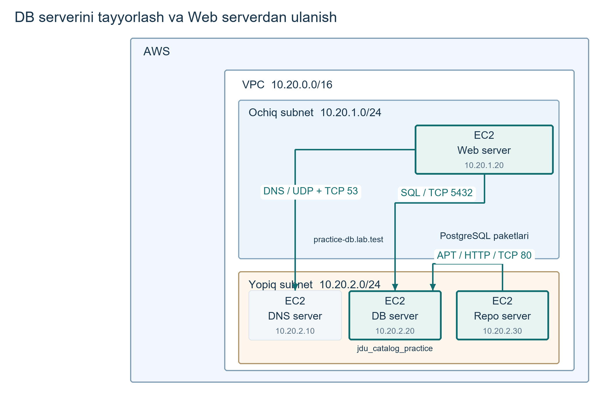

### Yechim namunasi (bajarish tartibi)

#### P3.1 Paketlar serveridan PostgreSQL o‘rnatish

**Bajarish muhiti:**

DB serverning SSM terminali: ssm-user

DB serverda PostgreSQL 16 ni o‘rnating. Keyingi qadamlar uchun SQL fayllarini arxivdan chiqaring.

Buyruqlar: raqamlar shu qadam ichidagi tartib

```bash
# 1. Ichki serverdagi paketlar ro‘yxatini yangilash.
sudo apt-get update
# 2. Paketlar serveridan postgresql-16 postgresql-client-16 va kerakli bog‘liqliklarni o‘rnatish.
sudo apt-get install postgresql-16 postgresql-client-16
# 3. Belgilangan hash ni tekshirib o‘qituvchi app/SQL resurslarini ochish.
sudo python3 -B /var/lib/jdu-web/lesson-resources-r1/offline_assets.py
# 4. PostgreSQL version, cluster, port va holatini o‘qish.
pg_lsclusters
# 5. Postgres sifatida DB sozlamasini o‘qish: SHOW data_directory;
sudo -u postgres psql -X -d postgres -c "SHOW data_directory;"
```

**Kutilgan natija va ma’nosi:**

`pg_lsclusters` da `16` versiya va `main` klasteri chiqadi. Ma’lumot katalogi `/var/lib/postgresql/16/main`.

#### P3.2 PostgreSQL manzili va portini sozlash

**Bajarish muhiti:**

DB serverning SSM terminali: ssm-user

`postgresql.conf` da DB serverning ichki IP manzili `10.20.2.20` va 5432-portni belgilang. Parollar uchun SCRAM-SHA-256 ni tanlang.

Kerakli parametrlarni topib, quyidagi qiymatlarni yozing. Qator boshidagi `#` bo‘lsa, olib tashlang.

```bash
sudo cp -an /etc/postgresql/16/main/postgresql.conf /etc/postgresql/16/main/postgresql.conf.before-p4
sudo nano /etc/postgresql/16/main/postgresql.conf
```

**nano da kiritiladigan matn**

```text
listen_addresses = '10.20.2.20'
port = 5432
password_encryption = 'scram-sha-256'
```

**Kutilgan natija va ma’nosi:**

Uchta parametrni bitta faylga saqlang. Qayta ishga tushirish kirish sozlangach P3.4 da bajariladi.

#### P3.3 Web serveridan DB ulanishiga ruxsat berish

**Bajarish muhiti:**

DB serverning SSM terminali: ssm-user

`pg_hba.conf` da manba, DB va rollarni belgilang. Web serverning `10.20.1.20` ichki manzilidan mashq va topshiriq uchun ko‘rsatilgan DB va rol juftliklariga ruxsat bering.

Ulanish qoidalarini quyidagilar bilan almashtirib, faylni saqlang.

```bash
sudo cp -an /etc/postgresql/16/main/pg_hba.conf /etc/postgresql/16/main/pg_hba.conf.before-p4
sudo nano /etc/postgresql/16/main/pg_hba.conf
```

**nano da kiritiladigan matn**

```text
local all postgres peer
local all all reject
host jdu_catalog_practice catalog_practice_setup 10.20.1.20/32 scram-sha-256
host jdu_catalog_practice catalog_practice_app 10.20.1.20/32 scram-sha-256
host jdu_catalog catalog_setup 10.20.1.20/32 scram-sha-256
host jdu_catalog catalog_app 10.20.1.20/32 scram-sha-256
host all all 0.0.0.0/0 reject
host all all ::/0 reject
```

**Kutilgan natija va ma’nosi:**

PostgreSQL yuqoridan birinchi mos qatorni ishlatadi. Avval ruxsat qatorlari, oxirida qolgan ulanishlar uchun `reject` turadi.

#### P3.4 PostgreSQL ni qayta ishga tushirib sozlamani tekshirish

**Bajarish muhiti:**

DB serverning SSM terminali: ssm-user

Saqlangan parametr va kirish qoidalarini qo‘llash uchun PostgreSQL ni qayta ishga tushiring.

Buyruqlar: raqamlar shu qadam ichidagi tartib

```bash
# 1. postgresql@16-main ni yangi sozlama bilan qayta ishga tushirish.
sudo systemctl restart postgresql@16-main
# 2. postgresql@16-main joriy ish holatini o‘qish.
systemctl is-active postgresql@16-main
# 3. PostgreSQL 10.20.2.20:5432 da tinglayotganini tekshirish.
sudo ss -lntp
# 4. Postgres sifatida DB sozlamasini o‘qish: SHOW password_encryption;
sudo -u postgres psql -X -d postgres -c "SHOW password_encryption;"
# 5. HBA xato qatorlarini topish; to‘g‘ri bo‘lsa 0 qator.
sudo -u postgres psql -X -d postgres -c \
  "SELECT line_number,error FROM pg_hba_file_rules WHERE error IS NOT NULL;"
```

**Kutilgan natija va ma’nosi:**

Xizmat `active`, manzil va port `10.20.2.20:5432`, parol saqlash usuli `scram-sha-256`, kirish xatolari `(0 rows)`.

#### P3.5 Mashq DB va ikkita rolini yaratish

**Bajarish muhiti:**

DB serverning SSM terminali: ssm-user

Tayyor SQL `jdu_catalog_practice` DB sini yaratadi. `catalog_practice_setup` jadval tayyorlashga, `catalog_practice_app` odatiy ishlashga xizmat qiladi. Avval SQL ni ko‘ring, so‘ng `psql` orqali bajaring.

Buyruqlar: raqamlar shu qadam ichidagi tartib

```bash
# 1. Ish katalogini /var/lib/jdu-web/lesson-resources-r1/app ga o‘zgartirish.
cd /var/lib/jdu-web/lesson-resources-r1/app
# 2. Mashq DB role yaratish SQL i ni ko‘rsatish; hali qo‘llamaslik.
python3 -B profile_sql.py --profile practice 01_create_roles.sql
# 3. Mashq DB role yaratish SQL i ni yaratib postgres orqali kerakli DB ga qo‘llash.
python3 -B profile_sql.py --profile practice 01_create_roles.sql | sudo -u postgres \
  psql -X -v ON_ERROR_STOP=1 -d postgres
# 4. Mashq DB va schema yaratish SQL i ni yaratib postgres orqali kerakli DB ga qo‘llash.
python3 -B profile_sql.py --profile practice 02_prepare_schema.sql | sudo -u postgres \
  psql -X -v ON_ERROR_STOP=1 -d jdu_catalog_practice
```

**Kutilgan natija va ma’nosi:**

`CREATE ROLE` ikki marta, `CREATE DATABASE` bir marta chiqadi.

**Ishlamasa:**

already exists oldin bajarilganini anglatishi mumkin. DROP qilmang; \du va \l orqali solishtiring. Pipe o‘ngidagi psql SQL error bermaganini tekshiring.

#### P3.6 Har bir DB roliga parol belgilash

**Bajarish muhiti:**

DB serverning SSM terminali: ssm-user

DB serverda `psql` ni oching. `\password` ni bittadan bajaring va har rol uchun tanlagan parolni ikki marta kiriting. Belgilar ko‘rinmaydi. Ikkala parol P4 da ham kerak. Kamida 16 belgili turli parollarni tanlang.

Buyruqlar: raqamlar shu qadam ichidagi tartib

```bash
# 1. DB OS terminalida postgres sifatida psql ochish; keyingi amallar psql ichida.
sudo -u postgres psql -X -d postgres
```

Bundan keyin psql ichida kiriting

```sql
-- 2. Psql ichida catalog_practice_setup parolini yashirin kiritish.
\password catalog_practice_setup
-- 3. Psql ichida catalog_practice_app parolini yashirin kiritish.
\password catalog_practice_app
-- 4. Psql ichida mashq DB role atribut va huquqlarini tekshirish.
\du catalog_practice_*
-- 5. Psql dan chiqib ayni DB server OS terminaliga qaytish.
\q
```

**Kutilgan natija va ma’nosi:**

`\du` chiqishida `catalog_practice_setup` va `catalog_practice_app` ko‘rinadi.

#### P3.7 Web serveridan mashq DB ga ulanish

**Bajarish muhiti:**

Web serverning SSM terminali: ssm-user

P0 dagidek Web server uchun Session Manager ni oching. `psql` da avval DB ichki IP manzilini, keyin P2 dagi `practice-db.lab.test` nomini kiriting. Har ikki ulanishda P3.6 dagi `catalog_practice_app` parolini ishlating.

Buyruqlar: raqamlar shu qadam ichidagi tartib

```bash
# 1. Paketlar serveridan postgresql-client-16 va kerakli bog‘liqliklarni o‘rnatish.
sudo apt-get install postgresql-client-16
# 2. Web dan kerakli DB ga mavjud parol bilan ulanib SELECT natijasini o‘qish.
psql -X -h 10.20.2.20 -U catalog_practice_app -d jdu_catalog_practice -W -c \
  'SELECT current_database(),current_user,1 AS value;'
# 3. Odatiy resolver orqali practice-db.lab.test IPv4 sini olish.
getent ahostsv4 practice-db.lab.test
# 4. Web dan kerakli DB ga mavjud parol bilan ulanib SELECT natijasini o‘qish.
psql -X -h practice-db.lab.test -U catalog_practice_app -d jdu_catalog_practice -W -c \
  'SELECT current_database(),current_user,1 AS value;'
```

**Kutilgan natija va ma’nosi:**

Ikkala ulanishda `jdu_catalog_practice` DB si, `catalog_practice_app` roli va `1` qiymati chiqadi.

**Ishlamasa:**

IP orqali ulanish ishlasa, nom orqali esa ishlamasa, P2 dagi tizim DNS i va mashq DB nomini tekshiring. Autentifikatsiya rad etilsa, manba, DB, rol va parolni tekshiring. Sinash uchun DB ni Internet ga ochmang.

#### P3.8 Baholash uchun DB parolini Web serverda saqlash

**Bajarish muhiti:**

Web serverning SSM terminali: ssm-user

Buyruqni bajarib `catalog_practice_app` parolini ikki marta kiriting. Kiritish yashirin, parol ulanishni tekshirish uchun Web serverdagi himoyalangan faylga yoziladi. O‘z kompyuteringizdagi baholash sahifasida P3 ni tekshiring.

Buyruqlar: raqamlar shu qadam ichidagi tartib

```bash
# 1. Mavjud mashq DB parolini yashirin kiritib, faqat Web da saqlash.
sudo python3 -B /var/lib/jdu-web/lesson-resources-r1/database_secret.py --profile \
  practice
```

**Kutilgan natija va ma’nosi:**

Terminalda `D11_EXISTING_DB_PASSWORD_STORED_LOCALLY` chiqadi. Baholash sahifasida P3 ning to‘qqiz mezoni ko‘rinadi.

**Ishlamasa:**

Fayl mavjud bo‘lsa qayta yaratmang. P4 da ayni DB paroli app sozlamasiga kiritiladi. M3 alohida mission DB/rollaridan foydalanadi.

### Natijani o‘qish namunasi (kiritmang)

```text
current_database    | current_user         | value
jdu_catalog_practice | catalog_practice_app | 1
```

SELECT natijasini o‘qish namunasi; ustun kengligi boshqacha bo‘lishi mumkin. DB, role va value=1 ni tekshiring. Bu table o‘zgartirish huquqini isbotlamaydi.

## P4 Berilgan app ni Web va DB bilan bog‘lash

**Practice4 da bajariladigan ishlar**

Web serverda jihozlar ilovasini ishga tushirib DB ga ulang. Ochiq ro‘yxat va Bastiondan boshqaruvni sozlang.

### Topshiriq diagrammasi

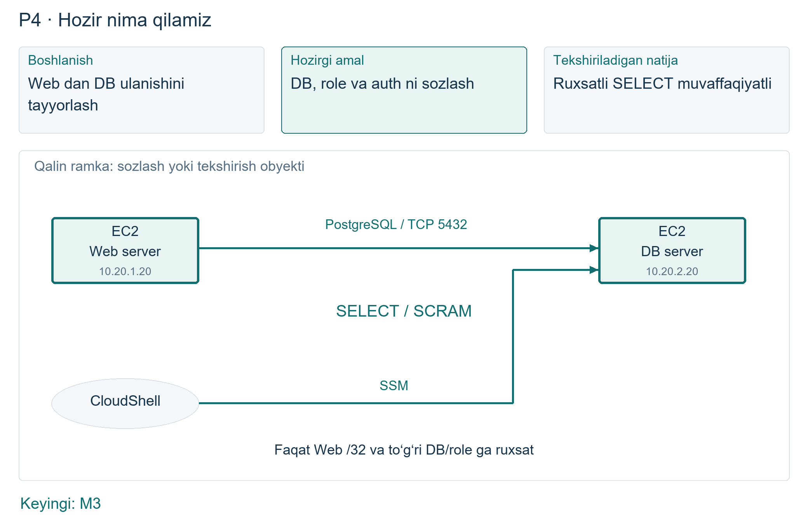

### Yechim namunasi (bajarish tartibi)

#### P4.1 DNS ni tekshirish va Python paketlarini tayyorlash

**Bajarish muhiti:**

Web serverning SSM terminali: ssm-user

Avval Web serverdan DB va boshqaruv sahifasi nomlarini yeching. So‘ng paketlar serveridan Python vositalarini o‘rnating, ilova va Python paketlarini oching.

Buyruqlar: raqamlar shu qadam ichidagi tartib

```bash
# 1. Odatiy resolver orqali db.lab.test IPv4 sini olish.
getent ahostsv4 db.lab.test
# 2. Odatiy resolver orqali admin.lab.test IPv4 sini olish.
getent ahostsv4 admin.lab.test
# 3. Paketlar serveridan python3-venv python3-pip va kerakli bog‘liqliklarni o‘rnatish.
sudo apt-get install --no-install-recommends python3-venv python3-pip
# 4. Imzo/hash ni tekshirib app va belgilangan wheel larni tayyorlash.
sudo python3 -B /var/lib/jdu-web/lesson-resources-r1/offline_assets.py --wheels
# 5. /var/lib/jdu-web/lesson-resources-r1/app dagi serverlarni sozlash fayllarini ro‘yxatlash.
ls /var/lib/jdu-web/lesson-resources-r1/app
# 6. /var/lib/jdu-web/lesson-resources-r1/wheels dagi serverlarni sozlash fayllarini ro‘yxatlash.
ls /var/lib/jdu-web/lesson-resources-r1/wheels
```

**Kutilgan natija va ma’nosi:**

`db.lab.test` uchun `10.20.2.20`, `admin.lab.test` uchun `10.20.1.20` chiqadi. Terminalda `PUBLIC_APP_RESOURCES_VERIFIED` va `SIGNED_OFFLINE_WHEELS_READY=7` ko‘rinadi.

#### P4.2 Ilovani joylab unga alohida Python muhiti yaratish

**Bajarish muhiti:**

Web serverning SSM terminali: ssm-user

Fayllarni `/opt/jdu-catalog/app` ga nusxalang. `venv` orqali ilova muhitini yaratib, tayyor paketlarni o‘rnating. `pip` tashqi saytga murojaat qilmasdan fayllar xeshlarini tekshiradi.

Buyruqlar: raqamlar shu qadam ichidagi tartib

```bash
# 1. /opt/jdu-catalog/app katalogini yaratish.
sudo mkdir -p /opt/jdu-catalog/app
# 2. /opt/jdu-catalog/app egasi va guruhini root:root ga o‘zgartirish.
sudo chown root:root /opt/jdu-catalog/app
# 3. /opt/jdu-catalog/app huquqlarini 0755 ga o‘zgartirish.
sudo chmod 0755 /opt/jdu-catalog/app
# 4. Fayllarni /opt/jdu-catalog/app/ ga nusxalash.
sudo cp -a /var/lib/jdu-web/lesson-resources-r1/app/. /opt/jdu-catalog/app/
# 5. App uchun alohida Python venv yaratish.
sudo python3 -m venv /opt/jdu-catalog/venv
# 6. Python bog‘liqliklarini faqat ichki wheel va lock/hash bilan o‘rnatish.
sudo /opt/jdu-catalog/venv/bin/python -m pip --isolated --no-cache-dir install \
  --no-index --find-links=/var/lib/jdu-web/lesson-resources-r1/wheels \
  --only-binary=:all: --require-hashes -r \
  /var/lib/jdu-web/lesson-resources-r1/requirements.lock
# 7. O‘rnatilgan Python bog‘liqliklari mosligini tekshirish.
sudo /opt/jdu-catalog/venv/bin/python -m pip check
```

**Kutilgan natija va ma’nosi:**

Oxirgi `pip check` natijasida `No broken requirements found.` chiqadi.

#### P4.3 Ilovani ishga tushiradigan OS foydalanuvchisini yaratish

**Bajarish muhiti:**

Web serverning SSM terminali: ssm-user

Web serverda ilovani ishlatuvchi `catalog` OS foydalanuvchisini yarating. CSS va boshqa fayllar katalogini yaratib, `catalog` ga yozish huquqini bering.

Buyruqlar: raqamlar shu qadam ichidagi tartib

```bash
# 1. App uchun login shell va home siz catalog tizim user ini yaratish.
sudo useradd --system --user-group --home-dir /nonexistent --no-create-home --shell \
  /usr/sbin/nologin catalog
# 2. /var/lib/jdu-catalog katalogini yaratish.
sudo mkdir -p /var/lib/jdu-catalog
# 3. /var/lib/jdu-catalog egasi va guruhini root:root ga o‘zgartirish.
sudo chown root:root /var/lib/jdu-catalog
# 4. /var/lib/jdu-catalog huquqlarini 0755 ga o‘zgartirish.
sudo chmod 0755 /var/lib/jdu-catalog
# 5. /var/lib/jdu-catalog/static katalogini yaratish.
sudo mkdir -p /var/lib/jdu-catalog/static
# 6. /var/lib/jdu-catalog/static egasi va guruhini catalog:catalog ga o‘zgartirish.
sudo chown catalog:catalog /var/lib/jdu-catalog/static
# 7. /var/lib/jdu-catalog/static huquqlarini 0755 ga o‘zgartirish.
sudo chmod 0755 /var/lib/jdu-catalog/static
# 8. Catalog user UID, GID va guruhlarini tekshirish.
id catalog
# 9. Catalog user home va login shell ini tekshirish.
getent passwd catalog
```

**Kutilgan natija va ma’nosi:**

Natijada `catalog` foydalanuvchisi va `/usr/sbin/nologin` ko‘rinadi. `/var/lib/jdu-catalog/static` egasi va guruhi `catalog`.

**Ishlamasa:**

Ruxsat xatosini chmod -R 777 yoki catalog ga sudo berish bilan hal qilmang. Aniq katalog va egasini solishtiring.

#### P4.4 Ilovaning odatiy DB ulanishini sozlash

**Bajarish muhiti:**

Web serverning SSM terminali: ssm-user

`YOUR-CURRENT-WEB-PUBLIC-IP` o‘rniga AWS Console dagi Web serverning joriy ochiq IPv4 manzilini yozing. So‘ralganda P3 dagi `catalog_practice_app` parolini kiriting. Yaratilgan mashq sozlamasini ilova uchun tanlang. Kiritilgan belgilar ekranda ko‘rinmaydi.

Buyruqlar: raqamlar shu qadam ichidagi tartib

```bash
# 1. AWS Console dagi joriy Web public IPv4 ni belgilash.
PUBLIC_WEB_IPV4='YOUR-CURRENT-WEB-PUBLIC-IP'
# 2. Mavjud DB parolini yashirin kiritib, practice runtime config yaratish.
sudo python3 -B /opt/jdu-catalog/app/configuration.py create-runtime --profile \
  practice --public-web-ipv4 "$PUBLIC_WEB_IPV4"
# 3. Keyingi ishga tushirish uchun saqlangan mashq profilini tanlash.
sudo python3 -B /opt/jdu-catalog/app/configuration.py activate --profile practice
# 4. Maxfiy qiymatlarni chiqarmay runtime config ni tekshirish.
sudo python3 -B /opt/jdu-catalog/app/configuration.py check --phase runtime
# 5. Ko‘rsatilgan fayl owner, guruh, permission va nomini o‘qish.
sudo stat -c '%U:%G %a %n' /etc/jdu-catalog/app.env
```

**Kutilgan natija va ma’nosi:**

`CATALOG_ENV_CREATED=practice`, `CATALOG_PROFILE_ACTIVATED=practice` va `VALID` chiqadi. `app.env` egasi va guruhi `root:root`, huquqi `600`.

#### P4.5 Ilova jadvallari va administratorini tayyorlash

**Bajarish muhiti:**

Web serverning SSM terminali: ssm-user

Vaqtinchalik sozlama yaratishda P3 dagi `catalog_practice_setup` parolini kiriting. Jadvallar va namunaviy jihozlarni yaratish uchun buyruqlarni bittadan bajaring. Oxirida `practice_admin` parolini o‘zingiz tanlab kiriting. Kiritilgan belgilar ekranda ko‘rinmaydi.

Buyruqlar: raqamlar shu qadam ichidagi tartib

```bash
# 1. Mavjud setup parolini yashirin kiritib, vaqtinchalik config yaratish.
sudo python3 -B /opt/jdu-catalog/app/configuration.py create-setup --profile practice
# 2. Setup rejimida app sozlama xatolarini tekshirish.
sudo /opt/jdu-catalog/venv/bin/python -B /opt/jdu-catalog/app/manage_secure.py \
  --phase setup check
# 3. O‘qituvchi migration larini bajarib, kerakli DB jadvallarini yaratish.
sudo /opt/jdu-catalog/venv/bin/python -B /opt/jdu-catalog/app/manage_secure.py \
  --phase setup migrate
# 4. Belgilangan boshlang‘ich ma’lumotni mashq DB ga yozish.
sudo /opt/jdu-catalog/venv/bin/python -B /opt/jdu-catalog/app/manage_secure.py \
  --phase setup seed_catalog
# 5. App administratorini yaratib parolini yashirin kiritish.
sudo /opt/jdu-catalog/venv/bin/python -B /opt/jdu-catalog/app/manage_secure.py \
  --phase setup create_lab_admin
```

**Kutilgan natija va ma’nosi:**

11 ta ilova jadvali va uchta namunaviy jihoz yaratiladi. Boshqaruv sahifasiga `practice_admin` bilan kirasiz.

#### P4.6 Ilovaning DB roliga kerakli huquqlarni berish

**Bajarish muhiti:**

DB serverning SSM terminali: ssm-user

DB server uchun Session Manager ni oching. `catalog_practice_app` roliga mavjud jadvallar bilan ishlash huquqlarini bering. Avval SQL ni ko‘ring, keyingi buyruq bilan uni qo‘llang.

Buyruqlar: raqamlar shu qadam ichidagi tartib

```bash
# 1. Ish katalogini /var/lib/jdu-web/lesson-resources-r1/app ga o‘zgartirish.
cd /var/lib/jdu-web/lesson-resources-r1/app
# 2. Runtime uchun kerakli SQL huquqlari SQL i ni ko‘rsatish; hali qo‘llamaslik.
python3 -B profile_sql.py --profile practice 03_runtime_grants.sql
# 3. Runtime uchun kerakli SQL huquqlari SQL i ni yaratib postgres orqali kerakli DB ga qo‘llash.
python3 -B profile_sql.py --profile practice 03_runtime_grants.sql | sudo -u postgres \
  psql -X -v ON_ERROR_STOP=1 -d jdu_catalog_practice
```

**Kutilgan natija va ma’nosi:**

`COMMIT` chiqadi. `catalog_item` jadvalida o‘qish, qo‘shish va o‘zgartirish mumkin.

#### P4.7 Ilovani systemd xizmati sifatida ishga tushirish

**Bajarish muhiti:**

Web serverning SSM terminali: ssm-user

Web serverda CSS va boshqa fayllarni Nginx katalogiga yig‘ing. Xizmat ta’rifini `/etc/systemd/system` ga nusxalab, systemd ga yuklang. `enable --now` xizmatni hozir ishga tushiradi va OS yuklanganda avtomatik startni sozlaydi.

Buyruqlar: raqamlar shu qadam ichidagi tartib

```bash
# 1. Runtime config bilan CSS va static fayllarni tarqatish katalogiga yig‘ish.
sudo /opt/jdu-catalog/venv/bin/python -B /opt/jdu-catalog/app/manage_secure.py \
  --phase runtime collectstatic
# 2. Administrator huquqi bilan /opt/jdu-catalog/app/config/jdu-catalog.service mazmunini o‘qish.
cat /opt/jdu-catalog/app/config/jdu-catalog.service
# 3. Fayllarni /etc/systemd/system/jdu-catalog.service ga nusxalash.
sudo cp /opt/jdu-catalog/app/config/jdu-catalog.service \
  /etc/systemd/system/jdu-catalog.service
# 4. /etc/systemd/system/jdu-catalog.service egasi va guruhini root:root ga o‘zgartirish.
sudo chown root:root /etc/systemd/system/jdu-catalog.service
# 5. /etc/systemd/system/jdu-catalog.service huquqlarini 0644 ga o‘zgartirish.
sudo chmod 0644 /etc/systemd/system/jdu-catalog.service
# 6. Joylangan systemd unit fayllarini qayta o‘qitish.
sudo systemctl daemon-reload
# 7. jdu-catalog ni hozir yoqish va avtomatik start ni yoqish.
sudo systemctl enable --now jdu-catalog
# 8. jdu-catalog joriy ish holatini o‘qish.
systemctl is-active jdu-catalog
# 9. Gunicorn 127.0.0.1:8000 da tinglayotganini tekshirish.
sudo ss -lntp
```

**Kutilgan natija va ma’nosi:**

Xizmat `active`. Gunicorn shu Web serverdagi Nginx ulanishi uchun `127.0.0.1:8000` da tinglaydi.

**Ishlamasa:**

Xatoda journalctl -u jdu-catalog ni o‘qing. Env mazmunini log ga qo‘ymang; formatni configuration.py check bilan tekshiring.

#### P4.8 Nginx ning ochiq va boshqaruv kirishlarini sozlash

**Bajarish muhiti:**

Web serverning SSM terminali: ssm-user

Sozlamani nusxalang va `sites-enabled` ichida ramziy havola yarating. Sozlamadan so‘ng 80-port ro‘yxatni, Bastiondan 8080-port boshqaruv sahifasini ochadi. Nginx ilova so‘rovlarini Gunicorn ga yuboradi.

Nusxalangan sozlamada `/practice.txt` va `/mission.txt` uchun ikkita location ni quyidagi bloklarga almashtiring. Bu P1 va M1 kataloglarini saqlaydi. Qolgan sozlamalar o‘zgarmasin.

Buyruqlar: raqamlar shu qadam ichidagi tartib

```bash
# 1. Administrator huquqi bilan /opt/jdu-catalog/app/config/jdu-catalog.nginx.conf mazmunini o‘qish.
cat /opt/jdu-catalog/app/config/jdu-catalog.nginx.conf
# 2. Fayllarni /etc/nginx/sites-available/jdu-catalog ga nusxalash.
sudo cp /opt/jdu-catalog/app/config/jdu-catalog.nginx.conf \
  /etc/nginx/sites-available/jdu-catalog
# 3. /etc/nginx/sites-available/jdu-catalog egasi va guruhini root:root ga o‘zgartirish.
sudo chown root:root /etc/nginx/sites-available/jdu-catalog
# 4. /etc/nginx/sites-available/jdu-catalog huquqlarini 0644 ga o‘zgartirish.
sudo chmod 0644 /etc/nginx/sites-available/jdu-catalog
# 5. Default sayt linkini nusxaga ko‘chirish; mavjud nusxani ustidan yozmaslik.
sudo mv -n /etc/nginx/sites-enabled/default /etc/nginx/default-site.before-p5
# 6. App sayt sozlamasini yoqish uchun link yaratish.
sudo ln -s /etc/nginx/sites-available/jdu-catalog /etc/nginx/sites-enabled/jdu-catalog
# 7. /etc/nginx/sites-available/jdu-catalog faylini nano da tahrirlash.
sudo nano /etc/nginx/sites-available/jdu-catalog
```

**nano da yoziladigan sozlama**

```text
location = /practice.txt { root /var/www/jdu-practice; try_files $uri =404; }
location = /mission.txt { root /var/www/jdu-mission; try_files $uri =404; }
```

Sozlamani Ctrl+O, Enter bilan saqlang, Ctrl+X bilan chiqing. Terminalda keyingi buyruqlarni bajaring.

Buyruqlar: raqamlar shu qadam ichidagi tartib

```bash
# 8. Nginx config sintaksisi va fayllarini tekshirish.
sudo nginx -t
# 9. nginx ni to‘xtatmay sozlamani qayta o‘qish.
sudo systemctl reload nginx
# 10. http://127.0.0.1/practice.txt manziliga HTTP so‘rov yuborish.
curl -i http://127.0.0.1/practice.txt
```

**Kutilgan natija va ma’nosi:**

`nginx -t` muvaffaqiyatli. `/practice.txt` HTTP `200` va `JDU WEB-02 practice: HTTP response verified.` qaytaradi. Shu usulda `http://127.0.0.1/mission.txt` ni ochib M1 matnini tekshiring.

#### P4.9 Boshqaruv sahifasida bittadan ochiq va yopiq jihoz qo‘shish

**Bajarish muhiti:**

RDP orqali bastiondagi Firefox

Bastion serveriga RDP orqali ulanib, Firefox da `http://admin.lab.test:8080/admin/` ni oching. P4.5 dagi parol bilan `practice_admin` sifatida kiring. «備品» (jihozlar) bo‘limida jadvaldagi ikki yozuvni bittadan qo‘shing. Ochiq yozuv miqdorini o‘zgartirib saqlang, so‘ng 4 ga qaytaring.

| Kod | Nom | Miqdor | Saqlash joyi | Ochiq |
| --- | --- | --- | --- | --- |
| P5-PUBLIC-001 | Practice keyboard | 4 | Training shelf A | Ha |
| P5-PRIVATE-001 | Practice mouse | 2 | Training shelf B | Yo‘q |

**Kutilgan natija va ma’nosi:**

Boshqaruv sahifasida `P5-PUBLIC-001` va `P5-PRIVATE-001` ko‘rinadi. Ochiq ro‘yxatda yangi yozuvlardan `P5-PUBLIC-001` chiqadi.

#### P4.10 Ikkala yozuv DB ga saqlanganini tekshirish

**Bajarish muhiti:**

Web serverning SSM terminali: ssm-user

Web terminalida `psql` orqali boshqaruv sahifasida qo‘shilgan ikki yozuvni o‘qing. P3.6 dagi `catalog_practice_app` parolini ishlating.

Buyruqlar: raqamlar shu qadam ichidagi tartib

```bash
# 1. Belgilangan ikki yozuv uchun SELECT ni saqlash; hali DB ga yubormaslik.
QUERY="SELECT code,name,quantity,location,is_public
FROM catalog_item
WHERE code IN ('P5-PUBLIC-001','P5-PRIVATE-001')
ORDER BY code;"
# 2. Web dan kerakli DB ga mavjud parol bilan ulanib SELECT natijasini o‘qish.
psql -X -h db.lab.test -U catalog_practice_app -d jdu_catalog_practice -W -c "$QUERY"
```

**Kutilgan natija va ma’nosi:**

`P5-PUBLIC-001` miqdori `4`, ochiqligi `t`. `P5-PRIVATE-001` miqdori `2`, ochiqligi `f`. Nom va saqlash joyini ham P4.9 jadvali bilan solishtiring.

#### P4.11 Baholash sahifasida ilova ishini tekshirish

**Bajarish muhiti:**

Shaxsiy PC brauzeri: Web Portal

O‘z kompyuteringizdan baholash sahifasida P4 ni ochib, funksiya va huquqlarni tekshirishni tanlang. `practice_admin` parolini kiritib tekshiruvni boshlang. Tekshiruv bitta nazorat yozuvini yaratadi va miqdor o‘zgarishini tekshiradi.

**Kutilgan natija va ma’nosi:**

P4 ning 13 mezoni chiqadi. Nazorat jihozi boshqaruv sahifasida qoladi.

## P5 Eng kam huquq va ochiq kirish chegarasi

**Practice5 da bajariladigan ishlar**

DB sozlash roliga kirishni yoping. Ilovaning odatiy huquqlar bilan ishlashini va ochiq tomondan boshqaruv hamda sozlamalar yopilganini tekshiring.

### Topshiriq diagrammasi

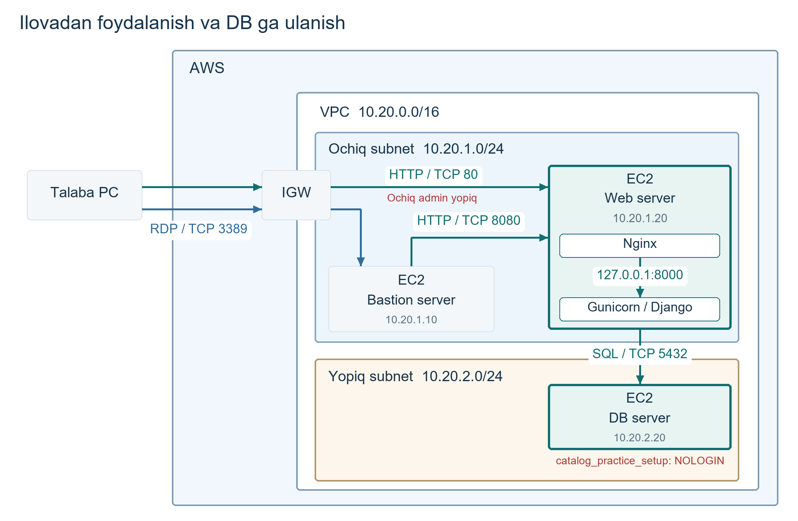

### Yechim namunasi (bajarish tartibi)

#### P5.1 Ilova DB da bajara oladigan amallarni ko‘rish

**Bajarish muhiti:**

DB serverning SSM terminali: ssm-user

DB terminalida `psql` ni oching. `\du` mashq rollari atributlarini, `\dp` jadval huquqlarini ko‘rsatadi.

Buyruqlar: raqamlar shu qadam ichidagi tartib

```bash
# 1. DB OS terminalida postgres sifatida psql ochish; keyingi amallar psql ichida.
sudo -u postgres psql -X -d jdu_catalog_practice
```

Bundan keyin psql ichida kiriting

```sql
-- 2. Psql ichida mashq DB role atribut va huquqlarini tekshirish.
\du catalog_practice_*
-- 3. Psql ichida public schema jadval huquqlarini o‘qish.
\dp public.*
-- 4. Psql dan chiqib ayni DB server OS terminaliga qaytish.
\q
```

**Kutilgan natija va ma’nosi:**

`catalog_practice_app` jihozni o‘qishi, qo‘shishi va o‘zgartirishi mumkin. Jihozni o‘chirish huquqi berilmagan.

#### P5.2 Boshlang‘ich sozlama uchun DB roli kirishini yopish

**Bajarish muhiti:**

DB serverning SSM terminali: ssm-user

`catalog_practice_setup` ochiq qolsa, uning parolini bilgan kishi yuqori huquqlarni ishlatishi mumkin. SQL da `NOLOGIN` ni topib, uni `psql` orqali qo‘llang.

Buyruqlar: raqamlar shu qadam ichidagi tartib

```bash
# 1. Ish katalogini /var/lib/jdu-web/lesson-resources-r1/app ga o‘zgartirish.
cd /var/lib/jdu-web/lesson-resources-r1/app
# 2. Setup role login ini o‘chirish SQL i ni ko‘rsatish; hali qo‘llamaslik.
python3 -B profile_sql.py --profile practice 04_disable_setup.sql
# 3. Setup role login ini o‘chirish SQL i ni yaratib postgres orqali kerakli DB ga qo‘llash.
python3 -B profile_sql.py --profile practice 04_disable_setup.sql | sudo -u postgres \
  psql -X -v ON_ERROR_STOP=1 -d jdu_catalog_practice
```

**Kutilgan natija va ma’nosi:**

`ALTER ROLE` chiqadi. `catalog_practice_setup` kirishi yopiladi, ilova esa `catalog_practice_app` bilan ulana oladi.

#### P5.3 Web serverdagi vaqtinchalik sozlama fayllarini olib tashlash

**Bajarish muhiti:**

Web serverning SSM terminali: ssm-user

Ikkita vaqtinchalik sozlama faylini o‘chiring. Ilovani to‘xtating, P4 dagi `practice` sozlamasini tanlang va ilovani ishga tushiring. `catalog` OS foydalanuvchisi ilova kodiga yoza olmasligini tekshiring.

Buyruqlar: raqamlar shu qadam ichidagi tartib

```bash
# 1. Ko‘rsatilgan fayl owner, guruh, permission va nomini o‘qish.
sudo stat -c '%U:%G %a %n' /etc/jdu-catalog/setup.env \
  /etc/jdu-catalog/profiles/practice.setup.env
# 2. Tekshirilgan ikkita vaqtinchalik setup maxfiy faylini o‘chirish.
sudo rm -- /etc/jdu-catalog/setup.env /etc/jdu-catalog/profiles/practice.setup.env
# 3. Ko‘rsatilgan fayl owner, guruh, permission va nomini o‘qish.
sudo stat -c '%U:%G %a %n' /etc/jdu-catalog/app.env \
  /etc/jdu-catalog/profiles/practice.app.env /etc/jdu-web/db-practice.runtime.env
# 4. Sozlamani tanlashdan oldin jdu-catalog ni to‘xtatish.
sudo systemctl stop jdu-catalog
# 5. Keyingi ishga tushirish uchun saqlangan mashq profilini tanlash.
sudo python3 -B /opt/jdu-catalog/app/configuration.py activate --profile practice
# 6. Maxfiy qiymatlarni chiqarmay runtime config ni tekshirish.
sudo python3 -B /opt/jdu-catalog/app/configuration.py check --phase runtime
# 7. jdu-catalog ni tanlangan sozlama bilan ishga tushirish.
sudo systemctl start jdu-catalog
# 8. jdu-catalog joriy ish holatini o‘qish.
systemctl is-active jdu-catalog
# 9. Catalog foydalanuvchisi yoza oladigan ilova fayl va kataloglarini qidirish.
sudo -u catalog find /opt/jdu-catalog/app -writable -print
```

**Kutilgan natija va ma’nosi:**

`CATALOG_PROFILE_ACTIVATED=practice` va `VALID` chiqadi. Ilova `active` holatida bo‘ladi. Oddiy ish fayllari `root:root 600`. Oxirgi `find` natija chiqarmaydi.

**Ishlamasa:**

Boshqa profil faol bo‘lsa, to‘xtang. O‘chirilgan fayllarni qayta o‘chirmang. To‘xtatish, profilni tanlash yoki tekshirishda xato bo‘lsa, ilovani ishga tushirishdan oldin sababini aniqlang.

#### P5.4 Ochiq 80-portdan nimalar ko‘rinishini tekshirish

**Bajarish muhiti:**

Bastionning SSM terminali: ssm-user

Bastion terminalidan Web ning 80-portiga HTTP so‘rovlarini yuboring. Ro‘yxat ochilishini, boshqaruv sahifasi va ichki sozlamalar yopiq ekanini tekshiring. Boshqaruv sahifasini RDP orqali Bastion Firefox brauzerida `http://admin.lab.test:8080/admin/` bilan oching.

Buyruqlar: raqamlar shu qadam ichidagi tartib

```bash
# 1. http://web.lab.test/ ga HTTP yuborib status, header va matnni ko‘rsatish.
curl -i http://web.lab.test/
# 2. http://web.lab.test/admin/ ga HTTP yuborib status, header va matnni ko‘rsatish.
curl -i http://web.lab.test/admin/
# 3. http://web.lab.test/app.env ga HTTP yuborib status, header va matnni ko‘rsatish.
curl -i http://web.lab.test/app.env
# 4. http://web.lab.test/static/app.env ga HTTP yuborib status, header va matnni ko‘rsatish.
curl -i http://web.lab.test/static/app.env
```

**Kutilgan natija va ma’nosi:**

Ro‘yxat HTTP `200` qaytaradi. `/admin/` va sozlama fayli URL manzillari uchun `403` yoki `404` qaytadi. 8080-portda boshqaruv tizimiga kirish sahifasi chiqadi.

**Ishlamasa:**

Env matni ko‘rinsa uni ulashmang; o‘qituvchiga aytib ochiq sozlamani tuzating.

#### P5.5 Baholash sahifasida kirish cheklovlarini tekshirish

**Bajarish muhiti:**

Shaxsiy PC brauzeri: Web Portal

Baholash sahifasida P5 ni ochib, funksiya va huquqlarni tekshirishni tanlang. `practice_admin` parolini kiriting. Tekshiruv muvaffaqiyatli kirish va tizimga kirmasdan jihozni qo‘shish yoki o‘zgartirish rad etilishini solishtiradi.

**Kutilgan natija va ma’nosi:**

P5 ning 16 mezoni natijalari ko‘rinadi.

## Davom ettirish va natijalar

Keyingi safar o‘z Lab va ayni besh serverni ishga tushirib, running/SSM Online va joriy public IP ni tekshiring. Web Portal ga maktab Google orqali kirib, M0 tayyorligidan boshlang. Yaratish, kalit va ro‘yxatni har safar takrorlamang. Muddat tugasa o‘qituvchidan yangilashni so‘rang.

Natijalar avtomatik saqlanadi. Ishlov paytida natijani yangilang; baholarni saqlangan baholar bo‘limidan ko‘ring. Nechta band bajarilganini va nimalarni tuzatish kerakligini ko‘ring. UNKNOWN o‘lchab bo‘lmagan holat, muvaffaqiyat yoki tasdiqlangan nol emas. Tekshirilmagan M ning tasdiqlangan ballari saqlanadi. Oxirgi baholanadigan natija olinadi; turli urinish PASS lari qo‘shilmaydi, maksimum avtomatik tanlanmaydi.

Parol/token/cookie/maxfiy kalit/env ni hisobot yoki chat ga yubormang.

## Ma’lumot manbalari

- [Nginx Beginner’s Guide](https://nginx.org/en/docs/beginners_guide.html)
- [BIND 9: configurations and zones](https://bind9.readthedocs.io/en/v9.18.39/chapter3.html)
- [PostgreSQL 16: pg_hba.conf](https://www.postgresql.org/docs/16/auth-pg-hba-conf.html)
- [EC2 instance states](https://docs.aws.amazon.com/AWSEC2/latest/UserGuide/ec2-instance-lifecycle.html)
