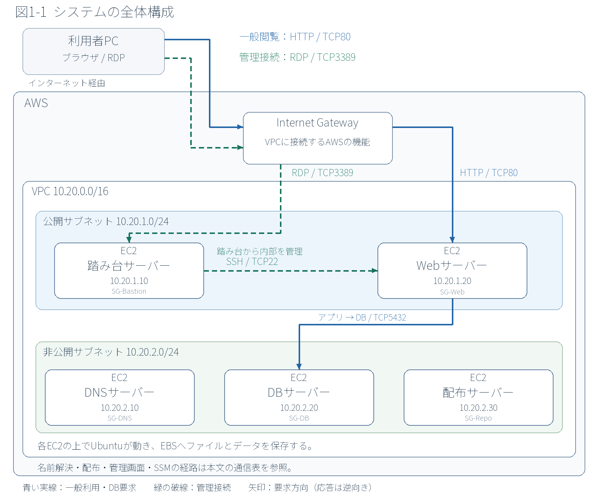
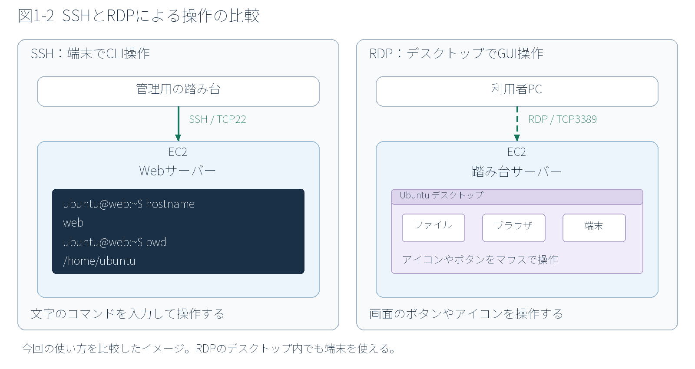
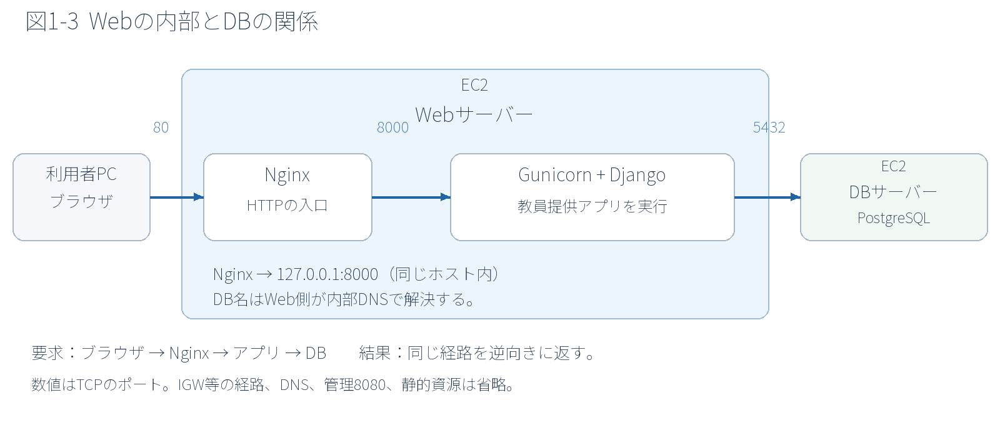
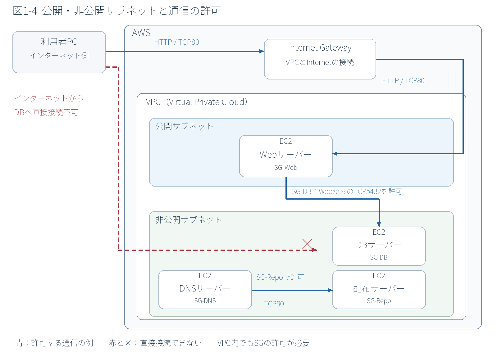
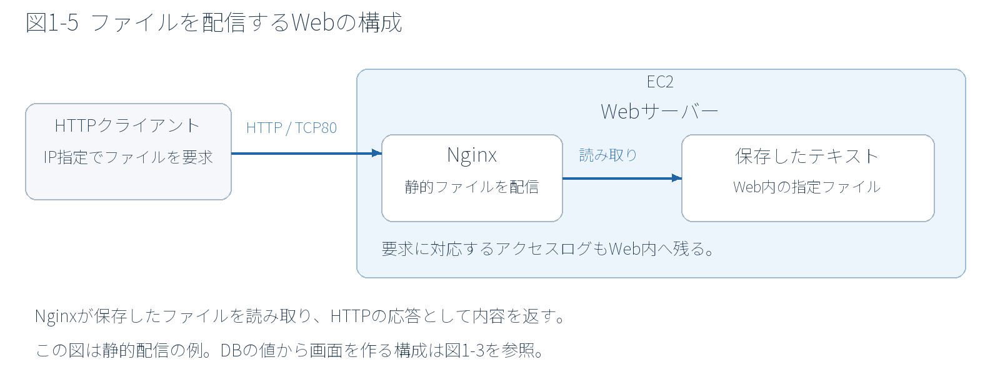

# 第1章 Webシステムを構成するもの

## この授業で作るシステム

今回は、**学校の中で使う備品管理システム**を作ることを想定する。学校にあるパソコン、モニター、ルーターなどについて、名前、数量、置き場所を管理するシステムである。利用者はブラウザで備品の一覧を見て、管理担当者は管理画面から備品を登録・変更する。

ただし、この授業では**アプリそのもののプログラミングは行わない**。備品を一覧表示したり、登録・変更したりするアプリは教員が用意する。そのアプリを動かすためのコンピューター、ネットワーク、ソフトウェア、保存先と接続設定を整えていく。このような、アプリの動作を支える土台を**インフラストラクチャー**という。

授業では、AWS上のサーバーを使ってこの土台を組み立てる。まずファイルをWebで配信し、その後、名前での接続、データの保存、アプリとデータベースの連携へ進む。最後に、備品の情報をWeb画面で読み取り、管理画面で登録・変更できる状態を目指す。

## この章で分かること

本章では、まず普段のWeb閲覧で何が起きるかを説明し、次に今回作るシステムの全体図と、各部の役割を見ていく。

- 利用者のPCとサーバーは、どのように仕事を分けるのか。
- 5台のサーバーは、それぞれ何のためにあるのか。
- AWS、EC2、Ubuntu、Webサーバーのソフトウェアは、どう違うのか。
- ページを見る経路と、設定作業をする経路は、どう違うのか。
- ファイルを配信するWebサーバーは、全体のどこに当たるのか。

## 1.1 ブラウザでホームページを見るときに何が起きているのか

大学のホームページでお知らせを読んだり、ニュースサイトで記事を開いたりする場面を考えてみよう。画面にページが現れるまでには、手元のソフトウェアと、ページを提供する相手が通信している。ここでは、一般的なWeb閲覧に登場する**ブラウザ、Webサーバー、ネットワーク**の三つを順に説明する。仕組みを単純化すると、次のようなことが起きている。

まず、皆さんが普段使っている**Google Chrome、Safari、Microsoft Edge**などを思い浮かべてほしい。これらは、ホームページを表示したり、その中のリンクやボタンを操作したりするためのソフトウェアで、まとめて**Webブラウザ**、または**ブラウザ**と呼ぶ。例えばChromeで大学のホームページを開き、「お知らせ」をクリックして記事を読むとき、手元でその操作を受け付け、ページを表示しているのがブラウザである。

次に、そのお知らせの文章や画像を提供する相手が**Webサーバー**である。ブラウザは、自分の中に世界中のホームページを保存しているわけではない。ページを開くとき、必要な情報をWebサーバーへ要求し、サーバーから送られてきた内容を使って画面を表示する。

このブラウザとWebサーバーの間で、要求やページの内容を運ぶのが**ネットワーク**である。学校のWi-Fiや携帯電話回線も、手元の端末を相手へつなぐ経路の一部になる。この例では、インターネットを通じて大学のWebサーバーへ接続している。

やり取りを順に並べると、次の流れになる。

- ブラウザが、Webサーバーへ「このお知らせのページを送ってほしい」と要求する。
- ネットワークを通じて要求が届き、Webサーバーがページの内容を返す。
- ブラウザが、受け取った文章や画像を使ってページを表示する。

このやり取りで、要求する側を**クライアント**、要求を受けて機能やデータを提供する側を**サーバー**という。今の例ではブラウザがクライアントである。これらは通信での役割を表す呼び方である。[MDNのWeb閲覧の説明](https://developer.mozilla.org/en-US/docs/Learn_web_development/Getting_started/Environment_setup/Browsing_the_web)

今回の備品管理システムでも、利用者はブラウザで備品一覧を要求し、Webサーバーが一覧の内容を返す。この身近なWeb閲覧と同じ仕組みを土台に、これから各サーバーの役割を見ていこう。

## 1.2 サーバーを動かす土台

### AWSとEC2

**AWS**は、ネットワーク経由でコンピューターや保存領域などを利用できるクラウドサービスである。今回の授業では、その中の**Amazon EC2**を使ってサーバーを動かす。

EC2で作成した一つの仮想サーバーを**インスタンス**という。実物のPCと同じように、CPU、メモリ、保存領域、ネットワークの機能を使える。机の上に5台のPCを置く代わりに、AWS内の5台の仮想サーバーをネットワーク越しに操作する、と考えるとよい。

EC2自体が、DNSの回答やWebページの作成をすべて行うわけではない。EC2はソフトウェアを実行する土台であり、どのソフトウェアを入れて何を設定するかによって、サーバーの役割が決まる。[AWSのEC2説明](https://docs.aws.amazon.com/AWSEC2/latest/UserGuide/concepts.html)

### Ubuntuと保存領域

各EC2では、OSとして**Ubuntu**を使う。OSは、プログラムの実行、ファイル、ユーザーの権限、ネットワークなどを管理する。これまでOS・Linuxで学んだ操作は、WebやDBを設定するときにも使う。

パソコンでは、OS、ソフトウェア、文書などをハードディスクやSSDへ保存する。こうしたデータを保存する領域を、一般に**ストレージ**という。サーバーにも、プログラム、設定ファイル、備品の情報などを保存するストレージが必要である。

**Amazon EBS（Elastic Block Store）**は、AWS上でEC2に接続して使うストレージを提供するサービスの名前である。EBSで用意した保存領域は**ボリューム**と呼ばれ、EC2のOSからディスクとして利用できる。今回の構成では、パソコンのハードディスクやSSDに相当する役割をEBSのボリュームが担い、そこへUbuntuやソフトウェア、設定、データを保存する。「ストレージ」は一般的な呼び方で、「EBS」はAWSのサービス名である。[AWSのEBS説明](https://docs.aws.amazon.com/ebs/latest/userguide/what-is-ebs.html)

例えば「Webサーバー」は、EC2という実行環境でUbuntuが動き、Web配信用のソフトウェアが要求を処理し、必要なファイルをEBSへ保存するという組合せになる。保存と停止・再開の詳しい関係は第8章で扱う。

## 1.3 今回のシステムの全体図

**図1-1 システムの配置と主な経路。** 青い実線は一般利用とDBへの要求、緑の破線は管理接続の方向を表す。矢印は要求方向で、応答は逆向きに戻る。Internet GatewayはAWSが提供し、VPCに接続する機能としてAWSの枠内に示している。名前解決と資源配布などの通信は、1.7の通信表で補う。

図の中の5つのEC2は、すべて別のコンピューターである。同じような端末画面が開いていても、保存しているファイルや動いているプログラムは別々である。

**IPアドレス**は、ネットワーク上で通信先を指定するためのアドレスである。図に示した`10.20`で始まるアドレスは、このネットワーク内で使う内部のIPv4アドレスである。利用者PCから一般Webや踏み台へ接続する際は、それぞれの現在の公開IPv4アドレスを使う。

## 1.4 5台のサーバーは何をするのか

### 踏み台サーバー：内部の作業を行うための端末

**踏み台サーバー**は、管理者がほかのサーバーを設定・保守するために経由するサーバーである。サーバー管理の入口を集約し、インターネットから各サーバーの管理用入口へ直接接続させないための、重要な役割を持つ。

例えば、DNS、DB、配布サーバーそれぞれの管理用入口をインターネットへ公開すると、外部から接続を試される入口が増える。そこで今回の構成では、各サーバーの管理用SSH接続を直接公開せず、踏み台からの接続だけを許可する。管理者は、許可された接続元からまず踏み台へ入り、そこから対象サーバーへ接続する。

このように入口を集約すると、接続元の制限や認証、入口の監視を集中させやすくなる。接続の記録を適切に残せば、いつ、どのアカウントで管理用の接続が行われたかを調べる手掛かりにもなる。調査では踏み台と接続先のサーバーのログを合わせて使う。接続履歴や操作内容を調べるための記録は、必要な内容が残るよう設定し、保存する。踏み台自身も、接続元の制限、認証、ソフトウェアの更新によって保護する。[AWSの踏み台と記録の説明](https://aws.amazon.com/blogs/security/how-to-record-ssh-sessions-established-through-a-bastion-host/)

今回は踏み台を作業端末としても使い、Ubuntuのデスクトップへ利用者PCからリモートデスクトップで接続する。

**リモートデスクトップ**とは、離れたコンピューターの画面を手元に表示し、キーボードやマウスで操作する仕組みである。手元の画面には、AWS内の踏み台で動くデスクトップが表示される。今回使う接続方式は**RDP（Remote Desktop Protocol）**である。

SSHでリモートの端末へ接続すると、コマンドを入力する**CLI（文字による操作）**でサーバーを操作できる。一方、RDPではリモートのデスクトップ画面を表示し、ボタンやアイコンを使う**GUI（画面上での操作）**で操作できる。どちらも、実際の処理は接続先のコンピューターで行われる。

**図1-2 SSHとRDPによる操作の比較。** 今回はSSHで各サーバーの端末を使い、RDPで管理用の踏み台のデスクトップを使う。RDPで開いたデスクトップの中でも、端末を起動してコマンドを入力できる。

踏み台からは、DNS・Web・DB・配布サーバーの端末へ接続して設定する。また、内部DNSの名前でWebを開いたり、内部向けのアプリ管理画面を使ったりする。

踏み台を経由させるのは管理用の接続である。一般利用者が備品一覧を見るときは、利用者PCからWebサーバーの公開入口へアクセスする。この一般閲覧と、管理者がサーバーの設定を変えるための接続を分けて考える。

### Webサーバー：利用者からの要求を受ける入口

**Webサーバー**は、ブラウザなどからの要求を受け、ページやファイルを返す役割を持つ。今回の一般利用者が最初に接続する相手である。

この役割を実現するには、コンピューターにWebサーバー用のソフトウェアを導入する。そのソフトウェアが、ブラウザからの要求を受け取り、どのページやファイルを返すかを処理する。この授業で使うWebサーバー用ソフトウェアの製品名が、**Nginx（エンジンエックス）**である。

最初は、NginxでWeb内のテキストファイルをそのまま返す。ファイルの置き場所と要求の対応、読むための権限、通信を待ち受ける設定などを整える。

後半では、同じWebの中に教員提供アプリを配置する。Nginxは要求を受け、必要に応じてアプリへ渡す。アプリはDBから備品データを読み、備品一覧を作って返す。

### DNSサーバー：接続名に対応する情報を答える

**DNS**は、`web.lab.test`のような名前を通信に使うIPアドレスへ対応させる仕組みである。名前から接続先を調べることを**名前解決**という。

例えばWeb上のアプリが`db.lab.test`へ接続するときは、Web側がDNSへその名前を問い合わせ、得たIPへDB接続を行う。人や設定ファイルは名前を使い、実際の通信ではアドレスを使うという役割分担になる。

今回のDNSでは、内部の名前を答えるソフトウェアとして**BIND 9**を使う。DNSはWeb本文を返したり、DBの備品を検索したりするものではない。名前解決の後の通信は、WebやDBとの間で別に行われる。

ここで、インターネット側のDNSと、今回作る内部DNSの利用範囲を区別しておこう。例えば`www.mozilla.org`のような一般公開された名前は、インターネットの公開DNSの仕組みを使ってIPアドレスを調べられる。携帯電話回線や自宅のネットワークからホームページを開くときも、この仕組みを利用する。

一方、学校や会社の内部で使うネットワークを**イントラネット**という。内部DNSは、その内部で使う名前を答えるために用意する。今回はAWS上の演習用ネットワークで、`web.lab.test`や`db.lab.test`という名前を使う。この名前とIPの対応は、今回の内部DNSに設定する情報である。

例えば、踏み台が内部DNSへ`web.lab.test`を問い合わせると、Webサーバーの内部IPである`10.20.1.20`が返る。踏み台とWebは、この内部DNSを問い合わせ先として使うよう設定する。

同じ`web.lab.test`を、通常の携帯電話回線につないだスマートフォンのブラウザに入力しても、今回のWebサーバーのIPは得られない。携帯電話回線側のDNSには、この演習の内部名を答える設定がなく、今回の内部DNSへ問い合わせる経路もないためである。名前が存在するだけで、インターネット上のどこからでも使えるわけではない。`.test`は、こうした試験用の内部名に使える予約済みの名前である。[BINDのゾーンと設定](https://bind9.readthedocs.io/en/v9.18.41/chapter3.html)、[RFC 6761のtestドメイン](https://www.rfc-editor.org/rfc/rfc6761.html#section-6.2)

### DBサーバー：データを保存し、読み書きを管理する

**DB**はデータベースの略で、データを整理して保存し、必要なものを検索・追加・変更できるようにする。今回の例では、備品の名前、数量、置き場所、公開するかどうかなどを保存する。

このデータを管理するソフトウェアとして**PostgreSQL**を使う。アプリがデータを要求すると、PostgreSQLが要求を処理して結果を返す。DBにはデータを置くだけでなく、誰が接続でき、何を読んだり変更したりできるかを設定する。

利用者のブラウザは、このDBへ直接接続しない。Web上のアプリがDBへ接続し、必要なデータを取り出してWeb画面にする。DBを内部に置き、接続できる相手を絞ることで、一般利用者にDB操作の入口を直接渡さない構成にする。[PostgreSQLのクライアントとサーバー](https://www.postgresql.org/docs/16/tutorial-arch.html)

### 配布サーバー：必要なソフトウェアを内部へ渡す

**配布サーバー**は、この授業で必要なパッケージやアプリ用の資源を、ほかのサーバーへ提供する。**パッケージ**は、ソフトウェアとその導入に必要な情報をまとめたものである。**リポジトリ（repo）**は、その取得元として使う保管先を指す。

内部のサーバーがそれぞれ外部から別の版を取得すると、環境が揃わなかったり、授業中の外部接続に依存したりする。そこで、用意された資源を内部の配布サーバーから取得する。

配布サーバーには、ソフトウェアの入手と導入を安全に管理する役割もある。インターネット上には、配布元のソフトウェアを複製して提供する**ミラーサーバー**もある。もし外部の配布元やミラーサーバーが改ざんされ、ウイルスなどの悪意あるプログラムを含んだファイルを、検証せずに導入すると、自分たちのシステムにも不正なプログラムを取り込む危険がある。

そこで、内部へ保存する前に、信頼できる配布元であること、署名やハッシュが期待するものと一致することを確かめる。さらに、組織のセキュリティ方針に沿った検査や承認を行い、使用を認めたソフトウェアを内部の配布サーバーへ保管する。署名・ハッシュによる配布元や内容の照合と、悪意あるプログラムや脆弱性に関する検査は、それぞれの役割に応じて行う。

各サーバーへの導入・更新では、この内部の配布サーバーを使う。更新するソフトウェアにも同じ検査と承認の手順を適用することで、どの版を、どの確認を経て配布したかを管理できる。[APTの配布元と署名の確認](https://manpages.debian.org/bookworm/apt/apt-secure.8.en.html)、[NISTの安全なソフトウェア開発・取得の指針](https://csrc.nist.gov/pubs/sp/800/218/final)

## 1.5 Webの中で動くソフトウェア

5台の役割を理解したら、Webの中を少し詳しく見よう。最終構成のWebでは、Nginxと教員提供アプリが連携する。

**図1-3 Webの内部とDBの関係。** Nginx、Gunicorn、DjangoはEC2 Webサーバーで動く。PostgreSQLはEC2 DBサーバーで動く。

**Nginx**は、HTTPの要求を受ける入口となる。HTTPはWebの要求と応答をやり取りするための約束である。Nginxは保存済みのファイルを返すほか、別の処理担当へ要求を渡し、その結果を利用者へ返すこともできる。後者の働きを**リバースプロキシ**という。[Nginxの静的配信とproxy](https://nginx.org/en/docs/beginners_guide.html)

**Gunicorn**は、PythonのWebアプリを動かして要求を受け渡すサーバーソフトウェアである。今回はWeb自身の内部でだけ接続できる待受を使い、Nginxから渡された要求を受ける。

**Django**は、教員提供アプリが利用するWebアプリの仕組みである。備品一覧や管理画面などの機能は提供済みのコードに含まれる。このアプリの配置、実行環境、接続先、起動方法、権限を整えて動かしていく。

保存済みのファイルを返す方式を**静的配信**という。一方、要求を受けてDBの値から内容を作る方式が**動的な応答**である。動的な画面であっても、見た目を整えるCSSなどは保存済みの静的ファイルとして配信できる。

## 1.6 サーバーをつなぎ、公開範囲を決めるもの

### VPCとサブネット

**VPC（Virtual Private Cloud）**は、AWSの中に作る論理的に分離されたネットワークである。その中のIP範囲を分けたまとまりが**サブネット**である。図1-1の5台は、一つのVPC内の二つのサブネットに配置する。

**公開サブネット**は、インターネットと直接通信するために使うサブネットである。今回はWebと踏み台を置き、公開IPと必要な通信の許可を設定する。これにより、利用者PCからWebの公開画面や、踏み台の管理用デスクトップへ接続できるようにする。

**非公開サブネット**は、インターネットから直接アクセスさせないサーバーを置くためのサブネットである。今回はDNS、DB、配布サーバーを置き、公開IPを割り当てない。例えば、インターネット上のPCからDBへ直接接続することはできない。

一方、VPC内のサーバー同士では、必要な通信を行う。公開サブネットのWebから非公開サブネットのDBへ接続したり、非公開サブネットのDNSから同じ非公開サブネットの配布サーバーへパッケージを取りに行ったりできる。このように、内部のサーバーはVPC内の公開・非公開サブネットにある相手から、許可された通信を受け付ける。[AWSのVPCとサブネット](https://docs.aws.amazon.com/vpc/latest/userguide/configure-subnets.html)

### Internet Gateway

**Internet Gateway（IGW）**は、VPCとインターネットをつなぐAWSのネットワーク機能である。図1-1ではAWSの枠内に置き、VPCにつながる位置に示している。利用者PCから公開WebへのHTTPも、管理用の踏み台へのRDP接続も、IGWを経由する。[AWSのInternet Gateway説明](https://docs.aws.amazon.com/vpc/latest/userguide/VPC_Internet_Gateway.html)

### Security Groupとポート

**Security Group（SG）**は、関連付けたAWS資源に対して、許可する通信を定める仕組みである。今回は各サーバーの役割に対応した別のSGを使う。相手、通信方式、ポートを用途ごとに制限する。

**ポート番号**は、一つのホスト内のどの通信窓口へ接続するかを指定する番号である。例えば一般Webの入口にはTCPの80番、DB接続にはTCPの5432番を使う。TCPやUDPは通信方式の名前であり、名前解決ではUDPとTCPの両方の53番を扱う。

経路があること、SGが許可すること、目的のソフトウェアがその宛先で接続を待つことは別々の条件である。SGを開くだけでWebやDBが動くわけではない。具体的な設定は第2章以降で扱う。

例えば、DBのSGではWebからのTCP5432を許可し、配布サーバーのSGでは必要な内部サーバーからのTCP80を許可する。VPC内の相手であっても、どのサーバーのどの機能を利用してよいかは、この許可条件で決める。

**図1-4 VPC、公開・非公開サブネット、IGW、SGの関係。** 青い矢印は必要な機能への接続例、赤い線と×印はインターネットからDBへ直接接続できないことを示す。内部の接続は、各サーバーのSGが許可した相手・ポートで行う。

## 1.7 利用、管理、名前解決、配布の経路

完成後の一般利用では、利用者PCのブラウザからWebへ要求する。アプリがDBの値を必要とするときは、Web側からDBへ接続する。接続名の解決が必要なら、Web側が内部DNSへ問い合わせる。DNSはページ本文やSQLの通信を中継しない。

管理者として設定を変えるときは、**RDPで利用者PCから管理用の踏み台へ接続する**。踏み台のデスクトップを開いたら、そこからSSHで対象サーバーの端末へ接続して設定する。アプリ管理画面も、踏み台のブラウザからWebの内部向け入口を開いて使う。

| 用途 | 送信元から宛先 | 通信方式・ポート |
| --- | --- | --- |
| 一般Web | 利用者PCからWebの公開IP | HTTP / TCP80 |
| 踏み台の画面操作 | 利用者PCから管理用の踏み台の公開IP | RDP / TCP3389 |
| 内部サーバーの端末操作 | 踏み台からWeb・DNS・DB・配布サーバー | SSH / TCP22 |
| 内部の名前解決 | 踏み台・WebからDNS | DNS / UDP53・TCP53 |
| DBの利用 | Web上のアプリからDB | PostgreSQL接続 / TCP5432 |
| アプリの管理画面 | 踏み台からWebの内部IP | HTTP / TCP8080 |
| Web内の要求転送 | Nginxから同じWeb内のアプリ | HTTP / TCP8000、同じホスト内のみ |
| パッケージ等の取得 | 踏み台・Web・DNS・DBから配布サーバー | HTTP / TCP80 |

この表の値は今回の演習の構成である。例えば8080番がどのWebシステムでも必ず管理画面になる、という意味ではない。ポートの用途はサービスの設定によって決まる。

このほか、**CloudShell**と**SSM（Session Manager）**というAWSの管理機能を使う。CloudShellはAWS上でコマンドを実行する環境、Session Managerは対象EC2の端末へ入る管理手段である。今回の5台にはこの管理経路も用意される。CloudShellを操作することと、接続先Ubuntuで操作することは区別する。具体的な接続・終了は第3章で扱う。

## 1.8 サービスを組み立てる

個別の基盤として、VPC、サブネット、5台のEC2、管理接続、配布の仕組みを先に用意する。その土台を使って、Nginx、BIND、PostgreSQL、提供アプリの配置や接続設定を順に行う。

例えば、EC2 WebサーバーにNginxと配信するファイルを配置し、HTTPの要求に応じてファイルを返す構成を作る。これは、サーバーという土台をWebのサービスとして動かす一例である。

**図1-5 ファイルを配信するWebの構成。** NginxがHTTP要求を受け、EC2 Webサーバーに保存されたファイルを読み取り、その内容を返す。

最初の課題では、このようにNginxで保存したファイルをHTTP配信する構成を作る。

## 1.9 本章のまとめ

一般利用者はブラウザからWebへ接続する。Webは最初に静的ファイルを返し、後半では同じサーバー内のアプリを使ってDBの値を返す。DNSは接続名を解決し、DBはデータを管理する。踏み台は管理作業の端末、配布サーバーは必要資源の取得元である。

それぞれの役割は、EC2、Ubuntu、EBSという実行と保存の土台の上で動く。VPC、サブネット、IGW、SGがネットワークの配置と接続、通信の許可を支える。

次の第2章では、全体図の配置と線を、ネットワークの設定へ結び付けて説明する。各章と課題の対応は[教科書の入口](../../README.md)で参照できる。

## 章末問題

### 問1

EC2、Ubuntu、Nginxは、それぞれ何を担当するか。

### 問2

踏み台サーバーの役割を説明せよ。

### 問3

今回のVPC内にある踏み台から、`web.lab.test`という名前でWebサーバーへ接続するとき、内部DNSが返す情報を答えよ。

### 問4

配布サーバーが必要になる場面を挙げよ。

## 章末解答

### 問1

EC2は仮想サーバーという実行環境、Ubuntuはプログラム・ファイル・権限などを管理するOS、NginxはHTTP要求を受けてファイルを返したり、アプリへ要求を渡したりするWebサーバー用ソフトウェアである。

### 問2

ほかのサーバーを管理するために経由するサーバーである。管理用の入口を集約し、各サーバーの管理用接続をインターネットへ直接公開する範囲を減らす。今回はRDPで開く管理用の作業端末としても使う。

### 問3

内部名`web.lab.test`に対応するWebサーバーの内部IPv4アドレス、`10.20.1.20`を返す。

### 問4

サーバーへソフトウェアを導入・更新するときに使う。外部の配布元に含まれる不正なプログラムをそのまま導入する危険を減らすため、入手元や署名・ハッシュを確認し、組織の方針に沿った検査と承認を経た資源を内部に保存して配布する。

## 参考資料

外部資料の確認日：2026-10-30。今回の配置・IP・課題条件は本リポジトリの現行仕様による。

- [AWS What is Amazon EC2?](https://docs.aws.amazon.com/AWSEC2/latest/UserGuide/concepts.html)
- [MDN Browsing the web](https://developer.mozilla.org/en-US/docs/Learn_web_development/Getting_started/Environment_setup/Browsing_the_web)
- [AWS What is Amazon EBS?](https://docs.aws.amazon.com/ebs/latest/userguide/what-is-ebs.html)
- [AWS How Amazon VPC works](https://docs.aws.amazon.com/vpc/latest/userguide/how-it-works.html)
- [AWS What is Amazon VPC?](https://docs.aws.amazon.com/vpc/latest/userguide/what-is-amazon-vpc.html)
- [AWS Subnets for your VPC](https://docs.aws.amazon.com/vpc/latest/userguide/configure-subnets.html)
- [AWS Security Groups](https://docs.aws.amazon.com/vpc/latest/userguide/vpc-security-groups.html)
- [Microsoft Remote Desktop Services overview](https://learn.microsoft.com/en-us/windows-server/remote/remote-desktop-services/overview)
- [Ubuntu OpenSSH server](https://ubuntu.com/server/docs/how-to/security/openssh-server/)
- [Debian apt-secure](https://manpages.debian.org/bookworm/apt/apt-secure.8.en.html)
- [NIST SP 800-218 SSDF](https://csrc.nist.gov/pubs/sp/800/218/final)
- [AWS Internet Gateway](https://docs.aws.amazon.com/vpc/latest/userguide/VPC_Internet_Gateway.html)
- [AWS How to Record SSH Sessions Established Through a Bastion Host](https://aws.amazon.com/blogs/security/how-to-record-ssh-sessions-established-through-a-bastion-host/)
- [Nginx Beginner’s Guide](https://nginx.org/en/docs/beginners_guide.html)
- [BIND 9 Configurations and Zone Files](https://bind9.readthedocs.io/en/v9.18.41/chapter3.html)
- [RFC 6761 Special-Use Domain Names](https://www.rfc-editor.org/rfc/rfc6761.html#section-6.2)
- [PostgreSQL 16 Architectural Fundamentals](https://www.postgresql.org/docs/16/tutorial-arch.html)
- [現行P/M教材](../../../labs/README.md)
- [教員提供アプリの配置と設定](../../../../development/01_roles/cyber_security/tools/web_lab_catalog/README.md)
