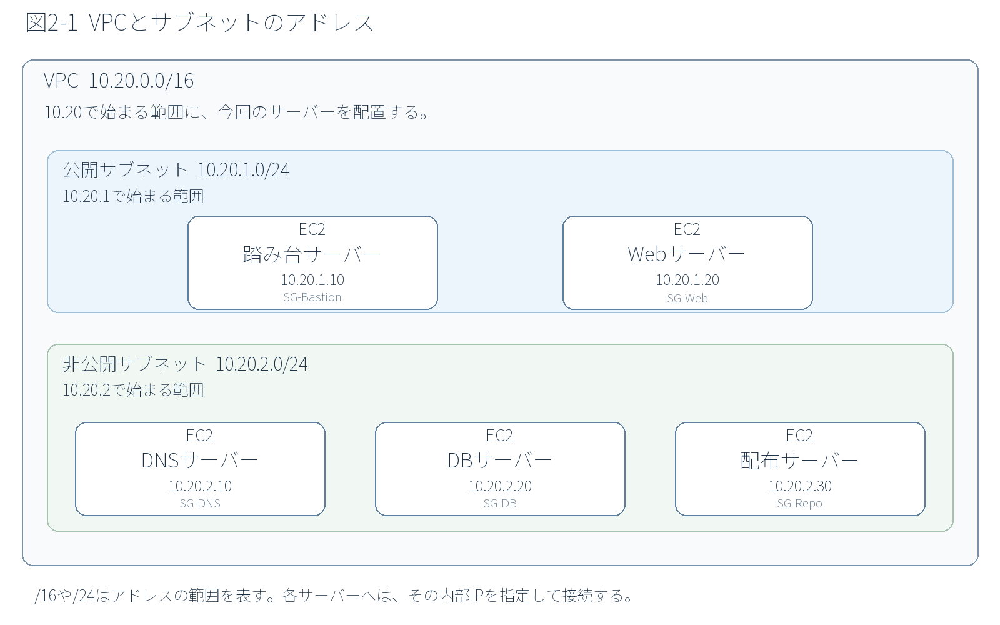

# 第2章 AWS上のネットワークと通信経路

## この章で分かること

第1章では、学校の備品管理システムを支える5台のサーバーを紹介した。本章では、そのサーバー同士がどのように接続するかを考える。例えば、利用者PCは公開Webサーバーへ接続し、Webサーバー上のアプリは内部のDBへ接続する。同じWebサーバーでも、一般の閲覧と管理画面では使う入口が異なる。

接続を理解するには、「どのサーバーへ」「どの機能を使うために」「どこから接続するか」を分けるとよい。接続先を指定するIPアドレス、機能の入口を指定するポート、相手を制限するSecurity Groupを、今回の構成に当てはめて説明する。

- 内部IPと公開IPは、どの場面で使うのか。
- VPCとサブネットのアドレス表記は、どう読むのか。
- IPアドレスが同じでも、接続するポートが違うと何が変わるのか。
- Security Groupでは、何を条件に通信を許可するのか。
- `127.0.0.1`は、どのコンピューターを指すのか。

## 2.1 IPアドレスで通信する相手を指定する

今回の備品管理アプリにおいて、利用者が備品の一覧を開くときは、利用者PCのブラウザがWebサーバーへページを要求する。その要求を受けたWebサーバー上の備品管理アプリが、DBサーバーへ備品データの読み取りを要求する。また、管理画面から備品を登録・変更するときも、Webサーバー上のアプリがDBサーバーへデータの書き込みを要求する。このように、ブラウザとアプリは、それぞれの処理に応じた相手と通信する。

**IPアドレス**は、ネットワーク上の通信先を指定するアドレスである。厳密にはホストのネットワーク接続口に付くが、本章ではサーバーを指定するためのアドレスとして読んでいく。今回の構成では、例えばWebサーバーの内部IPが`10.20.1.20`、DBの内部IPが`10.20.2.20`である。

このように、数字をドットで四つに区切った表記は**IPv4**という形式である。各部分には0〜255の値を使う。今回扱う接続先はIPv4で表す。

通信を始める側が**送信元**、その通信が向かう相手が**宛先**である。WebサーバーからDBへ接続する場面なら、送信元はWebサーバー、宛先はDBになる。DBから結果が返るときは、データが流れる方向が逆になる。

アドレスを見るときは、どこで動くプログラムが、どの相手に接続するのかを一緒に読む。例えば、ブラウザがWebサーバーへ接続することと、Webサーバー上のアプリがDBへ接続することは、別の通信である。

## 2.2 VPCとサブネットのアドレスを読む

**VPC（Virtual Private Cloud）**はAWSの中に用意するネットワークであり、**サブネット**はその中をIPアドレスの範囲で分けたものである。今回のVPCは`10.20.0.0/16`、公開サブネットは`10.20.1.0/24`、非公開サブネットは`10.20.2.0/24`を使う。

スラッシュを付けたこの書き方を**CIDR（Classless Inter-Domain Routing）表記**という。`10.20.1.20`は一つのアドレスだが、`10.20.1.0/24`はアドレスの範囲を表す。例えば、公開サブネットの `10.20.1.0/24` は、`10.20.1.0` から `10.20.1.255` までを含む。

IPv4の`/24`は、先頭の三つの数値を固定する。この授業の公開サブネットは`10.20.1.x`、非公開サブネットは`10.20.2.x`と書ける。`x`はアドレスによって変わる部分を表す。`/16`は先頭の二つを固定するので、VPCは`10.20.x.x`と書ける。二つのサブネットは、どちらもこのVPCの範囲に含まれる。

**図2-1 VPC、サブネット、内部IPの対応。** 大きなVPCのアドレス範囲の中を二つに分け、役割ごとにサーバーを配置する。公開側のサーバーも、VPC内で使う内部IPを持つ。

| アドレスの範囲 | サーバー | 内部IPv4アドレス | 配置するサブネット |
| --- | --- | --- | --- |
| `10.20.1.x` | 踏み台 | `10.20.1.10` | 公開 `10.20.1.0/24` |
| `10.20.1.x` | Webサーバー | `10.20.1.20` | 公開 `10.20.1.0/24` |
| `10.20.2.x` | DNS | `10.20.2.10` | 非公開 `10.20.2.0/24` |
| `10.20.2.x` | DB | `10.20.2.20` | 非公開 `10.20.2.0/24` |
| `10.20.2.x` | 配布 | `10.20.2.30` | 非公開 `10.20.2.0/24` |

この表では、アドレスの範囲と実際に使うアドレスを分けて読む。例えばWebサーバーの接続先は`10.20.1.20`であり、サブネット名の`10.20.1.0/24`へ接続するわけではない。[AWSのIPアドレスとCIDR](https://docs.aws.amazon.com/vpc/latest/userguide/vpc-ip-addressing.html)

## 2.3 インターネットからの接続とVPC内の接続

### 内部IPを使う場面

**内部IP（プライベートIP）**は、今回のVPC内のサーバー同士で使うアドレスである。踏み台からWebサーバーへSSH接続するときや、WebサーバーからDBへ接続するときは、相手の内部IPを使う。

内部IPは、インターネット上の端末からそのまま接続できる公開の宛先ではない。例えば、携帯電話回線につないだPCから`10.20.2.20`を指定しても、今回のDBへ直接接続することはできない。

### 公開IPを使う場面

**公開IP（パブリックIP）**は、インターネット側から接続するために使うアドレスである。今回は公開サブネットのWebサーバーと踏み台に公開IPを割り当てる。利用者PCから一般画面を見るときはWebサーバーの公開IP、RDPで管理用デスクトップを開くときは踏み台の公開IPを使う。

Webサーバーは公開IPだけでなく、内部IP`10.20.1.20`も持つ。同じWebサーバーに対して、利用者PCは公開側から接続し、踏み台はVPC内の内部IPへ接続する。使うアドレスが異なっても、今回の構成では同じEC2 Webサーバーへの接続である。

**図2-2 同じWebサーバーの公開IPと内部IP。** 青色は利用者PCが公開IPを指定して入る経路、緑色はVPC内のサーバー同士が内部IPを使う経路を表す。WebサーバーからDBサーバーへの接続も緑で示している。AWSのInternet Gatewayで宛先が公開IPから内部IPへ変換され、同じWebサーバーへ届く。`203.0.113.20`は説明用の例であり、実際には対象環境で割り当てられた公開IPを使う。[文書用IPアドレスの規定](https://www.rfc-editor.org/rfc/rfc5737.html)

### 公開範囲とInternet Gateway

**ゲートウェイ**は、異なるネットワークをつなぐ出入口を表す一般的な用語である。本書で**Internet Gateway（IGW）**と呼ぶものは、AWSがVPCとインターネットの接続のために提供する機能を指す。図2-2のIGWもAWS側にあり、利用者PCからWebサーバーへ向かう通信はここを経由する。

今回のIPv4通信では、AWSのIGWがWebサーバーの公開IPと内部IPの対応を処理する。利用者PCが公開IP宛てに送った通信は、IGWで宛先をWebサーバーの内部IPへ変換してからVPC内へ届けられる。返答では、インターネット側へ送るときに送信元がWebサーバーの公開IPへ変換される。これが、公開IPと内部IPのどちらを使っても同じWebサーバーへ届く仕組みである。[AWS Internet Gatewayのアドレス変換](https://docs.aws.amazon.com/vpc/latest/userguide/VPC_Internet_Gateway.html)

非公開サブネットのDNS、DB、配布サーバーには公開IPを割り当てない。インターネットから直接接続する入口は用意せず、VPC内の必要なサーバーから利用する。例えば、公開サブネットのWebサーバーから非公開サブネットのDBへ接続し、非公開サブネットのDNSから配布サーバーへ必要な資源を取得する。

公開・非公開は、インターネットとの接続の扱いである。VPC内の接続をどこまで許可するかは、後述するSGの条件で決める。公開IPを持つWebサーバーでも、公開するのは一般閲覧などに必要な入口である。[AWSの公開・非公開サブネット](https://docs.aws.amazon.com/vpc/latest/userguide/configure-subnets.html)、[Internet Gateway](https://docs.aws.amazon.com/vpc/latest/userguide/VPC_Internet_Gateway.html)

## 2.4 プロトコルとポートで使う機能を指定する

### 同じサーバーの中にも複数の入口がある

IPアドレスでWebサーバーを選んだ後、その中のどの機能へ接続するかを指定する。一般の一覧を開く、管理画面を開く、端末から設定する、という目的ごとに使う入口が異なる。その入口を区別する番号が**ポート番号**である。

通信の約束や方式を**プロトコル**という。今回のHTTP、SSH、RDP、DB接続では、データを順序どおり届けるTCPという通信方式を使う。DNSの問い合わせではUDPとTCPの両方を使う。TCPとUDPの同じ番号は、別の通信窓口として扱う。

例えば、Webサーバーの`10.20.1.20`へTCPの80番で接続すると一般のWeb入口を使う。踏み台から同じIPへTCPの22番で接続すると、SSHによる端末操作の入口を使う。接続先のサーバーは同じでも、使う機能が違う。

| 用途 | 通信方式 | 宛先ポート |
| --- | --- | --- |
| 一般WebサーバーのHTTP | TCP | 80 |
| 踏み台のRDP | TCP | 3389 |
| サーバー管理のSSH | TCP | 22 |
| 内部DNSへの問い合わせ | UDPとTCP | 53 |
| PostgreSQLへの接続 | TCP | 5432 |
| Webサーバーの内部向け管理画面 | TCP | 8080 |
| Webサーバー内のアプリへの要求転送 | TCP | 8000 |

ポート番号には、HTTPの80番やSSHの22番のように、標準や業界の慣習で用途が定まっているものがある。一方、実際にどのポートで接続を受け付けるかは、ソフトウェアの設定で指定できる。今回は一般向けのWebページを80番、内部向けの管理画面を8080番で受け付けるように設定する。管理画面だから自動的に8080番になるのではなく、構築する側がその番号を選んでいる。[IANAのサービス名とポート番号](https://www.iana.org/assignments/service-names-port-numbers/service-names-port-numbers.xhtml)

### ソフトウェアの待受

サーバーが、指定したアドレスとポートで接続を受け付ける準備をすることを**待受**という。NginxがWebサーバーの80番で待ち受けていれば、その入口へHTTPの要求を送れる。

待受には、ポートだけでなくアドレスも関わる。例えば、同じホスト内だけで使う`127.0.0.1:8000`と、VPC内から使う`10.20.1.20:8080`は、別の相手から利用する入口である。`127.0.0.1`の意味は2.7で詳しく説明する。

待受の表示で使う`0.0.0.0:80`は、そのホストのすべてのIPv4ローカルアドレスで80番を受け付ける指定である。VPC内やインターネットから実際に接続できるかどうかは、通信経路とSGの許可も必要になる。[LinuxのIPアドレスとソケット](https://man7.org/linux/man-pages/man7/ip.7.html)

## 2.5 Security Groupで通信する相手を制限する

### 入ってくる通信と出ていく通信

**Security Group（SG）**は、関連付けたサーバーなどのAWS資源について、許可する通信を定める仕組みである。今回は5台の役割に対応したSGを使う。

サーバーへ入ってくる通信の条件を**インバウンドルール（受信規則）**、サーバーから出ていく通信の条件を**アウトバウンドルール（送信規則）**という。送信元から出る側と、宛先へ入る側の条件を組み合わせて考える。

例えばWebサーバーからDBへ接続する場合、Webサーバーの送信側でDBへのTCP5432を許可し、DBの受信側でWebサーバーからのTCP5432を許可する。そのうえでDBが接続を受け付け、認証を行う。

**図2-3 WebサーバーからDBへの接続とSG。** オレンジ色の枠がSG、青色の枠がEC2である。Webサーバーに関連付けたSG-Webの送信規則と、DBに関連付けたSG-DBの受信規則で通信を許可する。SGはAWS側で通信を制御する仕組みであり、図ではEC2と分けて示している。青い矢印は接続を始める方向、緑の矢印はその接続への応答を表す。

### 許可条件を読む

受信規則では、主に「送信元」「プロトコル」「宛先ポート」を読む。次は今回のサービスに必要な受信規則の例である。

| 対象のSG | 送信元 | 許可する通信 |
| --- | --- | --- |
| WebサーバーのSG | インターネット側のIPv4 | TCP80：一般Webサーバー |
| 踏み台のSG | 許可された接続元IPの範囲 | TCP3389：RDP |
| 各内部管理先のSG | 踏み台のSG | TCP22：SSH |
| DNSのSG | 踏み台のSG、WebサーバーのSG | UDP53・TCP53：名前解決 |
| DBのSG | WebサーバーのSG | TCP5432：DB接続 |
| WebサーバーのSG | 踏み台のSG | TCP8080：管理画面 |
| 配布サーバーのSG | 必要な内部サーバーのSG | TCP80：資源の取得 |

送信元としてSGを指定する場合は、そのSGを関連付けたサーバーからの通信を許可する。例えばDBの受信規則でWebサーバーのSGを指定すると、今回そのSGを持つWebサーバーからの接続を許す。WebサーバーのSGに書かれた規則をDBへコピーする、という意味ではない。

IPの範囲を使う規則もある。`/32`はIPv4の一つのアドレス、`0.0.0.0/0`はすべてのIPv4アドレスの範囲を表す。今回の一般WebサーバーのTCP80は後者を使い、管理用のRDPは許可された接続元に絞る。

### 許可されていない通信と応答

SGでは、必要な通信の許可を追加する。今回のDBでWebサーバーからのTCP5432を許可しても、踏み台からのTCP5432やWebサーバーからの別のポートまで許可したことにはならない。VPC内にいるという条件だけで、すべての機能を使えるわけではない。

SGは、許可した通信に対する応答を認識する。Webサーバーから始めたDB接続への返答について、同じ応答のために逆方向の規則を追加する必要はない。この性質を**ステートフル**という。これは、DBからWebサーバーへ新しい別の接続を始めることまで許可するという意味ではない。[AWSのSGルール](https://docs.aws.amazon.com/vpc/latest/userguide/security-group-rules.html)、[応答通信の扱い](https://docs.aws.amazon.com/vpc/latest/userguide/vpc-security-groups.html)

## 2.6 利用と管理で異なる通信経路

### 一般のWeb閲覧

Webアプリ上で備品一覧を見るときは、利用者PCのブラウザがWebサーバーの公開IPへHTTPで接続する。要求はAWSのIGWを経由してWebサーバーの一般入口へ届く。Webサーバー上のアプリがDBの値を必要とするときは、Webサーバーが内部DNSでDB名を解決し、DBの内部IPへTCP5432で接続する。

このとき、ブラウザとWebサーバーの接続、WebサーバーからDNSへの問い合わせ、WebサーバーからDBへの接続は、それぞれ別の通信である。必要な通信ごとに送信元、宛先、プロトコル、宛先ポートを読む必要がある。

### サーバーのOSやサービスを管理する

Nginxの設定を変える、サービスを再起動する、ログを調べるといった操作は、サーバーのOS上で行う。踏み台を使う場合は、まずRDPで利用者PCから管理用の踏み台へ接続してデスクトップを開く。次に踏み台の端末からSSHでWebサーバーやDBなどの対象サーバーへ接続し、コマンドで操作する。WebサーバーやDBのSSHを、インターネットから直接接続する入口として公開しない構成である。

演習には、CloudShellからSSMで対象のEC2へ接続してOSを操作する方法もある。ここでは踏み台を使う経路を説明しているが、OSの管理手段はRDPとSSHだけに限らない。各接続方法の操作は第3章で扱う。

### Webアプリの管理画面を使う

Webアプリには、一般の利用者が情報を見る入口と、管理者が内容を登録・変更する入口を分けて用意することがある。今回の備品管理アプリも、一般画面では公開された備品の一覧を閲覧し、管理画面ではログインした管理者が備品の追加や、数量・保管場所などの変更を行う。

管理画面を使う場合も、まずRDPで踏み台のデスクトップを開く。その後はSSHではなく、踏み台上のブラウザから`http://admin.lab.test:8080/admin/`を開く。内部DNSがこの名前をWebサーバーの内部IP`10.20.1.20`へ解決し、ブラウザがWebサーバーの8080番へHTTPで接続する。RDPは踏み台を操作するための接続であり、アプリの管理者としてのログインは、その先のWeb画面で行う。

今回の構成では、一般向けの80番からは管理画面を開けない。管理用の8080番は踏み台からの接続だけを許可する。このように、同じ踏み台を利用しても、OSの設定変更はSSH、アプリ内の備品の登録・変更はブラウザと、目的によって使うソフトウェアと接続先が異なる。

### 送信元と宛先を一組で読む

例えば「DBのポートは5432」という情報だけでは、接続の全体は分からない。「Webサーバーから、DBの内部IPへ、TCP5432で接続する」と読めば、使う側と受け付ける側が明確になる。

同じ考え方で、「踏み台からDNSへUDP53・TCP53」「DNSから配布サーバーへTCP80」「踏み台からWebサーバーへTCP8080」と整理する。通信表はポート番号の暗記表ではなく、必要な相手と機能を示す表として使う。

## 2.7 127.0.0.1はそのホスト自身を表す

Webサーバー上のNginxは、同じWebサーバー内で動くアプリへ要求を渡す。この接続に使う`127.0.0.1`は、プログラムが動いているホスト自身を指す**ループバックアドレス**である。

Webサーバー上のNginxが`127.0.0.1:8000`へ接続すれば、Webサーバー自身の8000番へ向かう。今回のGunicornはその入口で待ち受けるため、同じWebサーバー内のNginxからアプリへ要求を渡せる。

一方、踏み台のブラウザで`127.0.0.1:8000`を指定すると、踏み台自身の8000番へ向かう。同じ数字を書いても、Webサーバー内のアプリを指すことにはならない。踏み台から管理画面を開く場合は、Webサーバーの内部IPと8080番を使う。

**図2-4 ループバックが指す相手。** `127.0.0.1`は接続を実行するホスト自身を指す。赤い×印を付けた矢印は、踏み台でこのアドレスを指定してもWebサーバーへ向かわないことを示す。

## 2.8 接続に必要な条件を結び付ける

Webサービスを利用するためには、通信先のIPとポートを選び、そこまでの通信を許可し、目的のソフトウェアが待ち受けている必要がある。その後、受け取った要求をソフトウェアが処理して、ページやデータを返す。

例えばSGでTCP80を許可しても、Nginxが停止していれば目的のWebサービスは使えない。また、Nginxが同じホスト内だけで待ち受けている場合は、外部向けの入口としては使えない。通信の許可と、サービスが応答することは、それぞれ設定する対象が違う。

DBでも同様に、SGでTCP5432を許可することと、PostgreSQLで接続するroleやパスワードを認証することは別の役割である。ネットワーク上で接続先まで届く条件と、ソフトウェアを利用するための条件を順に整える。

本章で説明したアドレス、ポート、SGの条件は、以後のWebサーバー、DNS、DB、アプリの設定を理解するための共通の土台となる。次の第3章では、実際に各サーバーへ接続するときの操作と、今どのホスト・ユーザーで作業しているかの見分け方を扱う。

## 章末問題

### 問1

IPアドレスとポート番号は、それぞれ何を指定するものか。

### 問2

公開IPを持つEC2 Webサーバーは、内部IPも持つか。利用者PCからの一般閲覧と、踏み台からの接続では、それぞれどのIPを使うか。

### 問3

DBのSGで、WebサーバーからのTCP5432だけをDB利用のために許可した。この規則により、同じVPC内の踏み台からもTCP5432でDBを利用できるか。

### 問4

踏み台のブラウザで`127.0.0.1:8000`を指定した場合、どのコンピューターの8000番へ接続しようとするか。

## 章末解答

### 問1

IPアドレスは通信するホスト側の宛先を指定し、ポート番号はそのホスト内の通信窓口を指定する。今回の例では、`10.20.1.20`でWebサーバーを選び、TCP80で一般Webサーバー、TCP22でSSHの入口を選ぶ。

### 問2

内部IPも持つ。利用者PCからの一般閲覧はWebサーバーの公開IPへ接続する。踏み台から同じWebサーバーへ接続する場合は、内部IPの`10.20.1.20`を使う。

### 問3

この規則では許可されない。送信元をWebサーバーに限定しているため、同じVPC内にある踏み台からのDB利用も別に扱う。今回の構成では、DB利用の接続元をWebサーバーに絞る。

### 問4

踏み台自身の8000番である。Webサーバー内のアプリを指すアドレスにはならない。今回、踏み台からWebサーバーの管理画面へ接続する際は、Webサーバーの内部IPと8080番を使う。

## 参考資料

確認日：2026-10-30。アドレス、ポート、通信許可の例は、今回の構成と現行教材の設定による。

- [AWS IP addressing for your VPCs and subnets](https://docs.aws.amazon.com/vpc/latest/userguide/vpc-ip-addressing.html)
- [AWS Subnets for your VPC](https://docs.aws.amazon.com/vpc/latest/userguide/configure-subnets.html)
- [AWS Internet Gateway](https://docs.aws.amazon.com/vpc/latest/userguide/VPC_Internet_Gateway.html)
- [IANA Service Name and Transport Protocol Port Number Registry](https://www.iana.org/assignments/service-names-port-numbers/service-names-port-numbers.xhtml)
- [AWS Security group rules](https://docs.aws.amazon.com/vpc/latest/userguide/security-group-rules.html)
- [AWS Security groups](https://docs.aws.amazon.com/vpc/latest/userguide/vpc-security-groups.html)
- [Linux man-pages ip(7)](https://man7.org/linux/man-pages/man7/ip.7.html)
- [RFC 5737 文書用IPv4アドレス](https://www.rfc-editor.org/rfc/rfc5737.html)
- [今回の5台構成](../../../../development/templates/web-lab-student.template.json)
- [Webサーバーの公開入口・管理入口の設定](../../../../development/01_roles/cyber_security/tools/web_lab_catalog/config/jdu-catalog.nginx.conf)
- [第1章](../../output/pdf/web_textbook_ch01_ja.pdf)
