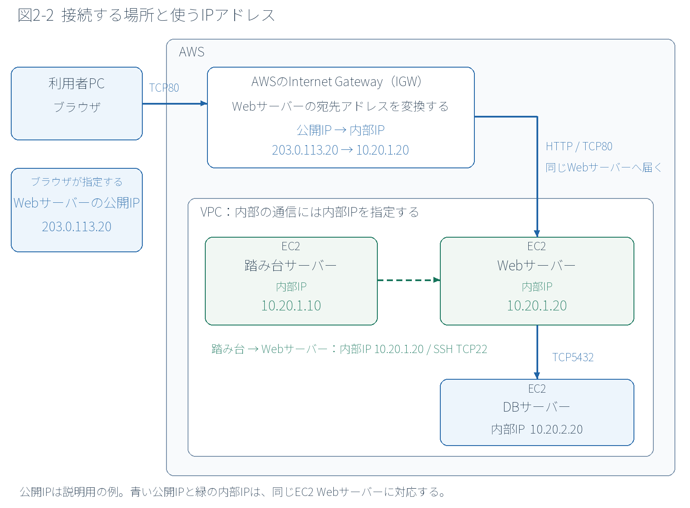
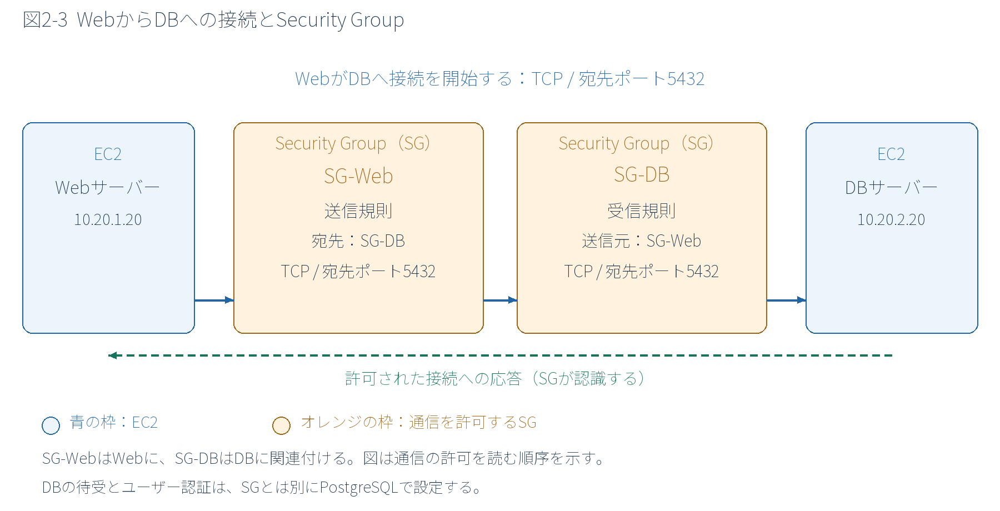
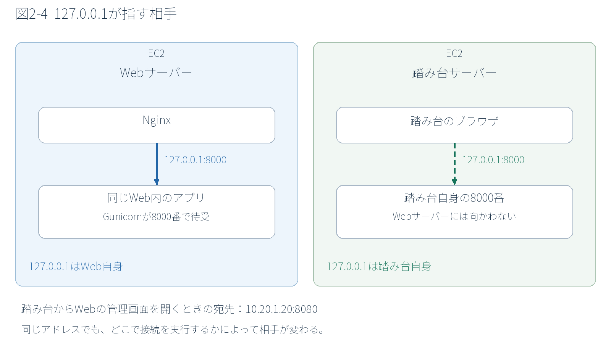

# 第2章 AWS上のネットワークと通信経路

## この章で分かること

第1章では、学校の備品管理システムを支える5台のサーバーを紹介した。本章では、そのサーバー同士がどのように接続するかを考える。例えば、利用者PCは公開Webへ接続し、Web上のアプリは内部のDBへ接続する。同じWebサーバーでも、一般の閲覧と管理画面では使う入口が異なる。

接続を理解するには、「どのサーバーへ」「どの機能を使うために」「どこから接続するか」を分けるとよい。接続先を指定するIPアドレス、機能の入口を指定するポート、相手を制限するSecurity Groupを、今回の構成に当てはめて説明する。

- 内部IPと公開IPは、どの場面で使うのか。
- VPCとサブネットのアドレス表記は、どう読むのか。
- IPアドレスが同じでも、接続するポートが違うと何が変わるのか。
- Security Groupでは、何を条件に通信を許可するのか。
- `127.0.0.1`は、どのコンピューターを指すのか。

## 2.1 IPアドレスで通信する相手を指定する

今回の備品管理アプリにおいて、利用者が備品の一覧を開くときは、利用者PCのブラウザがWebサーバーへページを要求する。その要求を受けたWebサーバー上の備品管理アプリが、DBサーバーへ備品データの読み取りを要求する。また、管理画面から備品を登録・変更するときも、Webサーバー上のアプリがDBサーバーへデータの書き込みを要求する。このように、ブラウザとアプリは、それぞれの処理に応じた相手と通信する。

**IPアドレス**は、ネットワーク上の通信先を指定するアドレスである。厳密にはホストのネットワーク接続口に付くが、本章ではサーバーを指定するためのアドレスとして読んでいく。今回の構成では、例えばWebの内部IPが`10.20.1.20`、DBの内部IPが`10.20.2.20`である。

このように、数字をドットで四つに区切った表記は**IPv4**という形式である。各部分には0〜255の値を使う。今回扱う接続先はIPv4で表す。

通信を始める側が**送信元**、その通信が向かう相手が**宛先**である。WebからDBへ接続する場面なら、送信元はWeb、宛先はDBになる。DBから結果が返るときは、データが流れる方向が逆になる。

アドレスを見るときは、どこで動くプログラムが、どの相手に接続するのかを一緒に読む。例えば、ブラウザがWebへ接続することと、Web上のアプリがDBへ接続することは、別の通信である。

## 2.2 VPCとサブネットのアドレスを読む

**VPC（Virtual Private Cloud）**はAWSの中に用意するネットワークであり、**サブネット**はその中をIPアドレスの範囲で分けたものである。今回のVPCは`10.20.0.0/16`、公開サブネットは`10.20.1.0/24`、非公開サブネットは`10.20.2.0/24`を使う。

スラッシュを付けたこの書き方を**CIDR（Classless Inter-Domain Routing）表記**という。`10.20.1.20`は一つのアドレスだが、`10.20.1.0/24`はアドレスの範囲を表す。

IPv4の`/24`では、先頭の三つの数値が同じ範囲を表す。今回なら`10.20.1`で始まる範囲と、`10.20.2`で始まる範囲を別のサブネットとして使う。`/16`は先頭の二つの数値が同じ、より広い範囲であり、今回の二つのサブネットはどちらもVPCの`10.20`で始まる範囲に含まれる。

**図2-1 VPC、サブネット、内部IPの対応。** 大きなVPCのアドレス範囲の中を二つに分け、役割ごとにサーバーを配置する。公開側のサーバーも、VPC内で使う内部IPを持つ。

| サーバー | 内部IPv4アドレス | 配置するサブネット |
| --- | --- | --- |
| 踏み台 | `10.20.1.10` | 公開 `10.20.1.0/24` |
| Web | `10.20.1.20` | 公開 `10.20.1.0/24` |
| DNS | `10.20.2.10` | 非公開 `10.20.2.0/24` |
| DB | `10.20.2.20` | 非公開 `10.20.2.0/24` |
| 配布 | `10.20.2.30` | 非公開 `10.20.2.0/24` |

この表では、アドレスの範囲と実際に使うアドレスを分けて読む。例えばWebの接続先は`10.20.1.20`であり、サブネット名の`10.20.1.0/24`へ接続するわけではない。[AWSのIPアドレスとCIDR](https://docs.aws.amazon.com/vpc/latest/userguide/vpc-ip-addressing.html)

## 2.3 インターネットからの接続とVPC内の接続

### 内部IPを使う場面

**内部IP（プライベートIP）**は、今回のVPC内のサーバー同士で使うアドレスである。踏み台からWebへSSH接続するときや、WebからDBへ接続するときは、相手の内部IPを使う。

内部IPは、インターネット上の端末からそのまま接続できる公開の宛先ではない。例えば、携帯電話回線につないだPCから`10.20.2.20`を指定しても、今回のDBへ直接接続することはできない。

### 公開IPを使う場面

**公開IP（パブリックIP）**は、インターネット側から接続するために使うアドレスである。今回は公開サブネットのWebと踏み台に公開IPを割り当てる。利用者PCから一般画面を見るときはWebの公開IP、RDPで管理用デスクトップを開くときは踏み台の公開IPを使う。

Webは公開IPだけでなく、内部IP`10.20.1.20`も持つ。同じWebに対して、利用者PCは公開側から接続し、踏み台はVPC内の内部IPへ接続する。使うアドレスが異なっても、今回の構成では同じEC2 Webサーバーへの接続である。

**図2-2 接続する場所によって使い分けるアドレス。** 図中の`203.0.113.20`は説明用の公開IPの例である。実際の接続には、対象環境で割り当てられた公開IPを使う。[文書用IPアドレスの規定](https://www.rfc-editor.org/rfc/rfc5737.html)

### 公開範囲とInternet Gateway

**Internet Gateway（IGW）**は、VPCとインターネットの接続に使うAWSの機能である。図2-2の一般Web閲覧は、利用者PCからIGWを経由してWebへ届く。

非公開サブネットのDNS、DB、配布サーバーには公開IPを割り当てない。インターネットから直接接続する入口は用意せず、VPC内の必要なサーバーから利用する。例えば、公開サブネットのWebから非公開サブネットのDBへ接続し、非公開サブネットのDNSから配布サーバーへ必要な資源を取得する。

公開・非公開は、インターネットとの接続の扱いである。VPC内の接続をどこまで許可するかは、後述するSGの条件で決める。公開IPを持つWebでも、公開するのは一般閲覧などに必要な入口である。[AWSの公開・非公開サブネット](https://docs.aws.amazon.com/vpc/latest/userguide/configure-subnets.html)、[Internet Gateway](https://docs.aws.amazon.com/vpc/latest/userguide/VPC_Internet_Gateway.html)

## 2.4 プロトコルとポートで使う機能を指定する

### 同じサーバーの中にも複数の入口がある

IPアドレスでWebサーバーを選んだ後、その中のどの機能へ接続するかを指定する。一般の一覧を開く、管理画面を開く、端末から設定する、という目的ごとに使う入口が異なる。その入口を区別する番号が**ポート番号**である。

通信の約束や方式を**プロトコル**という。今回のHTTP、SSH、RDP、DB接続では、データを順序どおり届けるTCPという通信方式を使う。DNSの問い合わせではUDPとTCPの両方を使う。TCPとUDPの同じ番号は、別の通信窓口として扱う。

例えば、Webの`10.20.1.20`へTCPの80番で接続すると一般のWeb入口を使う。踏み台から同じIPへTCPの22番で接続すると、SSHによる端末操作の入口を使う。接続先のサーバーは同じでも、使う機能が違う。

| 用途 | 通信方式 | 宛先ポート |
| --- | --- | --- |
| 一般WebのHTTP | TCP | 80 |
| 踏み台のRDP | TCP | 3389 |
| サーバー管理のSSH | TCP | 22 |
| 内部DNSへの問い合わせ | UDPとTCP | 53 |
| PostgreSQLへの接続 | TCP | 5432 |
| Webの内部向け管理画面 | TCP | 8080 |
| Web内のアプリへの要求転送 | TCP | 8000 |

これらは今回採用する設定である。例えば「8080番だから必ず管理画面になる」という意味ではなく、その番号で管理画面を受け付けるように設定する。

### ソフトウェアの待受

サーバーが、指定したアドレスとポートで接続を受け付ける準備をすることを**待受**という。NginxがWebの80番で待ち受けていれば、その入口へHTTPの要求を送れる。

待受には、ポートだけでなくアドレスも関わる。例えば、同じホスト内だけで使う`127.0.0.1:8000`と、VPC内から使う`10.20.1.20:8080`は、別の相手から利用する入口である。`127.0.0.1`の意味は2.7で詳しく説明する。

待受の表示で使う`0.0.0.0:80`は、そのホストのすべてのIPv4ローカルアドレスで80番を受け付ける指定である。VPC内やインターネットから実際に接続できるかどうかは、通信経路とSGの許可も必要になる。[LinuxのIPアドレスとソケット](https://man7.org/linux/man-pages/man7/ip.7.html)

## 2.5 Security Groupで通信する相手を制限する

### 入ってくる通信と出ていく通信

**Security Group（SG）**は、関連付けたサーバーなどのAWS資源について、許可する通信を定める仕組みである。今回は5台の役割に対応したSGを使う。

サーバーへ入ってくる通信の条件を**インバウンドルール（受信規則）**、サーバーから出ていく通信の条件を**アウトバウンドルール（送信規則）**という。送信元から出る側と、宛先へ入る側の条件を組み合わせて考える。

例えばWebからDBへ接続する場合、Webの送信側でDBへのTCP5432を許可し、DBの受信側でWebからのTCP5432を許可する。そのうえでDBが接続を受け付け、認証を行う。

**図2-3 WebからDBへの接続とSG。** 上の青い矢印は接続を始める方向、下の矢印はその接続への応答を示す。SGは相手とポートを許可し、DBの認証はPostgreSQLが行う。

### 許可条件を読む

受信規則では、主に「送信元」「プロトコル」「宛先ポート」を読む。次は今回のサービスに必要な受信規則の例である。

| 対象のSG | 送信元 | 許可する通信 |
| --- | --- | --- |
| WebのSG | インターネット側のIPv4 | TCP80：一般Web |
| 踏み台のSG | 許可された接続元IPの範囲 | TCP3389：RDP |
| 各内部管理先のSG | 踏み台のSG | TCP22：SSH |
| DNSのSG | 踏み台のSG、WebのSG | UDP53・TCP53：名前解決 |
| DBのSG | WebのSG | TCP5432：DB接続 |
| WebのSG | 踏み台のSG | TCP8080：管理画面 |
| 配布サーバーのSG | 必要な内部サーバーのSG | TCP80：資源の取得 |

送信元としてSGを指定する場合は、そのSGを関連付けたサーバーからの通信を許可する。例えばDBの受信規則でWebのSGを指定すると、今回そのSGを持つWebからの接続を許す。WebのSGに書かれた規則をDBへコピーする、という意味ではない。

IPの範囲を使う規則もある。`/32`はIPv4の一つのアドレス、`0.0.0.0/0`はすべてのIPv4アドレスの範囲を表す。今回の一般WebのTCP80は後者を使い、管理用のRDPは許可された接続元に絞る。ここでの`0.0.0.0/0`は相手の範囲であり、前節の`0.0.0.0:80`という待受の指定とは用途が異なる。

### 許可されていない通信と応答

SGでは、必要な通信の許可を追加する。今回のDBでWebからのTCP5432を許可しても、踏み台からのTCP5432やWebからの別のポートまで許可したことにはならない。VPC内にいるという条件だけで、すべての機能を使えるわけではない。

SGは、許可した通信に対する応答を認識する。Webから始めたDB接続への返答について、同じ応答のために逆方向の規則を追加する必要はない。この性質を**ステートフル**という。これは、DBからWebへ新しい別の接続を始めることまで許可するという意味ではない。[AWSのSGルール](https://docs.aws.amazon.com/vpc/latest/userguide/security-group-rules.html)、[応答通信の扱い](https://docs.aws.amazon.com/vpc/latest/userguide/vpc-security-groups.html)

この表のDNSはEC2で動かす内部DNSを指す。AWSが提供する基盤用DNSなどにはSGで制御できない通信もあるため、今回のBINDへの問い合わせと区別する。

## 2.6 利用と管理で異なる通信経路

### 一般のWeb閲覧

備品一覧を見るときは、利用者PCのブラウザからWebの公開IPへHTTPで接続する。要求はIGWを経由してWebの一般入口へ届く。Web上のアプリがDBの値を必要とするときは、Webが内部DNSでDB名を解決し、DBの内部IPへTCP5432で接続する。

このとき、ブラウザとWebの接続、WebからDNSへの問い合わせ、WebからDBへの接続は、それぞれ別の通信である。必要な通信ごとに送信元、宛先、プロトコル、宛先ポートを読む。

### サーバーの管理

設定を変えるときは、RDPで利用者PCから管理用の踏み台へ接続する。踏み台のデスクトップを開き、そこからSSHで対象サーバーへ接続する。WebやDBのSSHを、利用者PCのインターネット接続先として直接公開しない構成である。

アプリの管理画面を使うときは、踏み台のブラウザからWebの内部IPの8080番へ接続する。一般向けの80番と、内部向けの8080番を分けることで、管理画面へ到達できる相手を絞る。

### 送信元と宛先を一組で読む

例えば「DBのポートは5432」という情報だけでは、接続の全体は分からない。「Webから、DBの内部IPへ、TCP5432で接続する」と読めば、使う側と受け付ける側が明確になる。

同じ考え方で、「踏み台からDNSへUDP53・TCP53」「DNSから配布サーバーへTCP80」「踏み台からWebへTCP8080」と整理する。通信表はポート番号の暗記表ではなく、必要な相手と機能を示す表として使う。

## 2.7 127.0.0.1はそのホスト自身を表す

Web上のNginxは、同じWeb内で動くアプリへ要求を渡す。この接続に使う`127.0.0.1`は、プログラムが動いているホスト自身を指す**ループバックアドレス**である。

Web上のNginxが`127.0.0.1:8000`へ接続すれば、Web自身の8000番へ向かう。今回のGunicornはその入口で待ち受けるため、同じWeb内のNginxからアプリへ要求を渡せる。

一方、踏み台のブラウザで`127.0.0.1:8000`を指定すると、踏み台自身の8000番へ向かう。同じ数字を書いても、Web内のアプリを指すことにはならない。踏み台から管理画面を開く場合は、Webの内部IPと8080番を使う。

**図2-4 ループバックが指す相手。** `127.0.0.1`は共通のWebサーバー名ではなく、接続を実行するホスト自身を指す。左と右は別のEC2である。

## 2.8 接続に必要な条件を結び付ける

Webを利用するためには、通信先のIPとポートを選び、そこまでの通信を許可し、目的のソフトウェアが待ち受けている必要がある。その後、受け取った要求をソフトウェアが処理して、ページやデータを返す。

例えばSGでTCP80を許可しても、Nginxが停止していれば目的のWebサービスは使えない。また、Nginxが同じホスト内だけで待ち受けている場合は、外部向けの入口としては使えない。通信の許可と、サービスが応答することは、それぞれ設定する対象が違う。

DBでも同様に、SGでTCP5432を許可することと、PostgreSQLで接続するroleやパスワードを認証することは別の役割である。ネットワーク上で接続先まで届く条件と、ソフトウェアを利用するための条件を順に整える。

本章で説明したアドレス、ポート、SGの条件は、以後のWeb、DNS、DB、アプリの設定を理解するための共通の土台となる。次の第3章では、実際に各サーバーへ接続するときの操作と、今どのホスト・ユーザーで作業しているかの見分け方を扱う。

## 章末問題

### 問1

IPアドレスとポート番号は、それぞれ何を指定するものか。

### 問2

公開IPを持つEC2 Webサーバーは、内部IPも持つか。利用者PCからの一般閲覧と、踏み台からの接続では、それぞれどのIPを使うか。

### 問3

DBのSGで、WebからのTCP5432だけをDB利用のために許可した。この規則により、同じVPC内の踏み台からもTCP5432でDBを利用できるか。

### 問4

踏み台のブラウザで`127.0.0.1:8000`を指定した場合、どのコンピューターの8000番へ接続しようとするか。

## 章末解答

### 問1

IPアドレスは通信するホスト側の宛先を指定し、ポート番号はそのホスト内の通信窓口を指定する。今回の例では、`10.20.1.20`でWebを選び、TCP80で一般Web、TCP22でSSHの入口を選ぶ。

### 問2

内部IPも持つ。利用者PCからの一般閲覧はWebの公開IPへ接続する。踏み台から同じWebへ接続する場合は、内部IPの`10.20.1.20`を使う。

### 問3

この規則では許可されない。送信元をWebに限定しているため、同じVPC内にある踏み台からのDB利用も別に扱う。今回の構成では、DB利用の接続元をWebに絞る。

### 問4

踏み台自身の8000番である。Web内のアプリを指すアドレスにはならない。今回、踏み台からWebの管理画面へ接続する際は、Webの内部IPと8080番を使う。

## 参考資料

確認日：2026-10-30。アドレス、ポート、通信許可の例は、今回の構成と現行教材の設定による。

- [AWS IP addressing for your VPCs and subnets](https://docs.aws.amazon.com/vpc/latest/userguide/vpc-ip-addressing.html)
- [AWS Subnets for your VPC](https://docs.aws.amazon.com/vpc/latest/userguide/configure-subnets.html)
- [AWS Internet Gateway](https://docs.aws.amazon.com/vpc/latest/userguide/VPC_Internet_Gateway.html)
- [AWS Security group rules](https://docs.aws.amazon.com/vpc/latest/userguide/security-group-rules.html)
- [AWS Security groups](https://docs.aws.amazon.com/vpc/latest/userguide/vpc-security-groups.html)
- [Linux man-pages ip(7)](https://man7.org/linux/man-pages/man7/ip.7.html)
- [RFC 5737 文書用IPv4アドレス](https://www.rfc-editor.org/rfc/rfc5737.html)
- [今回の5台構成](../../../../development/templates/web-lab-student.template.json)
- [Webの公開入口・管理入口の設定](../../../../development/01_roles/cyber_security/tools/web_lab_catalog/config/jdu-catalog.nginx.conf)
- [第1章](../../output/pdf/web_textbook_ch01_ja.pdf)
