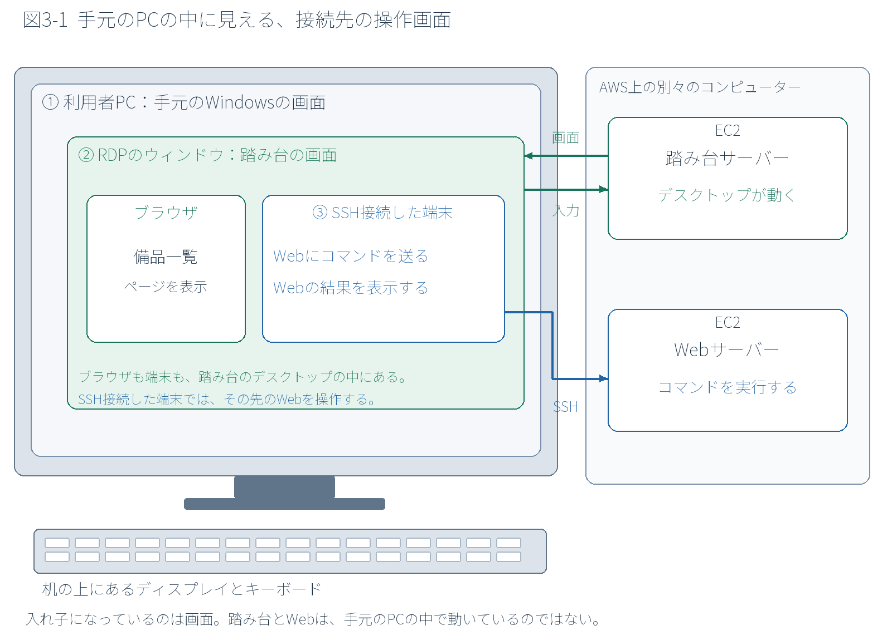
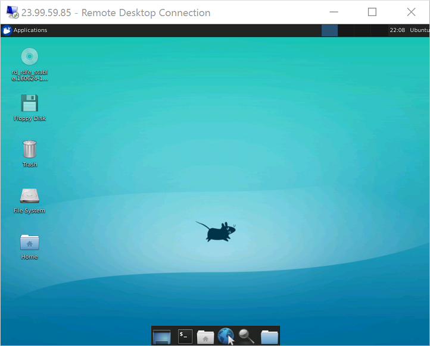
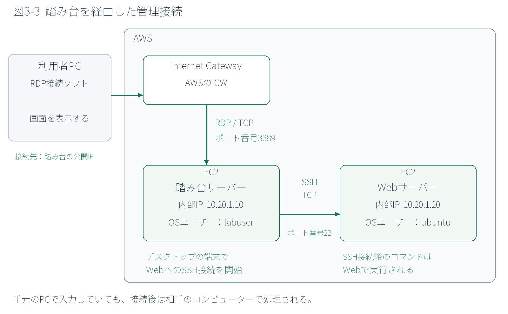
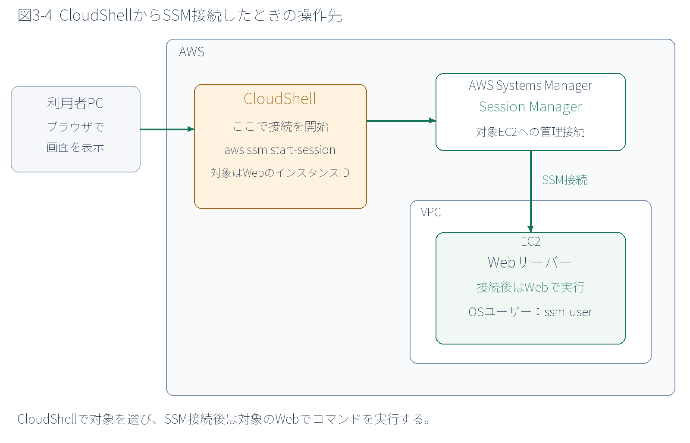
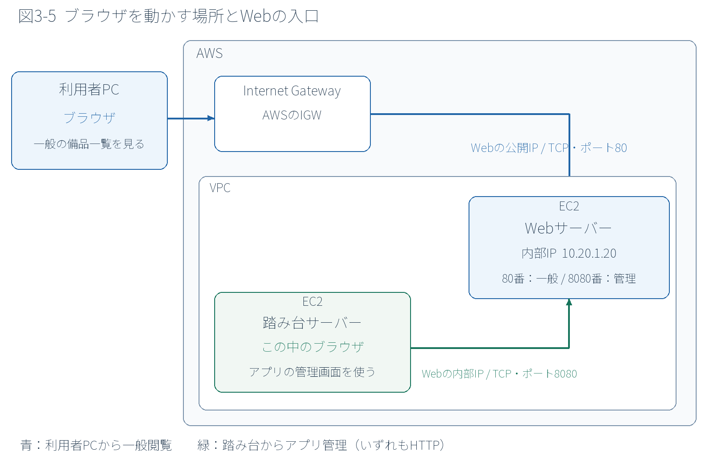

# 第3章 サーバーへの接続と作業場所

## この章で分かること

学校の備品管理システムでは、Webページを表示するための設定はWebサーバーで、備品データを保存するための設定はDBサーバーで行う。これらのサーバーはAWS上にあり、手元のPCから接続して操作する。

接続には、相手のデスクトップを開く方法と、相手へコマンドを送って操作する方法がある。また、同じ画面の中で作業していても、接続方法によって操作する相手が異なる。本章では「どのPCから」「どのサーバーへ接続し」「そこで何を操作するか」を、今回の構成に当てはめて説明する。

- 利用者PC、CloudShell、踏み台、各サーバーはどう違うのか。
- RDP、SSH、SSMは、それぞれ何を操作するために使うのか。
- 利用者PCのブラウザと踏み台のブラウザでは、通信の送信元がどう違うのか。
- サーバーの設定変更と、Webアプリの管理画面の操作はどう違うのか。

## 3.1 手元のPCと操作するサーバーを分けて考える

まず、机の上にあるPCと、そのディスプレイ、キーボード、マウスを思い浮かべてほしい。実際に手で操作している、このコンピューターを本書では**利用者PC**と呼ぶ。今回の利用者PCではWindowsを使う。一方、踏み台やWeb、DNS、DBは、AWS上に用意した別々のコンピューターである。

利用者PCで「リモートデスクトップ接続」というソフトウェアを開き、踏み台へRDP接続したとする。すると、Windowsの画面上に開いたウィンドウの内側に、踏み台のUbuntuのデスクトップが表示される。これは、離れた場所にある踏み台を、手元のPCから画面越しに操作するためのウィンドウである。

例えば、そのウィンドウ内のブラウザのアイコンをダブルクリックしてみる。マウスを動かしているのは手元の利用者PCだが、クリックした情報はRDPを通して踏み台へ送られる。その情報を受け取った踏み台がブラウザを起動し、起動したブラウザの画面を利用者PCへ送り返す。操作に合わせて画面が更新されるため、踏み台の前に座っているような感覚で操作できる。[リモートデスクトップの基本](https://learn.microsoft.com/en-us/windows-server/remote/remote-desktop-services/remotepc/understanding-security-warnings)

さらに、表示されている踏み台のデスクトップで端末を開き、その端末からWebへSSH接続する。接続後は、端末に入力したコマンドが踏み台からWebへ送られ、Webで処理される。処理結果は踏み台の端末に表示され、その端末を含むデスクトップの画面がRDPを通して手元のPCに届く。



**図3-1 手元のPC、RDPのウィンドウ、その中のSSH端末。** 大きな外枠は手元のPCのディスプレイ、緑の内枠はRDPで表示した踏み台のデスクトップ、さらに内側の端末はWebへSSH接続した状態を表す。入れ子になっているのは画面であり、踏み台とWebはAWS上の別々のコンピューターである。

今回使う環境を、最初に次のように整理しておこう。

| 環境 | 何であるか | 今回の主な用途 |
| --- | --- | --- |
| 利用者PC | 手元で操作するコンピューター | 一般のWeb閲覧、AWSコンソールの利用、RDP接続の開始 |
| CloudShell | ブラウザから使うAWS側の作業環境 | AWSのコマンドを実行し、対象EC2へのSSM接続を開始する |
| 踏み台 | 管理用のデスクトップを備えたEC2 | 内部Webの閲覧、アプリ管理、内部SSHの開始 |
| Web・DNS・DB・配布の各サーバー | 役割ごとのサービスを動かすEC2 | それぞれのソフトウェアを導入・設定し、サービスを動かす |

**AWSコンソール**は、AWSの資源を管理するWeb画面である。例えばEC2の一覧で対象サーバーを選ぶ操作は、利用者PCのブラウザからAWSへ行う操作である。一方、CloudShellや接続先サーバーの端末にコマンドを入力する操作は、その環境でプログラムを実行する操作になる。

## 3.2 RDPで踏み台のデスクトップを開く

**RDP（Remote Desktop Protocol）**は、離れたコンピューターのデスクトップを画面越しに操作するための通信方式である。今回は利用者PCから踏み台の公開IPへ接続し、TCPという通信方式で、踏み台のポート番号3389へ操作に必要な情報を届ける。インターネットからの接続は、AWSのInternet Gateway（IGW）を通って踏み台へ届く。

Windowsでは「リモートデスクトップ接続」を開き、接続先に現在の踏み台の公開IPを指定する。今回のRDP用ユーザーは`labuser`であり、パスワードには初期設定で用意した本人用の値を使う。これは利用者PCのWindowsへログインするアカウントとは別である。

例えば、RDPのウィンドウ内にある「Webブラウザ」のアイコンをクリックして備品一覧を開く。このときブラウザを起動しているのは、接続先の踏み台のUbuntuである。踏み台がWebへページを要求し、受け取ったページをブラウザに表示する。手元のPCでは、そのブラウザを含む踏み台のデスクトップの様子を見ている。

同じデスクトップで「端末」のアイコンをクリックすると、まず踏み台をコマンドで操作するためのウィンドウが開く。例えばそこで踏み台の設定を表示すれば、踏み台の情報が表示される。Webの設定を調べたい場合は、さらにこの端末からWebへSSH接続して、コマンドを送る相手をWebにする。この一段先への接続を、次の3.3で説明する。



**図3-2 WindowsからLinuxへRDP接続した画面例。** 外側のタイトルバーはWindowsの「リモートデスクトップ接続」のウィンドウを表し、その内側には接続先のLinuxのデスクトップが表示されている。本演習でもXfceという種類のデスクトップを使うが、背景やアイコン、接続先のアドレスはこの例と異なる。出典：Microsoft Learn「[Use xrdp with Linux](https://learn.microsoft.com/en-us/azure/virtual-machines/linux/use-remote-desktop)」、© Microsoft、[CC BY 4.0](https://creativecommons.org/licenses/by/4.0/)。画像は改変せず掲載。

## 3.3 踏み台からSSHで対象サーバーを操作する

Webのサービス設定やDBの設定を操作するには、そのサーバーへ接続する必要がある。踏み台を使う経路では、RDPで開いた踏み台のデスクトップ内に端末を開き、そこから対象サーバーへSSH接続する。

**SSH（Secure Shell）**は、別のコンピューターへ安全に接続し、コマンドで操作するための仕組みである。今回は踏み台から対象サーバーの内部IPを指定し、TCPという通信方式で、そのサーバーのポート番号22へ接続する。例えばWebへ接続するときは、内部IP`10.20.1.20`のポート番号22を接続先にする。



**図3-3 利用者PCから踏み台を経由してWebを操作する。** RDPでは踏み台のデスクトップを開く。その中の端末からSSH接続すると、以後その端末に入力するコマンドはWebで実行される。緑の矢印は管理接続を表す。

SSH接続によって操作先が変わるのは、接続に使った端末である。踏み台のデスクトップ全体がWebへ切り替わるのではない。例えば、端末でWebの設定を調べながら、別のウィンドウにある踏み台のブラウザでWebの表示を確認できる。

このとき、設定を調べるコマンドはWebで動き、ブラウザは踏み台で動いている。同じデスクトップに二つのウィンドウが見えていても、処理を担当するコンピューターは異なる。[OpenSSHのリモート接続](https://man.openbsd.org/ssh)

## 3.4 CloudShellからSSMで対象サーバーを操作する

### CloudShellはAWS側にある作業環境

**AWS CloudShell**は、AWSコンソールから開き、ブラウザ上でコマンドを使える作業環境である。利用者PCのWindows端末や、今回設定するUbuntuサーバーとは別の環境として用意される。

今回の構築手順では、主にCloudShellから**AWS Systems ManagerのSession Manager**を使って各EC2へ接続する。本書では、この方法を**SSM接続**と呼ぶ。SSMで対象サーバーへ接続すると、そのOS上でコマンドを実行できる。[AWS CloudShell](https://docs.aws.amazon.com/cloudshell/latest/userguide/welcome.html)

### 接続先をインスタンスIDで指定する

SSM接続では、接続先を**インスタンスID**で指定する。これは`i-`で始まる、EC2を識別するIDである。本人のAWSコンソールで演習用のリージョン`us-east-1`を選び、EC2一覧で本人の環境と役割を照合して、Webに対応するIDを選ぶ。CloudShellも同じリージョンで使う。

**実行場所：本人のCloudShell。IDは自分のWebのインスタンスIDへ置き換える。**

```bash
aws ssm start-session --target i-YOUR-WEB-INSTANCE-ID
```

`aws`はAWSをコマンドで操作するプログラム、`ssm start-session`は接続の開始、`--target`は接続対象の指定である。接続が完了するまではCloudShellの操作、接続後は選んだWebのOS上での操作になる。



**図3-4 CloudShellからSSM接続するときの操作先。** 図は接続を開始する操作の流れを示す。CloudShellでWebのインスタンスIDを指定し、接続後のコマンドはWebで実行する。CloudShell自体がWebサーバーになるわけではない。

SSMはAWS側の管理機能とEC2内のSSM Agentを通じて接続する。今回使うSSMのシェル接続のために、CloudShellからEC2のSSH用のポート番号22へ直接接続するわけではない。Webだけでなく、踏み台・DNS・DB・配布にも、それぞれのインスタンスIDを選んで接続する。[AWS Session Manager](https://docs.aws.amazon.com/systems-manager/latest/userguide/session-manager.html)、[セッションの開始](https://docs.aws.amazon.com/systems-manager/latest/userguide/session-manager-working-with-sessions-start.html)

### 今回の設定作業では主にSSMを使う

今回のSSM接続後のOSユーザーは`ssm-user`であり、管理用のsudoを使える。一方、RDPで踏み台を使う`labuser`にはsudo管理権限がない。内部SSHで対象サーバーへ接続するときは、接続先のOSユーザー`ubuntu`を使う。

そのため、既存の練習では、ソフトウェアの導入やシステム設定は主にSSMの`ssm-user`で行い、踏み台のデスクトップは内部Webの閲覧や管理画面の操作に使う。接続経路と、接続後に操作できる範囲を一緒に読む。

## 3.5 ブラウザを動かす場所によって通信の送信元が変わる

### 利用者PCのブラウザで一般画面を開く

利用者PCのブラウザから備品一覧を開くときは、Webの公開IPへHTTPで接続する。このブラウザは利用者PC上で動き、要求はインターネットからAWSのIGWを通ってWebの80番へ届く。一般の利用者が備品一覧を見るための経路である。

### 踏み台のブラウザで内部の入口を開く

踏み台へRDP接続し、そのデスクトップ内のブラウザからWebへアクセスした場合は、通信の送信元が踏み台になる。踏み台はVPC内にあるため、Webの内部IP`10.20.1.20`へ接続する。内部DNSを設定した後は、内部IPに対応する名前も使える。

後半で構築するアプリの管理画面は、この踏み台上のブラウザから`http://admin.lab.test:8080/admin/`を開く。内部DNSが名前をWebの内部IPへ解決し、ブラウザがWebの8080番へ接続する。



**図3-5 ブラウザを動かす場所と接続する入口。** 青は利用者PCからの一般閲覧、緑は踏み台からのアプリ管理を示す。RDPで踏み台を操作していても、その中のブラウザが送るHTTP要求の送信元は踏み台になる。

利用者PCのブラウザと、RDPのウィンドウ内に見える踏み台のブラウザは、別のコンピューター上で動いている。同じ人が同じ画面を見て操作していても、ネットワーク上での接続元は同じにはならない。管理用の8080番は、踏み台からの接続だけを許可する。

### アプリ管理とサーバー管理は操作対象が違う

備品を追加したり数量・保管場所を変更したりするときは、踏み台のブラウザでアプリの管理画面へログインする。一方、Webサーバー上のソフトウェアの設定を変えるときは、SSHやSSMでWebのOSへ接続する。

RDPは踏み台のデスクトップを開く接続であり、それだけでアプリの管理者としてログインすることにはならない。その先のブラウザでアプリへログインして、備品の管理を行う。アプリ内のデータを編集することと、OS上の設定を編集することを分けて考える。

## 3.6 設定する場所と動作を確認する場所を結び付ける

サービスの設定は、そのサービスを動かすサーバーで行う。例えばWebページを配信するソフトウェアはWebへ、内部の名前を管理するソフトウェアはDNSへ、備品データを保存するソフトウェアはDBへ導入する。CloudShellで接続を開始することと、CloudShell自体へそれらを導入することは異なる。

一方、設定の結果を確かめる場所は、確かめたい通信によって変わる。一般の閲覧を調べるなら利用者PCのブラウザ、内部向けの管理画面を調べるなら踏み台のブラウザを使う。

| 行いたいこと | 操作する場所 | 接続と操作の関係 |
| --- | --- | --- |
| Webの配信設定を変える | WebサーバーのOS | CloudShellからWebへSSM接続する。踏み台から内部SSHで接続する経路もある |
| 内部DNSを設定する | DNSサーバーのOS | 対象をDNSにして管理接続する |
| DBの設定を変える | DBサーバーのOS | 対象をDBにして管理接続する |
| 一般のWeb表示を確かめる | 利用者PCのブラウザ | Webの公開IPの80番へHTTPで接続する |
| 内部DNSの名前でWebを開く | 踏み台のブラウザ | 内部DNS設定後、名前に対応するWebの内部IPの80番へ接続する |
| アプリで備品を登録・変更する | 踏み台のブラウザ | Webの内部向け8080番へHTTPで接続し、管理画面で操作する |

このように、設定する場所と通信を試す場所は、目的によって使い分ける。以後の操作例は、コマンドだけでなく、その前に示す実行場所と一緒に読む。Linuxコマンド、ユーザーやファイル権限、端末の終了操作などの基本は、[OS・Linux教材](https://github.com/ShinyaHaga0910/OS-Linux-Control)を参照する。

次の第4章では、利用者PCのブラウザがWebへページを要求するとき、何を送って何を受け取るのかを説明する。

## 章末問題

### 問1

利用者PCからRDPで踏み台を開き、そのデスクトップ内のブラウザからWebへアクセスした。HTTPの要求を送るのは、利用者PCと踏み台のどちらか。

### 問2

踏み台のデスクトップ内の端末から、WebへSSH接続した。その端末へ入力する設定用のコマンドは、どのサーバーで実行されるか。

### 問3

CloudShellからSSMでDBへ接続したい。接続先には、DBの公開IP、内部IP、インスタンスIDのどれを指定するか。

### 問4

アプリで備品の数量を変更する操作と、Webサーバーのソフトウェアの設定を変更する操作は、それぞれどの接続・画面を使うか。

## 章末解答

### 問1

踏み台である。ブラウザは踏み台上で動き、そこからWebへHTTP要求を送る。利用者PCはRDPを通して、そのブラウザの画面を表示し、入力を伝えている。

### 問2

Webサーバーで実行される。踏み台の端末からSSH接続すると、その端末が接続先のWebへコマンドを送る。踏み台のブラウザなど、ほかのウィンドウの実行場所まで変わるわけではない。

### 問3

自分のDBに対応するインスタンスIDを指定する。CloudShellでSSM接続を開始し、接続後は対象DBのOS上で操作する。

### 問4

備品の数量変更は、踏み台のブラウザからWebの8080番の管理画面へ接続し、アプリへログインして行う。Webのソフトウェア設定は、SSMまたは踏み台からの内部SSHでWebのOSへ接続して行う。

## 参考資料

確認日：2026-10-30。RDPの仕組み・ポート・画面例は2026-11-03に追加確認。接続先、OSユーザーは今回の演習環境の設定による。

- [AWS CloudShell](https://docs.aws.amazon.com/cloudshell/latest/userguide/welcome.html)
- [AWS Session Manager](https://docs.aws.amazon.com/systems-manager/latest/userguide/session-manager.html)
- [AWS セッションの開始](https://docs.aws.amazon.com/systems-manager/latest/userguide/session-manager-working-with-sessions-start.html)
- [Microsoft リモートデスクトップの基本](https://learn.microsoft.com/en-us/windows-server/remote/remote-desktop-services/remotepc/understanding-security-warnings)
- [Microsoft RDPとXfceの画面例](https://learn.microsoft.com/en-us/azure/virtual-machines/linux/use-remote-desktop)
- [RDP画面例の出典・ライセンス](../../assets/third-party/rdp-desktop-example.md)
- [OpenSSH ssh(1)](https://man.openbsd.org/ssh)
- [既存の練習・共通準備](../../../labs/docs/ja/practice.md)
- [OS・Linux教材](https://github.com/ShinyaHaga0910/OS-Linux-Control)
- [第2章](../../output/pdf/web_textbook_ch02_ja.pdf)
