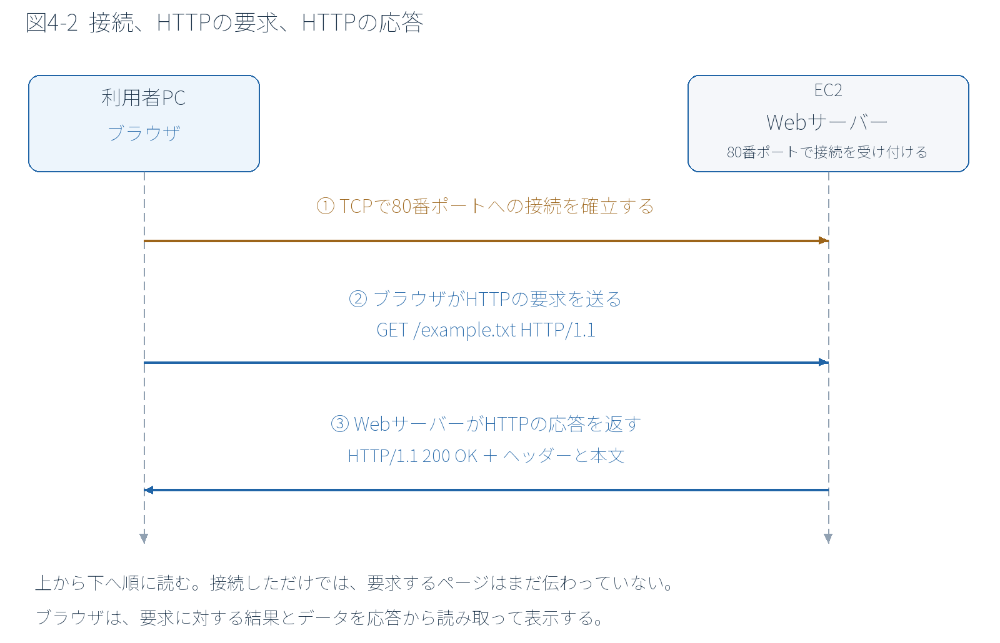
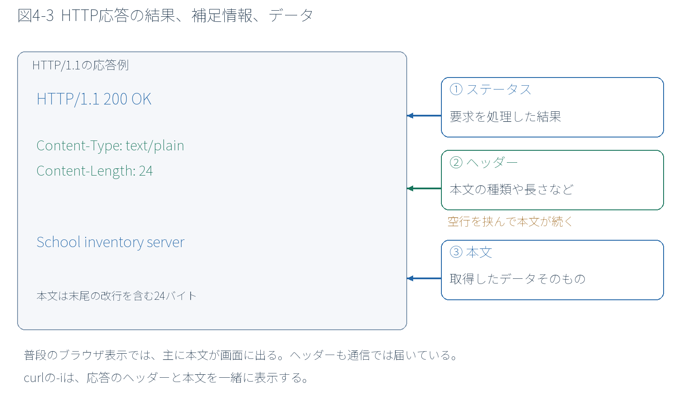

# 第4章 HTTPでページを要求する仕組み

## この章で分かること

学校の備品管理システムで備品一覧を開くと、ブラウザには備品名や数量が表示される。このときブラウザは、自分だけで一覧を作っているのではない。Webサーバーへ「このページを送ってほしい」と要求し、返ってきたデータを画面に表示している。

ブラウザとWebサーバーの間で、要求や返答をどのような形式でやり取りするかを定めるのが**HTTP（Hypertext Transfer Protocol）**である。ブラウザから送るものを**要求（リクエスト）**、Webサーバーから返すものを**応答（レスポンス）**という。

本章では、仕組みを読み取りやすくするために、Webサーバーへ置いた説明用の`example.txt`から短い文章を取得する場面を使う。HTTPの書き方はHTTP/1.1を例にする。備品管理アプリの画面でも、ブラウザから要求し、Webサーバーから応答を受け取るという関係は同じである。

- URLは、接続先と要求するものをどのように指定するのか。
- 接続することと、HTTPで要求することはどう違うのか。
- 要求と応答の中には、何が書かれているのか。
- 404という返答と、応答がない状態では何が違うのか。
- ブラウザの画面とcurlの出力は、それぞれ何を見せているのか。

## 4.1 URLで接続先と要求するものを指定する

ブラウザのアドレス欄へ入力する`http://...`という文字列を**URL（Uniform Resource Locator）**という。URLには、使う通信方式、接続先、ポート番号、要求する対象などを指定する。

例えば、利用者PCからWebサーバーの公開IPを指定して、説明用のファイルを要求するURLを考える。

**URLの例：公開IPは説明用の値である。**

```text
http://203.0.113.20:80/example.txt
```


**図4-1 URLの四つの部分。** `http`は通信方式、`203.0.113.20`は接続先のWebサーバー、`80`は接続先のポート番号、`/example.txt`は要求する対象のパスを表す。この公開IPは文書で説明するための例であり、実際の接続には割り当てられた公開IPを使う。

### IPアドレスとパスでは指定するものが違う

IPアドレスは、どのWebサーバーへ接続するかを指定する。一方、**パス**は、そのWebサーバーに何を要求するかを指定する。例えば同じWebサーバーに対して、`/example.txt`は説明用の文章、`/`はサイトの入口となるページを求める指定として使える。

URLのパスが、サーバーのストレージ上の絶対パスと同じになるとは限らない。Webサーバーの設定によって、`/example.txt`を配信するファイルへ対応付けたり、アプリに処理させたりする。ブラウザはURLで対象を求め、Webサーバー側がその要求をどのように処理するかを決める。

### 省略されたポート番号を読む

HTTPのURLでポート番号を省略すると、通常は80番ポートを使う。このため、次の二つは同じWebサーバーの同じ入口とパスを指定している。

```text
http://203.0.113.20:80/example.txt
http://203.0.113.20/example.txt
```

今回のアプリ管理のように8080番ポートを使う場合は、URLにも`:8080`を付ける。接続先のポート番号を省略したHTTPのURLでは、Webサーバーの80番ポートへ向かう。[HTTPのURLと既定ポート](https://www.rfc-editor.org/rfc/rfc9110.html#section-4.2.1)

## 4.2 接続した後にHTTPの要求を送る

利用者PCのブラウザでHTTPのURLを開くとき、まずブラウザは指定されたWebサーバーの80番ポートへTCPで接続する。接続が確立すると、その通信を使ってHTTPの要求を送る。TCPはデータを届けるための通信方式、HTTPはその上でページなどを要求するための取り決めとして働く。

例えば、80番ポートへ接続できただけでは、どのページを返してほしいかはWebサーバーへ伝わっていない。ブラウザがHTTPで`/example.txt`を要求することで、Webサーバーは何を求められたのかを読み取れる。



**図4-2 接続、要求、応答の順番。** 上から下へ順に読む。接続した後にブラウザが対象を要求し、Webサーバーが処理結果とデータを返す。図は初めて接続して一つの対象を取得する場面を示している。

Webサーバーは要求を読み、指定されたファイルを返すなどの処理を行う。対象を返せる場合も、見つからない場合も、その結果をHTTPの応答としてブラウザへ知らせる。ブラウザは応答を受け取り、その内容に応じてページやエラーの画面を表示する。

実際のブラウザは、一度確立した接続を続けて使うこともある。一つの接続でやり取りできる要求が、必ず一回だけというわけではない。本章では、一回の要求とそれに対する応答を取り出して考える。[HTTP/1.1のメッセージ](https://www.rfc-editor.org/rfc/rfc9112.html)

## 4.3 HTTPの要求には何が書かれているか

### GETで対象を取得する

ブラウザが説明用の文章を求めるHTTP/1.1の要求を、必要な行に絞って示す。

**要求の表示例：端末へ入力するコマンドではない。**

```text
GET /example.txt HTTP/1.1
Host: 203.0.113.20
```

先頭の行には、`GET`、`/example.txt`、`HTTP/1.1`の三つが並ぶ。`GET`は「対象の内容を取得したい」という要求の種類、`/example.txt`は取得したい対象、`HTTP/1.1`は使っているHTTPのバージョンである。

`GET`のように、何をしてほしいかを表す要求の種類を**メソッド**という。備品一覧や詳細を開くときのように、内容を取得する場面では主にGETを使う。ブラウザのアドレス欄にURLを入力する操作も、通常はGETによる取得につながる。[GETメソッド](https://developer.mozilla.org/en-US/docs/Web/HTTP/Reference/Methods/GET)

### ヘッダーで要求に関する情報を付ける

`Host: 203.0.113.20`は、**ヘッダー**の一つである。ヘッダーは`項目名: 値`という形式で、要求に関する補足情報を伝える。

`Host`には、URLで指定した宛先の名前やIPアドレスが入る。名前でアクセスしたときは、その名前が入る。Webサーバーはこの情報を使って、どのサイトに対する要求かを判断できる。一台のWebサーバーが複数のサイトを扱う場合にも使われる。[Webサーバーが要求を処理する仕組み](https://nginx.org/en/docs/http/request_processing.html)

要求でも、ヘッダーの終わりには空行が入る。本文を送る場合は、その空行の後にデータが続く。

名前から接続先のIPアドレスを調べるDNSと、接続後にHTTPの要求の中で宛先を伝えるHostヘッダーは、役割が異なる。今回の例はIPアドレスで直接接続するため、HostヘッダーにもそのIPアドレスを使っている。

### POSTで入力内容を送る

Webアプリの管理画面で備品の名前や数量を入力して保存するときは、入力した内容をWebサーバーへ送る必要がある。このような場面では**POST**というメソッドが使われる。入力値などのデータは、要求の**本文**に入れて送る。

GETは対象の取得、POSTは送ったデータの処理を求める、という違いを押さえておこう。今回の一般向けの備品一覧は閲覧用であり、登録・変更は踏み台サーバーのブラウザから開く管理画面で行う。[POSTメソッド](https://developer.mozilla.org/en-US/docs/Web/HTTP/Reference/Methods/POST)

## 4.4 HTTPの応答には結果とデータが入る

### 状態、ヘッダー、本文を分けて読む

説明用のファイルを返す応答を示す。本文は`School inventory server`という一行の文章とし、末尾の改行を含めて24バイトである。

**応答の表示例：入力するコマンドではない。**

```text
HTTP/1.1 200 OK
Content-Type: text/plain
Content-Length: 24

School inventory server
```

先頭の`HTTP/1.1 200 OK`は、要求を処理した結果を示す行である。`200`は成功を示す番号であり、**ステータスコード**という。`OK`はその状態を説明する語である。

続く`Content-Type`と`Content-Length`は、応答のヘッダーである。`Content-Type: text/plain`は、本文が通常のテキストであることを示す。`Content-Length: 24`は本文の長さをバイト数で示している。

ヘッダーの後には空行があり、その後に**本文**が続く。上の例では`School inventory server`が取得したデータである。ヘッダーはデータの種類などを説明する情報、本文は実際に受け取るデータとして分けて読む。



**図4-3 応答の結果とデータを読み分ける。** 先頭の行で処理結果を読み、ヘッダーで本文の種類などを読み、空行の後でデータそのものを読む。

### ブラウザは本文の種類に応じて表示する

ブラウザでこの応答を受け取ると、通常は本文の文章が表示される。`200 OK`や`Content-Type`などのヘッダーは、普段のページ表示では前面に出てこない。ブラウザがその情報を使って、受け取ったデータをどう扱うか判断する。

HTMLのページを返す場合は、例えば`Content-Type: text/html`を使う。ブラウザはHTMLを読み、文字やリンクなどを配置して画面を作る。ページの中で画像やCSSという表示用のファイルが指定されていれば、ブラウザはそれらを取得するために追加の要求を送ることもある。[HTTPの要求と応答](https://developer.mozilla.org/en-US/docs/Web/HTTP/Guides/Messages)

## 4.5 ステータスコードと通信できない状態を区別する

### 応答が返ってきたときの結果を読む

HTTPのステータスコードは、要求に対してWebサーバーがどのような結果を返したかを表す。以後の構築で出会う主な例を示す。

| ステータス | 何を知らせているか |
| --- | --- |
| `200 OK` | 要求を正常に処理した。GETなら、通常は取得した対象が本文に入る |
| `302 Found` | 別のURLへ移動するよう知らせている。移動先はLocationヘッダーで示す |
| `403 Forbidden` | 要求を理解したが、利用を拒否している |
| `404 Not Found` | 要求した対象が見つからない。存在を知らせないためにこの状態を返す場合もある |
| `500 Internal Server Error` | 要求を処理するサーバー側で、処理を完了できない問題が起きた |
| `502 Bad Gateway` | 中継するWebサーバーが、転送先のサーバーやアプリから正常な応答を得られなかった |

例えば、ブラウザで間違ったパスを指定し、404という返答があったとする。この場合、HTTPの要求を受け取り、応答を返した相手がいる。ただし、その相手が意図したWebサーバーかどうかは、URLの接続先などと合わせて考える必要がある。

302では、ブラウザがLocationヘッダーのURLを自動で開き直すことがある。そのため、最初の返答は302でも、画面には移動先のページが表示される場合がある。ステータスの番号と、最終的に表示されたページを分けて読む。[HTTPステータスコード](https://developer.mozilla.org/en-US/docs/Web/HTTP/Reference/Status)

### HTTPの返答を受け取れない場合

一方、**接続拒否**や**タイムアウト**は、HTTPのステータスコードとは異なる。接続拒否はTCP接続を受け付けてもらえなかった状態、タイムアウトは接続や応答を待っても一定時間内に完了しなかった状態を表す。HTTPの応答を受け取れていない場合には、200や404といったステータスコードを読むこともできない。

例えば、SGで通信が許可されていないために届かない場合と、Webサーバー上のソフトウェアが要求を受け取って403を返した場合では、調べる対象が異なる。403が見えたという理由で、SGが403という応答を作ったと考えてはいけない。

タイムアウトだけでは、接続経路の問題、サーバーの停止、処理の遅れなどのどこに原因があるかを一つに決められない。まず「HTTPの応答が返ったのか」「返ったなら何というステータスと本文だったのか」を分けて読む。

## 4.6 ブラウザとcurlで見える結果を比べる

### curlは応答を文字で読むためにも使える

ブラウザが受け取ったデータをページとして表示するのに対し、**curl**はURLを指定してデータを取得するコマンドである。HTTPの応答を文字で読みたいときにも使える。

例えば、説明用の`example.txt`を配信する設定ができたWebサーバーを、踏み台サーバーから調べる場合を考える。

**実行場所：踏み台サーバーの端末。接続先はWebサーバーの内部IPである。**

```bash
curl -i http://10.20.1.20/example.txt
```

`-i`は、取得した本文と一緒に応答のヘッダーも表示する指定である。4.4のような出力から、先頭のステータス、Content-Type、本文を読み取れる。この出力はWebサーバーから返ってきた応答であり、ブラウザが送った要求を表示しているわけではない。[curlの応答ヘッダー表示](https://curl.se/docs/manpage.html#-i)

この例のURLではポート番号を省略しているため、Webサーバーの80番ポートへ接続する。最初の`curl`は踏み台サーバー上で動き、要求を受けるソフトウェアはWebサーバー上で動く。

`curl -i`は、通常は302で指定された移動先を自動で取得せず、最初の応答を表示する。ブラウザでは移動先のページが見えていても、curlでは302とLocationヘッダーが見える場合がある。どちらも、同じやり取りの異なる部分を見ていることがある。

### 同じ対象でも、どこから取得したかで分かることが違う

| 取得する場所 | 指定するURLと使う入口 |
| --- | --- |
| 利用者PCのブラウザ | `http://203.0.113.20/example.txt`のようにWebサーバーの公開IPを指定し、80番ポートへ接続する |
| 踏み台サーバーのブラウザやcurl | `http://10.20.1.20/example.txt`でWebサーバーの内部IPを指定し、80番ポートへ接続する |
| Webサーバー自身のcurl | `http://127.0.0.1/example.txt`で、そのWebサーバー自身の80番ポートへ接続する |

公開IPの行は説明用の値である。同じパスの文章を取得する場合も、利用者PCから取得した結果はインターネット側からの閲覧、踏み台サーバーから取得した結果はVPC内からの閲覧を示す。Webサーバー自身からの成功だけでは、利用者PCからも取得できるとまでは分からない。

また、200が返っていても、本文がWebサーバーの初期ページや、別の文章であれば、求めていた対象を取得できたことにはならない。URL、ステータス、本文を対応させて読む。curlは通常、404などのHTTP応答もそのまま表示するため、コマンドが終了したことだけで成功と判断しない。

## 4.7 HTTPで届くことと暗号化は別の性質である

今回の説明と構築の基本では、`http://`のURLを使ってHTTPの要求と応答を学ぶ。HTTPのやり取りが成立したことは、必要なページやデータを要求して返してもらえることを示す。一方、`http://`での通信そのものは、通信内容を暗号化する仕組みを備えていない。

インターネットのWebサービスでは、**HTTPS**によりTLSという仕組みで通信を保護することが広く行われている。HTTPSのURLは`https://`で始まり、ポート番号を省略すると通常は443番ポートを使う。Webサーバー側にはTLSや証明書などの設定が必要になる。HTTPの要求・応答の役割と、それを保護する通信の仕組みを分けて理解しておこう。[HTTPとHTTPS](https://www.rfc-editor.org/rfc/rfc9110.html#section-4.2.2)

次の第5章では、本章で説明したHTTPの要求に対して、Webサーバー上のNginxがファイルを返す仕組みと設定を扱う。

## 章末問題

### 問1

`http://203.0.113.20:80/example.txt`のIPアドレス、ポート番号、`/example.txt`は、それぞれ何を指定しているか。

### 問2

HTTP応答のステータス、ヘッダー、本文は、それぞれ何を伝えるためのものか。

### 問3

404という応答を受け取った場合と、タイムアウトしてHTTPの応答を受け取れなかった場合では、分かることがどう違うか。

### 問4

curlで200が表示されたが、本文は求めていた説明用の文章ではなくWebサーバーの初期ページだった。この結果から、目的の文章を取得できたと判断してよいか。

## 章末解答

### 問1

IPアドレスは接続するWebサーバー、80はそのWebサーバーの80番ポート、`/example.txt`はWebサーバーへ要求する対象のパスを指定する。

### 問2

ステータスは要求を処理した結果、ヘッダーは本文の種類などの補足情報、本文は取得した文章やHTMLなどのデータを伝える。ヘッダーと本文の間には空行がある。

### 問3

404では、HTTPの要求に対して応答を返した相手がいることと、その要求に404という結果を返したことが分かる。タイムアウトだけでは、HTTPの処理まで届いたかや、どこで待っていたかを一つに決められない。

### 問4

判断してはいけない。200は要求を正常に処理したことを示すが、求めていた文章かどうかは本文も読んで判断する。接続先、パス、Webサーバーの配信設定などを、表示された内容と合わせて考える。

## 参考資料

確認日：2026-11-03。URL、要求・応答、本文は仕組みを説明するための例である。

- [RFC 9110 HTTP Semantics](https://www.rfc-editor.org/rfc/rfc9110.html)
- [RFC 9112 HTTP/1.1](https://www.rfc-editor.org/rfc/rfc9112.html)
- [MDN HTTP messages](https://developer.mozilla.org/en-US/docs/Web/HTTP/Guides/Messages)
- [MDN HTTP response status codes](https://developer.mozilla.org/en-US/docs/Web/HTTP/Reference/Status)
- [MDN GET](https://developer.mozilla.org/en-US/docs/Web/HTTP/Reference/Methods/GET)
- [MDN POST](https://developer.mozilla.org/en-US/docs/Web/HTTP/Reference/Methods/POST)
- [Nginx How nginx processes a request](https://nginx.org/en/docs/http/request_processing.html)
- [curl manual](https://curl.se/docs/manpage.html)
- [RFC 5737 文書用IPv4アドレス](https://www.rfc-editor.org/rfc/rfc5737.html)
- [第3章](../../output/pdf/web_textbook_ch03_ja.pdf)
