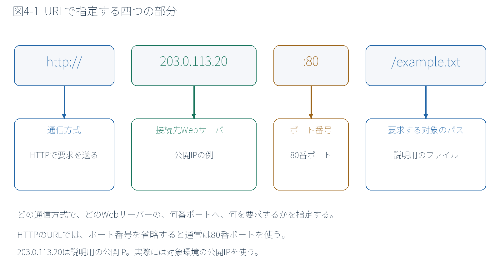

# 第4章 HTTPでページをリクエストする仕組み

## この章で分かること

学校の備品管理システムで備品一覧を開くと、ブラウザには備品名や数量が表示される。このときブラウザは、自分だけで一覧を作っているのではない。Webサーバーへ「このページを送ってほしい」とリクエストし、返ってきたデータを画面に表示している。

ブラウザとWebサーバーの間で、リクエストやレスポンスをどのような形式でやり取りするかを定めるのが**HTTP**（Hypertext Transfer Protocol）である。ブラウザから送るものを**リクエスト**、Webサーバーから返すものを**レスポンス**という。

本章では、仕組みを読み取りやすくするために、Webサーバーへ置いた説明用の`example.txt`から短い文章を取得する場面を使う。HTTPの書き方はHTTP/1.1を例にする。備品管理アプリの画面でも、ブラウザからリクエストし、Webサーバーからレスポンスを受け取るという関係は同じである。

- URLは、接続先とリクエストするものをどのように指定するのか。
- 接続することと、HTTPでリクエストすることはどう違うのか。
- リクエストとレスポンスの中には、何が書かれているのか。
- 404というレスポンスと、レスポンスがない状態では何が違うのか。
- ブラウザの画面とcurlの出力は、それぞれ何を見せているのか。

## 4.1 URLで接続先とリクエストするものを指定する

ブラウザのアドレス欄へ入力する`http://...`という文字列を**URL**（Uniform Resource Locator）という。URLには、使う通信方式、接続先、ポート番号、リクエストする対象などを指定する。

例えば、利用者PCからWebサーバーの公開IPを指定して、説明用のファイルをリクエストするURLを考える。

**URLの例：公開IPは説明用の値である。**

```text
http://203.0.113.20:80/example.txt
```



**図4-1 URLの四つの部分。** `http`は通信方式、`203.0.113.20`は接続先のWebサーバー、`80`は接続先のポート番号、`/example.txt`はリクエストする対象のパスを表す。この公開IPは文書で説明するための例であり、実際の接続には割り当てられた公開IPを使う。

### IPアドレスとパスでは指定するものが違う

IPアドレスは、どのWebサーバーへ接続するかを指定する。一方、**パス**は、そのWebサーバーに何をリクエストするかを指定する。例えば同じWebサーバーに対して、`/example.txt`は説明用の文章、`/`はサイトの入口となるページを求める指定として使える。

URLのパスが、サーバーのストレージ上の絶対パスと同じになるとは限らない。Webサーバーの設定によって、`/example.txt`を配信するファイルへ対応付けたり、アプリに処理させたりする。ブラウザはURLで対象を求め、Webサーバー側がそのリクエストをどのように処理するかを決める。

### 省略されたポート番号を読む

HTTPのURLでポート番号を省略すると、通常は80番ポートを使う。このため、次の二つは同じWebサーバーの同じ入口とパスを指定している。

```text
http://203.0.113.20:80/example.txt
http://203.0.113.20/example.txt
```

今回のアプリ管理のように8080番ポートを使う場合は、URLにも`:8080`を付ける。接続先のポート番号を省略したHTTPのURLでは、Webサーバーの80番ポートへ向かう。[HTTPのURLと既定ポート](https://www.rfc-editor.org/rfc/rfc9110.html#section-4.2.1)

## 4.2 接続した後にHTTPのリクエストを送る

利用者PCのブラウザでHTTPのURLを開くとき、まずブラウザは指定されたWebサーバーの80番ポートへTCPで接続する。接続が確立すると、その通信を使ってHTTPのリクエストを送る。TCPはデータを届けるための通信方式、HTTPはその上でページなどをリクエストするための取り決めとして働く。

例えば、80番ポートへ接続できただけでは、どのページを返してほしいかはWebサーバーへ伝わっていない。ブラウザがHTTPで`/example.txt`をリクエストすることで、Webサーバーは何を求められたのかを読み取れる。


**図4-2 接続、リクエスト、レスポンスの順番。** 上から下へ順に読む。接続した後にブラウザが対象をリクエストし、Webサーバーが処理結果とデータを返す。図は初めて接続して一つの対象を取得する場面を示している。

Webサーバーはリクエストを読み、指定されたファイルを返すなどの処理を行う。対象を返せる場合も、見つからない場合も、その結果をHTTPのレスポンスとしてブラウザへ知らせる。ブラウザはレスポンスを受け取り、その内容に応じてページやエラーの画面を表示する。

実際のブラウザは、一度確立した接続を続けて使うこともある。一つの接続でやり取りできるリクエストが、必ず一回だけというわけではない。本章では、一回のリクエストとそれに対するレスポンスを取り出して考える。[HTTP/1.1のメッセージ](https://www.rfc-editor.org/rfc/rfc9112.html)

## 4.3 GETとPOSTでリクエストの目的を伝える

Webサーバーへリクエストを送るときは、接続先やパスに加え、「何をしてほしいか」も伝える。この目的を表す指定が**HTTPメソッド**である。HTTPには複数のメソッドがあるが、ここでは基本として、**GET**と**POST**の二つを押さえる。

GETは「内容を取得したい」、POSTは「データを送るので処理してほしい」という目的で使う。まず二つを並べて見てみよう。

| メソッド | リクエストの目的 | 備品管理システムでの例 |
| --- | --- | --- |
| GET | ページやファイルなどの内容を取得する | 備品一覧のページを開く |
| POST | データを送り、そのデータに対する処理を求める | 管理画面で備品名や数量を入力し、保存する |

### GET：ページやファイルを取得する

ブラウザで備品一覧を開いたり、説明用のexample.txtを取得したりするときは、GETメソッドのリクエストを使う。アドレス欄へURLを入力してページを開く操作も、通常はGETによる取得につながる。[GETメソッド](https://developer.mozilla.org/en-US/docs/Web/HTTP/Reference/Methods/GET)

**GETリクエストの表示例：端末へ入力するコマンドではない。**

```text
GET /example.txt HTTP/1.1
Host: 203.0.113.20
```

先頭の行の`GET`は取得するという目的、`/example.txt`は取得したい対象、`HTTP/1.1`は使っているHTTPのバージョンを表す。Webサーバーはこの行から、何に対してどの処理を求められたかを読み取る。

次の`Host: 203.0.113.20`は、リクエストの**ヘッダー**の一つである。ヘッダーは`項目名: 値`という形式で、宛先などの補足情報を伝える。この例では、URLで指定したWebサーバーのIPアドレスをHostヘッダーへ入れている。

名前でアクセスした場合は、Hostヘッダーにもその名前が入る。Webサーバーはこの情報を使って、どのサイトへのリクエストかを判断できる。一台で複数のサイトを扱う場合にも使われる。DNSが名前から接続先IPを調べることと、Hostヘッダーでリクエスト先を伝えることは別の役割である。[Webサーバーがリクエストを処理する仕組み](https://nginx.org/en/docs/http/request_processing.html)

Hostなどのヘッダーは、GETだけでなくPOSTのリクエストでも使う。メソッドは処理の目的、ヘッダーは処理に必要な補足情報として区別する。ヘッダーの後には空行が入り、本文がある場合はその後にデータが続く。

### POST：データを送って処理してもらう

管理画面で新しい備品を登録する場面を考える。ブラウザで備品名と数量を入力して「保存」を押すと、入力内容をWebサーバーへ渡し、登録する処理をしてもらう必要がある。このような場面で使う基本のメソッドがPOSTである。[POSTメソッド](https://developer.mozilla.org/en-US/docs/Web/HTTP/Reference/Methods/POST)

POSTのリクエストでは、備品名や数量などのデータをリクエストの**本文**へ入れて送る。Webサーバー側のアプリは、そのデータを受け取って処理し、結果をレスポンスとしてブラウザへ返す。POSTは登録だけに限らず、送ったデータを使うさまざまな処理に使われる。

同じブラウザの操作でも、一覧を開いて内容を受け取る場面と、入力内容を送って保存してもらう場面では、リクエストの目的が違う。今回の一般向けの備品一覧はGETによる閲覧、踏み台サーバーのブラウザから使う管理画面の保存はPOSTによる送信、と結び付けて考える。

## 4.4 HTTPのレスポンスには結果とデータが入る

### curlでレスポンスを表示する

まず、端末にHTTPレスポンスがどのように表示されるかを見てみよう。**curl**は、URLを指定してデータを取得するコマンドである。`-i`は、取得した本文と一緒にレスポンスのヘッダーも表示するオプションである。

Webサーバーの`/example.txt`から、`School inventory server`という一行の文章を返す設定ができている場合を考える。踏み台サーバーの端末で次のコマンドを実行すると、Webサーバーの80番ポートへリクエストが送られる。

**実行場所：踏み台サーバーの端末。接続先はWebサーバーの内部IPである。**

```bash
curl -i http://10.20.1.20/example.txt
```

**表示例：コマンドの実行後に端末へ表示されるレスポンス。日時などの一部のヘッダーは省略している。**

```text
HTTP/1.1 200 OK
Content-Type: text/plain
Content-Length: 24

School inventory server
```

上のコマンドに対して、端末にはステータス、ヘッダー、空行、本文の順に表示される。ブラウザではページとして表示される文章も、curlではこのように文字で読める。

### 表示されたレスポンスを三つに分ける

先頭の`HTTP/1.1 200 OK`は、リクエストを処理した結果を示す行である。`200`は成功を示す番号であり、**ステータスコード**という。`OK`はその状態を説明する語である。

続く`Content-Type`と`Content-Length`は、レスポンスのヘッダーである。`Content-Type: text/plain`は、本文が通常のテキストであることを示す。`Content-Length: 24`は本文の長さをバイト数で示している。この例の本文は、末尾の改行を含めて24バイトである。

ヘッダーの後には空行があり、その後に**本文**が続く。上の例では`School inventory server`が取得したデータである。ヘッダーはデータの種類などを説明する情報、本文は実際に受け取るデータとして分けて読む。


**図4-3 レスポンスの各部分と説明を一組ずつ対応させる。** 左列は一つのHTTPレスポンスを、①ステータス行、②ヘッダー、③本文に分けたもの。右列は同じ番号の部分の意味を示す。同じ高さの枠を矢印で結び、番号と背景色でも対応を示している。ヘッダーと本文の間には空行がある。

### ブラウザは本文の種類に応じて表示する

ブラウザでこのレスポンスを受け取ると、通常は本文の文章が表示される。`200 OK`や`Content-Type`などのヘッダーは、普段のページ表示では前面に出てこない。ブラウザがその情報を使って、受け取ったデータをどう扱うか判断する。

HTMLのページを返す場合は、例えば`Content-Type: text/html`を使う。ブラウザはHTMLを読み、文字やリンクなどを配置して画面を作る。ページの中で画像やCSSという表示用のファイルが指定されていれば、ブラウザはそれらを取得するために追加のリクエストを送ることもある。[HTTPのリクエストとレスポンス](https://developer.mozilla.org/en-US/docs/Web/HTTP/Guides/Messages)

## 4.5 ステータスコードと通信できない状態を区別する

### レスポンスが返ってきたときの結果を読む

HTTPのステータスコードは、リクエストに対してWebサーバーがどのような結果を返したかを表す。以後の構築で出会う主な例を示す。

| ステータス | 何を知らせているか |
| --- | --- |
| `200 OK` | リクエストを正常に処理した。GETなら、通常は取得した対象が本文に入る |
| `302 Found` | 別のURLへ移動するよう知らせている。移動先はLocationヘッダーで示す |
| `403 Forbidden` | リクエストを理解したが、利用を拒否している |
| `404 Not Found` | リクエストした対象が見つからない。存在を知らせないためにこの状態を返す場合もある |
| `500 Internal Server Error` | リクエストを処理するサーバー側で、処理を完了できない問題が起きた |
| `502 Bad Gateway` | 中継するWebサーバーが、転送先のサーバーやアプリから正常なレスポンスを得られなかった |

例えば、ブラウザで間違ったパスを指定し、404というレスポンスがあったとする。この場合、HTTPのリクエストを受け取り、レスポンスを返した相手がいる。ただし、その相手が意図したWebサーバーかどうかは、URLの接続先などと合わせて考える必要がある。

302では、ブラウザがLocationヘッダーのURLを自動で開き直すことがある。そのため、最初のレスポンスは302でも、画面には移動先のページが表示される場合がある。ステータスの番号と、最終的に表示されたページを分けて読む。[HTTPステータスコード](https://developer.mozilla.org/en-US/docs/Web/HTTP/Reference/Status)

### HTTPのレスポンスを受け取れない場合

一方、**接続拒否**や**タイムアウト**は、HTTPのステータスコードとは異なる。接続拒否はTCP接続を受け付けてもらえなかった状態、タイムアウトは接続やレスポンスを待っても一定時間内に完了しなかった状態を表す。HTTPのレスポンスを受け取れていない場合には、200や404といったステータスコードを読むこともできない。

例えば、SG（AWSのSecurity Group）で通信が許可されていないために届かない場合と、Webサーバー上のソフトウェアがリクエストを受け取って403を返した場合では、調べる対象が異なる。403が見えたという理由で、SGが403というレスポンスを作ったと考えてはいけない。

タイムアウトだけでは、接続経路の問題、サーバーの停止、処理の遅れなどのどこに原因があるかを一つに決められない。まず「HTTPのレスポンスが返ったのか」「返ったなら何というステータスと本文だったのか」を分けて読む。

## 4.6 ブラウザとcurlで見える結果を比べる

### ブラウザとcurlでは結果の見せ方が違う

4.4では、踏み台サーバー上で`curl -i`を実行したときの表示を見た。ブラウザが受け取ったデータをページとして表示するのに対し、`curl -i`では、ステータスやヘッダーと本文を文字で読める。表示されるのはWebサーバーから返ってきたレスポンスである。[curlのレスポンスヘッダー表示](https://curl.se/docs/manpage.html#-i)

`curl -i`は、通常は302で指定された移動先を自動で取得せず、最初のレスポンスを表示する。

### 同じ対象でも、どこから取得したかで分かることが違う

| 取得する場所 | 指定するURLと使う入口 |
| --- | --- |
| 利用者PCのブラウザ | `http://203.0.113.20/example.txt`のようにWebサーバーの公開IPを指定し、80番ポートへ接続する |
| 踏み台サーバーのブラウザやcurl | `http://10.20.1.20/example.txt`でWebサーバーの内部IPを指定し、80番ポートへ接続する |
| Webサーバー自身のcurl | `http://127.0.0.1/example.txt`で、そのWebサーバー自身の80番ポートへ接続する |

表の`203.0.113.20`は、説明のために使っている公開IPの例である。実際に接続するときは、AWSのEC2画面でWebサーバーの「パブリックIPv4アドレス」を確認し、そのアドレスに置き換える。

同じパスの文章を取得する場合も、利用者PCから取得した結果はインターネット側からの閲覧、踏み台サーバーから取得した結果はVPC内からの閲覧を示す。Webサーバー自身からの成功だけでは、利用者PCからも取得できるとまでは分からない。

## 4.7 HTTPで届くことと暗号化は別の性質である

今回の説明と構築の基本では、`http://`のURLを使ってHTTPのリクエストとレスポンスを学ぶ。HTTPのやり取りが成立したことは、必要なページやデータをリクエストして返してもらえることを示す。一方、`http://`での通信そのものは、通信内容を暗号化する仕組みを備えていない。

インターネットのWebサービスでは、**HTTPS**によりTLSという仕組みで通信を保護することが広く行われている。HTTPSのURLは`https://`で始まり、ポート番号を省略すると通常は443番ポートを使う。Webサーバー側にはTLSや証明書などの設定が必要になる。HTTPのリクエスト・レスポンスの役割と、それを保護する通信の仕組みを分けて理解しておこう。[HTTPとHTTPS](https://www.rfc-editor.org/rfc/rfc9110.html#section-4.2.2)

次の第5章では、本章で説明したHTTPのリクエストに対して、Webサーバー上のNginxがファイルを返す仕組みと設定を扱う。

## 章末問題

### 問1

`http://203.0.113.20:80/example.txt`のIPアドレス、ポート番号、`/example.txt`は、それぞれ何を指定しているか。

### 問2

HTTPレスポンスのステータス、ヘッダー、本文は、それぞれ何を伝えるためのものか。

### 問3

404というレスポンスを受け取った場合と、タイムアウトしてHTTPのレスポンスを受け取れなかった場合では、分かることがどう違うか。

### 問4

`curl -i`の`-i`は、何を表示するためのオプションか。

## 章末解答

### 問1

IPアドレスは接続するWebサーバー、80はそのWebサーバーの80番ポート、`/example.txt`はWebサーバーへリクエストする対象のパスを指定する。

### 問2

ステータスはリクエストを処理した結果、ヘッダーは本文の種類などの補足情報、本文は取得した文章やHTMLなどのデータを伝える。ヘッダーと本文の間には空行がある。

### 問3

404では、HTTPのリクエストに対してレスポンスを返した相手がいることと、そのリクエストに404という結果を返したことが分かる。タイムアウトだけでは、HTTPの処理まで届いたかや、どこで待っていたかを一つに決められない。

### 問4

取得した本文と一緒に、レスポンスのヘッダーも表示するためのオプションである。出力からステータスやContent-Typeなども読み取れる。

## 参考資料

確認日：2026-11-03。URL、リクエスト・レスポンス、本文は仕組みを説明するための例である。

- [RFC 9110 HTTP Semantics](https://www.rfc-editor.org/rfc/rfc9110.html)
- [RFC 9112 HTTP/1.1](https://www.rfc-editor.org/rfc/rfc9112.html)
- [MDN HTTP messages](https://developer.mozilla.org/en-US/docs/Web/HTTP/Guides/Messages)
- [MDN HTTP response status codes](https://developer.mozilla.org/en-US/docs/Web/HTTP/Reference/Status)
- [MDN GET](https://developer.mozilla.org/en-US/docs/Web/HTTP/Reference/Methods/GET)
- [MDN POST](https://developer.mozilla.org/en-US/docs/Web/HTTP/Reference/Methods/POST)
- [Nginx How nginx processes a request](https://nginx.org/en/docs/http/request_processing.html)
- [curl manual](https://curl.se/docs/manpage.html)
- [RFC 5737 文書用IPv4アドレス](https://www.rfc-editor.org/rfc/rfc5737.html)
- [第3章](../../output/pdf/web_textbook_ch03_ja.pdf)
