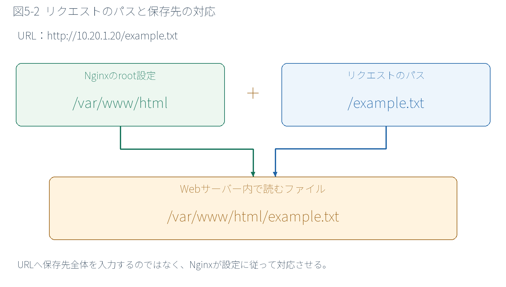
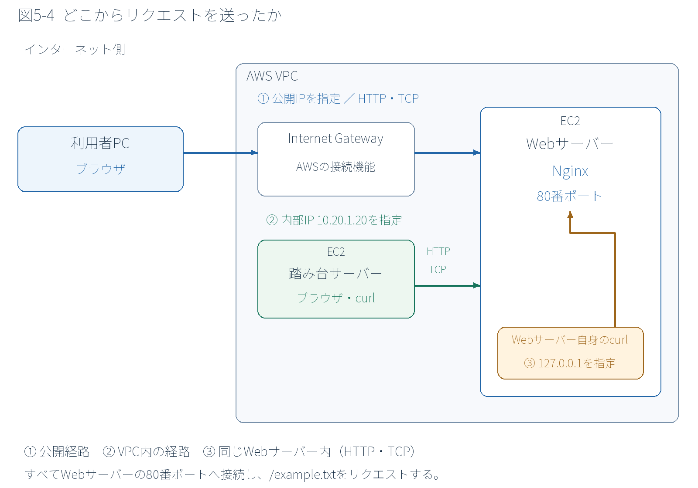

# 第5章 Nginxによる静的ファイルの配信

## この章で分かること

学校の備品管理システムでは、ブラウザからのリクエストを受け取り、ページや画像などを返す入口が必要になる。今回は、Webサーバー上で動かす**Nginx**（エンジンエックス）というソフトウェアが、その入口を担当する。

まずは短い文章を保存したファイルを使い、Nginxがその内容をブラウザへ返す仕組みを理解しよう。これを**静的ファイルの配信**という。ファイルの保存先、Nginxの設定、読み取り権限がどう結び付くかを学び、サービスの状態やログから動作を確かめる。

## 5.1 保存したファイルをHTTPで届ける

例えば、学校の備品管理システムの案内を`example.txt`というファイルへ保存したとする。ファイルに書かれている文章は、次の一行である。

**表示例：Webサーバーに保存する説明用ファイルの内容。**

```text
School inventory server
```

ブラウザでこのファイルのURLを開くと、ブラウザはWebサーバーへGETのリクエストを送る。Webサーバー上のNginxは、そのリクエストに対応するファイルを保存領域から読み、内容をHTTPレスポンスの本文に入れて返す。ブラウザは受け取った本文を画面へ表示する。

このように、保存済みのファイルの内容を返す配信を静的配信という。テキストだけでなく、HTML、画像、画面の見た目を指定するCSSなども静的ファイルとして配信できる。ここでの「静的」は、保存した内容を使うという意味である。管理者がファイルを書き換えれば、以後に取得する内容も変わる。


**図5-1 静的ファイルの内容がブラウザへ届くまで。** 左は踏み台サーバー上のブラウザ、右はEC2 Webサーバーである。青い矢印はVPC内のHTTP通信、緑の矢印はWebサーバー内でのファイルの読み取りと内容の受け渡しを示す。Nginxとファイルは、どちらも右側のWebサーバーの中にある。

後の章では、備品データをDBから読み、その値を使って一覧ページを作るアプリを接続する。まず本章では、保存済みの文章をそのまま届ける流れに注目する。

## 5.2 NginxをWebサーバー上で動かす

### EC2とNginxは何を担当するか

**EC2 Webサーバー**は、Ubuntu OSが動く仮想的なコンピューターである。**Nginx**は、そのUbuntu OSに導入して使うソフトウェアである。EC2が動いていても、Nginxが導入・起動されていなければ、NginxによるHTTPの受付は始まらない。

### 1. 導入する

初回セットアップで、Nginxのパッケージは **配布サーバー** に用意される。**Webサーバー** には、APTが配布サーバー（`10.20.2.30`）を使うための設定が入る。WebサーバーへのNginxのインストールは、P1で行う。

パッケージ一覧が準備できていれば、Webサーバーの端末で次のコマンドを使ってインストールできる。

```bash
sudo apt install nginx
```

このコマンドで、APTはNginxと必要なパッケージを配布サーバーから取得し、Webサーバーにプログラムや初期設定を配置する。P1では、パッケージ一覧の更新からインストールまでを実際に行う。[Ubuntuのパッケージ管理](https://ubuntu.com/server/docs/how-to/software/package-management/#install-a-package)

### 2. 起動する

Ubuntu OSでは、サービスを管理する **systemd** に起動を指示する。Webサーバーで次のコマンドを実行すると、systemdが現在の `nginx` サービスを起動する。インストール時にすでに起動している場合もある。現在動いているかは `systemctl is-active nginx` で確認でき、起動中なら `active` と表示される。[systemctlのサービス管理](https://www.freedesktop.org/software/systemd/man/latest/systemctl.html)

```bash
sudo systemctl start nginx
```

起動すると、Nginxのマスタープロセスが設定を読み込み、ワーカープロセスを管理する。ワーカーが設定されたポートでリクエストを受け取り、ファイルを読んでレスポンスを返す。[Nginxのプロセス構成](https://nginx.org/en/docs/beginners_guide.html)

### 3. 自動起動を設定する

次のコマンドで、Nginxの自動起動を登録する。登録後は、Ubuntu OSが起動するたびにsystemdがNginxを起動するので、そのつど `start` を実行する必要はない。 `systemctl is-enabled nginx` で登録を確認でき、有効なら `enabled` と表示される。[systemctlのenableとis-enabled](https://www.freedesktop.org/software/systemd/man/latest/systemctl.html)

```bash
sudo systemctl enable nginx
```

`enable` 単独で行うのは自動起動の登録である。P1では、**今すぐ起動する操作と自動起動の登録をまとめて**行う `sudo systemctl enable --now nginx` を使う。 `--now` を付けると、systemdにその場での起動も指示できる。

## 5.3 URLのパスとファイルの保存先を対応させる

### 設定ファイルは配信方法を決める

ブラウザで `http://10.20.1.20/example.txt` を開くと、ブラウザは `/example.txt` をリクエストのパスとして送る。**Webサーバー上のNginxプロセス**は、設定に従ってそのパスをWebサーバーのストレージ上のファイルに対応させる。

今回のUbuntuでは、中心となる設定ファイルは`/etc/nginx/nginx.conf`である。その中から別の設定ファイルも読み込む。初期のWebサイトの設定は`/etc/nginx/sites-available/default`にあり、`/etc/nginx/sites-enabled/default`から参照されることで有効になる。`sites-enabled`の参照はシンボリックリンクであり、別の設定内容をもう一組保存しているわけではない。[UbuntuのNginx設定](https://ubuntu.com/server/docs/how-to/web-services/configure-nginx/)

### 四つの設定を短い例で読む

次は、配信方法を読むための`server`ブロックの例である。`nginx.conf`の`http`ブロック内から読み込まれる設定の一部分として示している。

**設定の説明例：80番ポートで受け付け、/var/www/htmlを基準にファイルを探す。**

```nginx
server {
    listen 80;
    root /var/www/html;

    location / {
        try_files $uri $uri/ =404;
    }
}
```

**server**は、Webサイトとして受け付ける接続や処理をまとめるブロックである。**listen 80**は、Webサーバーの80番ポートで接続を受け付ける指定である。**root**は、配信するファイルを探す基準のディレクトリを指定する。**location**は、リクエストのパスに対応する処理をまとめるブロックである。

この例の`location /`は、`/`から始まるパスを扱う。中の`try_files`では、`$uri`に入るリクエストのパスからファイルを探し、続いて`$uri/`でディレクトリを探す。どちらも見つからなければ404を返す。例えば`/example.txt`なら、`root`の値と組み合わせた`/var/www/html/example.txt`を最初に探す。[rootと保存先の対応](https://nginx.org/en/docs/http/ngx_http_core_module.html#root)、[try_files](https://nginx.org/en/docs/http/ngx_http_core_module.html#try_files)



**図5-2 URLのパスから保存先が決まる。** `root /var/www/html`という設定と、`/example.txt`というリクエストのパスを組み合わせる。Nginxが読むファイルは、Webサーバー内の`/var/www/html/example.txt`である。

作業用ディレクトリで `example.txt` を作ったら、Nginxが探す `/var/www/html/example.txt` に配置する。これでURLのパスとファイルの保存先が対応する。

設定内の`root`という語は、ファイルを探す基準を表す。Linuxの管理者ユーザーである`root`とは、使われている場面と意味が異なる。

## 5.4 Nginxがファイルを読めるようにOSの権限を設定する

Ubuntu OSは、ファイルを開くプロセスの実行ユーザーに読み取りを許可するか判断する。自分が管理用の端末でファイルを読めても、Nginxのワーカープロセスが読めるとは限らない。この演習ではワーカーが **www-data** ユーザーで動く。管理者の `root` が読めるファイルでも、 `www-data` に読み取り権限がなければ配信できない。

OSの授業で学んだファイルの権限を思い出そう。 `root:root` は、所有者が `root` ユーザー、所有グループが `root` グループであることを示す。 `0644` の最後の3桁は、左から **所有者・所有グループ・その他のユーザー** の権限を表す。読み取りの `r` は4、書き込みの `w` は2、実行の `x` は1で、許可するものの数を足す。例えば、所有者の `6` は `4 + 2` なので読み書きできる。

今回の `www-data` はこのファイルの所有者でも `root` グループのメンバーでもないため、最後の桁の `4` が適用される。 `4` は読み取り（`r`）なので、ワーカーはファイルの本文を読める。

`/var/www/html/example.txt` を開くときは、ファイルの読み取りに加え、途中の `/`、 `/var`、 `/var/www`、 `/var/www/html` を通過する権限（`x`）も必要である。[Linuxのパス探索と権限](https://man7.org/linux/man-pages/man7/path_resolution.7.html)


**図5-3 Nginxワーカーがファイルを読むための権限。** ①途中のディレクトリを通過する。②ファイルの「その他のユーザー」の権限を使って本文を読む。

配信用ファイルには読み取りを許可する一方で、パスワードや秘密鍵などを同じ公開用ディレクトリへ置かない。`root`で指定した配信範囲には、利用者へ届けるファイルだけを配置する。

## 5.5 保存した設定をNginxへ反映する

### 構文を調べてから再読み込みする

設定ファイルを保存しても、起動中のNginxがすぐに新しい設定へ切り替わるわけではない。まず設定を検査し、その後に**reload**（再読み込み）で起動中のサービスへ反映する。設定を読む検査と、動作中のサービスへの反映を分けて考えよう。

**実行場所：Webサーバーの管理用端末。設定の検査と再読み込みに使うコマンドの例。**

```bash
sudo nginx -t
sudo systemctl reload nginx
```

上の2行は、1行目の検査に成功したことを確認してから2行目へ進む。`nginx -t`の`-t`は、設定の構文と参照するファイルを検査するオプションである。例えばセミコロンが欠けていれば、問題のあるファイル名や行番号が表示される。`syntax is ok`と`test is successful`は、検査が成功したときの表示である。[Nginxの検査オプション](https://nginx.org/en/docs/switches.html)

`systemctl reload nginx`は、起動中のNginxへ設定の再読み込みを指示する。Nginxは新しい設定を適用できるか調べ、適用できれば新しい設定で処理を始める。設定変更があるときのreloadと、停止中のサービスを動かすstartは、それぞれ目的が違う。[Nginxの設定再読み込み](https://nginx.org/en/docs/control.html)

### 状態を調べるコマンドは、見る対象が違う

次の表は、Webサーバーの管理用端末で使うコマンドと、それが調べる対象の対応である。

| コマンド | 調べる対象 |
| --- | --- |
| `sudo nginx -T` | 検査を行い、読み込み対象となる設定ファイル全体を表示する |
| `systemctl is-active nginx` | Nginxサービスが現在起動しているかを調べる |
| `sudo ss -lntp` | TCPの待受IP、ポート番号、対応するプロセスを表示する |
| `curl -i http://127.0.0.1/example.txt` | Webサーバー自身の80番ポートへ接続し、HTTPレスポンスを表示する |

## 5.6 接続する場所によって確認できる範囲が違う

利用者PC、踏み台サーバー、Webサーバー自身では、Webサーバーへ接続する経路が異なる。いずれも同じ`/example.txt`を取得する場合でも、どこからリクエストを送ったかによって、確かめられる範囲が変わる。



**図5-4 三つの場所からWebサーバーを見る。** 上段は利用者PCからインターネットとAWSのInternet Gatewayを経由する接続、中段はVPC内の踏み台サーバーからの接続、下段はWebサーバー自身の内部で完結する接続である。どの場合も、HTTPのリクエスト先はWebサーバーの80番ポートである。

| 取得する場所 | 接続先と確認する範囲 |
| --- | --- |
| ① 利用者PCのブラウザ | Webサーバーの現在の公開IPを使ったURL。インターネット側からの接続と配信を確かめる |
| ② 踏み台サーバーのブラウザやcurl | `http://10.20.1.20/example.txt`。VPC内からWebサーバーへ接続して配信を確かめる |
| ③ Webサーバー自身のcurl | `http://127.0.0.1/example.txt`。Nginxの配信を同じWebサーバー内で確かめる |

ページが表示されないときは、上の三つの経路を使って、どこまで通信できるかを調べる。取得できた場所とできなかった場所を比べると、次に確認する設定を絞り込める。

例えばWebサーバー自身からは取得できるのに、踏み台サーバーから接続できない場合、Nginxがファイルを返す処理は動いている。次は待受IPや接続先の内部IP、SG（AWSのSecurity Group）による通信許可など、踏み台サーバーから届くまでの範囲に注目する。

踏み台サーバーからは取得できるのに、利用者PCから接続できない場合は、現在の公開IPやインターネット側からの通信許可などを調べる。このように、接続できた場所とできなかった場所を比べると、調べる範囲を絞れる。

## 5.7 リクエストとログを結び付ける

### アクセスログには処理したリクエストが残る

ブラウザやcurlで取得した結果に加え、Webサーバー側でも何が起きたかを読むことができる。Nginxの**アクセスログ**には、リクエストを送った相手、時刻、パス、レスポンスのステータスなどが記録される。今回の静的配信では、`/var/log/nginx/access.log`を読む。

**実行場所：Webサーバーの管理用端末。アクセスログの末尾20行を表示する例。**

```bash
sudo tail -n 20 /var/log/nginx/access.log
```

**表示例：踏み台サーバーからのリクエストに対応する、アクセスログの1行。**

```text
10.20.1.10 - - [03/Nov/2026:10:00:00 +0500]
"GET /example.txt HTTP/1.1" 200 24 "-" "curl/8.x"
```

上は読みやすく2行に分けているが、実際のログでは1行に続いて記録される例である。`10.20.1.10`はリクエストの送信元である踏み台サーバー、角括弧の中は時刻、`GET /example.txt HTTP/1.1`は受け付けたリクエストを表す。続く`200`はレスポンスのステータス、`24`は送信した本文のバイト数である。この形式では末尾に、クライアントの種類などの情報も記録される。[Nginxのアクセスログ形式](https://nginx.org/en/docs/http/ngx_http_log_module.html)

ブラウザやcurlでアクセスした時刻とパスを手掛かりに、その操作に対応するログを探す。同じファイルの古い記録が残っていることもあるため、パスだけでなく時刻や送信元も合わせて読む。ブラウザが画像なども取得した場合には、開いたページ以外のリクエストが記録されることもある。

### エラーログでは問題の手掛かりを読む

**エラーログ**には、設定やファイルへのアクセスなどで起きた問題が記録される。今回のNginxでは、`/var/log/nginx/error.log`がその保存先である。例えば`Permission denied`が含まれる場合は読み取りや通過の権限、`No such file or directory`が含まれる場合は記録された保存先とファイルの有無が手掛かりになる。[Nginxのエラーログ](https://nginx.org/en/docs/ngx_core_module.html#error_log)

アクセスログは「どのリクエストを、どの結果で処理したか」、エラーログは「処理中に何が問題になったか」を読むために使う。設定でログの保存先を変えた場合は、その設定に書かれたファイルを読む。

### セキュリティ調査にもログを使う

Nginxのログは、配信のエラーを調べるときに加え、不審なアクセスや侵入の可能性を調べるときにも使える。アクセスログの時刻、送信元IP、リクエスト先、レスポンスのステータスを手掛かりに、普段と違う動きを探す。

例えば、備品一覧を配信するサーバーに、普段使われないURLへのリクエストが短時間に大量に届き、404が続いたとする。どのURLが続けてリクエストされたかを見ると、公開されている入口を探す動きの手掛かりになる。アプリの導入後は、URLに記録された入力値から、入力をSQLの命令として処理させようとする **SQLインジェクション** の試みが疑われることもある。

侵入の可能性を調べるときは、不審なリクエストがあった時間帯を起点に、OSのログイン記録やアプリ・DBの記録も照合する。どの処理や変更まで行われたかは、それを記録するログで確認する。[OWASPのログ記録ガイド](https://cheatsheetseries.owasp.org/cheatsheets/Logging_Cheat_Sheet.html#which-events-to-log)

練習・課題1では、Webサーバー上でNginxを動かし、指定されたファイルをHTTPで配信する構成を作る。その後にアプリを導入しても、既存の静的ファイルを取得するURLは引き続き利用できるようにする。

次の第6章では、IPアドレスを直接指定する代わりに、名前から接続先を調べるDNSの仕組みを学ぶ。

## 章末問題

### 問1

`root /var/www/html`という設定で`/example.txt`をリクエストしたとき、Nginxが探すファイルの保存先を答えなさい。

### 問2

管理者はファイルを読めるのに、Nginxはそのファイルを配信できない。ファイルと、その途中のディレクトリについて、誰のどの権限を調べる必要があるか。

### 問3

Nginxの設定ファイルを保存した。起動中のサービスに設定を反映する前に何を調べ、その後どの操作を行うか。

### 問4

Webサーバー自身からはファイルを取得できるが、踏み台サーバーからは接続できない。Webサーバー自身からの結果で分かることと、次に調べる範囲を説明しなさい。

### 問5

アクセスログで、自分が直前に行った`/example.txt`へのアクセスを見つけたい。どの情報を対応させて読むか。

## 章末解答

### 問1

Webサーバー内の`/var/www/html/example.txt`である。rootで指定した基準のディレクトリと、リクエストのパスを組み合わせる。

### 問2

Nginxのワーカープロセスを動かすwww-dataの権限を調べる。対象ファイルには読み取り権限が必要であり、そこへ到達するまでの各ディレクトリには通過する権限が必要である。

### 問3

まず`sudo nginx -t`で設定の構文と参照ファイルを検査する。成功したことを確認してから、`sudo systemctl reload nginx`で再読み込みを指示する。

### 問4

同じWebサーバー内ではNginxへ接続でき、ファイルの配信が動いている。次は、Nginxの待受IP・ポート、踏み台サーバーから指定した内部IP、両サーバー間の通信許可などを調べる。

### 問5

アクセスした時刻、送信元、`GET /example.txt`というリクエストのパス、レスポンスのステータスを対応させる。古い同じパスの記録と、直前の操作の記録を区別する。

## 参考資料

確認日 2026-11-24。設定断片、ファイルの本文、レスポンスやログは仕組みを説明するための例である。

- [Nginx Beginner’s Guide](https://nginx.org/en/docs/beginners_guide.html)
- [Nginx root](https://nginx.org/en/docs/http/ngx_http_core_module.html#root)
- [Nginx try_files](https://nginx.org/en/docs/http/ngx_http_core_module.html#try_files)
- [Nginx command-line parameters](https://nginx.org/en/docs/switches.html)
- [Nginx Controlling nginx](https://nginx.org/en/docs/control.html)
- [Nginx access_logとログ形式](https://nginx.org/en/docs/http/ngx_http_log_module.html)
- [Nginx error_log](https://nginx.org/en/docs/ngx_core_module.html#error_log)
- [OWASP Logging Cheat Sheet](https://cheatsheetseries.owasp.org/cheatsheets/Logging_Cheat_Sheet.html)
- [Ubuntu Server Nginx configuration](https://ubuntu.com/server/docs/how-to/web-services/configure-nginx/)
- [Linux man-pages path_resolution(7)](https://man7.org/linux/man-pages/man7/path_resolution.7.html)
- [systemd systemctl](https://www.freedesktop.org/software/systemd/man/latest/systemctl.html)
- [ss(8)](https://man7.org/linux/man-pages/man8/ss.8.html)
- [第4章](../../output/pdf/web_textbook_ch04_ja.pdf)
- [練習P1](../../../labs/docs/ja/p1.md)
