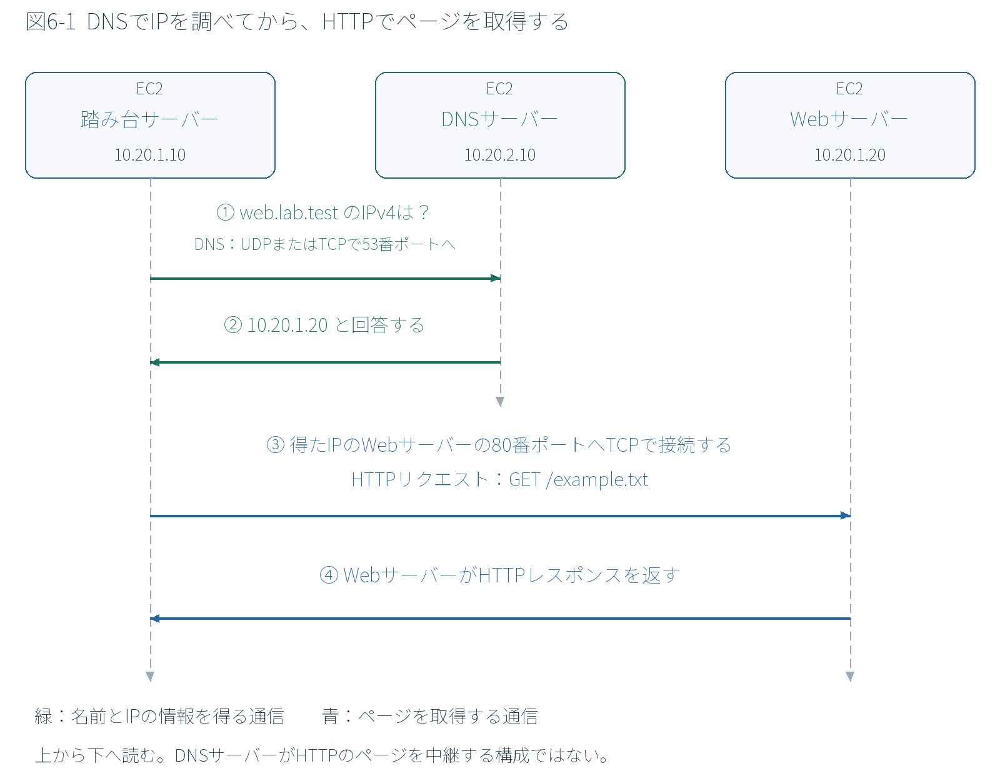
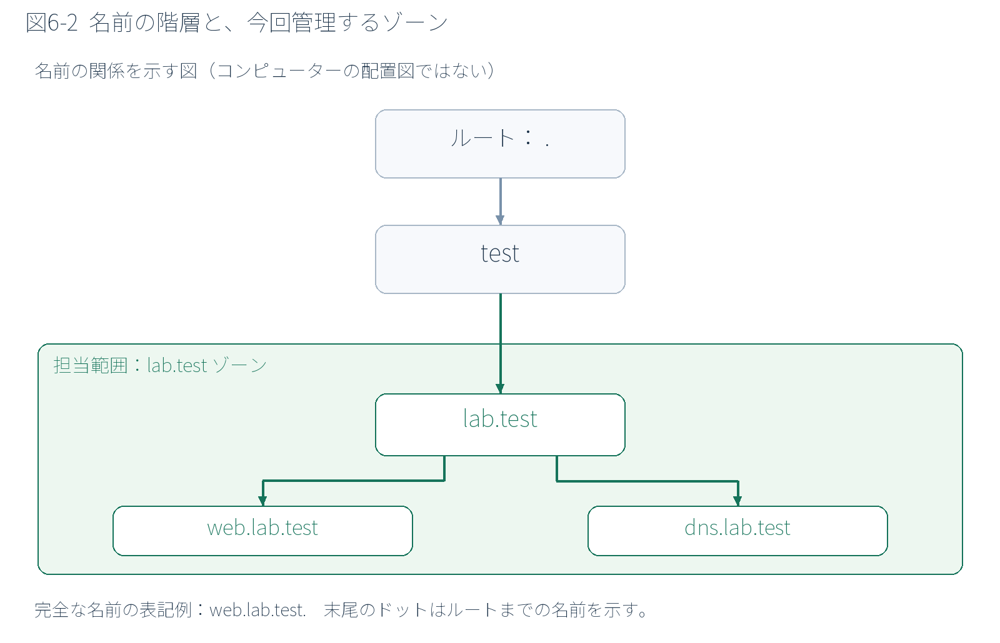
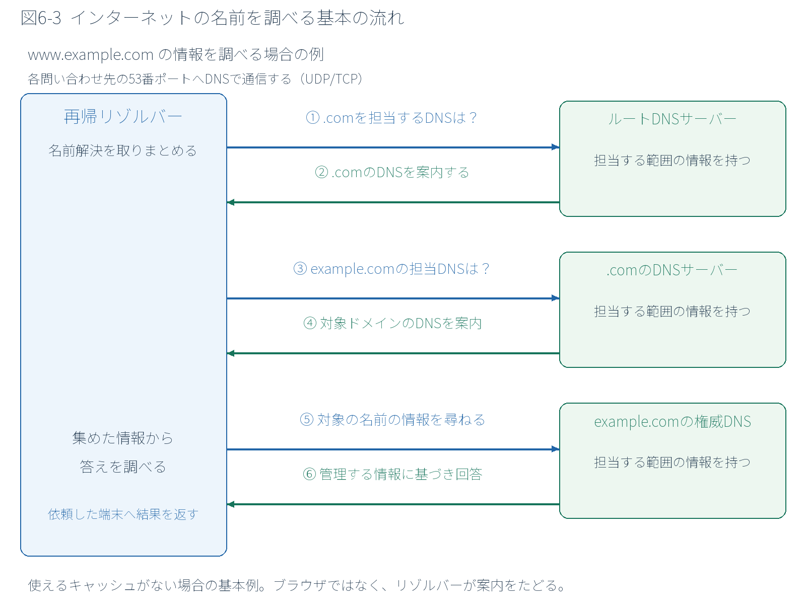
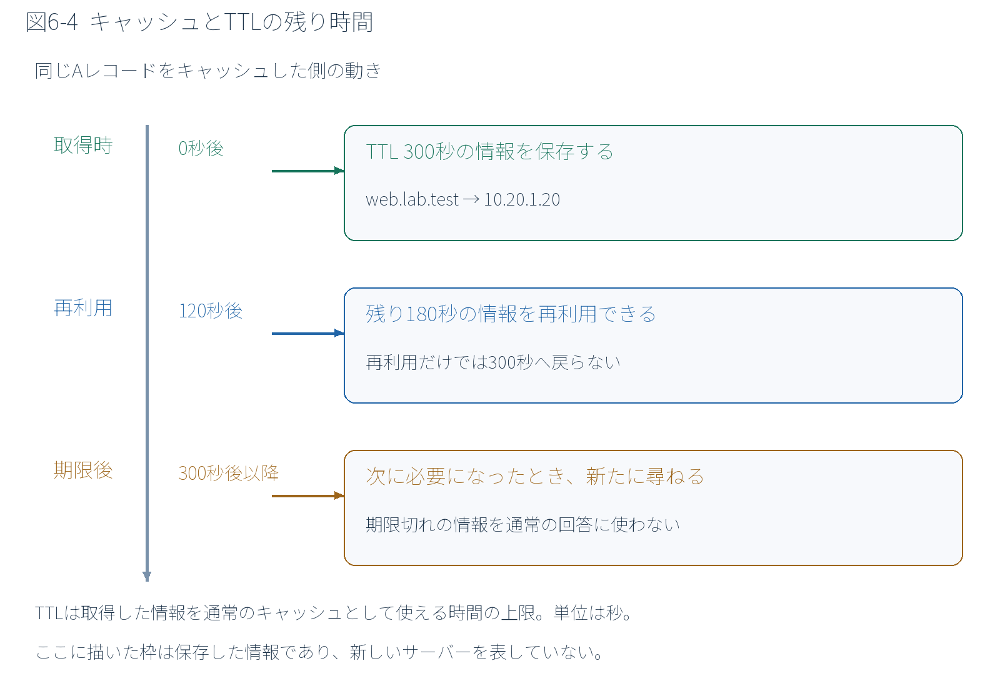
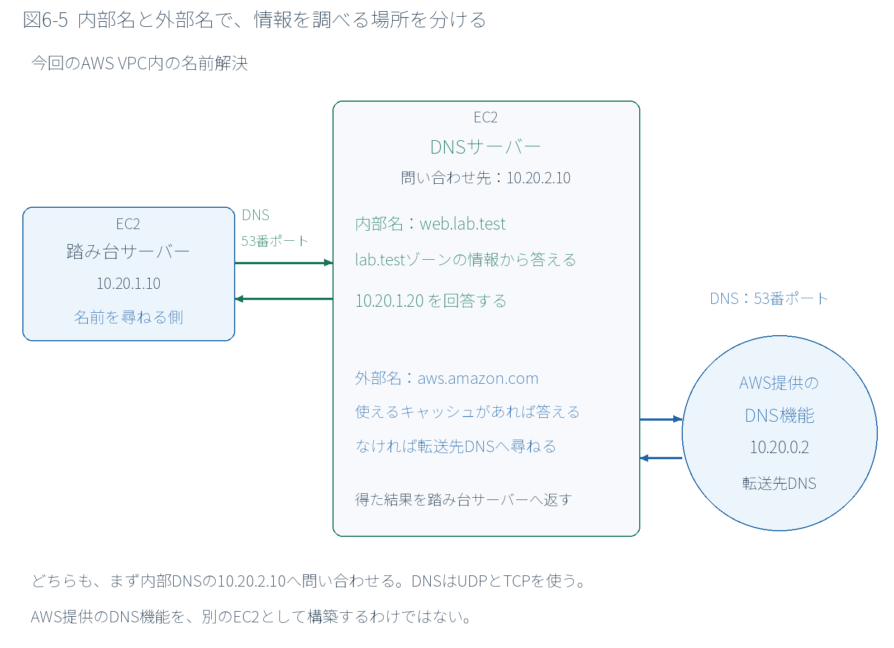

# 第6章 DNSによる名前解決の仕組み

## この章で分かること

前章では、WebサーバーのIPアドレスを指定してファイルを取得した。例えば、踏み台サーバーのブラウザで`http://10.20.1.20/example.txt`を開くと、Webサーバーへ接続できる。しかし、サーバーが増えるたびにIPアドレスを覚えたり、接続先を変更するたびに利用者へ新しい番号を知らせたりするのは大変である。

そこで、`web.lab.test`のような名前から、接続先のIPアドレスを調べる仕組みを使う。この仕組みを支えるのが**DNS（Domain Name System）**である。本章では、名前を入力してからIPアドレスを受け取り、Webサーバーへ接続するまでを順に説明する。今回構築するのは、学校の備品管理システムの内部で使うDNSである。

## 6.1 名前から接続先のIPアドレスを調べる

### 名前は人が接続先を指定する手掛かりになる

例えば、`web.lab.test`という名前と`10.20.1.20`というIPアドレスを対応付ける。利用者は名前を使ってWebサーバーを指定し、コンピューターは調べたIPアドレスを使って通信する。このように、名前に対応するIPアドレスなどの情報を調べることを**名前解決**という。

DNSは、名前とIPアドレスだけでなく、さまざまな種類の情報を扱う。本章では、まず「この名前に対応するIPv4アドレスは何か」を調べる場合に注目する。

### ブラウザに名前を入力した後の流れ

踏み台サーバーのブラウザで`http://web.lab.test/example.txt`を開く場面を考える。踏み台サーバーは、内部DNSを使えるように設定されているものとする。名前解決の結果がまだ保存されていない場合、次の順に処理が進む。

1. ブラウザはURLを読み、接続先の名前が`web.lab.test`であると分かる。

2. 踏み台サーバーの名前解決の仕組みが、設定されたDNSサーバーへ「web.lab.testのIPv4アドレスは何か」と問い合わせる。

3. DNSサーバーは、自分が管理する情報から`10.20.1.20`と回答する。

4. 踏み台サーバーは、そのIPアドレスを接続先として、Webサーバーの80番ポートへTCPで接続する。

5. ブラウザは`/example.txt`へのHTTPリクエストを送り、WebサーバーからHTTPレスポンスを受け取る。



**図6-1 名前を調べる通信と、ページを取得する通信。** 上から順に読む。緑の矢印ではDNSサーバーへ名前を尋ね、青の矢印ではWebサーバーへHTTPのリクエストを送る。HTTPの通信相手はWebサーバーであり、DNSサーバーを経由してページを取得するわけではない。

このURLでDNSへ尋ねるのは`web.lab.test`の情報である。`http://`という通信方式、80番という接続先ポート、`/example.txt`というファイルのパスは、ブラウザがHTTPで接続・リクエストする際に使う。DNSへURL全体を渡してページを探してもらう仕組みではない。[DNSの名前と問い合わせ](https://www.rfc-editor.org/rfc/rfc1034.html)

## 6.2 今回使う名前の範囲を理解する

### ドメイン名は階層を持つ

`web.lab.test`のような名前を**ドメイン名**という。ドットで区切られた一つずつの部分は**ラベル**である。名前の階層は右側から読むと分かりやすい。`test`という範囲の中に`lab.test`があり、その中に`web.lab.test`という名前がある。

DNSの名前の階層は、最上位の**ルート**から始まる。ルートは`.`で表される。ルートまで省略せずに書いた名前が**FQDN（Fully Qualified Domain Name）**であり、設定ファイルでは`web.lab.test.`のように末尾のドットまで書くことで、その名前が完結していると示せる。ブラウザのURLでは、通常は末尾のドットを省いて入力する。[DNSの名前とFQDN](https://www.rfc-editor.org/rfc/rfc9499.html)



**図6-2 名前の階層と、担当するゾーン。** 図は名前の関係を示している。今回のDNSサーバーは、色の付いた`lab.test`の範囲を担当する。枠は名前の管理範囲を表し、コンピューターの配置を表すものではない。

DNSサーバーが情報を管理するひとまとまりの範囲を**ゾーン**という。今回は`lab.test`ゾーンに、Webサーバーなどの名前とIPアドレスを登録する。名前の階層の一部を別のDNSへ任せる場合もあるが、今回の`lab.test`は一つのゾーンとして管理する。

### 今回の内部DNSと、スマートフォンが普段使うDNS

**今回構築するDNSは、備品管理システムの内部だけで使う内部DNSである。** VPC内のDNSサーバーが`lab.test`の情報を持ち、踏み台サーバーとWebサーバーを、そのDNSへ問い合わせるように設定する。

一方、普段スマートフォンでインターネットのホームページを開くときは、携帯電話回線やWi-Fiなどを通じて利用するDNSの仕組みが使われる。そこへ今回の`lab.test`の情報を公開登録する作業は行わない。`test`は試験用に予約された名前であり、今回の名前はインターネットに公開するドメインとして扱わない。[試験用の.test](https://www.rfc-editor.org/rfc/rfc2606.html)

例えば、設定済みの踏み台サーバーのブラウザでは、`http://web.lab.test/example.txt`を開ける。同じURLを、普段のインターネット接続を使っているスマートフォンのブラウザに入力しても、今回のWebサーバーのIPアドレスは得られない。スマートフォンが問い合わせる先には、今回の内部DNSに登録した情報がないからである。また、スマートフォンからVPC内のDNSサーバーへ直接問い合わせる接続経路も用意していない。

| 比べる点 | 今回構築する内部DNS | インターネットに公開するDNS情報 |
| --- | --- | --- |
| 名前を使う範囲 | 備品管理システムの内部 | インターネット上の利用者に使ってもらう範囲 |
| 情報の置き場所 | VPC内のDNSサーバーが管理するlab.testゾーン | 対象ドメインを担当する公開のDNSサーバー |
| スマートフォンからの利用 | 普段の回線・DNS設定のままでは今回の内部名を解決できない | 普段使うDNSの仕組みを通じて公開された情報を調べる |

### 「権威DNS」は、名前の情報を答える役割を表す

自分が担当するゾーンの情報を管理し、その情報に基づいて回答するDNSを**権威DNS**という。「内部・公開」は情報を使う範囲を分ける言い方であり、「権威DNS」は情報を管理して回答する役割を表す。今回の内部DNSも、`lab.test`ゾーンについては権威DNSである。インターネット向けのDNSにも、それぞれのドメインを担当する権威DNSがある。

## 6.3 名前を尋ねる側と、情報を持つ側を分ける

### リゾルバーが問い合わせを担当する

ブラウザなどのアプリから名前解決を頼まれ、必要な問い合わせを行う仕組みを**リゾルバー**という。端末やサーバーのOSには、名前解決を依頼するための仕組みがある。その依頼を受けて、他のDNSへ問い合わせながら答えを調べるDNSサーバーも、リゾルバーの役割を担う。

例えば、踏み台サーバー上のブラウザは、Ubuntu OSの名前解決の仕組みへ接続先を尋ねる。OS側では、設定されたDNSサーバーへ問い合わせる。ブラウザで名前を使うには、名前を登録するDNSサーバー側の設定と、そのDNSを使う踏み台サーバー側の設定の両方が必要になる。

### インターネットの名前は、複数のDNSが分担する

インターネット上のすべての名前を、一台のDNSサーバーが一覧として持つわけではない。名前の階層に応じて、担当するDNSが情報を分担する。例えば、リゾルバーが`www.example.com`を調べる際、使える情報が保存されていなければ、ルートDNS、`.com`のDNS、対象ドメインの権威DNSというように、問い合わせ先の案内をたどって情報を得る。

ルートDNSは、すべてのWebサーバーのIPアドレスを返すのではなく、次にどの範囲のDNSへ尋ねればよいかを案内する。`.com`のDNSは、`example.com`を担当するDNSを案内する。その案内をたどって、リゾルバーが必要な情報を調べ、依頼した側へ結果を返す。



**図6-3 インターネットのDNSが情報を分担する。** 左は名前解決を取りまとめるリゾルバー、右は名前の階層を担当する各DNSである。必要な案内や回答が保存されていない場合の基本の流れを示す。ブラウザ自身が順にすべてのDNSへ直接尋ねる図ではない。

問い合わせを取りまとめる役割を**再帰リゾルバー**という。次の問い合わせ先を自分でたどる方法に加え、他のリゾルバーへ調査を依頼する方法もある。後者の依頼先が**フォワーダー（転送先DNS）**である。[DNSの問い合わせ処理](https://www.rfc-editor.org/rfc/rfc1034.html#section-4.3.1)

### 今回は一台のBINDが二つの役割を担う

今回のDNSサーバーでは、**BIND 9**というDNSソフトウェアをUbuntu OS上で動かす。BINDは、`lab.test`については自分が持つゾーン情報から回答する。それ以外の名前については、許可された問い合わせ元からの依頼を受け、転送先DNSを使って名前解決を取りまとめる。

つまり、権威DNSとリゾルバーという二つの役割を、今回の一台のDNSサーバーが担う。役割の名前が二つあっても、別々のEC2を追加するという意味ではない。具体的な転送先との関係は6.6で説明する。[BINDによるDNSの構成](https://bind9.readthedocs.io/en/v9.18.39/chapter1.html)

## 6.4 名前の情報をレコードとして記録する

### レコードの種類で、情報の意味が変わる

DNSへ登録する一件ずつの情報を**リソースレコード**、または単に**レコード**という。レコードには種類があり、何の情報かを区別している。

| 種類 | 表す情報 | 今回の構成での例 |
| --- | --- | --- |
| A | 名前に対応するIPv4アドレス | web.lab.testに対する10.20.1.20 |
| NS | ゾーンを担当するDNSサーバーの名前 | lab.testを担当するdns.lab.test |
| SOA | ゾーンの管理情報 | 更新番号や更新確認の間隔など |
| CNAME | 別の名前を参照する別名 | ある名前を別の名前へ対応させる |

NSレコードに書くのは、担当するDNSサーバーの**名前**である。そのDNSサーバーへIPv4で接続するには、対応するAレコードなどでIPアドレスも分かる必要がある。CNAMEはIPアドレスを直接登録するものではなく、参照先の名前からさらに情報を調べる。[DNSレコードの種類](https://www.rfc-editor.org/rfc/rfc1035.html#section-3.3)

### Aレコードの一行を読む

次は、`web.lab.test`に対してIPv4アドレスを答える情報の例である。

**レコードの説明例：コマンドとして実行するものではない。**

```text
web.lab.test.  300  IN  A  10.20.1.20
```

| 部分 | 意味 |
| --- | --- |
| web.lab.test. | 情報を登録する名前。末尾のドットまで書いた完全な名前 |
| 300 | TTL。受け取った側が、この情報を通常のキャッシュとして使える時間の上限を秒で示す |
| IN | インターネットで一般的に使われるDNSのクラス。内部DNSでもこのクラスを使う |
| A | IPv4アドレスを表すレコードの種類 |
| 10.20.1.20 | この名前に対応するIPv4アドレス |

### ゾーンファイルでは、基準の名前を使って短く書ける

BINDでは、ゾーンの情報を**ゾーンファイル**に記録できる。次は`lab.test`ゾーンを読むための説明例である。

**ゾーンファイルの説明例：設定全体ではなく、レコードの読み方を示す例。**

```text
$ORIGIN lab.test.
$TTL 300
@ IN SOA dns.lab.test. hostmaster.lab.test. (
    2026110301 3600 600 604800 300 )
@   IN NS dns.lab.test.
dns IN A 10.20.2.10
web IN A 10.20.1.20
```

`$ORIGIN lab.test.`は、このファイルで使う名前の基準を指定する。`web`のように末尾のドットがない名前は、基準を補って`web.lab.test.`として読む。`@`は基準そのもの、ここでは`lab.test.`を表す。`$TTL 300`は、個別にTTLを指定していないレコードの既定値を300秒にする。[BINDのゾーンファイル](https://bind9.readthedocs.io/en/v9.18.39/chapter3.html#example-com-base-zone-file)

SOAの`dns.lab.test.`は主となるDNSサーバーの名前であり、`hostmaster.lab.test.`は管理者のメールアドレスを表す書式である。この例では`hostmaster@lab.test`を意味する。

SOAの括弧の中の先頭にある`2026110301`は、ゾーンの更新番号である**serial（シリアル）**を表す。レコードを変更するときは、この番号も増やす。続く値は順に、別のDNSサーバーが更新を確かめる間隔、失敗したときの再試行間隔、更新できない状態で情報を保持する期限、名前が存在しないなどの否定回答をキャッシュするときに関わる時間である。ここでは、それぞれゾーン管理のための秒数と押さえておこう。

serialは「ゾーン情報の版」を区別する番号であり、次節のTTLは「受け取った情報をキャッシュで使える時間」を表す。serialを増やすことと、すでに保存されたキャッシュの期限が切れることは、別の働きである。

## 6.5 キャッシュとTTLで、同じ問い合わせを減らす

### 毎回すべてのDNSへ問い合わせるわけではない

**キャッシュ**とは、取得した情報を一時的に保存して再利用する仕組みである。名前解決では、OSやリゾルバーなどが、以前に取得したDNS情報を保存することがある。使える情報がキャッシュにあれば、その情報を使うことで問い合わせの回数と待ち時間を減らせる。

例えば、踏み台サーバー側で`web.lab.test`のIPアドレスを保存していれば、同じ名前をもう一度使ったときに、その情報を再利用できる場合がある。ページを開くたびに、必ず内部DNSへ新しい問い合わせが届くとは限らない。

### TTLは、情報を使える時間を制限する

**TTL（Time to Live）**は、受け取ったDNS情報をキャッシュとして使える時間の上限である。例えばTTLが300秒なら、取得した時点から通常は最大300秒まで、その情報を再利用できる。120秒後なら残りは180秒であり、使うたびに300秒へ戻るわけではない。



**図6-4 キャッシュの期限は、取得してからの経過時間で減る。** 300秒のTTLを持つ情報をキャッシュする側の動きを示す。期限の後に同じ情報が必要になった場合は、通常、新たな問い合わせで取得する。図中の枠は保存した情報を表し、別のサーバーを表すものではない。

DNSサーバーでIPアドレスの登録を変更しても、他の端末やリゾルバーが以前の情報をまだキャッシュしていれば、しばらく以前のIPアドレスを使うことがある。このため、DNSサーバー側の変更が、すべての端末へ同時に反映されるとは限らない。[DNSのTTLとキャッシュ](https://www.rfc-editor.org/rfc/rfc2181.html#section-8)

また、「その名前は存在しない」という回答も、一定時間キャッシュされることがある。存在しなかった名前を後から追加したときも、以前の否定回答が残っている側では、すぐに新しい情報を使えない場合がある。[否定回答のキャッシュ](https://www.rfc-editor.org/rfc/rfc2308.html)

## 6.6 内部の名前と外部の名前で、答えを調べる場所が違う

### lab.testの情報は内部DNSが持つ

今回のDNSサーバーの内部IPは`10.20.2.10`である。踏み台サーバーから`web.lab.test`を尋ねると、DNSサーバー上のBINDが担当する`lab.test`ゾーンを調べ、登録したIPアドレスを回答する。

担当するゾーンの中に名前が存在しなければ、BINDはその名前が存在しないと回答する。例えば`absent.lab.test`が未登録で、その下の名前も存在しない場合は、**NXDOMAIN**という結果になる。自分が担当するゾーンの名前を、見つからないからという理由で外部のDNSへ探しに行く処理にはしない。

### 外部の名前は、転送先DNSへ調査を依頼する

一方、`aws.amazon.com`のような外部の名前は、今回の`lab.test`ゾーンの情報には入っていない。使えるキャッシュもなければ、BINDは設定されたフォワーダーへ問い合わせる。今回は、AWSが提供するDNSの機能を転送先に使い、そのアドレスを`10.20.0.2`とする。

このAWSのDNSは、EC2上に自分で構築する内部DNSとは別の、AWSが提供する名前解決のサービスである。今回のVPCは`10.20.0.0/16`なので、VPCのネットワークアドレスに2を加えた`10.20.0.2`でも利用できる。[AWSが提供するDNS](https://docs.aws.amazon.com/vpc/latest/userguide/AmazonDNS-concepts.html)



**図6-5 内部の情報と、外部の情報の調べ方。** 左の踏み台サーバーが尋ねる相手は、どちらの場合もDNSサーバーの`10.20.2.10`である。DNSサーバーは、内部名を担当ゾーンから答え、外部名では使えるキャッシュを確認してから転送先を使う。右の丸はAWS提供のDNS機能を表し、追加するEC2ではない。

今回使う`forward only`という設定では、外部名の解決を転送先DNSへ依頼する。BINDが転送先を使えなかったときに、自分でルートDNSから直接問い合わせ直す方法へ切り替えない。踏み台サーバーとWebサーバーが普段使うDNSは`10.20.2.10`とし、その内部DNSが必要に応じて`10.20.0.2`を使う、という順序である。[BINDのフォワーダー](https://bind9.readthedocs.io/en/v9.18.39/reference.html#namedconf-statement-forward)

外部の名前からIPアドレスを取得できても、その外部WebサーバーへHTTPで接続できるかは別である。DNSで情報を得る通信と、そのIPアドレスへ実際に接続する通信を分けて考えよう。

## 6.7 名前解決の結果と、その後の接続を読む

### DNSへ尋ねた結果を文字で見る

**dig**は、DNSへ問い合わせて結果を表示するコマンドである。次の例では、踏み台サーバーから、問い合わせ先のDNSサーバーを明示してWebサーバーのIPv4アドレスを尋ねる。

**実行場所：踏み台サーバーの端末。DNSサーバーに該当レコードを登録した後の説明例。**

```bash
dig @10.20.2.10 web.lab.test A
```

`@10.20.2.10`は「今回の問い合わせ先DNSサーバー」、`web.lab.test`は「調べる名前」、`A`は「IPv4アドレスを調べる種類」を指定している。このコマンドではDNSの問い合わせだけを行い、Webページは取得しない。

**表示例：digの出力から、問い合わせ結果に関わる行を抜粋したもの。**

```text
;; ->>HEADER<<- opcode: QUERY, status: NOERROR, id: 12001
;; flags: qr aa rd ra; QUERY: 1, ANSWER: 1
;; ANSWER SECTION:
web.lab.test.  300  IN  A  10.20.1.20
;; SERVER: 10.20.2.10#53(10.20.2.10) (UDP)
```

`status: NOERROR`はDNSの処理結果、`ANSWER SECTION`は回答の部分を示す。この例では、`web.lab.test.`に対して`10.20.1.20`が返っている。`aa`は、その回答が担当するゾーンの権威情報に基づくことを表す。`SERVER`の行では、実際に問い合わせた相手が`10.20.2.10`であると読み取れる。[digによるDNS問い合わせ](https://bind9.readthedocs.io/en/v9.18.39/manpages.html#dig-dns-lookup-utility)

今回のDNSへの問い合わせは、通常はUDPでDNSサーバーの53番ポートへ届く。DNSはTCPでも53番ポートを使い、通常の名前解決にもTCPが必要になる場合がある。UDPで問い合わせが成功したことと、TCPでも利用できることは分けて扱う。[DNSでのTCP利用](https://www.rfc-editor.org/rfc/rfc7766.html)

### 存在しない名前と、返事を得られない状態を分ける

| 結果 | 意味 |
| --- | --- |
| NOERRORと必要なAレコード | DNSの問い合わせが正常に処理され、この例では接続先のIPv4アドレスが回答されている |
| NXDOMAIN | 問い合わせた名前が存在しないという回答。Webページの404とは異なる |
| REFUSED | DNSサーバーが方針や許可設定により、その問い合わせを拒否した |
| SERVFAIL | DNSサーバーが、必要な名前解決の処理を完了できなかった |
| タイムアウト | 制限時間内にDNSの回答を受け取れなかった。回答としての不存在や拒否とは区別する |

NXDOMAINは「その名前が存在しない」と伝えるDNSの結果であり、HTTPの404は「リクエストした対象が見つからない」などを伝えるWebサーバーの結果である。どの段階の、誰からの結果かを分けて読む。[DNSの処理結果](https://www.rfc-editor.org/rfc/rfc1035.html#section-4.1.1)

なお、NOERRORでも、尋ねた種類のレコードが回答にない場合がある。名前が存在することと、その名前に必要なAレコードがあることは同じではない。IPv4の接続先を調べるときは、結果の文字と回答されたAレコードを対応させる。[名前とレコードの不存在](https://www.rfc-editor.org/rfc/rfc2308.html#section-2.2)

### 名前解決に成功した後、Webサーバーへ接続する

DNSから`10.20.1.20`が返った後、ブラウザはそのIPアドレスのWebサーバーの80番ポートへ接続する。DNSの設定が正しくても、Webサーバーの停止、Nginxの待受設定、SG（AWSのSecurity Group）の通信許可などに問題があれば、ページは取得できない。

例えば、IPアドレスを指定したURLでは開けるのに、名前を指定したURLでは開けない場合は、名前解決の段階を調べる手掛かりになる。名前から正しいIPアドレスが分かるのに接続できない場合は、その後のHTTP接続の範囲に注目する。

練習・課題2では、今回のシステム内で使う名前を内部DNSへ登録し、踏み台サーバーとWebサーバーがそのDNSを使う構成を作る。第7章では、DNSサーバー側の設定と、問い合わせる側のUbuntu OSの設定を対応させて学ぶ。

## 章末問題

### 問1

踏み台サーバーのブラウザで`http://web.lab.test/example.txt`を開く。DNSへ問い合わせる名前と、その回答を得た後のHTTP通信の接続先を答えなさい。

### 問2

今回の内部DNSを設定すると、普段のインターネット接続を使うスマートフォンでも`web.lab.test`を名前解決できるようになるか。理由とともに説明しなさい。

### 問3

権威DNSはどのような役割か。今回の内部DNSは、何のゾーンの権威DNSになるか。

### 問4

TTLが300秒の情報をキャッシュへ保存した。120秒後にその情報を再利用すると、残りの時間は何秒か。また、その再利用でTTLは300秒へ戻るか。

### 問5

今回の内部DNSへ、未登録の`absent.lab.test`を問い合わせた場合と、`aws.amazon.com`を問い合わせた場合では、情報の調べ方がどう違うか。前者の名前の下にも登録された名前はないものとする。

### 問6

DNSのNXDOMAIN、DNSのタイムアウト、HTTPの404では、それぞれ何が分かるか。

## 章末解答

### 問1

DNSへ問い合わせる名前は`web.lab.test`である。Aレコードから`10.20.1.20`を得た後、HTTPではそのWebサーバーの80番ポートへTCPで接続する。`/example.txt`は、その後に送るHTTPリクエストの対象のパスである。

### 問2

そのままでは名前解決できない。今回の名前は、VPC内の内部DNSが持つlab.testゾーンへ登録する。スマートフォンが普段使うDNSの仕組みへは、その情報を公開登録していない。

### 問3

担当するゾーンの情報を管理し、その情報に基づいて回答する役割である。今回の内部DNSはlab.testゾーンの権威DNSとなる。権威という語は役割を表しており、内部のDNSにも使う。

### 問4

残りは180秒である。保存した情報を再利用するだけでは300秒へ戻らない。TTLは、その情報を取得してからの経過時間に応じて減る。

### 問5

absent.lab.testは、自分が担当するlab.testゾーン内を調べ、名前が存在しないためNXDOMAINを回答する。外部へ転送して探し直さない。aws.amazon.comは担当ゾーンの外なので、使えるキャッシュがなければ転送先DNSへ問い合わせる。

### 問6

NXDOMAINはDNSが名前の不存在を回答したこと、DNSのタイムアウトは時間内に回答を受け取れなかったことを示す。HTTPの404は、HTTPリクエストに対してWebサーバーなどが返した結果である。DNSの段階と、HTTPで対象を取得する段階を区別する。

## 参考資料

確認日：2026-11-03。レコード、ゾーンファイル、digの出力は仕組みを説明するための例である。

- [RFC 1034 Domain Names - Concepts and Facilities](https://www.rfc-editor.org/rfc/rfc1034.html)
- [RFC 1035 Domain Names - Implementation and Specification](https://www.rfc-editor.org/rfc/rfc1035.html)
- [RFC 9499 DNS Terminology](https://www.rfc-editor.org/rfc/rfc9499.html)
- [RFC 2181 DNSのTTL](https://www.rfc-editor.org/rfc/rfc2181.html#section-8)
- [RFC 2308 否定回答のキャッシュ](https://www.rfc-editor.org/rfc/rfc2308.html)
- [RFC 2606 試験用のドメイン名](https://www.rfc-editor.org/rfc/rfc2606.html)
- [RFC 7766 DNSでのTCP利用](https://www.rfc-editor.org/rfc/rfc7766.html)
- [BIND 9 Configurations and Zone Files](https://bind9.readthedocs.io/en/v9.18.39/chapter3.html)
- [BIND 9 Introduction to DNS and BIND 9](https://bind9.readthedocs.io/en/v9.18.39/chapter1.html)
- [BIND 9 forward / forwarders](https://bind9.readthedocs.io/en/v9.18.39/reference.html#namedconf-statement-forward)
- [BIND 9 dig](https://bind9.readthedocs.io/en/v9.18.39/manpages.html#dig-dns-lookup-utility)
- [AWS Understanding Amazon DNS](https://docs.aws.amazon.com/vpc/latest/userguide/AmazonDNS-concepts.html)
- [第5章](../../output/pdf/web_textbook_ch05_ja.pdf)
- [練習P2](../../../labs/docs/ja/p2.md)
