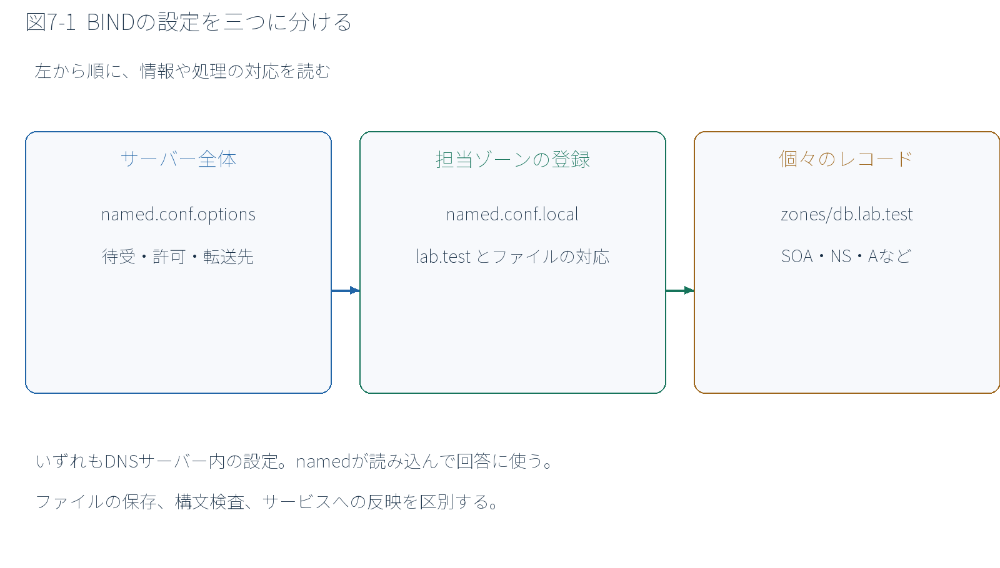
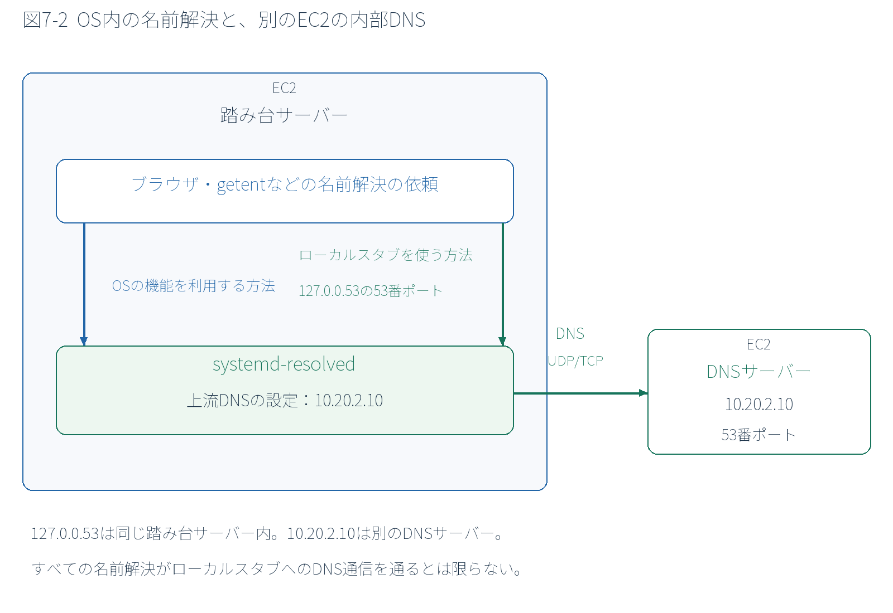
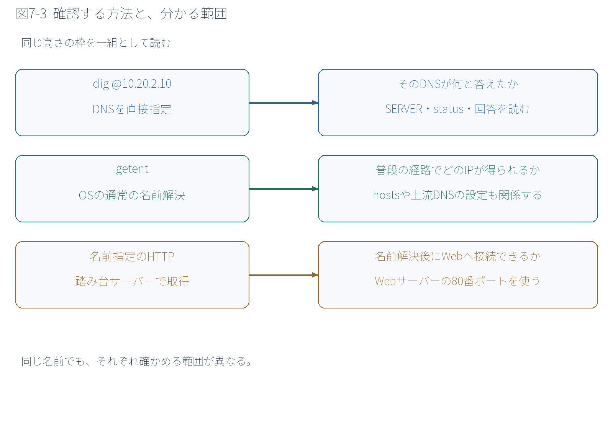

# 第7章 内部DNSの設定と動作確認

## この章で分かること

名前から接続先のIPアドレスを調べるには、情報を答えるDNSサーバーと、そのDNSを使う側の両方を準備する必要がある。学校の備品管理システムでは、DNSサーバーに内部名を登録し、踏み台サーバーとWebサーバーから利用する。

本章では、BINDの設定が何を決めるかを整理し、DNSへ直接尋ねる確認から、Ubuntu OSが普段使う名前解決、名前を使ったWeb閲覧へ進む。それぞれをどのサーバーで行うかに注目しよう。

## 7.1 BINDの設定を三つのまとまりで読む

DNSサーバー上では、BIND 9がDNSの処理を行う。実行するプログラムの名前は`named`であり、今回のUbuntu OSでは`named`サービスとして管理する。BINDはソフトウェアの名前、namedは実際に動くプログラムやサービスの名前として結び付けて理解する。

設定には、サーバー全体の方針、担当するゾーンの登録、そのゾーンのレコードという三つのまとまりがある。今回のUbuntu OSでは、中心となる`/etc/bind/named.conf`から、それぞれの設定ファイルを読み込む。

| ファイル | 決める内容 |
| --- | --- |
| /etc/bind/named.conf.options | 接続を待ち受けるIP、問い合わせを許す相手、外部名の転送先など |
| /etc/bind/named.conf.local | lab.testというゾーンを担当することと、ゾーンファイルの保存先 |
| /etc/bind/zones/db.lab.test | ゾーンの管理情報と、名前に対応するIPアドレスなどのレコード |



**図7-1 設定ファイルの役割。** 枠は設定内容のまとまりを示す。すべてDNSサーバー内の設定であり、ファイルごとに別のサーバーが必要になるわけではない。

設定ファイルを保存した後は、検査してからサービスへ反映する。保存した文章と、namedが現在使っている設定を区別することは、Nginxと同じである。[BINDの設定とゾーン](https://bind9.readthedocs.io/en/v9.18.39/chapter3.html)

## 7.2 ゾーンの登録とレコードを結び付ける

例えば、`lab.test`ゾーンのレコードを`/etc/bind/zones/db.lab.test`に保存する場合、namedにその関係を知らせる。

**設定の説明例：DNSサーバーのnamed.conf.local内に書くゾーンの登録。**

```text
zone "lab.test" {
    type primary;
    file "/etc/bind/zones/db.lab.test";
    allow-transfer { none; };
    allow-update { none; };
};
```

`zone`は担当する名前の範囲、`type primary`は元となるゾーン情報を管理すること、`file`はレコードを保存したファイルを指定する。`allow-transfer`は、このゾーンの登録情報一式を他のDNSサーバーへコピーする「ゾーン転送」を許す相手を指定する。`allow-update`は、DNSの通信による動的な更新を許す相手を指定する。ここでは、どちらも許可しない。ゾーン転送の用途は7.3で説明する。

ゾーンファイルには、第6章で説明したSOA、NS、Aなどを記録する。例えば`guide IN A 10.20.1.20`という行は、基準が`lab.test.`であれば`guide.lab.test.`をWebサーバーの内部IPへ対応させる。名前のつづり、ゾーンの基準、返すIPをそれぞれ読む。設定の構文が正しくても、別のIPを書けば、その別のIPが回答になる。

SOAのserialは、ゾーンの変更に合わせて増やす。ファイル名を`db.lab.test`にしただけではゾーン登録にはならず、ゾーン登録だけがあってもレコードの内容が正しいとは限らない。

## 7.3 問い合わせを許す相手と、転送先を決める

### 許可する送信元をまとめる

**ACL（Access Control List）**は、許可する相手などをまとめるリストである。今回のBINDでは、DNSサーバー自身、踏み台サーバー、Webサーバーからの問い合わせを扱う。

**設定の説明例：問い合わせ元のリストと、それを使う設定項目。**

```text
acl "internal_clients" {
    127.0.0.1;
    10.20.1.10;
    10.20.1.20;
};
```

このリストは、後の設定で相手の範囲を指定するときに使う。ACLを定義するだけで、すべての処理へ自動的に適用されるわけではない。

| 設定項目 | 制御すること |
| --- | --- |
| listen-on | DNSサーバー自身の、どのIPv4アドレスで接続を受け付けるか |
| allow-query | DNSへの問い合わせを許す相手 |
| allow-recursion | 外部名などの名前解決を取りまとめる処理を許す相手 |
| allow-query-cache | 保存しているキャッシュの情報を回答する相手 |

例えば、`allow-query { internal_clients; };`は、先ほどのACLに含まれる相手へ問い合わせを許す指定である。問い合わせを受けること、外部名を調べること、キャッシュを利用させることには、別々の設定がある。[BINDのアクセス制御](https://bind9.readthedocs.io/en/v9.18.39/reference.html)

### 外部名の解決と、ゾーン転送を区別する

`forwarders`には外部名を調べる際の依頼先として`10.20.0.2`を指定し、`forward only`でその転送先を使う。これは、名前解決の問い合わせを他のDNSへ依頼する設定である。

一方、**ゾーン転送**は、あるゾーンに登録したレコード一式を、別のDNSサーバーへコピーするための処理である。例えば、二台のDNSサーバーから同じ情報を回答したい場合、一台で管理する`lab.test`の登録情報をもう一台へ渡すために使う。そのゾーンの全レコードをまとめて転送する方式を**AXFR（エー・エックス・エフ・アール）**という。[ゾーン転送の仕様](https://www.rfc-editor.org/rfc/rfc5936.html)

| 問い合わせ | 求める情報の例 | 主な用途 |
| --- | --- | --- |
| 通常のAレコードの問い合わせ | 「guide.lab.testのIPv4アドレスを教えてほしい」 | ブラウザやアプリが接続先を調べる |
| ゾーン転送の問い合わせ（AXFR） | 「lab.testゾーンに登録されたレコード一式を渡してほしい」 | 別のDNSサーバーにも同じ登録情報を持たせる |

今回の構成では、内部DNSをもう一台に複製する作業は行わない。7.2の`allow-transfer { none; };`は、ゾーンの登録情報一式を渡す相手を許可しない設定である。これを設定しても、許可された相手からの通常のAレコードの問い合わせには回答できる。名前解決を他のDNSへ依頼する`forwarders`と、ゾーンの登録情報をコピーするAXFRは、用途が異なる。[BINDのゾーン転送の許可設定](https://bind9.readthedocs.io/en/v9.18.39/reference.html#namedconf-statement-allow-transfer)

### ここから行う確認と、接続元の設定

ここまでで、DNSサーバーのBINDへ登録する情報や、問い合わせを許す相手について説明した。ここからは、DNSが正しく答えることを確認し、そのDNSを普段使うように接続元のOSを設定する。

学校の備品管理システムで、踏み台サーバーのブラウザから`http://guide.lab.test/example.txt`を開く場合を考える。ブラウザは、まず`guide.lab.test`に対応するIPアドレスを調べ、そのIPのWebサーバーへ接続する。この名前解決を利用するには、**情報を答えるDNSサーバーの設定**と、**そのDNSへ尋ねる接続元のOSの設定**が必要になる。

ここでいう接続元は、名前を使って通信を始めるコンピューターである。ブラウザを動かす踏み台サーバーも、後でDBへ接続するWebサーバーも、DNSに尋ねるときには利用する側になる。一台のサーバーであっても、相手にサービスを提供する役割と、別のサービスを利用する役割がある。

| 場所 | 設定する内容 | 今回の例 |
| --- | --- | --- |
| DNSサーバーのBIND | 名前とIPの対応、問い合わせを受け付ける相手、外部名の転送先 | guide.lab.testに対して10.20.1.20と答える |
| 接続元のOS：踏み台サーバーとWebサーバーのそれぞれ | 普段、どのDNSサーバーへ問い合わせるか | 問い合わせ先を内部DNSの10.20.2.10にする |
| 踏み台サーバーのブラウザ | OSの名前解決を利用する設定 | 今回は準備済みの設定を使うため、追加の設定変更は行わない |

**接続元のOSへ書く`10.20.2.10`は、「尋ねる相手であるDNSサーバーのIP」である。WebサーバーのIPである`10.20.1.20`とは用途が違う。** 名前と接続先IPの対応はDNSサーバーで管理する。接続元のOSが問い合わせ先を知っていれば、必要な名前の情報をそこへ尋ねられる。

OS内の`/etc/hosts`へ名前とIPを直接書く方法もあるが、今回はその方法を使わない。例えば、踏み台サーバーのhostsに`guide.lab.test`と`10.20.1.20`を書けば、DNSへ尋ねずに名前を使える場合がある。それでは、構築した内部DNSから回答を得たことにならない。[Ubuntu OSの名前解決とhosts](https://ubuntu.com/server/docs/explanation/networking/configuring-networks/)

まずDNSサーバー側が正しく答えられることを確かめ、その後、接続元のOSが普段使う問い合わせ先を変更する。続く7.4〜7.7は、次の順序で進む。

| 節 | 作業する場所 | 目的 |
| --- | --- | --- |
| 7.4 | DNSサーバー | 設定を検査してサービスへ反映し、DNSサーバー自身から回答を確かめる |
| 7.5 | 踏み台サーバー・Webサーバー | digで問い合わせ先を直接指定し、別のサーバーからも回答を受け取れるか確認する |
| 7.6 | 踏み台サーバー・Webサーバー | それぞれのUbuntu OSが普段使うDNSを設定し、その設定と名前解決の結果を確認する |
| 7.7 | 踏み台サーバー | ブラウザで名前を使い、Webページを開く |

**digは、DNSへ問い合わせて回答を見るためのコマンドである。DNSサーバーの登録内容や、接続元のOSの設定を書き換えるコマンドではない。** 7.4〜7.5で行う問い合わせの確認と、7.6で行うOSの設定を区別して読もう。

## 7.4 DNSサーバー内で設定を検査し、反映する

踏み台サーバーとWebサーバーが普段使うDNSを変更する前に、DNSサーバーが自分の情報を正しく読める状態にする。名前解決の問い合わせ先を先に変更すると、設定途中のDNSに依存することになる。

**実行場所：DNSサーバーの管理用端末。構文検査に使う例。**

```bash
sudo named-checkconf -z
sudo named-checkzone lab.test /etc/bind/zones/db.lab.test
```

`named-checkconf`はBINDの設定を検査し、`-z`ではprimaryゾーンの読み込みも検査する。`named-checkzone`は、指定したゾーン名とゾーンファイルを組み合わせて検査する。エラーがあれば、表示されたファイルや行を直してから再検査する。[BINDの検査コマンド](https://bind9.readthedocs.io/en/v9.18.39/manpages.html)

検査後に設定をnamedサービスへ反映し、サービスの状態と、UDP・TCPそれぞれの53番ポートの待受を読む。ここまでの作業場所はDNSサーバーであり、踏み台サーバーやWebサーバーのOSのDNS設定はまだ変更しない。

次に、**dig（ディグ）**で問い合わせを送る。digは、DNSへ「この名前のAレコードを教えてほしい」と尋ね、返された情報を端末へ表示する。設定ファイルの検査が成功することと、動いているDNSから回答を得られることを、分けて確かめるために使う。[digの使い方](https://bind9.readthedocs.io/en/v9.18.39/manpages.html#dig-dns-lookup-utility)

**実行場所：DNSサーバーの管理用端末。自分自身で動くBINDへ問い合わせる例。**

```bash
dig @127.0.0.1 guide.lab.test A
```

`@`の後ろは問い合わせ先DNSのIPアドレス、次の`guide.lab.test`は調べる名前、最後の`A`はIPv4アドレスを調べる指定である。ここでの`127.0.0.1`は、コマンドを実行しているDNSサーバー自身を表す。

この実行で回答が得られても、他のサーバーから通信できるかまでは分からない。そこで7.5では、コマンドを実行する場所を踏み台サーバーやWebサーバーへ移す。

## 7.5 接続元からdigでDNSサーバーの回答を確認する

DNSサーバー自身から回答できたら、次は別のサーバーから尋ねる。踏み台サーバーとWebサーバーのそれぞれの端末で、問い合わせ先を内部DNSの`10.20.2.10`と明示する。この段階でも、接続元のOSが普段使うDNSの設定は変更しない。

**実行場所：踏み台サーバーの端末。登録済みの説明用の名前を問い合わせる例。**

```bash
dig @10.20.2.10 guide.lab.test A
dig @10.20.2.10 guide.lab.test A +tcp
```

例えば1行目は、「内部DNSの`10.20.2.10`に、`guide.lab.test`のIPv4アドレスを尋ねる」という意味である。回答に出る`10.20.1.20`は、接続先であるWebサーバーのIPであり、尋ねた相手のIPとは別である。

`@10.20.2.10`の指定が有効なのは、このdigの問い合わせだけである。実行を終えても、OSの普段の問い合わせ先は書き換わらない。

1行目は通常UDP、2行目の`+tcp`はTCPでDNSサーバーの53番ポートへ問い合わせるオプションである。UDPで回答できてもTCPでも回答できるとは限らないため、通信方式を区別する。

**表示例：回答の中心となる部分の抜粋。**

```text
status: NOERROR
flags: qr aa rd ra
guide.lab.test.  300  IN  A  10.20.1.20
SERVER: 10.20.2.10#53
```

`SERVER`は実際の問い合わせ先、`NOERROR`は処理結果、`aa`は、このDNSが管理するゾーンの情報に基づく回答を示す。Aレコードの右側が接続先のIPv4アドレス、300はTTLである。名前が正しくても、別のDNSからの回答を見ていないかも合わせて読む。

未登録名のNXDOMAIN、方針によるREFUSED、時間内に回答を受け取れないタイムアウトも区別する。ゾーン全体の転送（AXFR）の拒否を確かめる場合も、同じ相手から通常の問い合わせが成功することと、転送が明示的に拒否されることを対にして読む。タイムアウトだけでは、転送を拒否したのか、そもそも通信できないのかを区別できない。

## 7.6 接続元のUbuntu OSに、普段使うDNSを設定する

### 問い合わせるたびに相手を指定する方法から、OSの設定へ

`dig @10.20.2.10 ...`は、そのコマンドだけで問い合わせ先を指定している。これに成功しても、ブラウザやアプリが普段使う問い合わせ先が同じであるとは限らない。

ブラウザでページを開くときには、通常、URLのほかにDNSサーバーのIPを毎回指定しない。ブラウザはOSの名前解決を利用し、OSはあらかじめ設定されたDNSへ必要な問い合わせを送る。そのため、ここで接続元のOSに問い合わせ先を設定する。

今回のUbuntu OSでは、ネットワークの設定ファイルを扱う仕組みが**Netplan**、動作中の名前解決を支えるサービスが**systemd-resolved**である。踏み台サーバーとWebサーバーのそれぞれに、上流DNS、つまり問い合わせを依頼する相手として`10.20.2.10`を設定する。設定するのは、この二台のOSであり、DNSサーバー内のBINDの設定ファイルではない。

**設定の説明例：既存のネットワークインターフェース設定の一部分。**

```yaml
dhcp4: true
dhcp4-overrides:
  use-dns: false
nameservers:
  addresses: [10.20.2.10]
```

`dhcp4: true`はIPアドレスなどをDHCPで受け取る設定を保ち、`use-dns: false`はDHCPで配られるDNSを採用しない指定である。`nameservers`には普段使う問い合わせ先を書く。このアドレスは踏み台サーバー自身のIPではない。名前とWebサーバーのIPの対応を、このファイルへ一件ずつ書くわけではない。実際のファイルでは既存のインターフェース名や他の設定も保持する。[NetplanのDNS設定](https://netplan.readthedocs.io/en/stable/netplan-yaml/)

Netplanの設定ファイルを保存した後、`sudo netplan generate`で設定を生成・検査し、`sudo netplan apply`でネットワークへ適用する。ファイルの保存だけで、動作中の問い合わせ先まで変更されたとは限らない。digは、この設定の保存や適用には使わない。

### 127.0.0.53と内部DNSを混同しない

Ubuntu OSの`/etc/resolv.conf`に`127.0.0.53`が表示される場合がある。これは同じコンピューター内のsystemd-resolvedが提供する**ローカルスタブ**のアドレスであり、別のEC2の内部DNSを表しているわけではない。



**図7-2 設定する問い合わせ先と、回答される接続先IP。** 左のOSに設定するのはDNSサーバーの`10.20.2.10`である。右のDNSサーバーは、管理している名前とIPの対応から、Webサーバーの`10.20.1.20`を答える。`127.0.0.53`は、左のOS内でDNSの問い合わせを受け付けるためのアドレスであり、右のDNSサーバーのIPではない。

設定の適用後は、次の二つを区別して確認する。

**実行場所：踏み台サーバーとWebサーバーのそれぞれの端末。**

```bash
resolvectl dns
getent ahostsv4 guide.lab.test
```

`resolvectl dns`は、動作中の問い合わせ先DNSの設定を表示する。今回の上流DNSが`10.20.2.10`になっているかを読む。`getent ahostsv4`は、OSの通常の名前解決で得られるIPv4アドレスを表示する。`guide.lab.test`では、DNSから回答されるWebサーバーの`10.20.1.20`が対象となる。

getentはhostsの情報も利用できるため、その結果だけで、今回の内部DNSを使ったと決めることはできない。hostsで代用せず、Netplanの設定、resolvectlで表示する動作中の設定、実際に得たIPアドレスを対応させる。[systemd-resolvedの仕組み](https://www.freedesktop.org/software/systemd/man/latest/systemd-resolved.service.html)

## 7.7 名前を使って、既存のWebへ接続する

最後に、踏み台サーバーのブラウザでIP指定と名前指定のURLを開く。例えば、同じファイルに対する`http://10.20.1.20/example.txt`と`http://guide.lab.test/example.txt`を比較する。名前指定では、先に名前解決を行い、その結果を使って同じWebサーバーへ接続する。



**図7-3 確認ごとに分かることを積み重ねる。** 問い合わせ先を指定したdig、通常経路を使うgetent、名前を使ったHTTP取得は、確かめる範囲が異なる。

今回の踏み台サーバーのFirefoxは、OSの名前解決を使う準備が済んでいる。ブラウザが独自の外部DNSへ問い合わせる機能は、初期準備で無効にしているため、ここでブラウザへDNSのIPを追加設定する必要はない。7.6で設定した踏み台サーバーのOSを通じて、内部DNSへ名前を尋ねる。

RDPの画面を表示している利用者PCと、ブラウザを実際に動かす踏み台サーバーは別のコンピューターである。踏み台サーバーのOSを設定しても、利用者PCのOSやブラウザのDNS設定が変わるわけではない。

後にWebサーバーのアプリがDBへ接続するときも、Webサーバー自身がDBサーバーの名前を解決する。踏み台サーバーで成功した結果だけで済ませず、名前を使うサーバーごとに設定と結果を結び付ける。

練習・課題2では、内部DNSへ名前を登録し、踏み台サーバーとWebサーバーの通常の名前解決から利用する構成を作る。普段のインターネット接続のスマートフォンへ、今回の内部名を公開する構成ではない。

## 章末問題

### 問1

ゾーンの登録とゾーンファイルは、それぞれ何を指定するものか。

### 問2

`dig @10.20.2.10 guide.lab.test A`が成功すれば、踏み台サーバーのブラウザも同じDNSを使うと言えるか。

### 問3

127.0.0.53と10.20.2.10は、今回それぞれどこを表すか。

### 問4

ゾーン転送（AXFR）の問い合わせがタイムアウトしたことだけで、BINDが転送を明示的に拒否したと判断できるか。

## 章末解答

### 問1

ゾーンの登録は担当する名前の範囲、管理方式、レコードを保存したファイルの場所などを指定する。ゾーンファイルは、その範囲の管理情報や個々のレコードを記録する。

### 問2

言えない。digは問い合わせを行うコマンドであり、その実行によってOSの設定を変更しない。@の指定はそのdigだけの問い合わせ先である。OSが普段使うDNSはNetplanで設定し、動作中の上流DNS設定をresolvectlで読む。getentや名前指定HTTPの結果も合わせて確認する。

### 問3

127.0.0.53は、問い合わせる側の同じサーバー内にあるsystemd-resolvedのローカルスタブを表す。10.20.2.10は、別のEC2で動く今回の内部DNSサーバーである。

### 問4

判断できない。通信不能も考えられるため、通常問い合わせの成功と、AXFRに対する明示的な拒否を合わせて読む。

## 参考資料

確認日：2026-11-03。digとOSの名前解決の説明は2026-11-05、ゾーン転送の説明は2026-11-13に再確認した。設定・出力は説明例である。

- [BINDの設定とゾーン](https://bind9.readthedocs.io/en/v9.18.39/chapter3.html)
- [RFC 5936 DNS Zone Transfer Protocol (AXFR)](https://www.rfc-editor.org/rfc/rfc5936.html)
- [BIND設定リファレンス](https://bind9.readthedocs.io/en/v9.18.39/reference.html)
- [BINDのコマンド](https://bind9.readthedocs.io/en/v9.18.39/manpages.html)
- [Ubuntu OSの名前解決とhosts](https://ubuntu.com/server/docs/explanation/networking/configuring-networks/)
- [Netplan YAML設定](https://netplan.readthedocs.io/en/stable/netplan-yaml/)
- [systemd-resolved](https://www.freedesktop.org/software/systemd/man/latest/systemd-resolved.service.html)
- [第6章](../../output/pdf/web_textbook_ch06_ja.pdf)
- [練習P2](../../../labs/docs/ja/p2.md)
