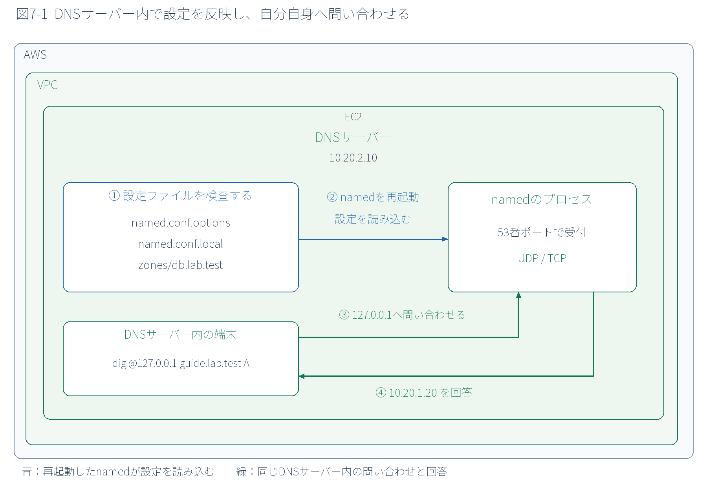
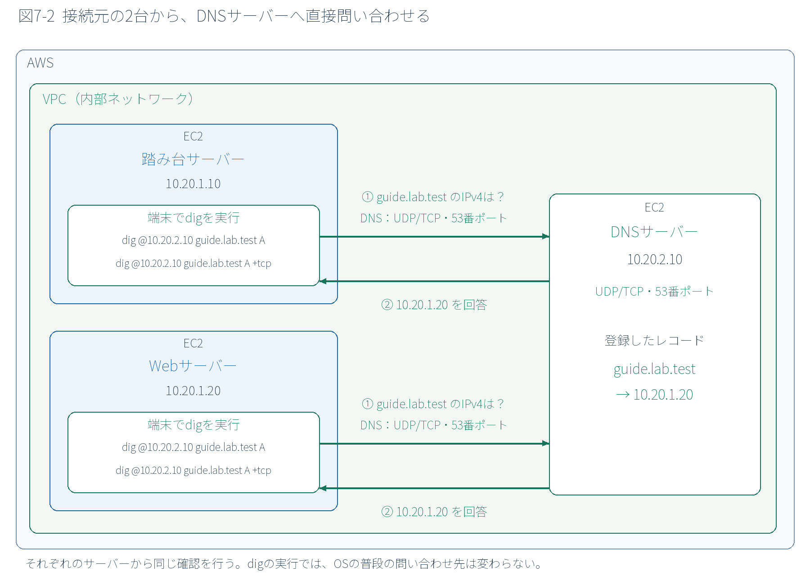
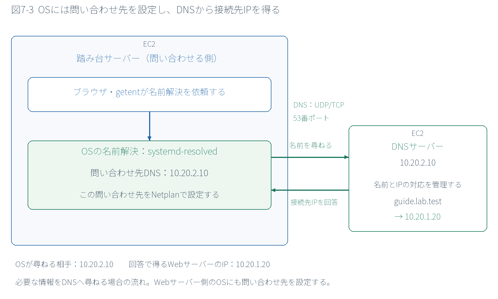
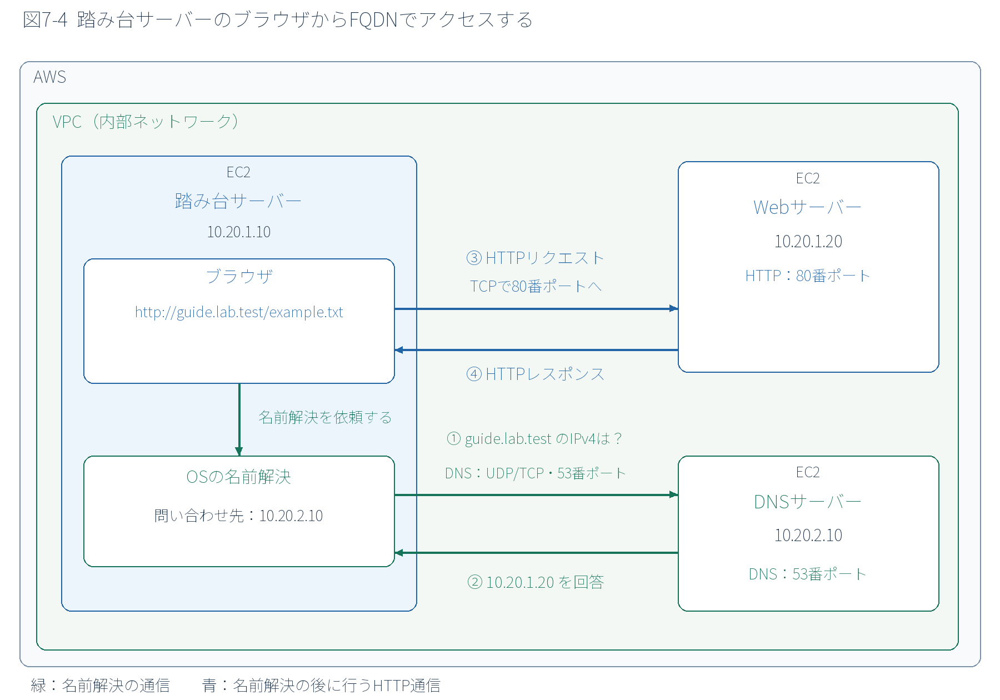

# 第7章 内部DNSの設定と動作確認

## この章で分かること

名前から接続先のIPアドレスを調べるには、情報を答えるDNSサーバーと、そのDNSを使う側の両方を準備する必要がある。学校の備品管理システムでは、DNSサーバーに内部名を登録し、踏み台サーバーとWebサーバーから利用する。

本章では、BINDの設定が何を決めるかを整理し、DNSへ直接尋ねる確認から、Ubuntu OSが普段使う名前解決、名前を使ったWeb閲覧へ進む。それぞれをどのサーバーで行うかに注目しよう。

## 7.1 BIND 9の三つの設定

DNSサーバー上では、BIND 9がDNSの処理を行う。実行するプログラムの名前は`named`であり、今回のUbuntu OSでは`named`サービスとして管理する。BINDはソフトウェアの名前、namedは実際に動くプログラムやサービスの名前として結び付けて理解する。

設定には、サーバー全体の方針、担当するゾーンの登録、そのゾーンのレコードという三つのまとまりがある。今回のUbuntu OSでは、中心となる`/etc/bind/named.conf`から、それぞれの設定ファイルを読み込む。

| ファイル | 決める内容 |
| --- | --- |
| /etc/bind/named.conf.options | 接続を待ち受けるIP、問い合わせを許す相手、外部名の転送先など |
| /etc/bind/named.conf.local | lab.testというゾーンを担当することと、ゾーンファイルの保存先 |
| /etc/bind/zones/db.lab.test | ゾーンの管理情報と、名前に対応するIPアドレスなどのレコード |

設定ファイルを保存した後は、検査してからサービスへ反映する。保存した文章と、namedが現在使っている設定を区別することは、Nginxと同じである。[BINDの設定とゾーン](https://bind9.readthedocs.io/en/v9.18.39/chapter3.html)

## 7.2 設定項目と、記載するファイルを対応させる

まず、説明する設定項目と、その記載先を一覧で確認する。`named.conf.options`にはサーバー全体の方針、`named.conf.local`には担当するゾーンの登録を書く。どちらもDNSサーバー内のファイルである。

**ACLの定義は、`options { ... }`や`zone "lab.test" { ... }`の外側に書く。** 一方、`allow-query`などは、そのACLを参照して問い合わせを許す相手を指定する設定項目である。すべてを`zone`の中に並べるわけではない。[BINDの設定ブロック](https://bind9.readthedocs.io/en/v9.18.39/reference.html#namedconf-statement-acl)

表の「記載先」は今回の設定例における場所を示す。複数の場所に書ける項目もある。例えば`allow-transfer`は`options`にも`zone`にも書け、`zone`内の指定はそのゾーンに適用される。

| 設定項目 | 今回の記載先 | 決める内容 |
| --- | --- | --- |
| 1. acl | named.conf.options内、optionsの外側 | 問い合わせ元として使うIPアドレスのリストに名前を付ける |
| 2. listen-on / listen-on-v6 | named.conf.optionsのoptions内 | DNSサーバー自身の、どのIPアドレスで問い合わせを受け付けるか |
| 3. recursion | named.conf.optionsのoptions内 | 外部名などの名前解決を取りまとめる機能を使うか |
| 4. allow-query | named.conf.optionsのoptions内 | DNSへの問い合わせを許す相手 |
| 5. allow-recursion | named.conf.optionsのoptions内 | 名前解決を取りまとめる処理の利用を許す相手 |
| 6. allow-query-cache | named.conf.optionsのoptions内 | 保存したキャッシュの情報を回答する相手 |
| 7. forward / forwarders | named.conf.optionsのoptions内 | 外部名の問い合わせ先と、転送先だけを使う方針 |
| 8. zone / type / file | named.conf.localでzoneを定義し、その中にtypeとfileを書く | 管理する名前の範囲、管理方式、ゾーンファイルの保存先 |
| 9. allow-transfer | named.conf.localのzone内 | ゾーン情報一式を別のDNSサーバーへ渡してよい相手 |
| 10. allow-update | named.conf.localのzone内 | DNSの通信によるレコードの動的更新を許す相手 |

次の二つの例を見比べ、その後で表と同じ番号の説明を読む。

### 設定例A：/etc/bind/named.conf.options

サーバー全体の設定を書くファイルである。次は、この節で説明する項目を抜粋した例である。ACLを定義する`acl`と、全体の動作を指定する`options`は、同じ外側の階層に並べて書く。

```text
acl "jdu_clients" {
    127.0.0.1;
    10.20.1.10;
    10.20.1.20;
};

options {
    listen-on { 127.0.0.1; 10.20.2.10; };
    listen-on-v6 { none; };
    recursion yes;
    allow-query { jdu_clients; };
    allow-recursion { jdu_clients; };
    allow-query-cache { jdu_clients; };
    forward only;
    forwarders { 10.20.0.2; };
};
```

`jdu_clients`は、この例でIPアドレスのリストに付けた名前である。リスト名は自分で付けられるが、定義した名前と参照するときの名前をそろえる必要がある。

### 設定例B：/etc/bind/named.conf.local

担当するゾーンを登録する、例Aとは別のファイルである。ここでは`lab.test`のレコードを`/etc/bind/zones/db.lab.test`に保存することを指定する。

```text
zone "lab.test" {
    type primary;
    file "/etc/bind/zones/db.lab.test";
    allow-transfer { none; };
    allow-update { none; };
};
```

例Aを、この`zone { ... }`の中へ入れるわけではない。`file`で指定した`db.lab.test`は、さらに別のファイルであり、そこへ名前とIPアドレスの対応を記録する。レコードの例は7.3で説明する。

### 1. acl：問い合わせ元のリストを定義する

**ACL**（Access Control List）は、相手のIPアドレスなどをまとめたリストである。例Aの`jdu_clients`には、DNSサーバー自身を表す`127.0.0.1`、踏み台サーバーの`10.20.1.10`、Webサーバーの`10.20.1.20`を入れている。

ACLを定義しただけでは、問い合わせを許可する設定にはならない。4〜6の各項目で`jdu_clients`を参照することで、それぞれの処理にリストを適用する。

### 2. listen-on / listen-on-v6：受け付けるIPアドレスを決める

`listen-on`は、DNSサーバー自身のどのIPv4アドレスで問い合わせを受け付けるかを指定する。例Aでは、DNSサーバー内からの確認に使う`127.0.0.1`と、他のサーバーから問い合わせる際の宛先となる内部IP`10.20.2.10`を指定している。

`listen-on-v6`はIPv6側の待受設定であり、この例では`none`で受け付けない。ここに書くのはDNSサーバー自身のIPであり、利用する踏み台サーバーやWebサーバーのIPではない。

### 3. recursion：名前解決を取りまとめる機能を使う

`recursion yes;`は、BINDが問い合わせ元に代わって必要な名前の情報を調べる機能を有効にする。例えば、内部DNSが自分のゾーンに持っていない`google.com`の情報を、転送先DNSへ依頼する際に使う。自分が管理する`lab.test`のレコードから回答する処理とは役割が違う。

### 4. allow-query：問い合わせを許す相手を決める

`allow-query { jdu_clients; };`は、ACLに含まれる相手からのDNS問い合わせを許す。例えば、踏み台サーバーが`guide.lab.test`のAレコードを尋ねる場合が該当する。`listen-on`が受け付ける側のIPを指定するのに対し、こちらは問い合わせる側のIPを指定する。

### 5. allow-recursion：名前解決の取りまとめを許す相手を決める

`allow-recursion { jdu_clients; };`は、3で有効にした機能を利用できる相手を指定する。例Aでは、外部名の調査を依頼できる相手も同じACLに限定する。機能を有効にする`recursion yes`と、利用する相手を限定する`allow-recursion`を組み合わせて使う。

### 6. allow-query-cache：キャッシュを回答する相手を決める

`allow-query-cache { jdu_clients; };`は、BINDが保存しているDNS情報を回答できる相手を指定する。例えば、先ほど調べた外部名の情報がキャッシュに残っている場合、その情報を同じACLの相手へ回答できる。

4〜6にはそれぞれ、問い合わせの受付、名前解決の取りまとめ、キャッシュからの回答という用途がある。今回の例では、三つとも同じACLを指定する。[BINDのアクセス制御](https://bind9.readthedocs.io/en/v9.18.39/reference.html#access-control)

### 7. forward / forwarders：外部名の問い合わせ先を決める

`forwarders { 10.20.0.2; };`は、自分のゾーンにない外部名を調べる際の依頼先を指定する。今回はAWS提供のDNSを使う。`forward only;`は、その転送先だけを使い、転送先に依頼できないときにBIND自身がルートDNSから直接調べ直す方法へ切り替えない指定である。使えるキャッシュがあれば、それを利用する。[BINDのフォワーダー](https://bind9.readthedocs.io/en/v9.18.39/reference.html#namedconf-statement-forward)

### 8. zone / type / file：担当ゾーンと保存先を登録する

`zone "lab.test"`は、このブロックで設定する名前の範囲を指定する。`type primary;`は、元となるゾーン情報をこのDNSサーバーで管理する指定である。`file`は、その情報を記録したゾーンファイルの保存先を指定する。

`file "/etc/bind/zones/db.lab.test";`と書くことと、その場所に正しいレコードを保存することの両方が必要になる。ファイル名を`db.lab.test`にしただけで、BINDへゾーンを登録したことにはならない。

### 9. allow-transfer：ゾーン情報一式を渡す相手を決める

**ゾーン転送**は、あるゾーンに登録したレコード一式を別のDNSサーバーへコピーする処理である。例えば、二台のDNSサーバーから同じ情報を回答したい場合、一台で管理する`lab.test`の情報をもう一台へ渡すために使う。全レコードをまとめて転送する方式を**AXFR**（エー・エックス・エフ・アール）という。[ゾーン転送の仕様](https://www.rfc-editor.org/rfc/rfc5936.html)

`allow-transfer`は、このコピーを許す相手を指定する設定項目である。例Bの`allow-transfer { none; };`は、`lab.test`のレコード一式を渡す相手を許可しない指定である。今回は複製先のDNSサーバーを構築しないため、この設定を使う。演習P2では例Aの`options`にも同じ指定を置き、サーバー全体の既定方針としても転送を許可しない。

| 問い合わせ | 求める情報 | 今回の扱い |
| --- | --- | --- |
| 通常のAレコードの問い合わせ | guide.lab.testのIPv4アドレス | 許可した問い合わせ元へ回答する |
| ゾーン転送の問い合わせ（AXFR） | lab.testのレコード一式 | allow-transferで許可しない |

ゾーン転送を許可しなくても、通常のAレコードの問い合わせには回答できる。7の`forwarders`は名前解決の依頼先であり、ゾーン情報をコピーする相手ではない。[BINDのゾーン転送の許可設定](https://bind9.readthedocs.io/en/v9.18.39/reference.html#namedconf-statement-allow-transfer)

### 10. allow-update：通信によるレコードの更新を許す相手を決める

`allow-update`は、DNSの通信を使ってレコードを追加・変更する動的更新を許す相手を指定する。例Bでは`allow-update { none; };`として、その更新を許可しない。管理者がDNSサーバー内でゾーンファイルを編集し、検査してから読み直させる作業とは別の処理である。

## 7.3 ゾーンファイルに名前とIPアドレスを記録する

ここで扱うのは、7.2の例Bの`file`で指定した**`/etc/bind/zones/db.lab.test`**である。これは`named.conf.options`や`named.conf.local`とは別のファイルであり、この中へSOA、NS、Aなどのレコードを書く。

**設定例C：DNSサーバーの/etc/bind/zones/db.lab.test。**

```text
$ORIGIN lab.test.
$TTL 300
@ IN SOA dns.lab.test. hostmaster.lab.test. (
    2026112701 3600 600 604800 300 )
@ IN NS dns.lab.test.
dns   IN A 10.20.2.10
guide IN A 10.20.1.20
```

`$ORIGIN lab.test.`は、このファイルで使う名前の基準である。`guide IN A 10.20.1.20`は、`guide.lab.test`という名前にWebサーバーの内部IPを対応させる。`@`は基準である`lab.test.`を表す。SOA、NS、TTLの読み方は第6章で説明した内容と同じである。

SOAのserialは、ゾーンの変更に合わせて増やす。設定の構文が正しくても、別のIPを書けば、その別のIPが回答になるため、名前のつづり、基準となる名前、返すIPをそれぞれ読む。

## 7.4 DNSサーバーの動作確認と、接続元の設定の流れ

ここまでで、DNSサーバー内の三つのファイルと、それぞれに書く設定やレコードを説明した。ここからは、DNSが正しく答えることを確認し、そのDNSを普段使うように接続元のOSを設定する。

学校の備品管理システムで、踏み台サーバーのブラウザから`http://guide.lab.test/example.txt`を開く場合を考える。ブラウザは、まず`guide.lab.test`に対応するIPアドレスを調べ、そのIPのWebサーバーへ接続する。この名前解決を利用するには、**情報を答えるDNSサーバーの設定**と、**そのDNSへ尋ねる接続元のOSの設定**が必要になる。

ここでいう接続元は、名前を使って通信を始めるコンピューターである。ブラウザを動かす踏み台サーバーも、後でDBへ接続するWebサーバーも、DNSに尋ねるときには利用する側になる。一台のサーバーであっても、相手にサービスを提供する役割と、別のサービスを利用する役割がある。

| 場所 | 設定する内容 | 今回の例 |
| --- | --- | --- |
| DNSサーバーのBIND | 名前とIPの対応、問い合わせを受け付ける相手、外部名の転送先 | guide.lab.testに対して10.20.1.20と答える |
| 接続元のOS：踏み台サーバーとWebサーバーのそれぞれ | 普段、どのDNSサーバーへ問い合わせるか | 問い合わせ先を内部DNSの10.20.2.10にする |
| 踏み台サーバーのブラウザ | OSの名前解決を利用する設定 | 今回は準備済みの設定を使うため、追加の設定変更は行わない |

**接続元のOSへ書く`10.20.2.10`は、「尋ねる相手であるDNSサーバーのIP」である。WebサーバーのIPである`10.20.1.20`とは用途が違う。** 名前と接続先IPの対応はDNSサーバーで管理する。接続元のOSが問い合わせ先を知っていれば、必要な名前の情報をそこへ尋ねられる。

OS内の`/etc/hosts`へ名前とIPを直接書く方法もあるが、今回はその方法を使わない。例えば、踏み台サーバーのhostsに`guide.lab.test`と`10.20.1.20`を書けば、DNSへ尋ねずに名前を使える場合がある。それでは、構築した内部DNSから回答を得たことにならない。[Ubuntu OSの名前解決とhosts](https://ubuntu.com/server/docs/explanation/networking/configuring-networks/)

まずDNSサーバー側が正しく答えられることを確かめ、その後、接続元のOSが普段使う問い合わせ先を変更する。続く7.5〜7.8は、次の順序で進む。

| 節 | 作業する場所 | 目的 |
| --- | --- | --- |
| 7.5 | DNSサーバー | 設定を検査してサービスへ反映し、DNSサーバー自身から回答を確かめる |
| 7.6 | 踏み台サーバー・Webサーバー | digで問い合わせ先を直接指定し、別のサーバーからも回答を受け取れるか確認する |
| 7.7 | 踏み台サーバー・Webサーバー | それぞれのUbuntu OSが普段使うDNSを設定し、その設定と名前解決の結果を確認する |
| 7.8 | 踏み台サーバー | ブラウザで名前を使い、Webページを開く |

**digは、DNSへ問い合わせて回答を見るためのコマンドである。DNSサーバーの登録内容や、接続元のOSの設定を書き換えるコマンドではない。** 7.5〜7.6で行う問い合わせの確認と、7.7で行うOSの設定を区別して読もう。

## 7.5 DNSサーバー内で設定を検査し、反映する

踏み台サーバーとWebサーバーが普段使うDNSを変更する前に、DNSサーバーが自分の情報を正しく読める状態にする。名前解決の問い合わせ先を先に変更すると、設定途中のDNSに依存することになる。

この節で操作するのはDNSサーバーである。7.2〜7.3で保存した設定を検査し、namedを再起動して読み込ませ、そのDNSサーバー自身から回答を確かめる。



**図7-1 DNSサーバー内で設定を反映し、自分自身へ問い合わせる。** ①保存した設定を検査し、②namedを再起動して読み込ませる。③同じDNSサーバー内の端末から自分自身へ問い合わせ、④登録したWebサーバーのIPが回答されることを確認する。青は設定の読み込み、緑はDNSの問い合わせと回答を示す。

**実行場所：DNSサーバーの管理用端末。構文検査に使う例。**

```bash
sudo named-checkconf -z
sudo named-checkzone lab.test /etc/bind/zones/db.lab.test
```

`named-checkconf`はBINDの設定を検査し、`-z`ではprimaryゾーンの読み込みも検査する。`named-checkzone`は、指定したゾーン名とゾーンファイルを組み合わせて検査する。エラーがあれば、表示されたファイルや行を直してから再検査する。[BINDの検査コマンド](https://bind9.readthedocs.io/en/v9.18.39/manpages.html)

検査でエラーがないことを確認したら、`sudo systemctl restart named`でnamedサービスを再起動する。Ubuntu OSのsystemdがnamedのプロセスを停止して起動し直し、新しく起動したnamedが保存済みの設定ファイルとゾーンファイルを読み込む。ここでいう「設定を反映する」とは、この再起動によって、編集した内容を実際のDNSの動作に使わせることである。[systemctlによるサービスの再起動](https://www.freedesktop.org/software/systemd/man/latest/systemctl.html#restart%20PATTERN%E2%80%A6)

**実行場所：DNSサーバーの管理用端末。設定の検査に成功した後に実行する。**

```bash
sudo systemctl restart named
systemctl is-active named
sudo ss -lntup
```

`systemctl is-active named`で`active`と表示されることを確認する。続いて`ss`の出力を見て、namedがDNSサーバーの内部IP`10.20.2.10`と`127.0.0.1`の53番ポートで、UDP・TCPそれぞれの通信を受け付けていることを確認する。TCPの待受は`LISTEN`、UDPの受付は通常`UNCONN`と表示される。

ここまでの作業場所はDNSサーバーであり、踏み台サーバーやWebサーバーのOSのDNS設定はまだ変更しない。

次に、**dig**（ディグ）で問い合わせを送る。digは、DNSへ「この名前のAレコードを教えてほしい」と尋ね、返された情報を端末へ表示する。設定ファイルの検査が成功することと、動いているDNSから回答を得られることを、分けて確かめるために使う。[digの使い方](https://bind9.readthedocs.io/en/v9.18.39/manpages.html#dig-dns-lookup-utility)

**実行場所：DNSサーバーの管理用端末。自分自身で動くBINDへ問い合わせる例。**

```bash
dig @127.0.0.1 guide.lab.test A
```

`@`の後ろは問い合わせ先DNSのIPアドレス、次の`guide.lab.test`は調べる名前、最後の`A`はIPv4アドレスを調べる指定である。ここでの`127.0.0.1`は、コマンドを実行しているDNSサーバー自身を表す。

この実行で回答が得られても、他のサーバーから通信できるかまでは分からない。そこで7.6では、コマンドを実行する場所を踏み台サーバーやWebサーバーへ移す。

## 7.6 接続元からdigでDNSサーバーの回答を確認する

DNSサーバー自身から回答できたら、次は別のサーバーから尋ねる。踏み台サーバーとWebサーバーのそれぞれの端末で、問い合わせ先を内部DNSの`10.20.2.10`と明示する。この段階でも、接続元のOSが普段使うDNSの設定は変更しない。



**図7-2 接続元の2台から、DNSサーバーへ直接問い合わせる。** 操作するのは左側の各サーバーの端末である。`dig`の`@10.20.2.10`で問い合わせ先を指定し、右側のDNSサーバーが登録した名前とIPを正しく回答するか確認する。UDPとTCPの両方で確かめる。この操作では、接続元OSの普段の問い合わせ先は変わらない。

**実行場所：踏み台サーバーの端末。登録済みの説明用の名前を問い合わせる例。**

```bash
dig @10.20.2.10 guide.lab.test A
dig @10.20.2.10 guide.lab.test A +tcp
```

例えば1行目は、「内部DNSの`10.20.2.10`に、`guide.lab.test`のIPv4アドレスを尋ねる」という意味である。回答に出る`10.20.1.20`は、接続先であるWebサーバーのIPであり、尋ねた相手のIPとは別である。

`@10.20.2.10`の指定が有効なのは、このdigの問い合わせだけである。実行を終えても、OSの普段の問い合わせ先は書き換わらない。

1行目は通常UDP、2行目の`+tcp`はTCPでDNSサーバーの53番ポートへ問い合わせるオプションである。UDPで回答できてもTCPでも回答できるとは限らないため、通信方式を区別する。

**表示例：回答の中心となる部分の抜粋。**

```text
status: NOERROR
flags: qr aa rd ra
guide.lab.test.  300  IN  A  10.20.1.20
SERVER: 10.20.2.10#53
```

`SERVER`は実際の問い合わせ先、`NOERROR`は処理結果、`aa`は、このDNSが管理するゾーンの情報に基づく回答を示す。Aレコードの右側が接続先のIPv4アドレス、300はTTLである。名前が正しくても、別のDNSからの回答を見ていないかも合わせて読む。

未登録名のNXDOMAIN、方針によるREFUSED、時間内に回答を受け取れないタイムアウトも区別する。ゾーン全体の転送（AXFR）の拒否を確かめる場合も、同じ相手から通常の問い合わせが成功することと、転送が明示的に拒否されることを対にして読む。タイムアウトだけでは、転送を拒否したのか、そもそも通信できないのかを区別できない。

## 7.7 接続元のUbuntu OSに、普段使うDNSを設定する

### 問い合わせるたびに相手を指定する方法から、OSの設定へ

`dig @10.20.2.10 ...`は、そのコマンドだけで問い合わせ先を指定している。これに成功しても、ブラウザやアプリが普段使う問い合わせ先が同じであるとは限らない。

ブラウザでページを開くときには、通常、URLのほかにDNSサーバーのIPを毎回指定しない。ブラウザはOSの名前解決を利用し、OSはあらかじめ設定されたDNSへ必要な問い合わせを送る。そのため、ここで接続元のOSに問い合わせ先を設定する。

今回のUbuntu OSでは、ネットワークの設定ファイルを扱う仕組みが**Netplan**、動作中の名前解決を支えるサービスが**systemd-resolved**である。踏み台サーバーとWebサーバーのそれぞれに、上流DNS、つまり問い合わせを依頼する相手として`10.20.2.10`を設定する。設定するのは、この二台のOSであり、DNSサーバー内のBINDの設定ファイルではない。

**設定の説明例：既存のネットワークインターフェース設定の一部分。**

```yaml
dhcp4: true
dhcp4-overrides:
  use-dns: false
nameservers:
  addresses: [10.20.2.10]
```

`dhcp4: true`はIPアドレスなどをDHCPで受け取る設定を保ち、`use-dns: false`はDHCPで配られるDNSを採用しない指定である。`nameservers`には普段使う問い合わせ先を書く。このアドレスは踏み台サーバー自身のIPではない。名前とWebサーバーのIPの対応を、このファイルへ一件ずつ書くわけではない。実際のファイルでは既存のインターフェース名や他の設定も保持する。[NetplanのDNS設定](https://netplan.readthedocs.io/en/stable/netplan-yaml/)

Netplanの設定ファイルを保存した後、`sudo netplan generate`で設定を生成・検査し、`sudo netplan apply`でネットワークへ適用する。ファイルの保存だけで、動作中の問い合わせ先まで変更されたとは限らない。digは、この設定の保存や適用には使わない。

### 設定した問い合わせ先を確認する



**図7-3 設定する問い合わせ先と、回答される接続先IP。** 左のOSに設定するのはDNSサーバーの`10.20.2.10`である。右のDNSサーバーは、管理している名前とIPの対応から、Webサーバーの`10.20.1.20`を答える。

設定の適用後は、次の二つを区別して確認する。

**実行場所：踏み台サーバーとWebサーバーのそれぞれの端末。**

```bash
resolvectl dns
getent ahostsv4 guide.lab.test
```

`resolvectl dns`は、動作中の問い合わせ先DNSの設定を表示する。今回の上流DNSが`10.20.2.10`になっているかを読む。`getent ahostsv4`は、OSの通常の名前解決で得られるIPv4アドレスを表示する。`guide.lab.test`では、DNSから回答されるWebサーバーの`10.20.1.20`が対象となる。

getentはhostsの情報も利用できるため、その結果だけで、今回の内部DNSを使ったと決めることはできない。hostsで代用せず、Netplanの設定、resolvectlで表示する動作中の設定、実際に得たIPアドレスを対応させる。[systemd-resolvedの仕組み](https://www.freedesktop.org/software/systemd/man/latest/systemd-resolved.service.html)

## 7.8 名前を使って、既存のWebへ接続する

最後に、踏み台サーバーのブラウザでIP指定と名前指定のURLを開く。例えば、同じファイルに対する`http://10.20.1.20/example.txt`と`http://guide.lab.test/example.txt`を比較する。名前指定では、先に名前解決を行い、その結果を使って同じWebサーバーへ接続する。



**図7-4 踏み台サーバーのブラウザからFQDNでアクセスする。** URLの`guide.lab.test`が接続先を表すFQDNである。①踏み台サーバーのOSが内部DNSへその名前を問い合わせ、②WebサーバーのIPである`10.20.1.20`を得る。③ブラウザはそのIPのWebサーバーの80番ポートへHTTPリクエストを送り、④HTTPレスポンスを受け取る。緑の矢印は名前解決、青の矢印はWebサーバーとの通信を示す。

今回の踏み台サーバーのFirefoxは、OSの名前解決を使う準備が済んでいる。ブラウザが独自の外部DNSへ問い合わせる機能は、初期準備で無効にしているため、ここでブラウザへDNSのIPを追加設定する必要はない。7.7で設定した踏み台サーバーのOSを通じて、内部DNSへ名前を尋ねる。

RDPの画面を表示している利用者PCと、ブラウザを実際に動かす踏み台サーバーは別のコンピューターである。踏み台サーバーのOSを設定しても、利用者PCのOSやブラウザのDNS設定が変わるわけではない。

後にWebサーバーのアプリがDBへ接続するときも、Webサーバー自身がDBサーバーの名前を解決する。踏み台サーバーで成功した結果だけで済ませず、名前を使うサーバーごとに設定と結果を結び付ける。

練習・課題2では、内部DNSへ名前を登録し、踏み台サーバーとWebサーバーの通常の名前解決から利用する構成を作る。普段のインターネット接続のスマートフォンへ、今回の内部名を公開する構成ではない。

## 章末問題

### 問1

ゾーンの登録とゾーンファイルは、それぞれ何を指定するものか。

### 問2

`dig @10.20.2.10 guide.lab.test A`が成功すれば、踏み台サーバーのブラウザも同じDNSを使うと言えるか。

### 問3

ゾーン転送（AXFR）の問い合わせがタイムアウトしたことだけで、BINDが転送を明示的に拒否したと判断できるか。

## 章末解答

### 問1

ゾーンの登録は担当する名前の範囲、管理方式、レコードを保存したファイルの場所などを指定する。ゾーンファイルは、その範囲の管理情報や個々のレコードを記録する。

### 問2

言えない。digは問い合わせを行うコマンドであり、その実行によってOSの設定を変更しない。@の指定はそのdigだけの問い合わせ先である。OSが普段使うDNSはNetplanで設定し、動作中の上流DNS設定をresolvectlで読む。getentや名前指定HTTPの結果も合わせて確認する。

### 問3

判断できない。通信不能も考えられるため、通常問い合わせの成功と、AXFRに対する明示的な拒否を合わせて読む。

## 参考資料

確認日：2026-11-03。digとOSの名前解決の説明は2026-11-05、ゾーン転送の説明は2026-11-13、設定の記載場所は2026-11-27に再確認した。設定・出力は説明例である。

- [BINDの設定とゾーン](https://bind9.readthedocs.io/en/v9.18.39/chapter3.html)
- [RFC 5936 DNS Zone Transfer Protocol (AXFR)](https://www.rfc-editor.org/rfc/rfc5936.html)
- [BIND設定リファレンス](https://bind9.readthedocs.io/en/v9.18.39/reference.html)
- [BINDのコマンド](https://bind9.readthedocs.io/en/v9.18.39/manpages.html)
- [Ubuntu OSの名前解決とhosts](https://ubuntu.com/server/docs/explanation/networking/configuring-networks/)
- [Netplan YAML設定](https://netplan.readthedocs.io/en/stable/netplan-yaml/)
- [systemd-resolved](https://www.freedesktop.org/software/systemd/man/latest/systemd-resolved.service.html)
- [第6章](../../output/pdf/web_textbook_ch06_ja.pdf)
- [練習P2](../../../labs/docs/ja/p2.md)
