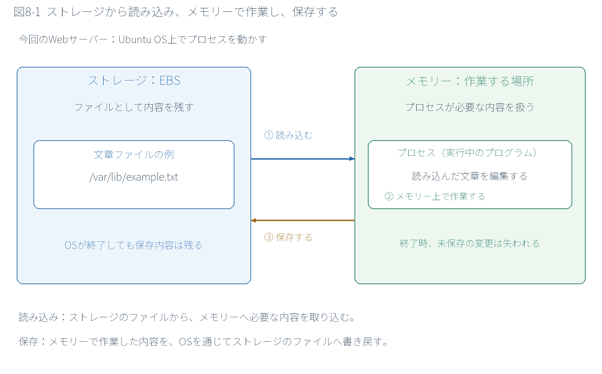
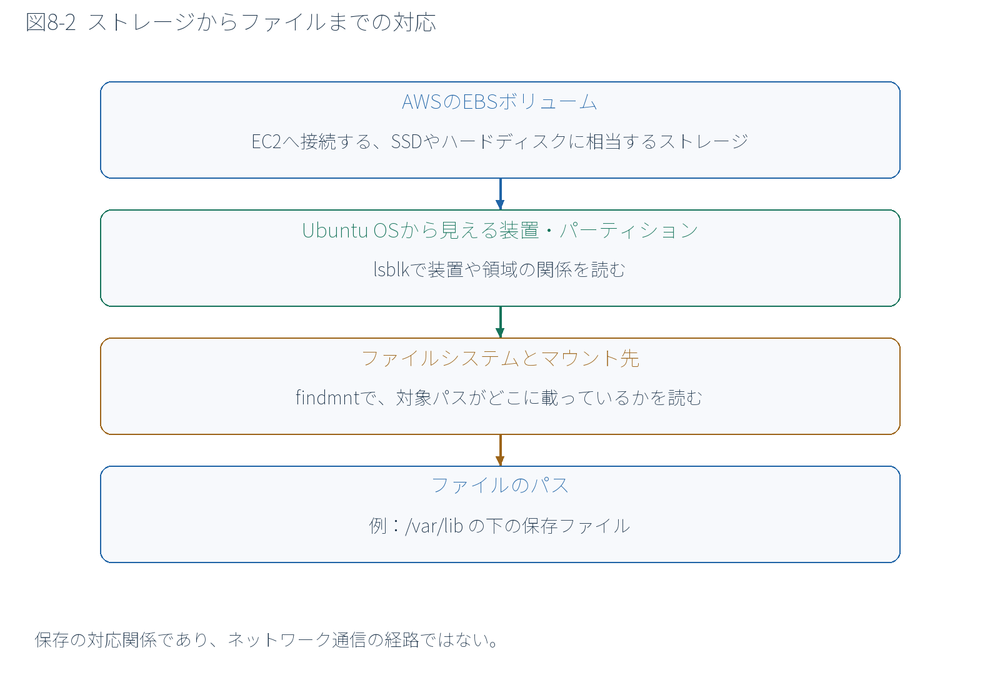
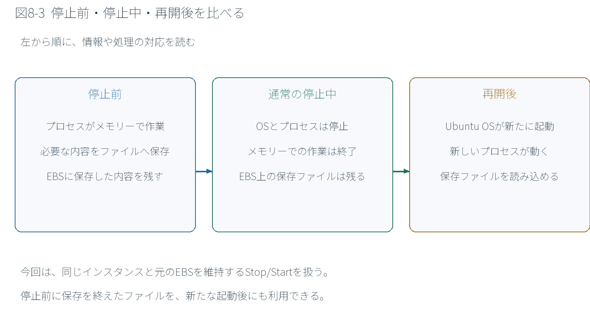
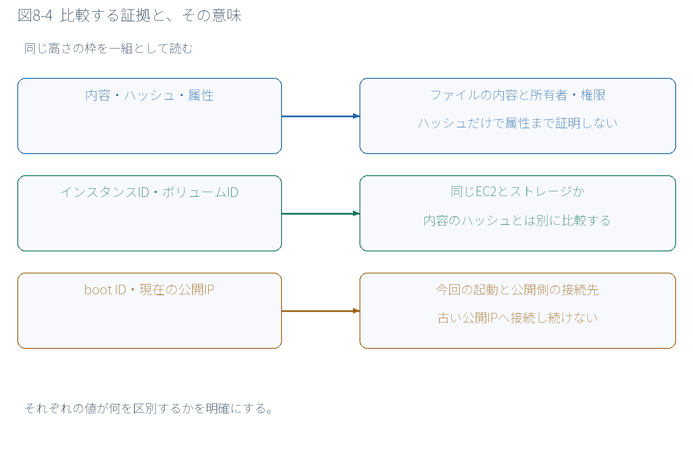

# 第8章 ストレージと停止後のデータ

## この章で分かること

Webサーバーを停止すると、ブラウザからページを取得できなくなる。それでは、保存したファイルやNginxの設定も消えてしまうのだろうか。学校の備品管理システムを継続して使うには、動いているプログラムと、保存した内容を分けて考える必要がある。

コンピューターには、作業中の内容を一時的に置く**メモリー**と、ファイルを保存しておく**ストレージ**がある。手元のPCでは、ハードディスクやSSDがストレージに当たる。

今回のAWS上のサーバーでは、ストレージとして**Amazon EBS（Elastic Block Store）**を利用する。EBSは、EC2へ接続して、ハードディスクやSSDのようにファイルやUbuntu OSを保存できるAWSのサービスである。今回使うのは、Webサーバーに最初から接続されているEBSである。[Amazon EBS](https://docs.aws.amazon.com/ebs/latest/userguide/what-is-ebs.html)

本章では、プロセスがメモリーとストレージをどう使うかを説明し、EBS上のファイルがWebサーバーの停止・再開後も残ることへ結び付ける。

## 8.1 プロセスが使うメモリーと、ファイルを残すストレージ

**プロセス**は、実行中のプログラムである。プログラムを起動すると、Ubuntu OSは実行に必要な命令やデータをメモリーへ読み込み、プロセスを動かす。プロセスは、メモリー上に置いたデータを使って処理を進める。

例えば、ストレージに保存した文章ファイルを編集する場合を考える。編集用ソフトウェアのプロセスは、OSを通じてファイルの内容をメモリーへ読み込む。文字を追加したり削除したりする作業は、読み込んだ内容に対して行われる。その変更を後でも使えるようにするには、保存操作で内容をストレージ上のファイルへ書き戻す必要がある。

**メモリー上で作業したことと、ストレージへ保存したことは、同じではない。** ファイルへ保存する前に編集用ソフトウェアを終了すると、メモリー上にだけあった未保存の変更は失われる。プロセスが終了すると、そのプロセスの作業に使っていたメモリーは解放される。OS自体を終了する場合も、各プロセスの作業中の状態を、そのまま次の起動へ持ち越すことはできない。

一方、ストレージへの保存を終えたファイルは、そのプロセスやOSが終了しても残る。次にソフトウェアを起動したとき、新しいプロセスがそのファイルを再びメモリーへ読み込むことで、保存した内容を利用できる。

| 比較すること | メモリー | ストレージ |
| --- | --- | --- |
| 主な役割 | 実行中のプロセスが命令やデータを扱う作業場所 | ファイルとしてデータを残す場所 |
| 文章を編集する例 | 読み込んだ文章や、編集中の内容を置く | 保存した文章ファイルを置く |
| プロセスが終了したとき | そのプロセスの作業用メモリーは解放される | 保存を終えたファイルは残る |
| OSを終了してから起動したとき | 以前のプロセスの作業状態をそのまま再開しない | 保存を終えたファイルを再び読み込める |



**図8-1 プロセスは、読み込む・作業する・保存する。** 青はファイルを残すストレージ、緑はプロセスが作業するメモリーである。読み込みと保存の矢印を分けて示す。今回は、このストレージとしてEBSを使う。

今回行う通常のStop/Startでも、この違いが現れる。StopでUbuntu OSとプロセスの動作は終了するが、元のEBSに保存したファイルは残る。StartではUbuntu OSが新たに起動し、そこで動き始めるプロセスが必要なファイルを読み込む。停止前のメモリーの中身や、未保存の編集状態をそのまま再開する操作ではない。[EC2の停止と起動](https://docs.aws.amazon.com/AWSEC2/latest/UserGuide/Stop_Start.html)

## 8.2 EBSからファイルのパスまでをつなげる

EBSで作成し、EC2へ接続して使う一つのストレージを**EBSボリューム**という。Ubuntu OSからは、ファイルを保存するディスクとして扱える。

Ubuntu OSは、保存装置の領域をファイルシステムとして利用する。ファイルシステムは、ファイル名、ディレクトリ、内容や属性を管理する仕組みである。それをディレクトリへ接続して使えるようにすることを**マウント**という。

今回のWebサーバーでは、元のrootボリューム上のファイルシステムを、ルートディレクトリ`/`から利用する。その下にある`/var/www/html`や`/var/lib`なども、実際にどのファイルシステムに載っているかを調べることができる。



**図8-2 AWSのストレージと、Ubuntu OSから見えるファイル。** 下へ進むほど、アプリや利用者が扱うファイルの名前に近付く。図は保存の対応関係であり、ネットワーク通信の経路ではない。

ここでのrootボリュームは、Ubuntu OSを起動するストレージを指す。管理者ユーザーのrootとは対象が異なる。今回の保存確認では、この元のストレージを使う。

## 8.3 保存先と空き容量を調べる

ファイルのパスだけを見ても、実際にどの保存装置を使っているかは分からない。途中のディレクトリへ別のファイルシステムをマウントしている場合、その場所より下は別のストレージになるからである。

**実行場所：Webサーバーの管理用端末。保存先を読むための例。**

```bash
findmnt -T /var/lib
lsblk -o NAME,TYPE,SIZE,MOUNTPOINTS,SERIAL
df -h /var/lib
```

`findmnt -T`は、指定したパスを含むファイルシステムとマウント先を調べる。`lsblk`は、Ubuntu OSから見えるディスクやパーティション、その容量やマウント先などを示す。`df -h`は、対象が載るファイルシステムの使用量と空き容量を読みやすい単位で表示する。

OS内の装置名は、環境によって`/dev/nvme...`などの表記になる。名前を見ただけで別のEBSへ付け替えず、AWS側のボリューム識別情報と対応させる。使用量と空き容量も、保存済みの内容と別に確認する。[lsblk](https://man7.org/linux/man-pages/man8/lsblk.8.html)、[findmnt](https://man7.org/linux/man-pages/man8/findmnt.8.html)

## 8.4 ファイルの内容と属性を別々に比較する

停止前の状態を説明するには、何を保存したか、どこへ置いたか、誰が読めるかを記録する。ファイルには本文だけでなく、所有者や権限などの属性もある。

| 記録するもの | 比較する目的 |
| --- | --- |
| ファイルのパス | どの場所のファイルを比較したかを示す |
| 内容 | 保存した文章が読めるかを確かめる |
| 所有者・権限 | 読取りや変更を許す範囲が保たれているかを確かめる |
| SHA-256のハッシュ値 | 停止前後でファイルの内容を比較する |

**ハッシュ値**は、内容から一定の方法で計算する値である。例えば、説明用ファイルに対する`sha256sum`は、内容が変わっていないかを比較する手掛かりになる。改行や空白も内容に含まれる。

ただし、ハッシュ値はファイル名、所有者、権限、EC2の識別子をまとめて証明する値ではない。同じ内容を別のEC2へコピーしても、内容のハッシュ値は同じになる。何の一致を確かめたのかを区別する。[SHA-256の計算](https://man7.org/linux/man-pages/man1/sha256sum.1.html)

## 8.5 停止、再開、再起動、終了を区別する

EC2の**Stop**はインスタンスを停止し、**Start**は停止したインスタンスを起動する操作である。通常のStop/Startでは、EBS上に保存した内容を保ちながらUbuntu OSを起動し直せる。[EC2の停止と起動](https://docs.aws.amazon.com/AWSEC2/latest/UserGuide/Stop_Start.html)

| 操作 | 何をするか |
| --- | --- |
| Stop → Start | インスタンスを停止した後、同じインスタンスを再び起動する |
| Reboot | インスタンスを再起動する。Stopの停止状態を経由する操作とは区別する |
| Terminate | インスタンスの利用を終了する。Stopと違い、そのインスタンスをStartして戻すことはできない |

Terminateでは、設定により接続されていたEBSも削除されることがある。今回行う保存確認は、同じインスタンスと元のボリュームを維持したStop/Startである。AWSの画面では、対象と操作名を対応させる。



**図8-3 メモリー上の作業は終了し、保存したファイルは残る。** 保存を終えたファイルは元のEBSに残る。再開後のプロセスは、そのファイルを読み込んで利用する。

## 8.6 再開後は、保存と接続の両方を見る

同じEC2かどうかは**インスタンスID**、同じストレージかどうかは**ボリュームID**で区別できる。一方、Ubuntu OSの**boot ID**は、一回の起動を区別するための値である。Stop/Start後に、元のインスタンスIDとボリュームIDは同じで、boot IDは変わるという関係を読む。

**実行場所：Webサーバーの端末。現在の起動を区別する値を読む例。**

```bash
cat /proc/sys/kernel/random/boot_id
```

再開後はファイルの内容、ハッシュ、所有者・権限を停止前と比べる。また、自動割当の公開IPv4アドレスはStop/Startで変わることがある。古い公開IPのURLへ接続できなくても、それだけでファイル消失とは言えない。EC2画面で現在の公開IPを読み、Nginxのサービスと待受の状態も確認する。



**図8-4 一つの値にすべての意味を持たせない。** 内容の一致、保存した場所の同一性、今回の起動、公開側の接続先を別々の観点で読む。

## 8.7 ファイルが残ることと、復元できることは違う

Stop/Start後にもファイルが残ることは、元のストレージに保存された内容を引き続き利用できることを示す。しかし、誤って削除した内容や、上書きしてしまった以前の内容を戻せると示したわけではない。

**バックアップ**は、失われた内容を戻すために別の保存を用意することであり、**リストア**はその保存から復元することである。今回の保持確認は、それらの復元試験と区別する。単にEC2を止めるだけでは、誤削除したファイルの以前の版は作られない。

練習・課題3では、元のEBSへ保存したファイルが、同じWebサーバーの停止・再開後も保持されることを確かめる。次の第9章では、保存するデータを表として管理するデータベースへ進む。

## 章末問題

### 問1

EBS、ファイルシステム、ファイルのパスは、それぞれ何を表すか。

### 問2

停止前後でファイルのハッシュ値が同じなら、同じEC2だと判断できるか。

### 問3

再開後に保存ファイルはあるが、以前のURLでWebページを取得できない。何を調べるか。

### 問4

Stop/Start後にファイルが残ったことは、誤削除から復元できることの証明になるか。

## 章末解答

### 問1

EBSはAWSが提供するストレージ、ファイルシステムはその上でファイルなどを管理する仕組み、パスはOSのディレクトリの中でファイルの場所を指定する名前である。

### 問2

判断できない。ハッシュ値は内容の比較に使う。EC2の同一性はインスタンスID、ストレージはボリュームIDで別に比較する。

### 問3

現在の公開IP、指定したURL、Nginxのサービス状態、待受IP・ポート、接続経路などを調べる。保存した内容と、稼働・接続の状態を分ける。

### 問4

ならない。元の保存内容を利用できることと、失った内容を別の保存から復元できることは異なる。

## 参考資料

確認日：2026-11-03。EBSと通常のStop/Startの説明は2026-11-13に再確認した。識別子や保存内容は説明用であり、実行環境の値は対象から読む。

- [Amazon EBS](https://docs.aws.amazon.com/ebs/latest/userguide/what-is-ebs.html)
- [EC2の停止と起動](https://docs.aws.amazon.com/AWSEC2/latest/UserGuide/Stop_Start.html)
- [lsblk](https://man7.org/linux/man-pages/man8/lsblk.8.html)
- [findmnt](https://man7.org/linux/man-pages/man8/findmnt.8.html)
- [SHA-256の計算](https://man7.org/linux/man-pages/man1/sha256sum.1.html)
- [練習P3](../../../labs/docs/ja/p3.md)
