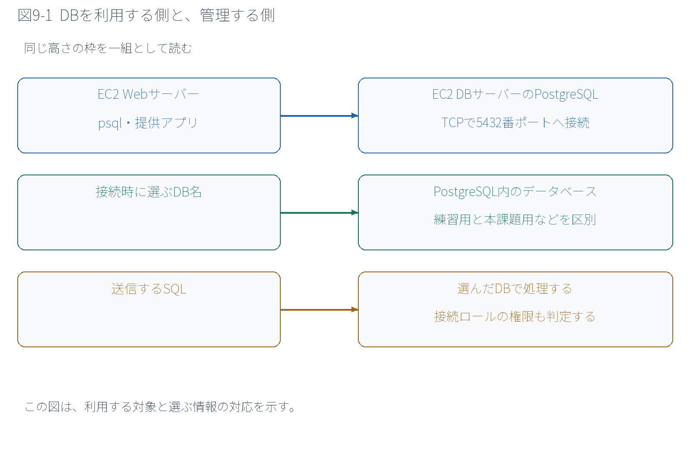
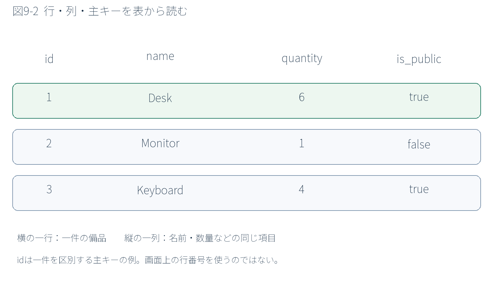
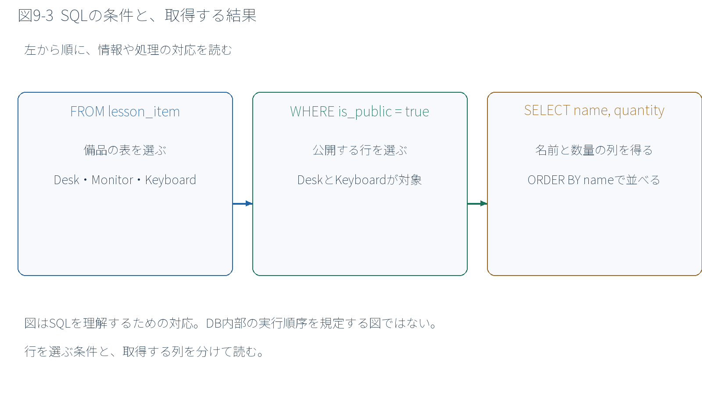

# 第9章 リレーショナルDBとSQLの基本

## この章で分かること

学校の備品管理システムでは、備品の名前、数量、保管場所、一般向けに表示するかどうかを管理する。Webサーバーが一覧ページを作るたびに、保存したデータから必要な備品を取り出せる必要がある。

本章では、データベースが管理する仕事を、備品の表から考える。表、行、列、主キーを理解した後、SQLでデータを読む意味と書き換える意味を学ぶ。SQLの例は説明用の表を使い、アプリのプログラムを書く作業とは分けて扱う。

## 9.1 備品の情報を、まとまりとして管理する

備品を少数だけ記録するなら、テキストファイルや表計算でも一覧を作れる。しかし複数の担当者が同時に変更し、コードの重複を防ぎ、必要な行だけを探すとなると、保存する文章だけでなく、変更の順序や値の整合性を管理する必要がある。

**データベース（DB）**は、関連するデータを整理して管理するまとまりである。**リレーショナルデータベース**では、データを表として扱い、必要に応じて複数の表を関連付ける。

例えば、数量を数値として管理すれば、6個ある備品だけを探したり、数量を増減したりできる。備品コードに重複を許さない制約を設ければ、同じコードの別の備品を登録しようとしたときに拒否できる。DBは値を保存するだけでなく、許された操作と整合性を管理する。

## 9.2 PostgreSQL、データベース、クライアントを分ける

**DBMS（Database Management System）**は、DBを管理するソフトウェアである。今回のDBサーバー上では、**PostgreSQL（ポストグレスキューエル）**を使う。PostgreSQLはクライアントから接続を受け、データを読む・書く処理を実行する。

一つのPostgreSQLで、練習用と本課題用など複数のデータベースを管理できる。接続時には、どのデータベースを使うかも指定する。コンピューターとしてのDBサーバー、管理ソフトウェアとしてのPostgreSQL、その中の個別のデータベースを区別しよう。

**psql**は、PostgreSQLへ接続してSQLを送る端末用のクライアントである。Webサーバー上で動く備品管理アプリも、DBへ問い合わせるときにはクライアントとなる。[psql](https://www.postgresql.org/docs/16/app-psql.html)



**図9-1 ソフトウェア、データベース、利用する側。** 通信する相手はDBサーバー上のPostgreSQLであり、その接続で利用するデータベースを選ぶ。

## 9.3 表、行、列、型を読む

次は、説明用の`lesson_item`という表である。表を**テーブル**、横に並ぶ一件のデータを**行**、縦に並ぶ各項目を**列**という。

| id | name | quantity | is_public |
| --- | --- | --- | --- |
| 1 | Desk | 6 | true |
| 2 | Monitor | 1 | false |
| 3 | Keyboard | 4 | true |

一行が一件の備品を表す。`name`列は名前、`quantity`列は数量、`is_public`列は一般向けに表示するかどうかである。`true`と`false`は、真・偽を表す値である。

列には**データ型**を定める。例えば、名前は文字列、数量は整数、公開区分は真偽値として扱う。値が同じ文字で見えても、数値として保存した6と、文字列として保存した'6'では、使う演算や比較の意味が異なる。[表とデータ型](https://www.postgresql.org/docs/16/tutorial-table.html)



**図9-2 一件を表す行と、項目を表す列。** idは一件を区別する手掛かりである。表の見た目の何行目かを識別子として使うわけではない。

## 9.4 主キーと制約で、データの整合性を保つ

**主キー**は、表の中の一行を一意に区別するために選ぶ列、または列の組である。上の例ではidを使う。同じ名前の備品が複数あっても、idが違えば別の行として区別できる。主キーには重複とNULLを許さない。

**制約**は、保存する値が満たす条件である。重複しないこと、必須の値が欠けないこと、数量が許された範囲であることなどを定める。NULLは値がないことを表し、数値の0や空の文字列とは異なる。[制約](https://www.postgresql.org/docs/16/ddl-constraints.html)

複数の表を関連付ける場合には、別の表のキーを参照する**外部キー**を使える。例えば保管場所を別の表で管理し、備品側でその場所のidを参照すれば、存在しない場所への関連付けを防げる。

また、番号を自動で割り当てるために**シーケンス**という仕組みを使う場合がある。表へ行を追加する権限と、シーケンスから番号を取得する権限は別である。自動の番号には欠番が生じる場合もあり、番号を行数の代わりとして扱わない。[シーケンス](https://www.postgresql.org/docs/16/functions-sequence.html)

## 9.5 SQLで、必要な列と行を取り出す

**SQL（Structured Query Language）**は、DBへデータの取得や変更などを伝える言語である。データを読む基本の文が**SELECT**である。

**説明用SQL：公開する備品の名前と数量を取り出す。入力場所はpsql内である。**

```sql
SELECT name, quantity
FROM lesson_item
WHERE is_public = true
ORDER BY name;
```

`SELECT`の後で取り出す列、`FROM`で対象の表、`WHERE`で取り出す行の条件を指定する。`ORDER BY`は結果を並べる順序であり、この例では名前の昇順になる。SQLの終わりにはセミコロンを書く。

**表示例：先ほどの説明用の表から得られる結果。**

```text
   name   | quantity
----------+----------
 Desk     |        6
 Keyboard |        4
(2 rows)
```

公開区分がfalseのMonitorは結果に含まれない。結果の列は二つで、行は二件である。SQLが選ぶ列と、WHEREが選ぶ行を分けて読む。[SELECTによる取得](https://www.postgresql.org/docs/16/tutorial-select.html)



**図9-3 条件と取得結果の対応。** 表示順を決めたい場合はORDER BYで指定する。保存されたときの順番や、以前表示された順番が、次の結果でも保証されるとは限らない。

## 9.6 SQLでデータを変更する

**INSERT**は行の追加、**UPDATE**は既存の行の変更、**DELETE**は行の削除に使う。UPDATEとDELETEでは、WHEREの条件により対象を絞る。条件を付けなければ、対象の表のすべての行が変更・削除の対象になり得る。

**説明用SQL：idが1の数量を変更し、確定せずに取り消す例。**

```sql
BEGIN;
UPDATE lesson_item SET quantity = 7 WHERE id = 1;
SELECT id, name, quantity FROM lesson_item WHERE id = 1;
ROLLBACK;
```

**トランザクション**は、複数の処理を一つのまとまりとして扱う仕組みである。`BEGIN`で始め、`COMMIT`で確定し、確定前なら`ROLLBACK`でそのトランザクション内の変更を取り消す。この例では、同じ接続で変更後の値を見た後に取り消している。COMMIT済みの変更を、後から単にROLLBACKして戻せるという意味ではない。[トランザクション](https://www.postgresql.org/docs/16/tutorial-transactions.html)

実際の備品管理アプリでは、管理画面の追加・変更をアプリがSQLへつなげる。一般の一覧を見る操作と、保存した値を変更する操作は、必要なDB権限も異なる。

## 9.7 SQLを入力する場所と、接続の結果を読む

シェルへ入力する`psql`は、DBクライアントを起動するコマンドである。起動したpsqlの中で、SELECTなどのSQLを入力する。psqlが表示する接続先名付きのプロンプトは、OSのシェルのプロンプトと区別する。

psqlには、SQL以外に`\conninfo`や`\q`などの**メタコマンド**もある。`\conninfo`は接続情報を表示し、`\q`はpsqlを終了する。SQLのように末尾へセミコロンを加える必要はない。

アプリ用の表をまだ作っていない段階でも、接続先と実行者を調べられる。

**実行場所：接続済みのpsql内。**

```sql
SELECT current_database(), current_user;
SELECT 1;
```

最初のSQLは、現在のデータベース名とDB側の実行者を返す。二つ目は定数を返すため、備品表がなくてもSQLが処理されることを確認できる。ただし、接続できたことと、個別の備品表を読む権限があることは別である。

練習・課題4では、WebサーバーからDBサーバーへ認証して接続し、SQLを実行できる構成を作る。接続条件とDBの権限を、次の第10章で詳しく扱う。

## 章末問題

### 問1

PostgreSQL、個別のデータベース、psqlは、それぞれ何を担当するか。

### 問2

数量が6の備品について、名前だけを読むには、SELECT、FROM、WHEREでそれぞれ何を指定するか。

### 問3

主キーには、表を画面へ表示したときの行番号ではなく、一件を区別する値を使うのはなぜか。

### 問4

DBへ接続してSELECT 1に成功すれば、備品表のUPDATEも許されていると言えるか。

## 章末解答

### 問1

PostgreSQLはDBを管理するソフトウェア、個別のデータベースは管理するデータのまとまり、psqlは接続してSQLを送るクライアントである。

### 問2

SELECTでname、FROMでlesson_item、WHEREでquantity = 6を指定する。

### 問3

取得条件や並べ方によって表示上の位置は変わる。主キーは位置によらず同じ行を一意に識別するために使う。

### 問4

言えない。接続と定数のSQLの処理は確認できるが、表の存在と、その表を変更する権限は別に必要である。

## 参考資料

確認日：2026-11-03。lesson_itemは説明用の表であり、課題の備品データとは別の例である。

- [PostgreSQLの表と型](https://www.postgresql.org/docs/16/tutorial-table.html)
- [SELECT](https://www.postgresql.org/docs/16/tutorial-select.html)
- [制約](https://www.postgresql.org/docs/16/ddl-constraints.html)
- [トランザクション](https://www.postgresql.org/docs/16/tutorial-transactions.html)
- [シーケンス](https://www.postgresql.org/docs/16/functions-sequence.html)
- [psql](https://www.postgresql.org/docs/16/app-psql.html)
