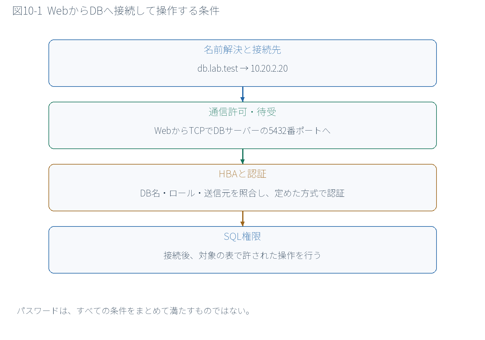

# 第10章 PostgreSQLの接続と認証

## この章で分かること

Webサーバーのアプリが備品を読むには、DBサーバーへ接続し、適切なデータベースを選び、許可された操作を実行する必要がある。正しいパスワードだけを用意しても、このすべてが成立するわけではない。

本章では、PostgreSQLの中のまとまり、OSユーザーとDBのロール、接続を受け付ける設定と認証、個々のSQL操作の権限を順に結び付ける。

## 10.1 PostgreSQLの中のまとまりを知る

今回のDBサーバーにはPostgreSQL 16を導入する。Ubuntu OSでは、`16/main`という**クラスター**を管理する。ここでのクラスターは、一つのPostgreSQLの管理単位である。

その管理単位の中に複数の**データベース**を置ける。さらに、データベース内の**スキーマ**は、表などの名前を整理するまとまりである。例えば`public.catalog_item`は、publicスキーマ内のcatalog_item表を表す。

`pg_lsclusters`ではバージョン、クラスター名、ポート、稼働状態、保存先などを読む。今回、実際の処理を行うサービスは`postgresql@16-main`であり、まとめ役のサービスの表示だけで個別クラスターの状態を判断しない。

## 10.2 OSユーザーとDBロールを区別する

**ロール（role）**は、PostgreSQL内で権限を管理する単位である。ログインできるロール、他のロールへ権限をまとめて与えるロールなどとして利用できる。ロールはクラスター内で管理され、個別のデータベースだけに属するOSユーザーではない。[DBロール](https://www.postgresql.org/docs/16/database-roles.html)

今回のDBサーバーには、OSユーザーとしての`postgres`と、DBの管理ロールとしての`postgres`がある。同じ名前でも管理する場所が違う。OSのroot権限やsudoが、そのまま別サーバーのDBへの接続資格になるわけではない。

| 種類 | 主な仕事 |
| --- | --- |
| OSの管理用ユーザー | PostgreSQLの設定ファイル、サービス、ログなどを管理する |
| DBの管理ロール | データベースやロールを作成し、権限を管理する |
| 構築用ロール | アプリ用の表や初期データなどを準備する |
| 通常アプリ用ロール | 一覧の取得や管理画面の保存に必要なSQLを実行する |

**LOGIN**は、そのロールとして直接接続できる属性である。**SUPERUSER**はDB内の広い管理権限を持つ属性であり、LOGINと同じ意味ではない。通常アプリのために管理ロールの権限を使い続けず、用途を分ける。

## 10.3 所有者と、許された操作を分ける

DBや表などには**所有者**がいる。所有者はその対象の管理を行えるため、通常アプリを表の所有者にすると、必要以上の操作が可能になる。今回の構成では、構築用と通常用を分け、通常用へ必要な権限を与える。

**GRANT**は権限を与え、**REVOKE**は与えられている権限を取り除くSQLである。例えば、DBへのCONNECT、スキーマへのUSAGE、表へのSELECTは対象が異なる権限である。[権限](https://www.postgresql.org/docs/16/ddl-priv.html)

**説明用SQL：lesson_appへ表を読む権限を与える例。**

```sql
GRANT SELECT ON public.lesson_item TO lesson_app;
```

これは特定の表の読取りを許す例であり、表の作成、変更、削除をすべて許す指定ではない。INSERTやUPDATEを必要とする機能には、それぞれに対応する権限を検討する。番号を採番する場合には、シーケンス側の権限も別に読む。[GRANT](https://www.postgresql.org/docs/16/sql-grant.html)

## 10.4 WebサーバーからDBへ届く条件をつなげる

接続の前には、Webサーバーが`db.lab.test`からDBサーバーの内部IP`10.20.2.20`を得る。その後、TCPでDBサーバーの5432番ポートへ接続する。



**図10-1 接続してSQLを使うまでの条件。** 左から順に関係する範囲を読む。パスワードが正しいことは、この中の認証に関わる一つの条件である。

SG（AWSのSecurity Group）がWebサーバーからDBサーバーへの通信を許し、PostgreSQLが正しいIP・ポートで待ち受けている必要がある。`listen_addresses`は、PostgreSQL自身のどのアドレスで受け付けるかを決める。接続元の許可リストではない。[待受設定](https://www.postgresql.org/docs/16/runtime-config-connection.html)

今回の待受はDBサーバーの内部IPを使う。サービスの起動、待受IP、SG、名前解決をそれぞれ対応させる。DBサーバーはインターネットから直接使う入口として公開しない。

## 10.5 pg_hba.confで接続条件と認証方式を読む

PostgreSQLは、`pg_hba.conf`で接続する方法、対象DB、ロール、送信元、認証方式を定める。HBAは**Host-Based Authentication**の略である。

**設定の説明例：説明用DB・ロールへの接続を、Webサーバー一台から許す一行。**

```text
host lesson_catalog lesson_app 10.20.1.20/32 scram-sha-256
```

`host`はTCP/IPによる接続、`lesson_catalog`はDB名、`lesson_app`は接続するロール、`10.20.1.20/32`は送信元のWebサーバー一台、`scram-sha-256`はパスワード認証に使う方式である。

HBAは上から読み、**最初に接続条件が一致した行**を使う。その行で認証が失敗しても、下の別の行へ移って試し直すわけではない。広すぎる許可行が先にあれば、後に置いた制限より先に使われる。[HBAの照合](https://www.postgresql.org/docs/16/auth-pg-hba-conf.html)

`local`は同じDBサーバー内のUnixソケット接続を扱う。今回、OSのpostgresから管理する接続では`peer`によりOSユーザーを照合する。WebサーバーからのTCP接続では、対応するhost行とパスワード認証を使う。`password_encryption`を変えても、以前のパスワードの保存形式が自動ですべて更新されるわけではない。

## 10.6 接続した相手と実行者をSQLで読む

接続するときは、接続先ホスト、ポート、DB名、ロールをそろえる。パスワードは端末の非表示入力で渡し、共有資料やコマンドの引数へ書かない。

**実行場所：Webサーバーの端末。説明用DB・ロールへ接続する例。**

```bash
psql -h db.lab.test -p 5432 \
  -U lesson_app -d lesson_catalog -W
```

`-h`はホスト、`-p`はポート、`-U`はDBロール、`-d`はデータベースを指定する。`-W`はパスワード入力を求めるオプションである。実際には、自分の構成で作成した対象を指定する。

**実行場所：接続後のpsql内。**

```sql
SELECT current_database(), current_user;
```

**表示例：説明用DBとロールの場合。**

```text
 current_database | current_user
------------------+--------------
 lesson_catalog   | lesson_app
(1 row)
```

この結果は、SQLを処理しているDBと実行者を示す。WebサーバーのOSユーザー名や、アプリ管理画面のログイン名ではない。

## 章末問題

### 問1

OSユーザーpostgresと、DBロールpostgresは同じ管理対象か。

### 問2

listen_addressesとHBAの送信元IPは、それぞれどちら側のアドレスを指定するか。

### 問3

HBAで最初に一致した行のパスワード認証が失敗したら、下の行で認証をやり直すか。

### 問4

ログインに成功すれば、すべての表をUPDATEできるか。

## 章末解答

### 問1

異なる。OSユーザーはUbuntu OSが管理し、DBロールはPostgreSQLが管理する。同名でも権限と照合する場所を区別する。

### 問2

listen_addressesはDBサーバー自身が待ち受けるIP、HBAの送信元は接続してくるWebサーバーなどのIPである。

### 問3

やり直さない。最初に条件が一致した行で認証する。その認証の失敗は、後続の行へ移る理由にならない。

### 問4

できない。接続の認証と、各表で許可する操作は別であり、必要なSQL権限が要る。

## 参考資料

確認日：2026-11-03。lesson_catalog、lesson_appは接続条件を読むための説明用の名前である。

- [DBロール](https://www.postgresql.org/docs/16/database-roles.html)
- [権限](https://www.postgresql.org/docs/16/ddl-priv.html)
- [GRANT](https://www.postgresql.org/docs/16/sql-grant.html)
- [待受設定](https://www.postgresql.org/docs/16/runtime-config-connection.html)
- [HBA](https://www.postgresql.org/docs/16/auth-pg-hba-conf.html)
- [psql](https://www.postgresql.org/docs/16/app-psql.html)
- [練習P4](../../../labs/docs/ja/p4.md)
