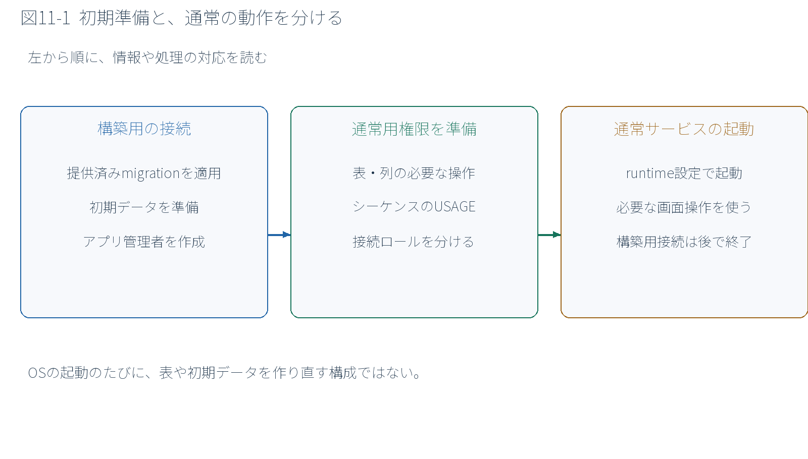
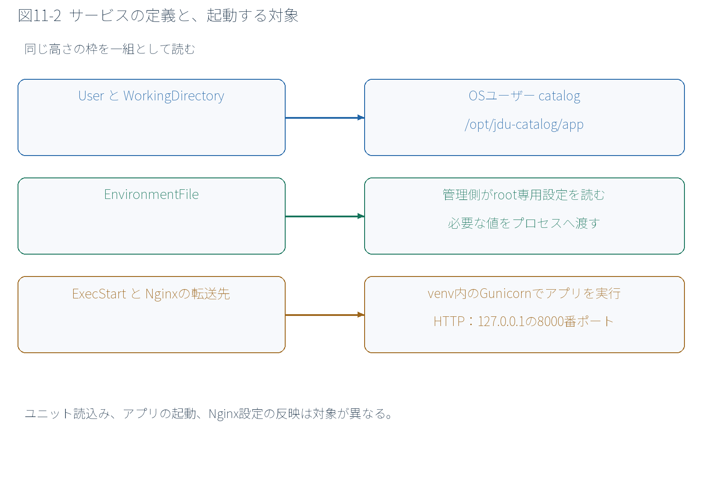

# 第11章 提供アプリの配置と初期設定

## この章で分かること

備品管理アプリを使えるようにするには、プログラムをWebサーバーへコピーした後、そのプログラムが動く条件を整える必要がある。例えば、アプリが接続先のDBを知らなければ、備品の一覧を取り出せない。接続できても、備品を保存する表や操作の権限がなければ、追加・変更はできない。

本章で扱う設定は、「どのソフトウェアを使って動かすか」「どこにあるデータを使うか」「どの権限で操作するか」を、OSやアプリへ伝えるためのものである。設定を理解すると、アプリが起動しない場合と、起動しているがDBへ接続できない場合で、調べる対象が異なることも分かる。

第10章では、ブラウザ、Nginx、Gunicorn、アプリ、DBが連携する仕組みを説明した。本章では、その連携を成立させる準備を、目的と理由から説明する。練習・課題5では、これらの設定を行い、提供アプリがDBを利用して動く状態を作る。

## 11.1 コード、依存、設定、データを分ける

例えば、備品の数量を4個から6個へ変更するときは、DBに保存した数量を更新する。一方、練習用のDBから本課題用のDBへ接続先を変えるときは、アプリの接続設定を変更する。どちらも、備品一覧を作るプログラムそのものを書き換える作業ではない。何を変えたいのかによって、扱う対象が異なる。

**コード**は、一覧の取得や保存などの処理を記述したプログラムである。**依存パッケージ**は、そのプログラムが利用するDjangoやDB接続のライブラリなどである。**設定**は、接続先DBや実行時に使う値である。**データ**は、DBへ保存した備品やアプリ管理者などの情報である。

これらを分けて管理すると、同じコードを使いながら、接続先や保存する備品を変えられる。パスワードもコードから分けることで、秘密を含まない提供プログラムを共通に使える。今回の主な保存先は次のとおりである。

| 種類 | 今回の主な保存先 |
| --- | --- |
| 提供アプリのコード | Webサーバーの/opt/jdu-catalog/app |
| Pythonの実行環境と依存 | Webサーバーの/opt/jdu-catalog/venv |
| 通常アプリの秘密設定 | Webサーバーの/etc/jdu-catalog/app.envなど |
| 配信用CSSなど | Webサーバーの/var/lib/jdu-catalog/static |
| 備品などのDBデータ | DBサーバー上のPostgreSQLが管理するデータベース |

## 11.2 アプリ専用のPython環境を用意する

提供アプリのプログラムは、DjangoやDB接続用ライブラリの機能を呼び出して動く。そのため、アプリのコードとともに、呼び出される側のパッケージも用意する必要がある。必要なパッケージがなければ、その機能を呼び出すところでエラーになり、アプリは処理を続けられない。

パッケージは、版によって使える機能や動作が変わることがある。提供コードに合う版をそろえ、OS側や別のアプリのためのパッケージ管理から分けておくと、アプリ用の環境を保ちやすい。このために使うのが**venv**である。venvは、アプリ専用のPython環境を、同じWebサーバー内にディレクトリとして作成する仕組みである。[Pythonのvenv](https://docs.python.org/3/library/venv.html)

今回は、Webサーバーの`/opt/jdu-catalog/venv`にvenvを作り、内部の配布サーバーに用意された指定版のパッケージを導入する。DjangoとGunicornも、このアプリ用の環境にそろえる。

初期準備には`/opt/jdu-catalog/venv/bin/python`を、サービスの起動にはこのvenv内のGunicornを使う。こうして実行ファイルのパスを指定することで、準備のときも通常の起動のときも、用意した同じパッケージを使える。

## 11.3 管理するユーザーと、動かすユーザーを分ける

Webアプリは、ブラウザから届いた入力を処理するプログラムである。その処理もOS上のプロセスとして動くため、実行しているOSユーザーの権限の影響を受ける。rootで動かせば、アプリにもOS全体を変更できる大きな権限を持たせることになる。

備品一覧を作ったり、DBへ数量の変更を送ったりする日常の処理に、OS全体を管理する権限は必要ない。そこで、今回のアプリは**catalog**という専用のOSユーザーで動かす。catalogには、アプリのコードを読んで実行するための権限を用意する。

一方、コードとvenvはrootが管理し、catalogから自由に書き換えられないようにする。実行する権限と書き換える権限を分けることで、アプリの不具合などを通じて、次回実行するプログラムやパッケージまで変更されることを防ぐ。

この分担は、「管理側が実行する内容を用意し、アプリは用意された内容を必要な権限で動かす」という関係である。catalogは、ブラウザから管理画面へログインするアプリ管理者とは別の、プロセスを動かすためのOSユーザーである。

## 11.4 アプリからDBへ接続するための設定

ここからは、備品管理アプリがDBを利用するための準備を説明する。アプリは、Webサーバーの中だけで備品データを探すのではなく、DBサーバーへ接続してデータを読み書きする。そのため、「接続する相手」と「接続後に使うDBと権限」を設定で伝える必要がある。設定する場所はWebサーバーであり、接続する相手はDBサーバーである。

第8章で説明したように、一つのPostgreSQLが複数のデータベースを管理できる。そのため、DBサーバーの名前が分かるだけでは、練習用と本課題用のどちらのDBを使うかは決まらない。また、同じDBへ接続しても、使うDBロールによって許可される操作が変わる。

| 項目 | 何を決めるための設定か |
| --- | --- |
| DB_HOST | 接続するDBサーバーを指定する。今回はdb.lab.testを使う |
| DB_PORT | DBサーバー上のPostgreSQLの受付を指定する。今回は5432番ポートを使う |
| DB_NAME | PostgreSQLが管理するDBのうち、どれを利用するかを選ぶ |
| DB_USER | どのDBロールの権限で操作するかを指定する |
| DB_PASSWORD | 指定したDBロールで接続するための認証に使う |

例えば、練習用DBを使うつもりで本課題用のDB名を設定すれば、別の備品を読んだり、別の場所へ保存したりする原因になる。接続先の名前、DB名、DBロールは、使いたいデータと操作権限を選ぶための一組の情報である。

DBのパスワードを、サーバー内の誰でも読めるファイルに保存すると、意図しないDB接続に利用されるおそれがある。そこで今回は、DB接続設定をroot所有で`0600`の通常ファイルとして保存する。この権限は、所有者のrootだけがファイルを読み書きできることを表す。

アプリがDBへ接続するには、パスワードなどの値を受け取る必要がある。今回の構成では、systemdのシステム側の管理機能が`EnvironmentFile`で指定した設定ファイルを読み、その値を**環境変数**としてアプリのプロセスへ渡す。環境変数は、プロセスが名前を指定して参照できる設定値である。catalogに設定ファイルを直接読む権限を追加しなくても、アプリは起動時に必要な値を受け取れる。[systemdの実行環境](https://www.freedesktop.org/software/systemd/man/latest/systemd.exec.html)

初期準備用の補助処理も、管理権限で設定を読んだ後、必要な値を渡し、許可した処理をcatalogユーザーの権限で実行する。どちらの場合も、アプリのプロセス自身はDB認証に必要な値を受け取る。保存した秘密ファイルの保護と、アプリへ必要な値を渡す処理を組み合わせている。

設定が用意できたかは、秘密を全文表示するのではなく、設定検査の結果とファイルの所有者・権限で確認する。また、DB用、RDP用、アプリ管理者用のパスワードは、認証する相手が異なるため、それぞれの用途で使い分ける。

## 11.5 DBに表・初期データ・アプリ管理者を準備する

接続先のDBを用意しても、その中にアプリが使う表がなければ、備品を読み出したり保存したりできない。例えば、アプリが備品名と数量の列を読みたいときには、それに合う表と列が必要である。そこで、提供アプリが想定している構造をDBの中へ用意する。

この準備には**マイグレーション**を使う。マイグレーションは、アプリが必要とする表などの構造を、指定された定義に沿ってDBへ適用する仕組みである。今回は提供済みの定義を使い、アプリのコードに合う構造を作る。準備処理を実行する場所はWebサーバーであり、その処理が構築用ロールでDBサーバーへ接続する。[Djangoのマイグレーション](https://docs.djangoproject.com/en/5.2/topics/migrations/)

表を用意した後は、その中へ初期データとアプリ管理者の情報を入れる。それぞれの目的は次のとおりである。

- **seedによる初期データの投入。** 用意された架空の備品データを入れる。これにより、一覧へ表示するデータがある状態からアプリを使い始められる。
- **アプリ管理者の作成。** 管理画面へログインし、備品を追加・変更する担当者を登録する。管理者の情報もDBへ保存され、アプリのログインや操作権限の判定に使われる。



**図11-1 一度行う初期準備と、通常のサービス起動。** 表や初期データ、管理者を用意してから、通常のアプリを起動する。

準備を終えた後の日常の起動では、既に保存されている備品や管理者を使う。登録したデータを保つため、起動のたびにDBを初期化したり、同じ初期データや管理者を作り直したりしない。補助処理が既存状態を検出した場合も、保存済みの内容を確認して扱う。

## 11.6 構築用と通常用のDBロールを切り替える

ここで分けるのは、PostgreSQLへ接続するDBロールである。最初の準備では表を作る権限が必要だが、日常の備品一覧では表の中の値を読み、管理画面では備品の行を追加・変更する。構築時と通常時では、必要な操作が異なる。

例えば、数量を変更するアプリが表そのものを削除する権限まで持っていると、不具合や不正な操作が起きたときの影響が大きくなる。そこで、表を作る構築用ロールと、通常の読み書きを行うアプリ用ロールを分ける。通常時は、必要な操作に権限を絞ったロールを使う。

表の準備後には、通常用ロールへ必要なSQL権限を付ける。備品のSELECT・INSERT・UPDATE、補助表の用途に応じた操作、必要なシーケンスのUSAGEなどである。DBへ接続する認証に成功しても、表などへの操作権限がなければ、その操作は拒否される。必要な権限を付けることも、アプリを動かす準備の一部である。

通常サービスが使うロールは、起動時に渡す設定のDB_USERで指定する。権限不足が起きたときも、通常ロールを所有者やsuperuserへ変更するのではなく、どの対象のどの操作が必要かを調べる。構築用接続を終了する方法は、第12章で扱う。

## 11.7 systemdとNginxの起動設定を対応させる

備品管理アプリは、利用者がページを開いたときに処理できるよう、Gunicornを起動して待ち受ける必要がある。その際には、実行するOSユーザー、使うコードとPython環境、DB接続設定をそろえる。これらを起動方法として記録し、OSにサービスとして管理させるのがsystemdの設定である。

**ユニットファイル**は、systemdにサービスの起動方法などを伝える定義である。今回の`jdu-catalog.service`に起動条件をまとめることで、サービスを起動し直すときも同じ条件で動かせる。自動起動の設定と組み合わせ、Ubuntu OSの起動後にもアプリを起動できるようにする。

**設定の説明例：配布ユニットの主要な項目の抜粋。**

```ini
User=catalog
WorkingDirectory=/opt/jdu-catalog/app
EnvironmentFile=/etc/jdu-catalog/app.env
```

`User`は「どのOSユーザーの権限で動かすか」、`WorkingDirectory`は「どのディレクトリを作業場所にするか」、`EnvironmentFile`は「どの設定ファイルの値を渡すか」を指定する。これらが、ここまでに用意した専用ユーザー、コードの配置先、DB接続設定につながる。`ExecStart`では、venv内のGunicornで提供アプリを実行し、`127.0.0.1:8000`で待ち受ける起動方法を指定する。



**図11-2 準備したものを、サービスの起動条件へ結び付ける。** 実行ユーザー、コードの場所、渡す設定、起動するソフトウェアが対応している。

ブラウザからのHTTP接続はNginxへ届くため、Nginxにも、受け取ったリクエストをどこへ渡すかを設定する。公開用80番ポートと管理用8080番ポートの入口から、同じWebサーバー内のGunicornへ転送する設定を、実際の待受とそろえる。

また、ブラウザで画面の見た目を整えるには、HTMLとともにCSSなども取得できる必要がある。`collectstatic`は、アプリが使うCSSなどを、Nginxが配信するディレクトリへ集める処理である。今回は`/var/lib/jdu-catalog/static`を使う。秘密設定はこの配信先へ置かず、従来の静的URLも引き続き配信できるようにする。

配置した新しいユニットをsystemdに認識させるために、`systemctl daemon-reload`を行う。Nginxの配信・転送設定を変えたときは、Nginxを`reload`して読み直させる。DB接続設定のようにアプリの起動時に受け取る値を変えたときは、サービスを再起動するなどして新しいプロセスへ値を渡す。変更する対象によって、設定を反映する操作も異なる。

## 11.8 practiceとmissionで使う設定を切り替える

練習と本課題では同じ提供アプリを使うが、そこで登録する備品や管理者は分けて扱う。練習で数量を変更したり備品を追加したりしても、本課題側のデータへ影響させないためである。このため、練習用と本課題用で、接続するDBとDBロールを分ける。

今回の**profile**は、練習用のpracticeと本課題用のmissionの設定を、一組ずつまとめた名前である。どちらを選ぶかによって、アプリへ渡すDB名やDBロールが切り替わる。同じプログラムでも、接続するDBを変えれば、別に保存された備品や管理者を使うことになる。

| 対象 | 切替で意識すること |
| --- | --- |
| コードとvenv | 同じ提供版を使うため、切替のために再配置する必要はない |
| DB名とロール | 利用するデータと操作権限を選ぶため、同じprofileの組へ切り替える |
| 一時構築用設定 | 選んだprofileの初期準備だけに使い、完了後に終了する |
| 起動中のアプリ | 起動時に受け取った古い接続設定を使い続けないよう、停止・明示切替・再開を行う |

設定ファイルを切り替えても、既に動いているプロセスへ起動時に渡した値は、その操作だけでは変わらない。そのため、サービスを停止して使用するprofileを明示的に切り替え、新しい設定で起動する。DB名とロールの組をそろえることで、意図した側のデータへ、意図した権限で接続できる。

現行の演習は、P4で練習アプリを動かした後、P5で練習側の構築用接続を終了してからM4へ進む。順序は**P4 → P5 → M4 → M5**である。前の構築用設定と次の設定を混在させないよう、練習側の準備を終えてから本課題用のprofileへ切り替える。

練習・課題5では、コード、依存、設定、DBの準備とサービスを一組にする。次の第12章では、必要な動作を保ちながら公開範囲と権限を絞る。

## 章末問題

### 問1

提供アプリに必要なPythonパッケージを、アプリ専用のvenvへ用意するのはなぜか。

### 問2

通常アプリを構築用ロールで動かし続けないのはなぜか。

### 問3

DB接続設定のファイルを誰でも読める状態にしないのはなぜか。root専用の設定から、アプリへ必要な値はどう渡されるか。

### 問4

practiceからmissionへ切り替えるとき、同じコードを使っていればDB名とロールを意識しなくてもよいか。

## 章末解答

### 問1

Ubuntu OS側のPython環境と分けて管理し、アプリが使うパッケージを提供コードに合う指定版でそろえるためである。

### 問2

通常動作に不要な構造変更などの権限が残るためである。通常用へ必要な操作だけを許す。

### 問3

DBパスワードなどが、意図しないDB接続に利用されることを防ぐためである。systemdの管理側や許可された準備処理が設定ファイルを読み、必要な値を環境変数としてアプリのプロセスへ渡す。

### 問4

意識する必要がある。共通のコードでも、選んだDBとロールによって読み書きするデータと権限が変わる。

## 参考資料

確認日：2026-11-13。配置・profile・権限の説明は提供アプリと現行P4/P5の構成に基づく。

- [Python venv](https://docs.python.org/3/library/venv.html)
- [Djangoマイグレーション](https://docs.djangoproject.com/en/5.2/topics/migrations/)
- [systemdの実行環境](https://www.freedesktop.org/software/systemd/man/latest/systemd.exec.html)
- [提供アプリ](../../../../development/01_roles/cyber_security/tools/web_lab_catalog/README.md)
- [練習P4](../../../labs/docs/ja/p4.md)
- [練習P5](../../../labs/docs/ja/p5.md)
