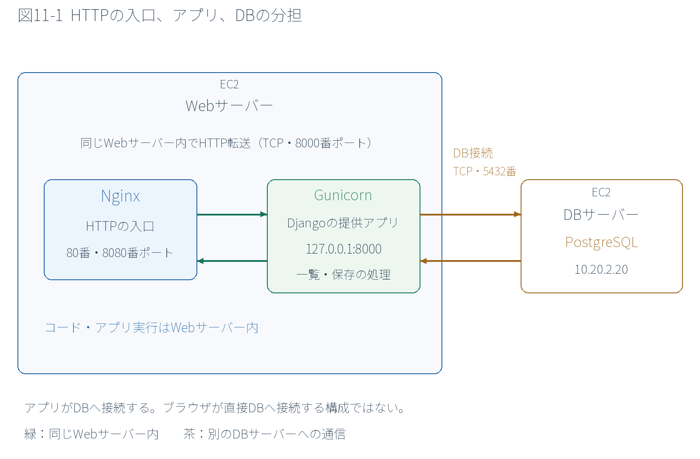
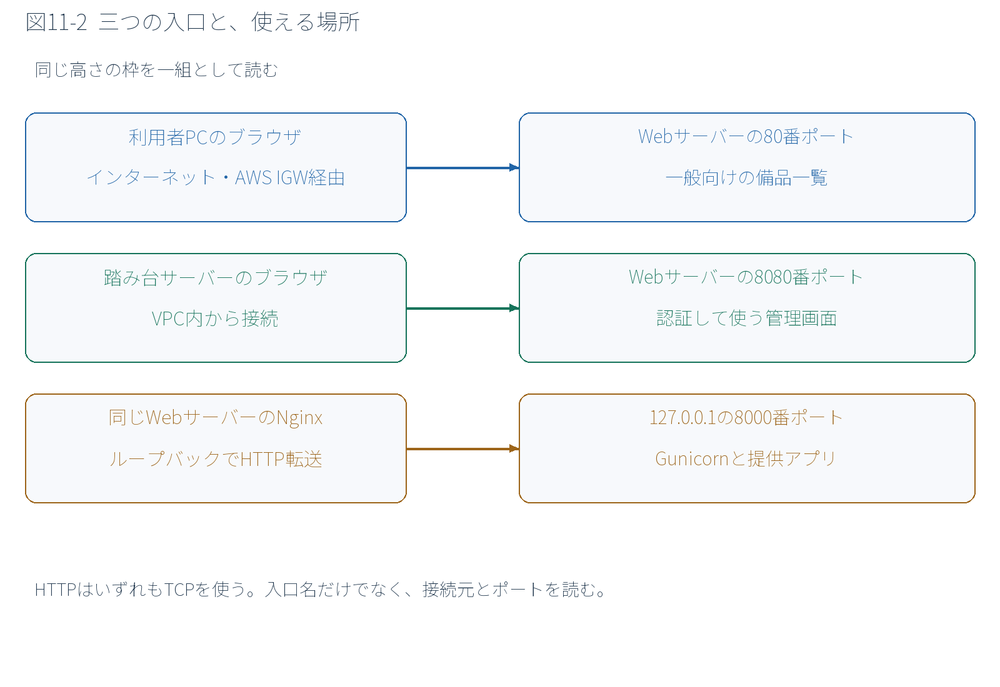
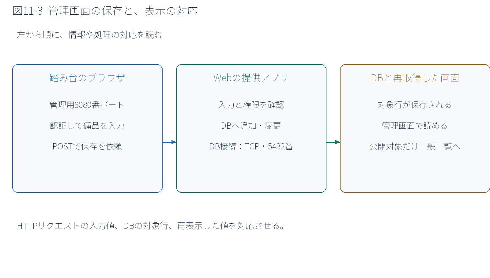

# 第11章 WebサーバーとアプリとDBの連携

## この章で分かること

これまでに、ファイルを返すWebサーバー、名前を答える内部DNS、データを管理するDBを学んだ。ここからは、それらを学校の備品管理アプリへつなげる。アプリのプログラムは提供済みであり、サーバー上で動かすための土台を構築する。

本章では、一覧を開いたときと、管理画面で備品を追加したときに、どのソフトウェアが何を担当するかを追う。ブラウザ、Webサーバー内の処理、DBサーバーを一つの流れとして理解しよう。

## 11.1 保存済みファイルと、その場で作るページ

第5章の静的配信では、Nginxが保存済みのファイルを読み、内容をHTTPレスポンスとして返した。一方、備品一覧は、その時点のDBの値を読んで作る。管理担当者が数量を変更すれば、後から取得する一覧にも変更後の値が反映される。

このように、リクエストの処理中にデータを取得して本文を作る処理を**動的なページの生成**として考える。表示のたびにPythonコードそのものを書き換えるのではなく、提供されたアプリがDBの値を読み、HTMLの本文へ組み込む。

| 対象 | 本文やデータの準備方法 |
| --- | --- |
| 説明用のテキストファイル | 保存したファイルの内容を配信する |
| 備品一覧のHTML | アプリがDBの公開対象の備品を読み、その値から作る |
| CSSや画像 | 動的なページと一緒に使う場合も、静的ファイルとして配信できる |

動的な一覧と静的なCSSは、一つのWebシステムで同時に使える。ページの内容を作る処理と、画面の見た目を指定するファイルの配信は、役割が違う。

## 11.2 Nginx、Gunicorn、Djangoの分担

今回のWebサーバー内では、三つの名前が登場する。それぞれを同じ「サーバー」という言葉だけでまとめず、処理を分けて読む。

| ソフトウェア | 今回の役割 |
| --- | --- |
| Nginx | ブラウザからのHTTP接続を受け、静的ファイルを返したり、アプリへリクエストを渡したりする |
| Gunicorn | PythonのWebアプリを動かし、Nginxからのリクエストをアプリの処理へつなぐ |
| Django | 備品管理アプリが使う枠組み。URLの処理、DBの利用、HTMLの生成、管理画面などを支える |

NginxとGunicornは、同じEC2 Webサーバー上の別のプロセスとして動く。Djangoを利用した提供アプリはGunicornから実行される。DBを管理するPostgreSQLは、別のEC2 DBサーバー上で動く。



**図11-1 同じEC2内の処理と、別のEC2への接続。** Webサーバー内の転送と、WebサーバーからDBサーバーへの通信を区別する。ソフトウェアごとにEC2を増やす構成ではない。

## 11.3 リバースプロキシで、入口からアプリへ渡す

Nginxが受けたHTTPリクエストを別の待受へ転送し、返ってきたレスポンスを利用者へ返す仕組みを**リバースプロキシ**という。ブラウザから見える入口をNginxへまとめ、その後ろでアプリを動かせる。

今回のGunicornは、Webサーバー自身の`127.0.0.1:8000`で待ち受ける。NginxはそこへHTTPで転送する。127.0.0.1は同じWebサーバー内を示すため、利用者PCや踏み台サーバーからそのアプリの待受へ直接接続する構成にはしない。

**設定の説明例：Nginxがアプリへ渡す転送先。**

```nginx
proxy_pass http://127.0.0.1:8000;
```

これは転送先を示す一項目であり、実際の配布設定には、対象パス、許可するメソッド、Hostの受け渡し、入口の区別なども含まれる。転送先の一行だけで管理入口の制限まで成立するわけではない。[Nginxのリバースプロキシ](https://nginx.org/en/docs/http/ngx_http_proxy_module.html#proxy_pass)

## 11.4 一般利用と管理で入口を分ける

一般利用者は、利用者PCのブラウザからWebサーバーの公開IPを使い、80番ポートで備品一覧を開く。一覧は閲覧用であり、備品を追加する入口は置かない。

管理担当者は、RDPで入った踏み台サーバー上のブラウザから、`http://admin.lab.test:8080/admin/`を開く。名前は同じWebサーバーの内部IPを示すが、接続先ポートと処理する入口が違う。管理画面では、許可された担当者が備品を閲覧・追加・変更できる。



**図11-2 名前、ポート、接続元を一緒に読む。** 一般入口と管理入口は同じWebサーバー上にある。どちらも必要な処理を同じアプリへ渡すが、公開側から管理画面へは入れない。

`admin`という名前だけでは制限にならない。Nginxの待受IPと送信元制限、SG（AWSのSecurity Group）、アプリ側の入口判定がそれぞれ関わる。提供された設定では、公開側の/admin/は404となり、利用者が入口を示すヘッダーを偽って送っても管理経路として扱わない。

RDPは踏み台サーバーのデスクトップを操作する接続であり、アプリ管理者へのログインそのものではない。RDPで入った後にブラウザで管理画面を開き、別のアプリ管理者の認証を行う。OSの設定変更では、その踏み台サーバーからSSHする方法や、CloudShellからSession Managerを使う方法で対象サーバーの端末を操作する。

## 11.5 DBの値が一覧になるまで

一般向けの備品一覧を開いたときの処理を追ってみよう。名前を使う場所では、まず必要なDNSの名前解決を行う。

- ブラウザがWebサーバーへ、一覧のHTTPリクエストを送る。
- Nginxが受け取り、同じWebサーバー内のGunicornへ渡す。
- 提供アプリがDBサーバーへ接続し、公開する備品を取得する。
- PostgreSQLが該当する行の値を返す。
- アプリがその値を使ってHTMLを作る。
- GunicornとNginxを通じてHTTPレスポンスが返り、ブラウザが表示する。

今回の提供アプリでは、`is_public`がtrueの備品を一般一覧へ表示する。falseの備品もDBには保存されているが、一般一覧の取得対象から除く。これはアプリのデータの公開区分であり、サブネットやSGの公開・非公開とは別の意味である。

ブラウザが直接DBサーバーの5432番ポートへ接続するわけではない。DBへの接続元はWebサーバー上のアプリであり、DBのパスワードもそのサーバー側の設定で使う。

## 11.6 管理画面の保存がDBへ届くまで

管理担当者が備品名、数量、保管場所、公開区分を入力して保存すると、ブラウザは入力した内容をPOSTのリクエストとして送る。アプリは認証や操作権限、入力値の条件を確認し、許された内容をDBへ保存する。

新規の備品なら行を追加し、既存の備品の変更なら対象の行を更新する。保存後に一覧を再取得すると、DBに保存された新しい値を基に画面が作られる。



**図11-3 保存の結果を、DBと画面の両方で読む。** 保存操作の成功と、一般向けに表示するかどうかは、入力した公開区分も含めて判断する。

今回の管理者に与える機能は、備品の閲覧・追加・変更である。備品の削除、利用者やグループの管理は提供しない。アプリ管理者であることを、DB管理ロールやOSのroot権限と混同しない。

## 11.7 画面の表示と、保存した値を照合する

アプリの動作を見るときは、どの備品のどの値を保存し、どこへ表示する想定かを決めて比較する。例えば、公開する備品の数量を変更したら、管理画面、DBの該当行、一般一覧の値を対応させる。

一方、非公開にした備品は管理画面とDBにはあるが、一般一覧には出ないことを読む。一般一覧が空でも、DBが空なのか、公開対象がないのかは、画面だけでは一つに決められない。

SQLで照合するときは、対象のコードなどを条件にしてSELECTで読む。確認のために同じ備品を何度も追加したり、既存の備品を削除したりせず、保存された対象を特定して比べる。

練習・課題5では、提供アプリを配置し、公開一覧と踏み台サーバーからの管理操作をDBへ接続する構成を作る。第12章では、この仕組みを動かすためのコード、依存パッケージ、設定、DBの準備を扱う。

## 章末問題

### 問1

備品一覧が動的なページであっても、CSSを静的ファイルとして配信できるのはなぜか。

### 問2

一般利用者のブラウザが、DBの5432番ポートへ直接接続する構成か。

### 問3

Webサーバーの80番、8080番、127.0.0.1の8000番は、それぞれ何の入口か。

### 問4

非公開の備品を保存した後、一般一覧に表示されないことだけで保存失敗と判断できるか。

## 章末解答

### 問1

一覧の本文をDBの値から作る処理と、見た目を指定する保存済みCSSの配信は役割が異なり、同じシステムで組み合わせて使えるからである。

### 問2

異なる。ブラウザはWebサーバーへHTTPで接続し、Webサーバー上のアプリがDBへ接続する。

### 問3

80番は一般向けのHTTP、8080番は踏み台サーバーから使う管理用HTTP、同じWebサーバー内の127.0.0.1の8000番はNginxから転送するアプリの待受である。

### 問4

判断できない。非公開なら一般一覧に出さない動作が想定される。管理画面とDBの対象行に保存されているかを比較する。

## 参考資料

確認日：2026-11-03。今回の動作は提供アプリの一覧処理、管理画面、入口判定、Nginx設定と照合している。

- [Nginx proxy_pass](https://nginx.org/en/docs/http/ngx_http_proxy_module.html#proxy_pass)
- [Django管理画面](https://docs.djangoproject.com/en/5.2/ref/contrib/admin/)
- [提供アプリ](../../../../development/01_roles/cyber_security/tools/web_lab_catalog/README.md)
- [練習P5](../../../labs/docs/ja/p5.md)
