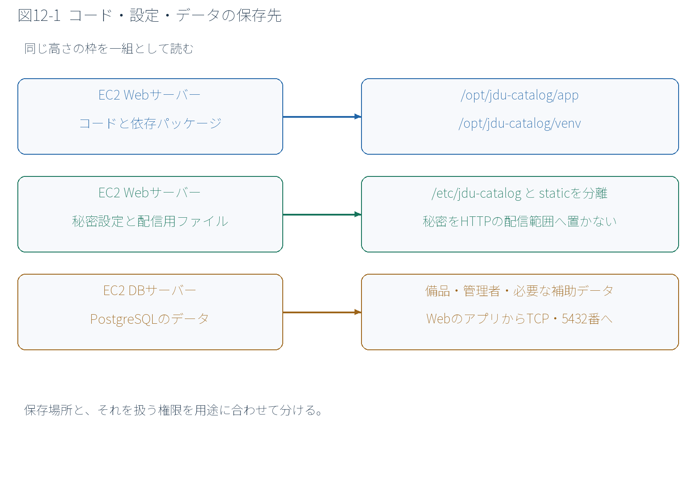
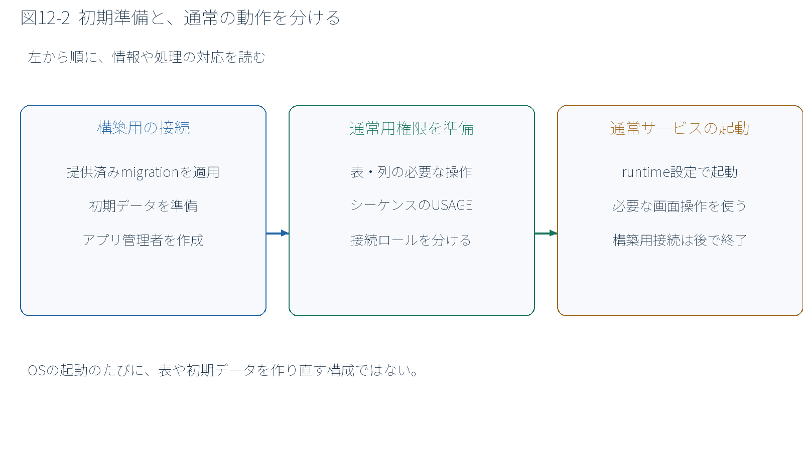
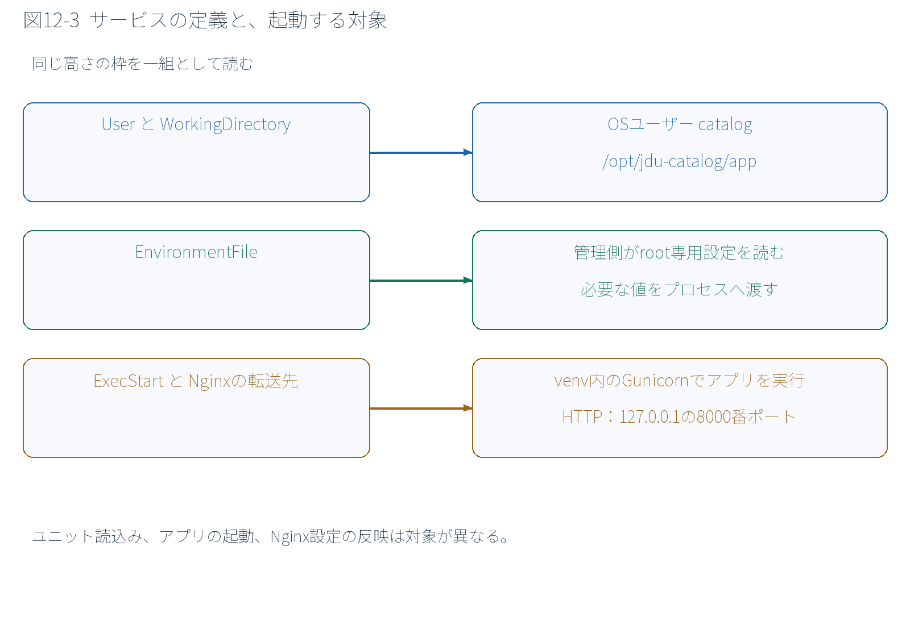

# 第12章 提供アプリの配置と初期設定

## この章で分かること

提供アプリのファイルをWebサーバーへコピーするだけでは、備品一覧は動かない。アプリが使うPythonのパッケージ、接続先の設定、DBの表、起動するユーザー、Nginxの入口もそろえる必要がある。

本章では、何をどこへ置き、どの段階でどの権限を使うかを説明する。プログラムを書き換えるのではなく、提供されたものが所定の役割で動く状態を作る。

## 12.1 コード、依存、設定、データを分ける

**コード**は、一覧の取得や保存などの処理を記述したプログラムである。**依存パッケージ**は、そのプログラムが利用するDjangoやDB接続のライブラリなどである。**設定**は、接続先DBや実行時に使う値である。**データ**は、DBへ保存した備品や管理者などの情報である。

| 種類 | 今回の主な保存先 |
| --- | --- |
| 提供アプリのコード | Webサーバーの/opt/jdu-catalog/app |
| Pythonの実行環境と依存 | Webサーバーの/opt/jdu-catalog/venv |
| 通常アプリの秘密設定 | Webサーバーの/etc/jdu-catalog/app.envなど |
| 配信用CSSなど | Webサーバーの/var/lib/jdu-catalog/static |
| 備品などのDBデータ | DBサーバー上のPostgreSQLが管理するデータベース |



**図12-1 同じシステムを構成する、異なる保存対象。** venvへパッケージを導入することと、DBへ備品を登録することは別の作業である。

## 12.2 venvへ固定した依存パッケージを用意する

**venv**は、Pythonの依存パッケージをアプリごとに分けて管理するための仮想環境である。別のEC2や別のOSを作る機能ではなく、同じWebサーバー内にPythonの実行環境を用意する。[Pythonのvenv](https://docs.python.org/3/library/venv.html)

例えば、`/opt/jdu-catalog/venv/bin/python`を使えば、そのvenvに用意したPython環境で処理を実行できる。systemdの起動定義も、この環境内のGunicornを指定する。対話端末で別のPythonを動かした結果と、サービスが使う環境を混同しない。

今回の依存パッケージは、検査済みの**wheel**という配布ファイルから導入する。指定版とハッシュを記録したlockファイルを使い、内部に用意した資源からそろえる。版が違えば、同じコードでも利用できる機能や動作が変わることがある。

`--no-index`は外部のパッケージ一覧を使わない指定、`--find-links`は配布ファイルを探す場所、`--require-hashes`は記録したハッシュとの照合を求める指定である。ハッシュ照合は、信頼して用意した記録と配布物を結び付けるために使う。[pipの検証付き導入](https://pip.pypa.io/en/stable/topics/secure-installs/)

## 12.3 管理するユーザーと、動かすユーザーを分ける

コードとvenvはrootが管理し、通常のアプリは**catalog**という専用のOSユーザーで動かす。catalogは、コードを読み、必要な処理を実行するが、コードや依存パッケージを自由に書き換えるユーザーにはしない。

実行ユーザーがコードまで変更できると、アプリの処理を通じて想定外の変更が起きた場合に、次回起動する内容へ影響が残る。実行する権限と、配置した内容を管理する権限を分ける理由はここにある。

Nginxが返すCSSなどは、`collectstatic`という処理で配信用ディレクトリへ集める。コードの保存先、静的ファイルの配信先、秘密設定の保存先を、それぞれの用途で分ける。秘密設定を静的ファイルの配信範囲へ置かない。

## 12.4 接続設定と秘密を起動処理へ渡す

通常アプリが使う設定には、接続先を選ぶ値と秘密の値が含まれる。

| 項目 | 選ぶもの |
| --- | --- |
| DB_HOST | 接続先DBサーバーの名前 |
| DB_PORT | 接続先のポート番号 |
| DB_NAME | 利用するデータベース |
| DB_USER | 通常動作で使うDBロール |
| DB_PASSWORD | そのロールの認証に必要な秘密 |

例えばDB_HOSTが正しくても、DB_NAMEやDB_USERが別の環境を指していれば、目的の備品は取得できない。接続先、データのまとまり、実行者を一組で読む。

今回の秘密設定は、root所有で`0600`の通常ファイルとして保存する。catalogユーザーが秘密ファイル全体を直接読めるように、権限を広げる構成にはしない。

systemdのシステム側の管理機能が`EnvironmentFile`の値を読み、実行するプロセスへ必要な環境変数として渡す。初期準備用の補助処理も、管理権限で設定を読んだ後、許可した処理をcatalogユーザーの権限へ落として行う。ファイルを読む権限と、プロセスが必要な値を受け取る仕組みを分けて考える。[systemdの実行環境](https://www.freedesktop.org/software/systemd/man/latest/systemd.exec.html)

秘密は画面へ全文表示せず、設定検査の結果と、ファイルの所有者・権限を読む。DB用、RDP用、アプリ管理者用のパスワードも、それぞれ別の認証に使う。

## 12.5 表の構造、初期データ、管理者を準備する

**マイグレーション**は、アプリが必要とする表などの構造を、指定された定義に沿ってDBへ適用する仕組みである。今回は提供済みの定義を使い、構築用ロールで必要な構造を作る。[Djangoのマイグレーション](https://docs.djangoproject.com/en/5.2/topics/migrations/)

表を作ることと、表の中へ備品データを入れることは異なる。**seed**は用意された初期データを投入する処理であり、**管理者作成**はアプリの管理画面へ入る担当者を用意する処理である。それぞれの対象を区別する。



**図12-2 一度行う初期準備と、通常のサービス起動。** 通常の起動のたびに、初期データや管理者を作り直す構成ではない。

既存のデータがあるときに初期投入を繰り返すと、重複や上書きの原因になる。提供された補助処理が既存状態を検出した場合は、その状態を読み、DBを削除して最初からやり直す操作へ置き換えない。

## 12.6 構築用と通常用のDBロールを切り替える

構築用ロールには、表などの構造を作るための権限が必要である。しかし、毎回の一覧取得や管理画面の保存に、同じ構造変更権限が必要なわけではない。

表の準備後には、通常アプリ用ロールへ必要なSQL権限を付ける。備品のSELECT・INSERT・UPDATE、補助表の用途に応じた操作、必要なシーケンスのUSAGEなどを分ける。通常ロールを所有者やsuperuserへ変更して、権限不足をまとめて解消する方法にはしない。

通常のサービスがどちらのロールを使っているかは、runtime設定のDB_USERと、接続したDB側の実行者を対応させて読む。構築用接続の終了は、第13章で扱う。

## 12.7 systemdとNginxの起動設定を対応させる

**ユニットファイル**は、systemdにサービスの起動方法などを伝える定義である。今回の`jdu-catalog.service`には、実行ユーザー、作業場所、秘密設定の読込み、Gunicornの起動方法が含まれる。

**設定の説明例：配布ユニットの主要な項目の抜粋。**

```ini
User=catalog
WorkingDirectory=/opt/jdu-catalog/app
EnvironmentFile=/etc/jdu-catalog/app.env
```

`User`はOSの実行ユーザー、`WorkingDirectory`は作業場所、`EnvironmentFile`は起動時に読み込む設定ファイルである。`ExecStart`ではvenv内のGunicornと、実行するアプリ、`127.0.0.1:8000`の待受を指定する。



**図12-3 定義を読み、動いている対象と照合する。** ユニットを配置してsystemdへ読み込ませる操作、アプリの起動、Nginx設定の反映は、それぞれ対象が違う。

`systemctl daemon-reload`はsystemdにユニット定義を読み直させる。Nginxの`reload`はNginxの配信・転送設定を再読み込みする。アプリの設定変更をサービスのプロセスへ反映する場合は、対象サービスを再起動するなど、その設定の読込み時点に合わせる。

Nginxでは、公開側と管理側の入口、静的ファイル、アプリへの転送を対応させる。以前作った静的URLも保持し、アプリ導入後に既存の配信が失われていないことを読む。

## 12.8 practiceとmissionで使う設定を切り替える

今回の**profile**は、練習用のpracticeと本課題用のmissionの設定のまとまりを区別する名前である。共通の提供コードを使いながら、接続するDB、DBロール、管理者、保存した備品を分ける。

| 対象 | 切替で意識すること |
| --- | --- |
| コードとvenv | 同じ提供版を使う。profileの変更だけで再配置を繰り返さない |
| DB名とロール | 練習用と本課題用で、接続する組を切り替える |
| 一時構築用設定 | そのprofileの準備だけに使用し、完了後に終了する |
| 起動中のアプリ | 古い接続設定を使い続けないよう、停止・明示切替・再開を対応させる |

現行の演習は、P5で練習アプリを動かした後、P6で練習側の構築用接続を終了してからM5へ進む。順序は**P5 → P6 → M5 → M6**である。practiceの一時setup設定を残したままmissionへ重ねるのではなく、前の構築段階を終えてから次のprofileを選ぶ。

練習・課題5では、コード、依存、設定、DBの準備とサービスを一組にする。次の第13章では、必要な動作を保ちながら公開範囲と権限を絞る。

## 章末問題

### 問1

venvへ依存パッケージを導入することと、DBへ備品を登録することは同じ作業か。

### 問2

通常アプリを構築用ロールで動かし続けないのはなぜか。

### 問3

秘密設定がroot専用であるとき、catalogユーザーのプロセスへ必要な値はどう渡されるか。

### 問4

practiceからmissionへ切り替えるとき、同じコードを使っていればDB名とロールを意識しなくてもよいか。

## 章末解答

### 問1

異なる。venvはPythonの実行環境と依存を用意する場所であり、備品データは別のDBサーバーのデータベースで管理する。

### 問2

通常動作に不要な構造変更などの権限が残るためである。通常用へ必要な操作だけを許す。

### 問3

systemdの管理側や許可された準備処理が設定を読み、必要な値を環境変数として実行プロセスへ渡す。秘密ファイルの読取り権限を広げることで実現する構成ではない。

### 問4

意識する必要がある。共通のコードでも、選んだDBとロールによって読み書きするデータと権限が変わる。

## 参考資料

確認日：2026-11-03。配置・profile・権限の説明は提供アプリと現行P5/P6の構成に基づく。

- [Python venv](https://docs.python.org/3/library/venv.html)
- [pipの検証付き導入](https://pip.pypa.io/en/stable/topics/secure-installs/)
- [Djangoマイグレーション](https://docs.djangoproject.com/en/5.2/topics/migrations/)
- [systemdの実行環境](https://www.freedesktop.org/software/systemd/man/latest/systemd.exec.html)
- [提供アプリ](../../../../development/01_roles/cyber_security/tools/web_lab_catalog/README.md)
- [練習P5](../../../labs/docs/ja/p5.md)
- [練習P6](../../../labs/docs/ja/p6.md)
