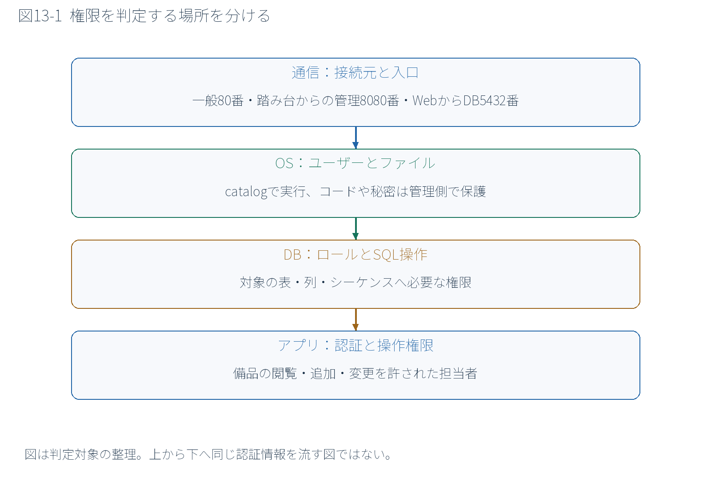
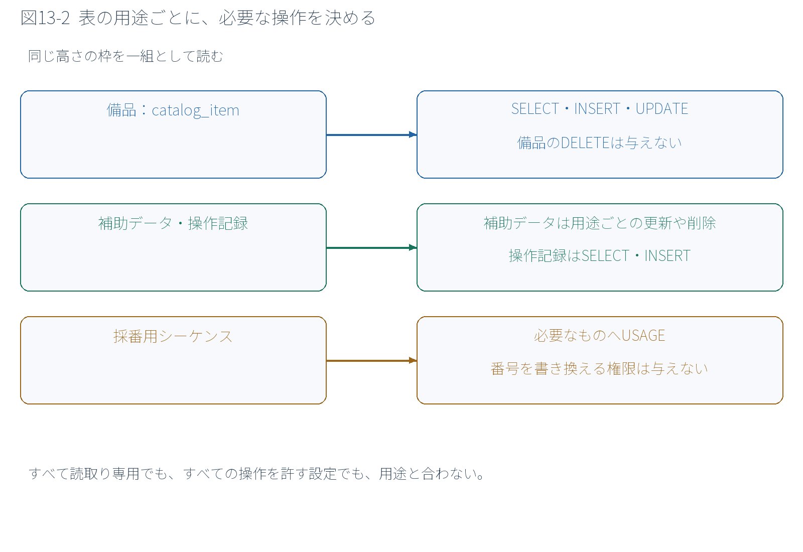
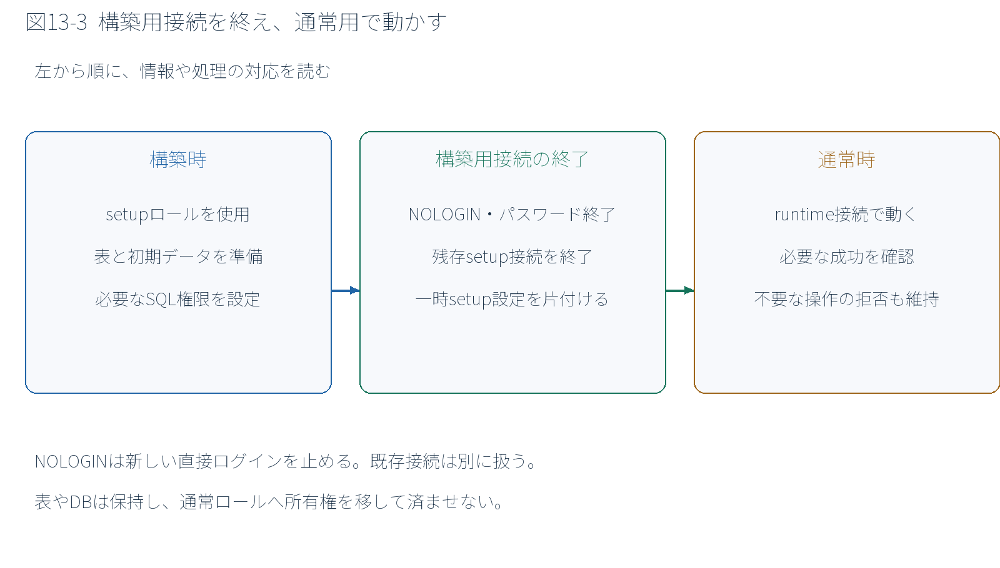

# 第13章 公開範囲と最小権限

## この章で分かること

備品一覧が表示され、管理画面で追加できるようになったら、次は「誰が、どの入口から、何をできるか」を読む。必要な機能が動くことに加え、必要のない操作を許さないことも、インフラストラクチャーの構築に含まれる。

本章では、通信、OS、DB、アプリの四つの制御を整理し、通常の機能を保つための権限と、構築時だけ使う権限を分ける。

## 13.1 四つの場所で、違う権限を管理する

同じ「管理者」という呼び方でも、管理する対象が違う。OSのrootはファイルやプロセスを管理し、PostgreSQLの管理ロールはDBを管理し、アプリ管理者は管理画面で許された機能を使う。

| 制御する場所 | 主に決めること |
| --- | --- |
| 通信 | どの接続元から、どのサーバーの何番ポートへ接続できるか |
| OS | どのユーザーがファイルを読み、変更し、プロセスを動かせるか |
| DB | どのロールが、どのデータに、どのSQL操作を行えるか |
| アプリ | どのログイン利用者が、どの画面や操作を使えるか |



**図13-1 権限を判定する場所を分ける。** 例えば、管理画面での追加を許可しても、OSのsudoやDBのsuperuserを与える必要はない。

**最小権限**は、必要な仕事ができる範囲へ権限を絞る考え方である。単に何もできない状態を目指すのではなく、必要な操作を先に定め、それを実現する権限を用意する。

## 13.2 正規の操作から必要な権限を考える

今回の一般利用者は公開された備品一覧を読む。管理担当者は、踏み台サーバー上のブラウザで認証して、備品を閲覧・追加・変更する。備品の削除やユーザー管理は必要な機能に含めない。

アプリは、それらの操作を実現するためにDBへ接続する。公開一覧では備品をSELECTし、登録ではINSERTし、変更ではUPDATEする。同じ通常アプリ用ロールがこれらの処理を支えるため、アプリ全体のDB権限を読取り専用にすると、必要な保存もできなくなる。

また、アプリの通常動作には備品表以外の補助データも使う。どの表でも同じ操作を許すのではなく、その表の用途と、必要な機能を対応させる。

## 13.3 公開入口、管理入口、秘密の保存先を分ける

一般向けの80番ポートからは一覧を使い、管理画面はWebサーバーの内部IPの8080番ポートで踏み台サーバーから利用する。SG（AWSのSecurity Group）とNginxの制限を、接続元、待受IP、ポート、対象パスへ対応させる。

公開側からの/admin/は管理画面を返さず、管理側では正しく認証して必要な操作ができることを比べる。Nginxがアプリへ渡す入口情報は、利用者が送った値をそのまま信頼せず、各入口で上書きする配布設定を使う。

コードとvenvはrootが管理し、catalogユーザーへ不要な書換え権限を与えない。秘密設定はroot所有の0600とし、通常のHTTP配信範囲へ置かない。公開のファイルを返す場所と、秘密の値を起動処理へ渡す場所は異なる。

ここでのアプリ管理者は、staffとして備品の閲覧・追加・変更を許された利用者であり、アプリのsuperuserとしてすべてを扱う設定にはしない。画面の権限とDBロールの権限は、それぞれ別に保つ。[Djangoの管理画面](https://docs.djangoproject.com/en/5.2/ref/contrib/admin/)

## 13.4 DBの権限を、表の用途ごとに読む

今回の通常アプリ用ロールが使う主な操作を整理する。表名が違えば、必要な権限も異なる。

| 対象 | 通常動作で許す操作 | 用途 |
| --- | --- | --- |
| catalog_item | SELECT・INSERT・UPDATE | 備品の一覧・追加・変更 |
| auth_user | SELECTとlast_login・password列だけのUPDATE | 認証と許可された管理用補助処理 |
| 権限や関連の参照用の表 | SELECT | アプリ利用者の許可内容などの参照 |
| django_session | SELECT・INSERT・UPDATE・DELETE | ログインに必要な補助データの管理 |
| django_admin_log | SELECT・INSERT | 管理操作の記録と参照 |
| 必要な採番用シーケンス | USAGE | 備品や操作記録へ新しい番号を割り当てる |



**図13-2 許可する操作を対象ごとに決める。** 補助データのDELETEを必要とすることと、備品そのものの削除を許すことは異なる。

auth_userに対する列単位のUPDATEは、表全体のUPDATEとは範囲が違う。通常ロールが、管理者属性や権限を自由に書き換えられる状態へ広げない。django_migrationsは構造の適用履歴を管理する表であり、通常ロールの作業対象にはしない。

シーケンスのUSAGEは採番に必要だが、値を任意に設定するUPDATEまで与える必要はない。確認のためにnextvalやsetvalを呼ぶと実際の番号の状態を変えるため、定義と権限の情報を読む。[SQL権限](https://www.postgresql.org/docs/16/sql-grant.html)、[シーケンスの権限](https://www.postgresql.org/docs/16/functions-sequence.html)

## 13.5 明示したGRANTだけで、実効権限は決まらない

**実効権限**は、その接続で実際に行える操作の範囲である。直接GRANTした内容だけでなく、所有者であること、所属するロールから受ける権限、PUBLICへの許可、列単位の権限なども影響する。

PostgreSQLの**PUBLIC**は、すべてのロールに共通する許可先である。インターネットへ公開するという意味ではない。通常ロールへの許可を消しても、PUBLICから同じ権限を受ければ、その操作が可能な場合がある。

**実行場所：DBサーバーで、対象DBへ接続した管理用psql内。権限を読む例。**

```text
\du
\drg
\dp public.*
```

`\du`はロールの属性、`\drg`はロール同士の所属・権限継承の情報、`\dp`は表などのアクセス権を読む。権限表に出る`r`はSELECT、`a`はINSERT、`w`はUPDATE、`d`はDELETEを表す。列単位の許可も、表全体の許可と分けて読む。[psqlの権限表示](https://www.postgresql.org/docs/16/app-psql.html)

表全体の権限をREVOKEしただけでは、以前に与えた列単位の権限が残る場合がある。通常ロールが所有者やsuperuserではないことも含め、最終的に可能な操作を確認する。[所有者と権限](https://www.postgresql.org/docs/16/ddl-priv.html)

## 13.6 構築用の接続を終了する

表の作成や初期データの準備が終われば、日々のアプリ動作に構築用の接続は必要ない。通常の機能がruntimeロールで動くことを確かめ、構築用ロールの新しいログインを止める。

| 終了する対象 | 目的 |
| --- | --- |
| setupロールのLOGIN | 新たに構築用ロールとして直接ログインさせない |
| setupロールのパスワード | 構築時の認証情報を利用し続けない |
| 残っているsetup接続 | 既存の構築用接続を終了する |
| 一時的なsetup設定ファイル | Webサーバー側に構築用秘密を残さない |

**NOLOGIN**は、新しい直接ログインを止める属性である。設定しただけで既存の接続が自動終了するわけではないため、残存接続の扱いも分ける。[ALTER ROLE](https://www.postgresql.org/docs/16/sql-alterrole.html)



**図13-3 終えるのは構築用の接続である。** DBや表の所有者としてsetupロールが残ることと、そのロールで通常ログインできることは異なる。所有者を通常ロールへ移したり、表を削除したりして終了する構成ではない。

残すのは、通常アプリの接続設定、必要なDBデータ、提供コードなどである。一時setup設定とruntime設定をファイル名・profileで区別し、まとめて削除する操作へ置き換えない。

## 13.7 許された成功と、意図した拒否を対で見る

入口や権限の確認では、動いてほしい機能と、拒否してほしい操作を組にする。

| 正規の動作 | 比較する拒否・制限 |
| --- | --- |
| 一般一覧に公開備品が出る | 同じ時点の非公開備品は出ない |
| 管理入口で正しくログインできる | 誤ったパスワードでは認証が成立しない |
| 認証した担当者が備品を追加・変更できる | 未認証の利用者は同じ保存操作を行えない |
| 管理入口で管理画面を使える | 公開入口の/admin/からは管理画面を取得できない |
| runtime接続でアプリが動く | 終了したsetup接続は使えない |

何も表示できず、何も保存できない状態なら、単に全体が故障している可能性もある。拒否だけを見ず、必要な成功を同じ構成で比較する。既存のパスワードを変えて試すのではなく、指定された範囲で正しい認証と一回の誤認証を比べる。

練習・課題6では、構築用接続を終了し、公開範囲、ファイル、DB、管理画面の権限を用途に合わせる。現行の演習順はP5 → P6 → M5 → M6であり、practiceの構築用接続を終えてからmissionへ切り替える。

## 章末問題

### 問1

通常アプリのDB接続を、すべて読取り専用にすれば、今回の必要な機能を満たせるか。

### 問2

通常ロールへのGRANTにDELETEがなければ、そのロールは必ず削除できないと言えるか。

### 問3

setupロールをNOLOGINにすれば、既存のsetup接続も自動的に閉じるか。

### 問4

公開側の管理画面が表示されないことだけで、正常な制限ができたと判断してよいか。

## 章末解答

### 問1

満たせない。備品の追加・変更や、通常動作に必要な補助データの操作がある。表と用途に応じて権限を決める。

### 問2

言えない。所有者、PUBLIC、他のロールへの所属などによる実効権限も調べる必要がある。

### 問3

閉じない。新たな直接ログインを止めることと、既存の接続を終了することは別である。

### 問4

判断できない。公開一覧の成功や管理入口での正規操作の成功と比べ、意図した対象だけが拒否されていることを確かめる。

## 参考資料

確認日：2026-11-03。権限の用途は提供されたSQLと管理画面の実装に基づく。

- [PostgreSQLの権限](https://www.postgresql.org/docs/16/ddl-priv.html)
- [GRANT](https://www.postgresql.org/docs/16/sql-grant.html)
- [ALTER ROLE](https://www.postgresql.org/docs/16/sql-alterrole.html)
- [シーケンス](https://www.postgresql.org/docs/16/functions-sequence.html)
- [psql](https://www.postgresql.org/docs/16/app-psql.html)
- [Django管理画面](https://docs.djangoproject.com/en/5.2/ref/contrib/admin/)
- [練習P6](../../../labs/docs/ja/p6.md)
