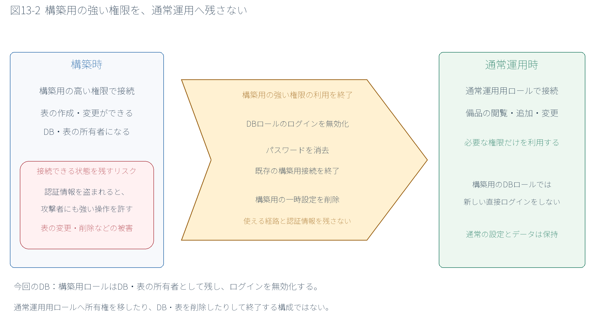

# 第13章 公開範囲と最小権限

## この章で分かること

備品管理アプリには、一般利用者が一覧を見る入口と、管理担当者が備品を追加・変更する入口がある。この使い分けを成立させるには、通信を許す範囲、アプリを動かすOSユーザー、DBで許す操作、管理画面で許す機能を、それぞれの場所で設定する必要がある。

権限が不足すれば、必要な機能が動かない。一方、必要以上の権限があると、不具合や攻撃によって不正な操作をされた場合に、被害が広がるおそれがある。本章では、何を許可し、どこで制限するかを、備品管理アプリの構成に沿って説明する。

## 13.1 アクセス制御を入れる場所

利用者PCからDBの備品データまでの間には、異なる役割のソフトウェアやサーバーがある。そのため、一つの設定で全体を制御するのではなく、各場所で扱う対象に合わせて制限を設ける。

| 制御する場所 | 主に決めること |
| --- | --- |
| AWSのネットワーク | どの接続元から、どのEC2の何番ポートへ通信を許すか |
| Webサーバー内のNginx | 受け付ける入口とURL、アプリへ転送するリクエストを決める |
| OS | どのOSユーザーがプロセスを動かし、ファイルを読み書きできるか |
| DBMS（PostgreSQL） | 接続を認証し、DBロールごとに表などの操作を許可する |
| 備品管理アプリ | 誰がログインし、備品の閲覧・追加・変更をできるか |


**図13-1 通信経路と、アクセス制御を入れる場所。** Web利用とDB接続に関係する部分を示す。紫の枠はEC2に関連付けたSG（AWSのSecurity Group）であり、吹き出しはその場所で行う制御の説明である。矢印は利用する通信の向きを示す。

SGは、関連付けたEC2へ届く通信や、そこから出る通信を制御する。例えば、Webサーバーの8080番ポートへの通信は踏み台サーバーからだけ許し、DBサーバーの5432番ポートへの通信はWebサーバーからだけ許す。[AWSのSecurity Group](https://docs.aws.amazon.com/vpc/latest/userguide/vpc-security-groups.html)

通信が届いた後は、Nginxが入口とURLを判断し、アプリが利用者の認証や操作権限を判断する。DBへSQLが届けば、PostgreSQLがDBロールに許された操作かを判断する。アプリの管理者であっても、そのことだけでOSの管理権限やDBMSの管理権限を持つわけではない。

## 13.2 権限の設計について

権限を設計するときは、まず「誰が、何のために、どの操作を行うか」を決める。今回の一般利用者には公開された備品一覧を見てもらい、アプリの管理担当者には備品の閲覧・追加・変更をしてもらう。備品の削除や、ほかの利用者の権限を変更する機能は含めない。

次に、その機能を実現するために必要な権限を選ぶ。例えば、一覧を作るアプリには備品を読むSELECT、備品の追加にはINSERT、数量や保管場所の変更にはUPDATEが必要である。アプリ全体のDB権限を読取り専用にすると、一覧を表示できても追加・変更はできなくなる。

必要以上の権限も与えない。例えば、備品の数量を更新する処理に、備品表を丸ごと削除する権限は必要ない。強すぎる権限があると、アプリの不具合や攻撃を通じて、その権限を本来の用途以外に使われた場合の影響が大きくなる。

このように、必要な機能が成立する範囲で、権限を必要最低限に絞る考え方を**最小権限**という。権限を減らすことだけを目的にせず、利用用途と許可する操作を一組にして考える。

## 13.3 Webサーバーとアプリのセキュリティ設定

ここでは、Webサーバーと備品管理アプリで行っている制限を、具体例で説明する。一般利用者はWebサーバーの80番ポートで一覧を使い、アプリの管理担当者は踏み台サーバーのブラウザから、内部IPの8080番ポートで管理画面を使う。

Nginxは、一般向けの80番ポートで受け取った`/admin/`へのアクセスには、管理画面を返さず404を返す。管理向けの8080番ポートは、踏み台サーバーの内部IPからの接続だけを受け付ける。この段階で、どの入口から管理画面を利用できるかを絞っている。

さらにNginxは、アプリへ転送するHTTPリクエストに、どの入口で受け付けたかを表す情報を付ける。HTTPの付加情報を入れる**ヘッダー**のうち、今回は`X-JDU-Entry`という項目を使う。

| Nginxが受け付けた入口 | Nginxが転送時に設定する値 | 意味 |
| --- | --- | --- |
| Webサーバーの80番ポート | X-JDU-Entry: public | 一般利用の入口で受け付けた |
| Webサーバーの8080番ポート | X-JDU-Entry: admin | 管理用の入口で受け付けた |

**この値を上書きするのは、Webサーバー上のNginxである。** 利用者が同じヘッダーに別の値を入れて送っても、Nginxは自分が受け付けた入口に合わせて値を設定し直す。対象はアプリへ渡す入口情報であり、備品名や数量などのフォーム入力を書き換える処理ではない。[Nginxのproxy_set_header](https://nginx.org/en/docs/http/ngx_http_proxy_module.html#proxy_set_header)

**アプリ側は、その入口情報を確認する。** 管理画面へのリクエストでは、同じWebサーバー内のNginxから転送され、管理用入口の情報が付いていることを確認する。そのうえで、アプリ管理者のログインと操作権限を確かめる。Nginxの入口判定と、アプリの認証・権限判定を組み合わせている。

OS側では、第12章で説明したように、アプリを専用のcatalogユーザーで動かし、コードとvenvはrootが管理する。アプリを実行するユーザーにコードの書換えまで許さず、秘密設定はroot所有の0600で保護する。秘密設定をHTTPの配信先へ置かないことで、ブラウザから取得されることも防ぐ。

アプリ管理者に許可する機能は、備品の閲覧・追加・変更である。備品の削除や利用者・グループの管理まで許可しない。アプリで利用者に許す機能と、アプリがDBへ接続するロールに許すSQL操作は、それぞれの目的に合わせて設定する。

## 13.4 DBMSのセキュリティ設定

ここからは、DBサーバー上のPostgreSQLの設定を説明する。PostgreSQLは、接続元やDB名、DBロールをHBA設定と照合し、指定された方式で認証する。接続後は、そのロールに許された範囲でSQLを実行する。接続時の設定は第10章、ここでは主に接続後の操作権限を扱う。

アプリが使うDBには、備品だけでなく、利用者の認証に使う情報や、管理画面で行った操作の記録もある。すべての表に同じ権限を与えると、必要な処理まで止めたり、不要な変更まで許したりするため、保存する情報の用途ごとに操作を選ぶ。

| 対象 | 通常運用用ロールに許す操作 | 何に使うか |
| --- | --- | --- |
| 備品（catalog_item） | SELECT・INSERT・UPDATE | 備品の一覧・追加・変更 |
| アプリ利用者（auth_user） | SELECTとlast_login・password列だけのUPDATE | 認証、最終ログイン時刻の記録、許可された補助処理 |
| 権限の対応表など | SELECT | アプリ利用者に許された操作の参照 |
| ログインに使う一時情報（django_session） | SELECT・INSERT・UPDATE・DELETE | ログイン中の利用に必要な情報の管理と後片付け |
| 管理操作の記録（django_admin_log） | SELECT・INSERT | 記録を残し、読む |
| DB構造の適用履歴（django_migrations） | 許可しない | 第12章で行った構造の準備が、どこまで済んでいるかを記録する |
| 自動で番号を発行する仕組み（シーケンス） | 必要なものにUSAGE | 新しい備品や操作記録へIDを付ける |

例えば、ログインに使う一時情報は、不要になれば削除する必要がある。一方、備品そのものを削除する機能は今回のアプリには用意しない。同じDELETEでも、何を削除する権限かによって必要性が異なる。

利用者の情報も、最終ログイン時刻などの更新が必要な項目だけを許す。表全体を自由に変更できる権限を与えると、管理者の属性や操作権限まで書き換えられる範囲が広がる。DB構造の適用履歴は構築時の管理に使う情報であり、通常の備品の追加・変更では書き換える必要がない。

**シーケンス**は、新しい行へ付ける番号を順に発行するDBの仕組みである。例えば、新しく登録した備品へIDを割り当てるときに使う。通常運用用ロールには、必要な番号を受け取るUSAGEを許すが、番号を管理する値を任意に変更する権限まで与える必要はない。確認するときも、番号を発行・変更する操作は実行せず、設定された権限の情報を読む。[PostgreSQLのGRANT](https://www.postgresql.org/docs/16/sql-grant.html)

### DBで実際に使える権限を確認する

DBロールへ直接与えた許可だけを見ても、実際にできる操作を判断できない場合がある。例えば、表の所有者には、表自体を変更・削除する強い権限がある。ほかのロールに所属して、その権限を受け継ぐ場合もある。

また、PostgreSQLの**PUBLIC**は、すべてのDBロールに共通する許可先である。インターネット公開という意味ではない。通常運用用ロールへ直接許可していなくても、PUBLICに与えた権限を通じて操作できる場合がある。

その接続で実際に使える権限を**実効権限**という。今回の提供SQLは、通常運用用ロールが所有者やsuperuserになっていないことなどを確認し、PUBLICを含む余分な許可を整理してから、必要な権限を与える。以前に与えた列単位の権限も整理する。これは、指定したロールが必要以上の操作をできないようにするためである。

**実行場所：DBサーバーで、対象DBへ接続した管理用psql内。権限を読む例。**

```text
\du
\dp public.*
```

`\du`はロールの属性、`\dp`は表などのアクセス権を読む。表示される`r`はSELECT、`a`はINSERT、`w`はUPDATE、`d`はDELETEを表す。表全体の許可と、特定の列だけの許可を分け、所有者やほかの許可から使える権限も合わせて考える。[所有者と権限](https://www.postgresql.org/docs/16/ddl-priv.html)、[psqlの権限表示](https://www.postgresql.org/docs/16/app-psql.html)

## 13.5 構築用の強い権限を通常運用へ残さない

**構築用ロールで接続できる状態を残すと、認証情報が漏れた場合に、攻撃者もその高い権限を利用できるおそれがある。** 構築用ロールには表の作成・変更などを行う権限があり、表の所有者でもある。悪用されれば、備品の値だけでなく、表そのものを変更・削除されるなど、被害が広がる可能性がある。

そのため、構築時だけ必要なユーザーやロールは、運用を始める際に利用を終える。不要なものは削除し、所有者として残す必要があるものは、その強い権限で接続できる経路を無効化する。通常のアプリは、備品の閲覧・追加・変更に必要な権限を持つ**通常運用用ロール**で動かす。

今回のDBでは、構築用のsetupロールがDBや表の所有者になっている。所有者としての役割を保つため、このロール自体は削除しない。次の対策を組み合わせ、構築用ロールでの接続と、構築時に使った認証情報を使い続けない状態にする。

| 終了する対象 | 行う対策と、その理由 |
| --- | --- |
| 構築用ロールの新規ログイン | NOLOGINにして、新たな直接ログインを禁止する |
| 構築用ロールのパスワード | PASSWORD NULLにして、保存されたパスワード認証情報を消去する |
| 接続済みの構築用ロール | 既存の接続も終了し、接続済みの状態から強い操作を続けられないようにする |
| Web上の一時的な構築用設定 | 構築用パスワードを含む一時設定ファイルを削除する |

**NOLOGIN**は、新しい直接ログインを止める属性である。これだけでは、既に接続している処理は自動終了しない。そのため、残っている構築用の接続も別に終了する。通常運用用ロールが構築用ロールの権限を受け継ぐことのないよう、所属するロールも前節の権限設計に含める。[ALTER ROLE](https://www.postgresql.org/docs/16/sql-alterrole.html)



**図13-2 構築時のリスクを、運用開始時の対策で減らす。** 左右の四角は構築時と通常運用時、中央の矢印形は移行時に行う対策である。今回、削除するのは構築用の一時設定であり、DBロール自体は所有者として残したままログインを無効化し、パスワードを消去する。

通常運用用の接続設定、DBと表、備品データ、提供コードは運用に必要なので残す。構築用設定を片付ける際は、通常運用用の設定までまとめて削除しない。構築用ロールの所有権を通常運用用ロールへ移すと、通常運用側へ不要な強い権限まで渡すことになるため、今回の構成では移さない。

練習・課題6では、必要な通常機能を保ちながら、構築用の接続と一時設定を終了し、用途に合うアクセス制御を整える。

## 章末問題

### 問1

通常運用用のDBロールを読取り専用にすれば、今回の備品管理アプリに必要な機能を満たせるか。

### 問2

通常運用用ロールへのGRANTにDELETEがなければ、そのロールは必ず削除できないと言えるか。

### 問3

構築用ロールを運用開始後も接続できる状態で残すと、どのようなリスクがあるか。NOLOGINだけで既存の接続も終了するか。

### 問4

アプリへ渡す入口情報のヘッダーは、どのソフトウェアが設定し直すか。アプリ側はその後に何を確かめるか。

## 章末解答

### 問1

満たせない。備品の追加・変更や、補助データの操作がある。必要な機能と表の用途に合わせて権限を選ぶ。

### 問2

言えない。所有者、PUBLIC、ほかのロールへの所属などから使える実効権限も調べる必要がある。

### 問3

構築用の認証情報が漏れると、攻撃者に高い権限を使われ、表の変更・削除などをされるおそれがある。NOLOGINは新しい直接ログインを禁止するが、既存の接続は終了しないため、接続終了も別に行う。

### 問4

Nginxが、受け付けた入口に合わせてヘッダーを設定し直す。アプリ側は、Nginxから管理用の入口を通って届いたことを確認し、アプリ管理者のログインと操作権限を確かめる。

## 参考資料

確認日：2026-11-17。設定の説明は、提供されたNginx設定、アプリの入口判定、DB権限のSQL、構築用接続の終了処理と照合している。

- [AWSのSecurity Group](https://docs.aws.amazon.com/vpc/latest/userguide/vpc-security-groups.html)
- [Nginxのproxy_set_header](https://nginx.org/en/docs/http/ngx_http_proxy_module.html#proxy_set_header)
- [PostgreSQLの権限](https://www.postgresql.org/docs/16/ddl-priv.html)
- [GRANT](https://www.postgresql.org/docs/16/sql-grant.html)
- [ALTER ROLE](https://www.postgresql.org/docs/16/sql-alterrole.html)
- [psql](https://www.postgresql.org/docs/16/app-psql.html)
- [練習P6](../../../labs/docs/ja/p6.md)
- [課題M6](../../../labs/docs/ja/m6.md)
