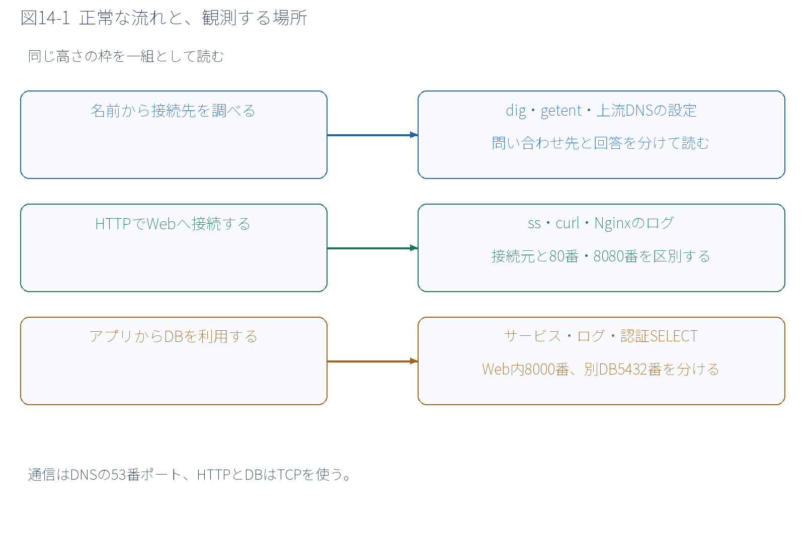
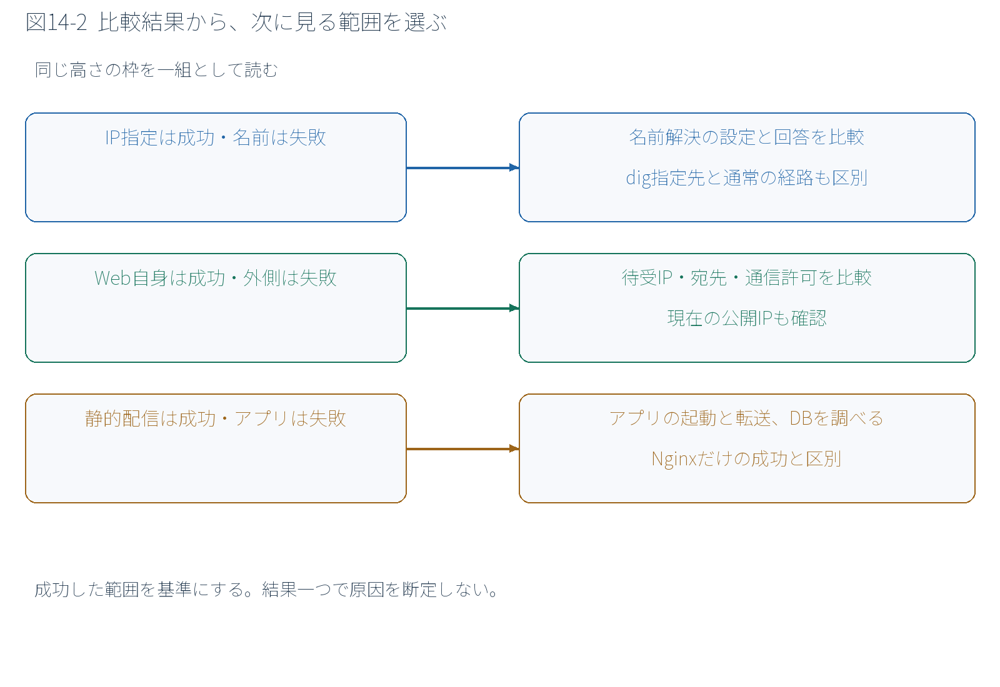
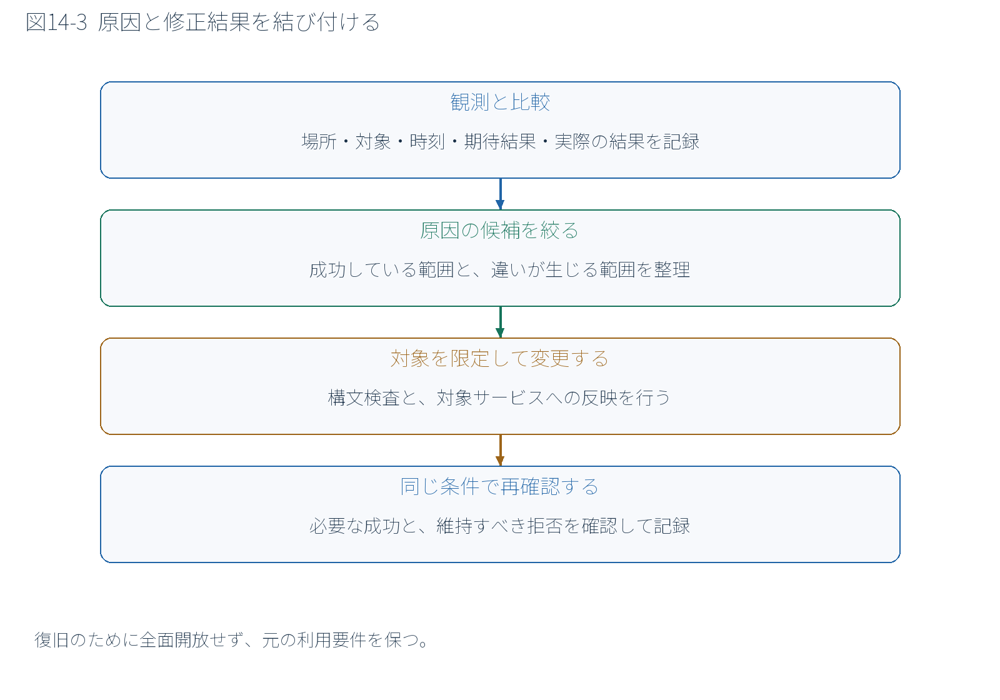

# 第14章 観測による障害の切り分けと復旧

## この章で分かること

「備品一覧が開かない」という見た目だけでは、DNS、通信、Nginx、アプリ、DBのどこに原因があるかは分からない。各部分がどのように連携するかを理解していると、結果を比較し、次に調べる範囲を選べる。

本章では、これまでに学んだ観測を使い、症状から原因を絞り、対象を限定して修正する考え方を学ぶ。以下の事例は読み取り用の説明例である。

## 14.1 症状を、再現できる形で書く

障害を調べる最初の一歩は、何をしたときに、何が起きたかを具体的にすることである。「つながらない」だけで済ませず、接続元、対象、期待結果、実際の結果をそろえる。

| 書く情報 | 説明例 |
| --- | --- |
| 時刻 | いつの操作と結果か |
| 操作した場所 | 利用者PC、RDP内の踏み台サーバー、Webサーバーの端末など |
| 対象 | URL全体、名前、IP、ポート、DB名など |
| 期待したこと | 公開一覧を表示したい、管理画面で保存したいなど |
| 実際の結果 | DNSエラー、タイムアウト、HTTPのステータス、具体的な表示など |

例えば、利用者PCから管理用の内部名を開けないことと、踏み台サーバーから管理画面を開けないことでは、前提となる接続経路が違う。一般画面と管理画面、IP指定と名前指定も区別する。

## 14.2 正常時の流れへ、観測する場所を重ねる

名前を使って備品一覧を開くと、必要な名前解決、Webサーバーへの接続、Nginxからアプリへの転送、DBの利用、HTTPレスポンスという流れがある。



**図14-1 正常な流れから、何を観測するかを決める。** 名前解決とページ取得を分け、Webサーバー内の転送と、別のDBサーバーへの接続も分ける。

観測は、毎回すべての設定を初めからやり直す手順ではない。例えば、IP指定の静的ファイルは取得できているなら、その結果を使って、すでに動いている範囲を整理する。何が分かり、どこがまだ分からないかを更新しながら進める。

## 14.3 知りたいことに合わせて道具を選ぶ

| 道具・情報 | 主に分かること | それだけでは分からないこと |
| --- | --- | --- |
| digで指定DNSへ問い合わせ | そのDNSの処理結果と回答 | OSやブラウザが普段同じDNSを使うか |
| getent | OSの通常の名前解決の結果 | HTTPの取得まで成功するか |
| systemctl | 対象サービスの状態 | 必要な本文やデータを返すか |
| ss | 待受のIP・ポートとプロセス | 相手側から通信できるか、認証が成功するか |
| curl | 指定した場所からのHTTPの結果 | 他の接続元や入口でも同じ結果になるか |
| 認証後のSELECT | 接続したDB・ロールと、許された取得の結果 | 管理画面からの保存まで成功するか |
| AWSの設定と現在値 | 接続先IPやSGなどの構成 | アプリ内の処理が正常か |

例えば、Webサーバー自身のcurlが成功しても、公開経路のSG（AWSのSecurity Group）や現在の公開IPまで調べたことにはならない。同じ道具でも、実行したサーバーを変えると、観測する経路も変わる。

## 14.4 よく似た症状を、比較して分ける

### IP指定では開けるが、名前指定では開けない

同じWebサーバーの同じファイルについて比較する。IP指定で取得できるなら、その経路でのHTTP配信は動いている。次は名前のつづり、OSの通常の問い合わせ先、指定DNSの回答を比較する。digだけ成功しgetentが失敗するなら、DNSへ直接尋ねる方法と通常の名前解決の違いに注目する。

### Webサーバー自身では開けるが、別の場所から開けない

Webサーバー内の127.0.0.1への接続、踏み台サーバーから内部IPへの接続、利用者PCから現在の公開IPへの接続を分ける。待受が127.0.0.1だけになっていないか、正しいIP・ポートか、必要な通信が許されているかを読む。

### 静的ファイルは取得できるが、一覧アプリが動かない

静的ファイルの配信は、Nginxが保存したファイルを読んで返す処理である。一覧アプリには、その先のGunicorn、提供アプリ、DB接続が加わる。アプリサービスの状態、Web内の8000番ポート、アプリのログ、DBの名前解決・認証・権限を比較する。

### 一覧は出るが、保存できない

一般一覧は読取り、管理画面の保存は認証と追加・変更の権限を使う。踏み台サーバー上の正しい管理入口か、正規の管理者で認証しているか、入力値が条件を満たすか、DBへ必要な書込みが許されているかを読む。

### 停止・再開の後だけ開けなくなった

現在の公開IPと、起動したサービスの状態を調べる。古い公開IPへ接続している場合と、Nginxやアプリが起動していない場合を区別する。保存ファイルの消失と決める前に、同じインスタンスと保存領域、内容、稼働状態を比べる。



**図14-2 成功している側を手掛かりにする。** 一つの症状から一つの原因を断定せず、違いが生じる範囲を絞る。

## 14.5 設定、ログ、実際の結果を対応させる

設定ファイルは「どう動かすか」を示し、ログは「何が起きたか」を示す。HTTPやSQLの結果は「その接続から見えた結果」である。三つを同じ対象と時刻にそろえる。

今回のアプリ導入後、Nginxの公開側のログは`/var/log/nginx/jdu-catalog-public.access.log`などへ変わる。初期のaccess.logだけを読み続けず、現在有効な設定の保存先を調べる。管理側のログも別である。

**実行場所：Webサーバーの管理用端末。アプリサービスの直近のログを読む例。**

```bash
sudo journalctl -u jdu-catalog -n 20 --no-pager
```

この例はjdu-catalogサービスの記録を読む。Nginxの配信ログや、DBサーバー側のログとは保存元が異なる。同じリクエストがどの段階まで達したかを、時刻や対象を手掛かりに比較する。[journalctl](https://www.freedesktop.org/software/systemd/man/latest/journalctl.html)

HTTP502ならアプリへの転送先を調べる手掛かりになるが、番号だけで停止・待受・転送設定のどれが原因かを一つに決めない。HTTP500でも、アプリの処理、DB接続、DB権限などの手掛かりをログから読む。

記録を共有するときは、必要なエラー名、対象、時刻を残し、パスワードや秘密設定の全文を含めない。秘密ファイルを表示して貼り付ける代わりに、設定検査の結果と属性を使う。

## 14.6 対象を絞って修正し、元の動作を確かめる

修正の前に、現在の状態、原因と考えること、変更したときに期待する結果を短く記録する。例えば「待受が127.0.0.1だけなので、踏み台サーバーから接続できない」という観測からなら、対象は待受設定とその反映になる。

変更後は、必要な構文検査と反映を行い、最初に失敗した接続元・対象で比較する。一度に多くの設定を変更すると、どの変更が結果を変えたか分かりにくくなる。



**図14-3 修正の理由と、結果の変化を結び付ける。** 復旧後には必要な成功に加え、公開していない入口や許可していない操作の拒否も維持する。

例えば、アプリのDB権限が不足していた場合、必要な表や列の操作へ限定して見直す。superuser、全接続元の許可、すべてのファイルの書換え許可へ広げると、動作が戻っても元の利用要件を崩してしまう。

## 14.7 再開と引き継ぎに必要な情報を残す

記録は、後から同じ対象と操作場所を再現できる形にする。実際に確認した内容と、まだ確認していない内容を区別する。

| 記録する項目 | 残す内容 |
| --- | --- |
| 構成 | 各サーバーの役割、内部IP、必要な通信とポート |
| 再開 | 現在の公開IPの読み方、サービス、保存内容の確認対象 |
| 症状 | 接続元、URLやDB、時刻、期待結果、実際の結果 |
| 原因と変更 | 比較した結果、絞った原因、変更した設定 |
| 修正後 | 元の接続での成功、必要な拒否、残った未確認事項 |

例えば「直った」だけではなく、「踏み台サーバーから名前指定で同じファイルを取得でき、指定DNSと通常の名前解決が同じ内部IPを示した」と書けば、確かめた範囲が伝わる。

本章は、各演習で結果を読むための参照として使える。新しい採点課題や、次へ進むための追加の確認段階を設けるものではない。

## 章末問題

### 問1

同じ対象がIP指定では取得でき、名前指定では取得できない。最初にどの結果を比較するか。

### 問2

静的ファイルが取得できることは、アプリとDBの連携まで正常である証明になるか。

### 問3

設定を保存しても挙動が変わらないとき、どのような違いを調べるか。

### 問4

権限不足の復旧後に、表示成功以外で何を確かめるか。

## 章末解答

### 問1

同じ接続元・対象のIP指定と名前指定、指定DNSへのdigとOSの通常の名前解決を比較する。HTTPが成功した経路を基準に名前解決の範囲を読む。

### 問2

ならない。静的配信と、アプリ実行・DB接続は処理が異なる。その先のサービス、待受、認証や権限などを観測する。

### 問3

保存した設定と稼働中の設定、編集したファイルと実際の読込み対象、反映したサービスを比較する。必要なreloadや再起動の対象も確認する。

### 問4

意図したデータの取得や保存、正しい実行者、管理入口や秘密・不要な操作の拒否が維持されていることを確かめる。

## 参考資料

確認日：2026-11-03。症状と比較例は読み取り用の説明例であり、環境を故意に壊す手順ではない。

- [BINDのコマンド](https://bind9.readthedocs.io/en/v9.18.39/manpages.html)
- [Nginx設定と制御](https://nginx.org/en/docs/control.html)
- [PostgreSQLの認証設定](https://www.postgresql.org/docs/16/auth-pg-hba-conf.html)
- [journalctl](https://www.freedesktop.org/software/systemd/man/latest/journalctl.html)
- [EC2の停止と起動](https://docs.aws.amazon.com/AWSEC2/latest/UserGuide/Stop_Start.html)
